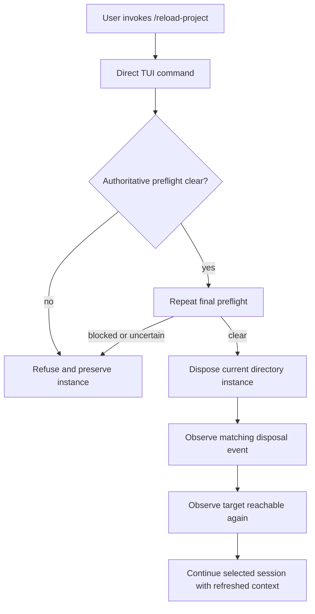
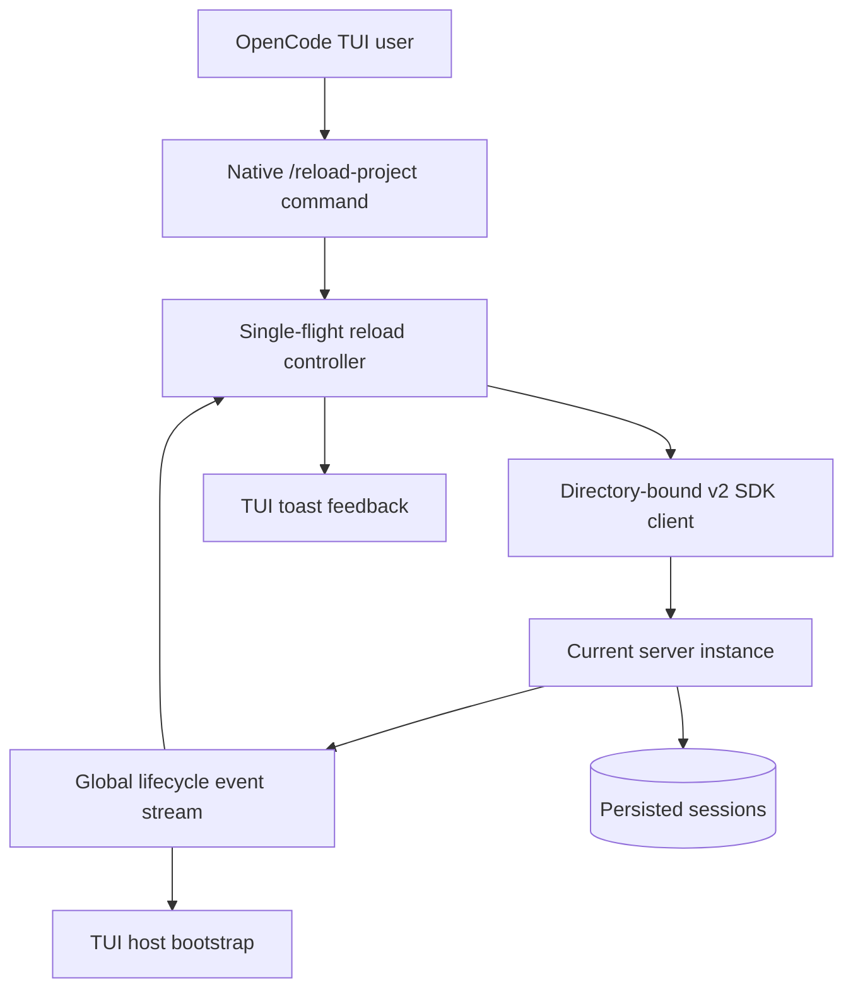
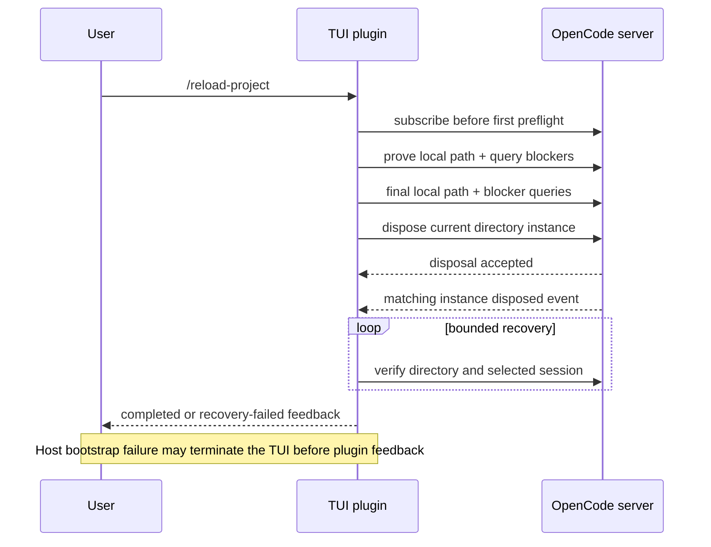
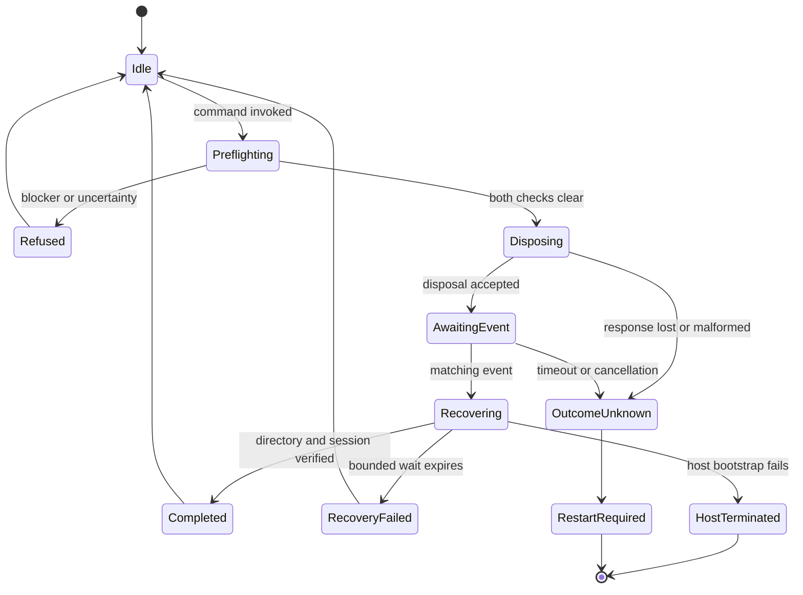

# OpenCode Project Reload - Plan

## Goal Capsule

- **Objective:** Deliver a standalone OpenCode TUI plugin that reloads only the current project's server instance through a direct `/reload-project` action.
- **Authority:** The Product Contract governs behavior, the Planning Contract governs implementation, and repository instructions override execution mechanics.
- **Stop conditions:** Stop before disposal when project state cannot be proven clear, the routed directory changes, or the supported OpenCode API contract is unavailable.
- **Execution profile:** Build and verify the new child repository first, then register its tested revision in the parent workspace. Existing child repositories remain unchanged.
- **Tail ownership:** The plugin repository owns package, compatibility, and user documentation. The parent workspace owns only submodule registration and child-repository guidance.

---

## Product Contract

### Summary

Provide a focused OpenCode TUI plugin with a direct `/reload-project` command for local projects.
The command reloads the current project instance without a model turn, then continues the selected session with refreshed server-side project context.

### Problem Frame

OpenCode caches project configuration and plugin-derived capabilities within a directory-scoped instance.
Today, refreshing that state can require restarting the shared OpenCode server, which interrupts unrelated projects and clients.
Creating a new session is not a reliable refresh boundary for cached project state.

### Key Decisions

- **Use the released TUI plugin API:** OpenCode 1.18.3 already allows an external TUI plugin to register a direct slash action, so `/reload-project` does not require a model turn or upstream change.
- **Reload the project instance:** The operation targets the plugin's current directory instance, not an individual session and not the whole server.
- **Fail closed on observed state:** Active work, retrying work, pending permissions, pending questions, malformed responses, and failed preflight requests prevent reload.
- **Accept the bounded concurrency limitation:** Rechecking immediately before disposal narrows but cannot eliminate the race in which another client starts work after the final check.
- **Restrict v1 to provable local routing:** The command refuses remote and experimental workspace contexts because the public TUI plugin API does not expose authoritative workspace identity.
- **Continue the current session:** Session history remains intact and the current session stays selected after reload.

Product Contract changed: R1-R7, R9-R16, F1, F3-F4, and AE1, AE4, AE7 were revised after OpenCode 1.18.3 source confirmed direct external TUI commands; R5, R10, and AE9 were narrowed to local projects after the user confirmed that safety boundary.

### Requirements

**Command and intent**

- R1. The plugin must expose `/reload-project` through TUI slash autocomplete and the command palette.
- R2. Dispatching the registered command must execute directly without creating a model turn, session command, or model-visible tool call.
- R3. Project reload must occur only from explicit command invocation and never during plugin loading or unrelated TUI activity.
- R4. The command must accept no directory, force, abort, or lifecycle arguments.

**Scope and safety**

- R5. The reload capability must require a selected local session, bind to that session's canonical absolute directory, and refuse home, remote, or workspace-routed contexts.
- R6. The operation must refuse when the target has busy or retrying work, a pending permission, a pending question, an unavailable or ambiguous preflight result, or a routing mismatch.
- R7. The operation must repeat authoritative blocker checks immediately before disposal and disclose that this best-effort guard is not an atomic server-side exclusion.
- R8. Repeated requests while a reload is pending or its disposal outcome is unknown must not trigger overlapping disposals.
- R9. Failure proven to occur before disposal dispatch must leave the current instance running, while a post-dispatch result that cannot establish whether disposal was accepted or completed must prohibit automatic retry and report unknown disposition.

**Reload outcome**

- R10. A successful operation must dispose only the canonical local directory instance while leaving the shared server and other directory instances running.
- R11. Completion requires a successful disposal response, a same-directory event observed after dispatch, and best-effort evidence that the target is reachable again.
- R12. Recreation must reload project-scoped configuration, server plugins, agents, skills, commands, and instruction discovery.
- R13. Reload must preserve all sessions, messages, and the currently selected TUI session route.
- R14. The next model turn must receive the current contents and precedence of applicable instruction files, including a newly selected or edited `AGENTS.md`.
- R15. The command must not claim to refresh process-cached global configuration, TUI configuration, TUI plugin code, or imported server-plugin module code.

**Feedback**

- R16. The user must receive distinct feedback when reload starts, is refused, completes, times out, or has unknown disposition whenever the host TUI remains available.
- R17. Refusal feedback must identify the blocking category without exposing permission, question, session, or credential content.
- R18. Completion and failure feedback must state when a TUI or full server restart is still required for the requested change.

### Key Flows



- F1. **Successful reload:** The user invokes `/reload-project`; both preflights are clear; only the current directory instance is disposed; the TUI recreates it; the plugin observes the directory and selected session reachable again; the session continues.
- F2. **Busy refusal:** Preflight finds active work, a pending permission, or a pending question in the current directory; reload is refused; no work is aborted and no instance is disposed.
- F3. **Preflight uncertainty:** A status or interaction query fails or returns an ambiguous shape; reload is refused and the current instance remains available.
- F4. **Recovery after disposal:** The target does not become reachable within the bounded wait; the plugin reports recovery failure without issuing another disposal; later ordinary directory activity may retry instance creation.
- F5. **Unknown disposition:** A response, event, or connection is lost after disposal dispatch; the plugin reports that the outcome is unknown and blocks another reload until bounded reconciliation or TUI restart.

### Acceptance Examples

- AE1. **Covers R1-R4, R10-R14.** Given an idle current directory and selected session, when the user invokes `/reload-project`, then no model request occurs and the same session continues after ordered completion evidence succeeds.
- AE2. **Covers R6, R9, R17.** Given busy or retrying work in the current directory, when the user invokes `/reload-project`, then active work is identified as the blocker and the instance is not disposed.
- AE3. **Covers R6, R17.** Given a pending permission or question in the current directory, when the user invokes `/reload-project`, then the operation refuses without revealing pending content.
- AE4. **Covers R6-R7, R9.** Given a failed, malformed, or ambiguous preflight response, when the user invokes `/reload-project`, then the operation refuses and leaves project state unchanged.
- AE5. **Covers R5, R10.** Given multiple active directory instances on one server, when reload succeeds, then only the command's current directory instance is recycled.
- AE6. **Covers R8.** Given a reload is already pending, when another reload request arrives, then no second disposal begins.
- AE7. **Covers R15, R18.** Given a TUI, global, or process-cached module change, when project reload completes, then feedback warns that a TUI or full server restart may still be required.
- AE8. **Covers R7.** Given another client starts work after the final preflight, when disposal races with that work, then the plugin makes no claim of atomic protection and the documented OpenCode concurrency limitation remains explicit.
- AE9. **Covers R5-R6, R10.** Given no selected session or a remote or workspace-routed session, when the user dispatches `/reload-project`, then the operation refuses before any lifecycle mutation.
- AE10. **Covers R8-R9, R16.** Given disposal was dispatched but its response or event cannot be reconciled, when the wait expires, then feedback reports unknown disposition and a repeated command cannot issue another disposal.
- AE11. **Covers R9, R16.** Given recreated project state causes fatal host bootstrap failure, when the TUI terminates, then the plugin does not claim completion and ordinary host failure reporting remains authoritative.

### Scope Boundaries

- The first version does not restart or stop the shared OpenCode server.
- The first version does not reload process-cached global configuration.
- The first version is a TUI plugin and does not add a Web or model-mediated fallback.
- The first version supports only selected local, non-workspace sessions whose directory identity the public TUI API can prove.
- The first version does not delete, archive, fork, or automatically replace the current session.
- The first version does not abort active model work or reject pending permissions or questions.
- The first version does not add a general lifecycle toolbox, protected companion IPC service, or cross-client control framework.
- The first version does not require an upstream OpenCode change for external TUI command registration.
- Direct Neovim, Web, and standalone CLI adapters may be considered later but are not part of this plugin release.

### Dependencies And Assumptions

- OpenCode 1.18.3 and 1.18.4 expose the TUI plugin, v2 SDK, directory-instance disposal, and global disposal-event APIs required by this plan.
- Project instance disposal continues to preserve persisted sessions while invalidating directory-scoped configuration and plugin state.
- OpenCode does not provide an atomic guard spanning preflight and disposal, so concurrent work admitted after the final check is an accepted residual risk.
- The initial compatibility range is OpenCode `>=1.18.3 <=1.18.4`; later patches require validation before the declared range expands.

### Sources And Research

- `mkchad/lua/configs/opencode.lua` contains the existing directory-scoped reload preflight, disposal, and reconnection behavior.
- `mkchad/README.md` documents the difference between project-instance reload and a full shared-server restart.
- [OpenCode plugin documentation](https://opencode.ai/docs/plugins/) documents plugin hooks, custom tools, and the SDK client context.
- [OpenCode server documentation](https://opencode.ai/docs/server/) documents session status and directory-instance disposal APIs.
- [OpenCode SDK documentation](https://opencode.ai/docs/sdk/) documents session, instance, and TUI client capabilities.
- [OpenCode 1.18.3 TUI plugin specification](https://github.com/anomalyco/opencode/blob/v1.18.3/packages/opencode/specs/tui-plugins.md) defines direct command registration, package targets, installation, lifecycle, and plugin-scoped cleanup.
- [OpenCode 1.18.3 TUI plugin types](https://github.com/anomalyco/opencode/blob/v1.18.3/packages/plugin/src/tui.ts) expose the keymap, route, state, v2 client, event, UI, and lifecycle APIs.
- [OpenCode 1.18.3 instance lifecycle](https://github.com/anomalyco/opencode/blob/v1.18.3/packages/opencode/src/server/routes/instance/httpapi/lifecycle.ts) shows that disposal is performed after its HTTP response.
- [OpenCode 1.18.3 instruction loading](https://github.com/anomalyco/opencode/blob/v1.18.3/packages/opencode/src/session/instruction.ts) shows that applicable instruction paths and contents are resolved for model context.

---

## Planning Contract

### Key Technical Decisions

- **KTD1. Use a TUI-only plugin target.** The package exports a dedicated TUI module built against `@opencode-ai/plugin` 1.18.3. It does not register a server plugin, model command, or model-visible tool.
- **KTD2. Register a native palette command.** The plugin uses the supported keymap layer with slash name `reload-project`. It avoids the deprecated command shim and leaves the command ungated so slash autocomplete can dispatch it.
- **KTD3. Prove local directory authority from the selected session.** Each invocation requires a session route, resolves that session from TUI state, rejects any workspace ID, canonicalizes its directory, and verifies it through an explicit path query. No user input or command argument can select another target.
- **KTD4. Query authoritative state twice without retaining sensitive bodies.** The controller reads directory-scoped session status, permissions, and questions at admission and immediately before disposal. It checks only top-level response shape and emptiness for interaction lists, then discards them.
- **KTD5. Accept and expose the remaining TOCTOU race.** The client-side double check is best effort because OpenCode 1.18.x has no atomic guarded-dispose operation. Tests preserve this limitation as an explicit risk instead of implying stronger safety.
- **KTD6. Use one process-scoped in-flight operation.** One promise owns preflight, event observation, disposal, recovery, feedback, and cleanup. A module-scoped guard survives plugin deactivation within the same TUI process and prevents another disposal while the first result remains uncertain.
- **KTD7. Observe lifecycle before the first preflight.** The controller subscribes before reading state, rejects a same-directory disposal observed before its own dispatch, and arms completion matching only when its disposal request is sent. Directory-only events provide ordering evidence, not causal proof.
- **KTD8. Define completion as best-effort evidence, not authoritative recreation proof.** A successful response and post-dispatch event must precede an ordered path probe and required selected-session probe. The TUI route is never changed, and persisted-session lookup alone cannot prove instance recreation.
- **KTD9. Keep feedback deterministic and private.** Plugin-owned UI feedback reports blocker categories and lifecycle phases. It never includes pending request bodies, session identifiers, credentials, or model-authored text.
- **KTD10. Package for verified patches only.** The first release declares OpenCode `>=1.18.3 <=1.18.4`, checks the host version before lifecycle requests, commits the built TUI artifact because plugin installation disables lifecycle scripts, and tests both supported patches.
- **KTD11. Reuse host transport and lifecycle exclusively.** Production code uses only `api.client`, `api.event`, and `api.lifecycle.signal`. It never creates another SDK client, raw fetch request, event stream, or authorization header.
- **KTD12. Treat post-dispatch ambiguity as a distinct terminal state.** A failed or malformed disposal response, missing event, lifecycle cancellation, or connection loss after dispatch cannot prove preservation. The controller reconciles within a bound, suppresses late UI output after host disposal, and otherwise requires TUI restart before another reload.
- **KTD13. Let host bootstrap own host-state refresh.** The global disposal event independently triggers the TUI's bootstrap. Plugin probes can report server reachability, but fatal host bootstrap may terminate the TUI before plugin feedback and is surfaced through the host's ordinary failure path.
- **KTD14. Ship an immutable source-install artifact.** The first release is installed from an immutable Git revision containing reviewed build output and lockfile. Mutable latest specs and registry publication remain outside v1.

### High-Level Technical Design







### Output Structure

```text
opencode-project-reload/
  .github/workflows/ci.yml
  dist/tui.js
  src/tui.ts
  src/reload.ts
  test/tui-plugin.test.ts
  test/reload.test.ts
  test/lifecycle.test.ts
  test/fixtures/provider.ts
  test/integration/opencode.test.ts
  package.json
  tsconfig.json
  bun.lock
  README.md
  LICENSE
```

The parent workspace additionally updates `.gitmodules` and `AGENTS.md` to register the new independent child repository and its commit order.

### Implementation Constraints

- Use only public `@opencode-ai/plugin/tui` and generated v2 SDK surfaces. Do not import private OpenCode core modules.
- Reuse the host client and event stream; pass the explicit canonical directory to every request rather than relying on client defaults.
- Refuse home routes, sessions with workspace identity, and any path probe that cannot prove local routing.
- Treat every session-status entry, including retry state, as active because idle sessions are absent from the status map.
- Bind every request and event match to the invocation's normalized absolute directory.
- Establish the event listener before the first preflight and clean listeners, timers, and transient payload references in all terminal paths.
- Bound each request and the complete recovery sequence. Plugin cleanup must finish within the host's five-second cleanup budget even though normal recovery may wait up to ten seconds.
- Cancellation before disposal dispatch guarantees no mutation. Cancellation after dispatch suppresses late UI output but retains the process-scoped ambiguity guard.
- Leave `api.route.current` unchanged. Session preservation is verified through the SDK rather than achieved through navigation.
- Do not claim that project-instance recreation reloads the TUI plugin, `tui.json`, global configuration, or process-cached imported module code.
- Keep plugin initialization side-effect free beyond command registration.
- Inspect only whether permission and question arrays are empty; never copy, format, log, or persist their elements.

### Sequencing

1. Bootstrap the standalone child and prove its package target and direct command registration.
2. Implement and unit-test preflight, single-flight, and privacy behavior against a fake TUI API and SDK client.
3. Add disposal-event correlation, bounded recovery, selected-session validation, and lifecycle cleanup.
4. Verify the immutable packed artifact against real OpenCode 1.18.3 and 1.18.4.
5. Finish installation and limitation documentation, then register the tested child revision in the parent workspace.

### Risks And Dependencies

- **Underdocumented API:** Public plugin docs omit TUI plugins. The release source specification, runtime capability guard, and exact-patch compatibility tests prevent unsupported mutation.
- **Concurrent-client race:** Work can begin after final preflight because disposal is not server-guarded. The first release accepts this residual risk and keeps the upstream atomic guard as follow-up work.
- **Workspace ambiguity:** Public TUI events omit workspace identity. V1 refuses any context where local routing cannot be proven.
- **Event ordering and attribution:** The disposal response precedes teardown, and directory-only events carry no request token. Subscription-before-preflight, dispatch arming, ordered evidence, and outcome-unknown handling prevent false certainty.
- **Host bootstrap failure:** The TUI can terminate if recreated project state is invalid. Documentation treats host termination as a standard recovery path and never promises plugin feedback after host shutdown.
- **Process caching:** Project reload reinitializes server-side project services but may reuse imported module code. Feedback and README guidance preserve this distinction.
- **Sensitive interaction data:** Permission and question APIs expose full request objects. Production logic checks only array shape and emptiness, while canary tests prohibit disclosure through every diagnostic surface.
- **Supply chain:** Source installation could bypass engine checks or use mutable refs. The release uses an immutable Git revision, committed build output, exact dependencies, reviewed lockfile, and runtime host-version guard.
- **External repository provisioning:** The child remote must exist before the parent can record its submodule URL and gitlink.

### Deferred To Follow-Up Work

- Web, model-mediated, Neovim, and standalone CLI adapters.
- An upstream atomic guarded-dispose operation that closes the concurrent-client race.
- Compatibility beyond OpenCode 1.18.4.
- npm registry publication and release automation beyond a source-installable, pack-valid first release.

---

## Implementation Units

### U1. Standalone package and direct command

- **Goal:** Create the independent TUI plugin package and register `/reload-project` as a direct native action.
- **Requirements:** R1-R5; AE1, AE9.
- **Dependencies:** None.
- **Files:** `opencode-project-reload/package.json`, `opencode-project-reload/tsconfig.json`, `opencode-project-reload/bun.lock`, `opencode-project-reload/dist/tui.js`, `opencode-project-reload/src/tui.ts`, `opencode-project-reload/test/tui-plugin.test.ts`.
- **Approach:** Export a target-exclusive TUI module, declare the exact tested engine range, register one palette command through the keymap API, and capture only ready local TUI directory and route state when the command runs. Commit the generated entrypoint required by script-disabled installation.
- **Execution note:** Write command-registration and package-contract tests before the plugin entrypoint.
- **Patterns to follow:** OpenCode 1.18.3's TUI plugin specification and built-in direct-command registrations.
- **Test scenarios:** Load the module through its `./tui` package export; assert slash-autocomplete and palette discovery; dispatch both gestures without any model or session-command request; verify plugin load itself performs no lifecycle request; refuse unsupported host versions, home routes, and non-local workspace sessions; verify raw text with trailing whitespace, arguments, or multiple lines is not falsely classified as successful plugin-command dispatch.
- **Verification:** The packed artifact resolves as a TUI plugin under OpenCode 1.18.3, and the command delegates exactly one invocation to the reload controller.

### U2. Fail-closed preflight and single-flight coordination

- **Goal:** Refuse every observed or ambiguous blocker and prevent overlapping reload attempts.
- **Requirements:** R5-R9, R17; F2-F3; AE2-AE4, AE6, AE8-AE10.
- **Dependencies:** U1.
- **Files:** `opencode-project-reload/src/reload.ts`, `opencode-project-reload/test/reload.test.ts`.
- **Approach:** Model reload as one process-scoped in-flight promise. Establish lifecycle observation first, prove the canonical local path, then query authoritative directory-scoped session status, permission, and question endpoints twice. Bound every request and refuse on active or retrying state, pending interactions, request failure, directory drift, workspace ambiguity, prior same-directory disposal, or uncertainty.
- **Execution note:** Use deterministic deferred barriers and fake clients rather than sleeps for concurrency coverage.
- **Patterns to follow:** MkChad's current blocker ordering and privacy-safe category feedback, adjusted for the v2 TUI client.
- **Test scenarios:** Cover idle success; busy and retrying statuses; pending permission and pending question independently and together; malformed, failed, and never-settling endpoint responses; canonical aliases and directory changes at await boundaries; local-client default mismatch; remote/workspace mode; blocker appearance before the final check; a same-directory disposal during preflight; simultaneous and repeated invocations; another client starting work after the final check as the accepted residual race.
- **Verification:** Every proven pre-dispatch refusal issues zero dispose calls, emits no pending content or identifiers, and releases the guard. Generated canaries from pending bodies and transport errors are absent from feedback, logs, exceptions, snapshots, and CI artifacts.

### U3. Disposal, recovery, and session preservation

- **Goal:** Dispose only the target instance, observe its lifecycle, validate recreation, and preserve the selected session.
- **Requirements:** R8-R18; F1, F4-F5; AE1, AE5-AE7, AE10-AE11.
- **Dependencies:** U2.
- **Files:** `opencode-project-reload/src/reload.ts`, `opencode-project-reload/test/lifecycle.test.ts`.
- **Approach:** Arm the existing listener at disposal dispatch, require a successful Boolean response plus a post-dispatch directory event, then probe the routed path before the captured session. Treat response loss, missing events, cancellation, and competing same-directory events as ambiguous rather than safe failures. Keep the TUI route unchanged and let host bootstrap own synchronized TUI state.
- **Execution note:** Drive ordering with event latches and a fake clock so response-before-event and event-before-readiness cases remain deterministic.
- **Patterns to follow:** OpenCode's global disposal event and TUI bootstrap behavior; MkChad's exact-directory recovery validation.
- **Test scenarios:** Cover response before event; dropped or malformed response followed by disposal; event without usable response; matching events before dispatch; concurrent same-directory disposal; unrelated and duplicate events; delayed recreation; old-instance responses after an event; directory mismatch; preserved selected-session messages; timeout at every phase; cancellation before and after dispatch; deactivation/reactivation; fatal host bootstrap; no late toast or unhandled rejection; unchanged second-directory instance.
- **Verification:** Exactly one target disposal occurs. Completion requires the ordered best-effort evidence defined by KTD8; ambiguous mutation never auto-retries; plugin cleanup stays within five seconds; session and route preservation are proven when the host survives.

### U4. OpenCode compatibility and package verification

- **Goal:** Prove the built package and lifecycle flow against supported real OpenCode releases without credentials or external services.
- **Requirements:** R1-R18; F1-F5; AE1-AE11.
- **Dependencies:** U1-U3.
- **Files:** `opencode-project-reload/test/fixtures/provider.ts`, `opencode-project-reload/test/integration/opencode.test.ts`, `opencode-project-reload/.github/workflows/ci.yml`, `opencode-project-reload/package.json`.
- **Approach:** Install the immutable packed artifact with lifecycle scripts disabled and run the same deterministic scenarios against OpenCode 1.18.3 and 1.18.4. Exercise direct command registration, authenticated host-client reuse, local routing, disposal ordering, host bootstrap, project-service discovery, isolation, and persisted sessions. Use a local provider-capture fixture only for the explicit post-reload instruction turn.
- **Patterns to follow:** OpenCode package-local tests and MkChad's isolated reload fixtures under task-scoped temporary directories.
- **Test scenarios:** Install the packed target from an immutable Git/package fixture into isolated TUI config; load and dispatch its command; prove reload itself makes no model request; run successful, refused, ambiguous, and host-fatal paths; verify ephemeral Basic Auth through the host transport; preserve a session and messages; keep another directory usable; observe changed project config, server-plugin initialization, agents, skills, commands, and instruction precedence; validate file-install runtime guarding and package-engine rejection.
- **Verification:** Both compatibility jobs pass with no real credentials, external service dependency, real user config, mutable package reference, or unbounded wait. The one instruction assertion is captured by a deterministic local provider fixture.

### U5. User documentation and workspace registration

- **Goal:** Make the plugin installable and its reload boundary unambiguous, then add the independent child to the coordination workspace.
- **Requirements:** R1, R5, R7, R15-R18; AE7-AE10.
- **Dependencies:** U4.
- **Files:** `opencode-project-reload/README.md`, `opencode-project-reload/LICENSE`, `.gitmodules`, `AGENTS.md`.
- **Approach:** Document local and global installation from an immutable source revision, current-TUI activation or restart behavior, `/reload-project` gestures, refusal categories, local-project scope, ambiguous outcomes, the accepted concurrency race, and changes that still require TUI or server restart. Register the child remote and add its repository-specific ownership and commit-order guidance to the parent.
- **Test expectation:** None for prose and submodule metadata; package installation and compatibility are already enforced by U4.
- **Verification:** A new user can install the built package using documented OpenCode facilities, understand the safety boundary, and locate the child repository from the parent workspace.

---

## Verification Contract

### Child Repository Gates

- `bun install --frozen-lockfile` completes without modifying the lockfile.
- `bun run typecheck` passes with the public OpenCode 1.18.3 TUI plugin types.
- `bun test` passes all command, preflight, privacy, concurrency, lifecycle, and recovery scenarios.
- `bun run build` reproduces the committed JavaScript target referenced by `exports["./tui"]` without relying on install lifecycle scripts.
- `npm pack --dry-run` includes only the runtime artifact, license, README, and required package metadata.
- The produced archive installs and loads in a clean isolated environment with lifecycle scripts disabled.
- Direct dependencies and build tooling are exactly pinned in the reviewed lockfile, and no unresolved high or critical advisory affects shipped runtime code.
- `bun run test:compat -- 1.18.3` passes against MkChad's pinned runtime.
- `bun run test:compat -- 1.18.4` passes against the latest verified patch.

### Behavioral Gates

- Slash-autocomplete and palette dispatch produce no model, prompt, session-command, session-abort, session-delete, or server-stop request; unsupported free-form slash text is not reported as plugin execution.
- Remote/workspace contexts, unsupported versions, every observed blocker, and every preflight uncertainty cause zero disposal calls.
- Every request uses the host-provided authenticated client and explicit canonical directory; no secondary transport, event stream, or credential material is created.
- At most one disposal may be in flight in a TUI process, including across duplicate commands, duplicate lifecycle events, and plugin deactivation/reactivation. After a proven terminal transition returns the controller to Idle, a later explicit invocation is evaluated normally.
- Completion requires a successful Boolean disposal response, a post-dispatch same-directory event, and ordered path/session reachability probes within ten seconds; it does not claim causal or atomic proof.
- Any unresolved post-dispatch outcome blocks automatic retry and never reports that the original instance is unchanged.
- A second directory instance remains available throughout target reload.
- Persisted session IDs, messages, and selected route survive target recreation.
- Public APIs show refreshed project configuration, server-plugin initialization, agents, skills, and commands after recreation while module re-import remains explicitly unclaimed.
- A deterministic local provider-capture turn sees edited instruction contents and changed instruction precedence; reload itself never contacts a provider.
- User feedback, logs, exceptions, snapshots, and CI artifacts contain no pending request content, session identifiers, credentials, transport headers, or raw response bodies.
- Cancellation and host bootstrap failure produce no late toast, leaked listener or timer, unhandled rejection, or second disposal.

### Parent Workspace Gates

- `git diff --check` passes in the parent workspace.
- The new submodule URL and gitlink resolve to the tested child revision.
- `AGENTS.md` identifies the child as an independent repository and preserves child-before-parent commit ordering.

---

## Definition of Done

- The Product Contract revisions remain limited to the user-confirmed direct TUI design, accepted best-effort concurrency guard, and local-project safety boundary.
- U1-U5 satisfy their requirement and acceptance-example traces.
- All Child Repository, Behavioral, and Parent Workspace gates pass.
- The package loads through its dedicated TUI export on OpenCode 1.18.3 and 1.18.4.
- `/reload-project` reloads only a provably local current directory instance, preserves the selected session when the host survives, and never invokes a model.
- Refusal, completion, timeout, unknown-disposition, host-fatal, and recovery-failed behavior are deterministic and privacy-safe.
- README guidance clearly separates project-instance refresh from TUI, global, module-code, and full-server restart boundaries.
- The documented installation uses an immutable source revision with committed build output and a recorded checksum.
- The standalone child repository is registered in the parent workspace at the verified revision.
- No changes land in `mkchad/`, `opencode.nvim/`, or `msk_containers/` for this release.
- Abandoned experiments, unused compatibility shims, debug logging, generated archives, and temporary fixtures are absent from the final diff.
