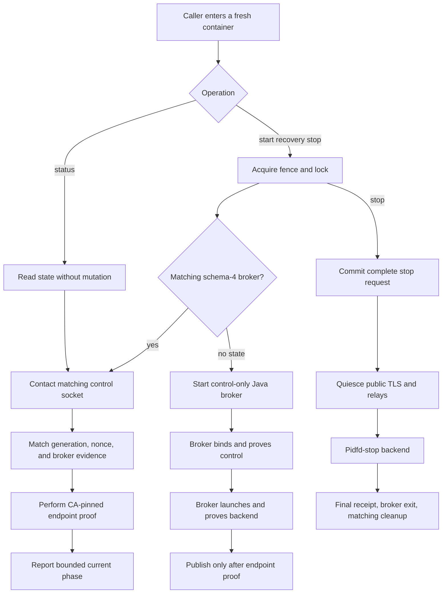
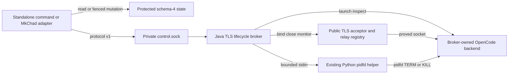
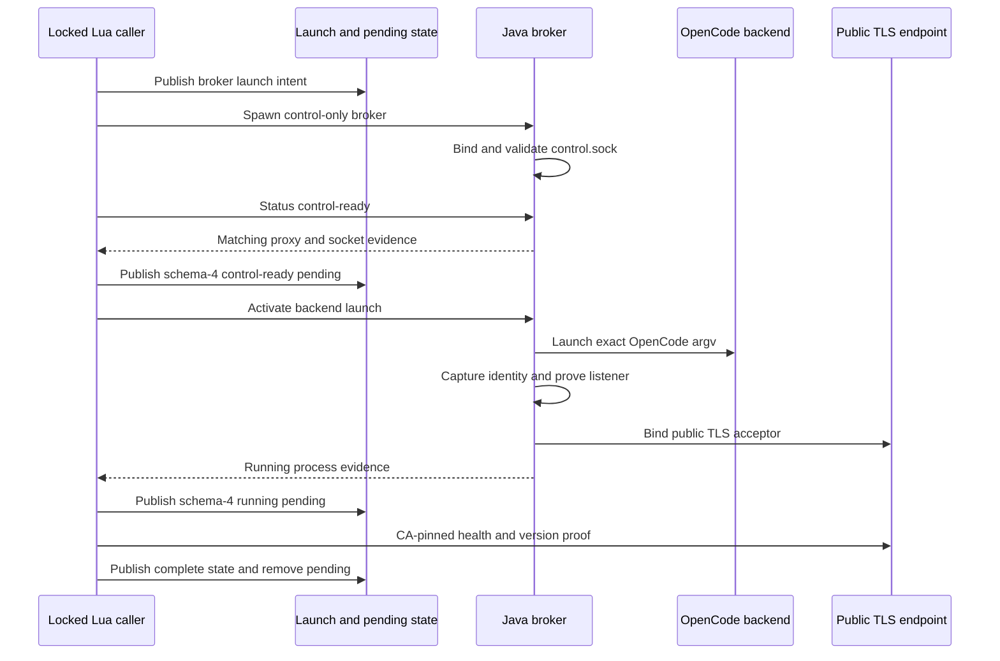
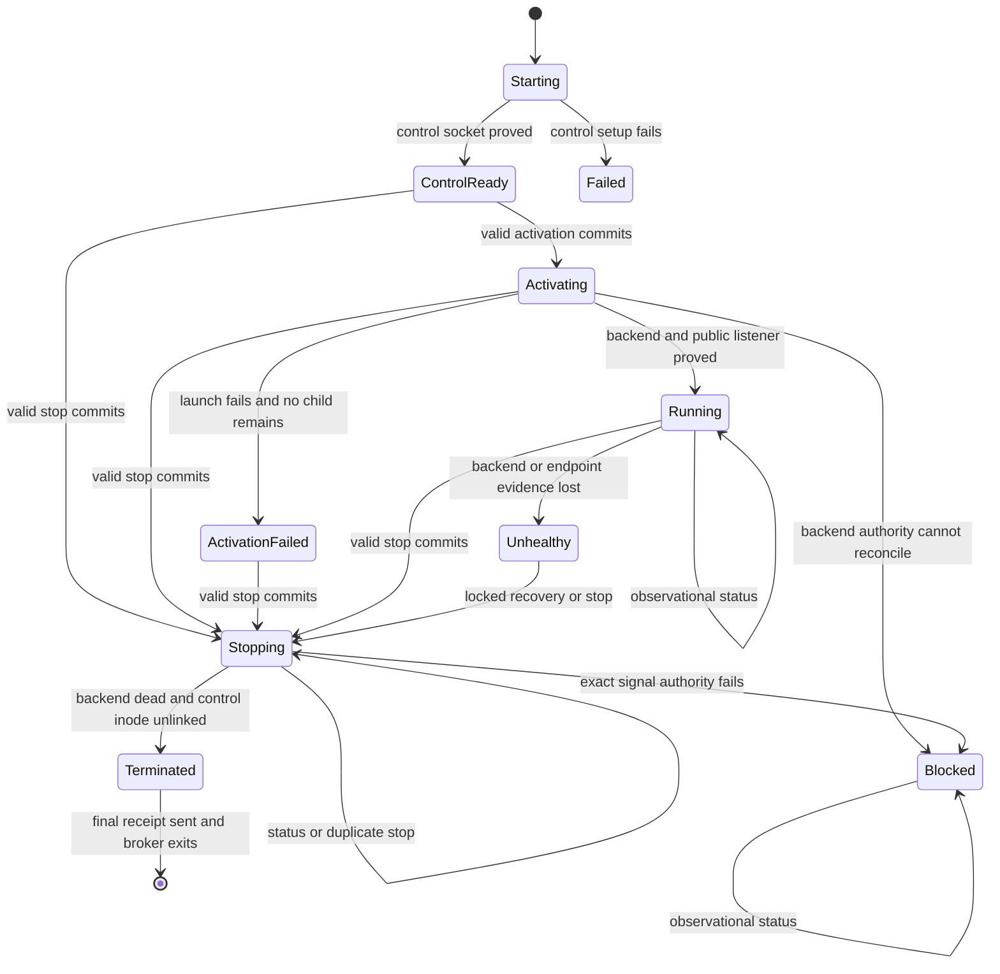

# TLS Proxy Lifecycle Broker - Plan

## Goal Capsule

- **Objective:** Make standalone TLS-mode OpenCode lifecycle commands work across restricted Singularity or Apptainer invocations by keeping backend process authority with the persistent TLS proxy.
- **Product authority:** This Product Contract governs TLS lifecycle behavior and preserves the existing Sprint 2 threat model unless an approved amendment replaces a requirement.
- **Scope:** TLS-proxy generations use brokered lifecycle control; direct loopback-HTTP lifecycle behavior is unchanged.
- **Stop conditions:** Stop rather than weaken authority when broker identity, generation, socket ownership, backend identity, or pidfd signaling cannot be proved.
- **Execution profile:** Prepare and review the parent safety-policy delta first without committing it; then change and verify MkChad, add exact wrapper/runtime evidence in `msk_containers`, and finalize parent policy, evidence, and gitlinks last.
- **Tail ownership:** `mkchad` owns lifecycle behavior and user documentation; `msk_containers` owns host/image parity and runtime evidence; the parent owns governing policy and coordination artifacts.
- **Open blockers:** No implementation decision remains open. Deployment claims require real Java 21 Unix-socket interoperability through separate supported SingularityCE and Apptainer invocations.

---

## Product Contract

Product Contract changed: R1, R3-R5, R7-R9, R12, R14-R21, and R23-R25 were clarified; R26-R30, F6-F8, and AE10-AE16 were added after planning research confirmed broker-first startup, schema-4 downgrade safety, explicit authority transfer, public-quiesce-first stop, strict control framing, crash-cut recovery, and stale-socket requirements. All other IDs and product intent are unchanged.

### Summary

Make the persistent TLS proxy the lifecycle authority for its OpenCode backend.
Standalone commands communicate with that authority through a private Unix-domain control socket instead of re-inspecting protected process metadata from a fresh container.

### Problem Frame

The standalone launcher starts the OpenCode backend and TLS proxy inside a short-lived Singularity or Apptainer invocation.
On hardened HPC systems, a later container invocation can read the recorded processes' command lines and start ticks but cannot dereference `/proc/<pid>/exe` or `/proc/<pid>/fd/*` across the container boundary.
The current lifecycle therefore cannot prove executable or listener ownership even though the original proxy retains the process context needed to validate its backend.

Failing closed is correct for signaling safety, but it leaves a healthy TLS generation unavailable to `status`, reuse, recovery, and `stop` through the documented standalone command.

### Key Decisions

- **Broker lifecycle through the TLS proxy.** (session-settled: user-directed — chosen over changing both transports: TLS is the intended profile for restricted HPC deployments.) The persistent proxy remains in the process context that can inspect the backend and already performs backend start-time and socket-inode proofs.
- **Use a private Unix-domain control socket.** (session-settled: user-directed — chosen over TLS control and a host-native verifier: filesystem-scoped control avoids exposing lifecycle operations through the tunneled network endpoint or duplicating authority on the host.)
- **Use brokered control for every new TLS generation.** (session-settled: user-approved — chosen over permission-error fallback: one TLS lifecycle path avoids environment-dependent behavior.)
- **Block and preserve when broker authority is unavailable.** (session-settled: user-approved — chosen over host fallback or replacement startup: avoiding an incorrect signal remains more important than automatic cleanup.)
- **Let the broker launch the backend.** (session-settled: user-directed — chosen over retaining Lua-first launch: persistent authority must exist before a backend can outlive its caller.)
- **Use schema 4 for broker-capable TLS state.** (session-settled: user-directed — chosen over a two-release schema-3 rollout: current schema-3 readers already preserve unsupported future state.)
- **Quiesce public TLS before backend stop.** (session-settled: user-approved — chosen over backend-first cleanup: the proxy retains private control authority while refusing new public work.)
- **Preserve exact process safety.** The broker changes where verification occurs, not which boot, start, executable, argv, listener, generation, fencing, or pidfd guarantees apply.

### Actors

- A1. **Lifecycle caller:** The standalone launcher or MkChad integration requesting TLS start, status, reuse, recovery, or stop.
- A2. **TLS lifecycle broker:** The persistent proxy that owns the private control channel and validates its recorded generation and backend.
- A3. **OpenCode backend:** The loopback server process pinned to one brokered TLS generation.

### Requirements

**Authority and control channel**

- R1. Every newly started TLS generation must establish one private lifecycle control channel owned by its persistent TLS proxy before any backend process is launched.
- R2. The control channel must be a Unix-domain socket beneath the protected host-specific state directory and must not be reachable through the public TLS listener.
- R3. The host-specific state directory and broker-created subdirectories must be owned by the current user and mode `0700`; broker-created files and the control socket must be owned by the current user and mode `0600`. Directory type, ownership, mode, and stable device/inode identity must be checked without following symlinks before authority-bearing operations.
- R4. Each legal control exchange permits at most one versioned request and one response with strict per-frame byte, structure, trailing-data, duplicate-field, and absolute-time bounds; invalid or incomplete input and peer disconnection do not guarantee response delivery. Concurrent connections and queued control work must also have fixed aggregate bounds, and overload rejection must be non-mutating.
- R5. A caller must hold the existing lifecycle exclusion authority while mutating shared lifecycle state or reconciling control paths; after a complete mutating request commits, the broker's single-writer state machine owns process-lifecycle completion independently of caller survival.

**Identity and health**

- R6. The broker must return affirmative running or healthy backend authority only after validating the recorded boot, backend PID and start tick, executable identity, exact role argv, and required listener ownership from its original process context. A valid non-healthy phase response such as `control-ready` may affirm broker and control authority without claiming backend authority.
- R7. Before returning affirmative authority, the broker must validate its recorded PID and start tick, Java runtime identity, exact argv, source identity, control-socket identity, and every listener required by its current phase.
- R8. A healthy result must additionally prove the expected TLS generation, certificate identity, public endpoint, backend health, and server version under existing transport rules.
- R9. Every request and response must match the exact operation, schema-4 generation, and fresh nonce expected by the caller so stale state or a stale socket cannot authorize another generation.
- R10. Ordinary TLS relay traffic must retain its existing backend identity and established-socket ownership proofs without being parsed as lifecycle control traffic.

**Start and reuse**

- R11. TLS `start` must reuse an existing generation only when its broker returns a complete matching healthy result and the caller validates the brokered endpoint contract.
- R12. A fresh TLS generation must have a durable matching launch intent before broker spawn and must not be published as complete until control is ready, the broker has launched and validated the backend, schema-4 pending authority exists, and a separate control request plus CA-pinned endpoint proof confirms readiness; every manager-death cut must remain exactly reconcilable without pathname-only adoption.
- R13. Concurrent lifecycle callers must still converge on one host-namespaced TLS generation under the existing kernel fence and logical lock contract.

**Status and recovery**

- R14. TLS `status` must remain side-effect free while using brokered evidence and endpoint health; it must not acquire mutation authority, change state, request cleanup, rotate TLS material, or start or stop a process.
- R15. A live broker reporting a dead or unhealthy backend may be cleaned up only by a fenced and locked start, recovery, or stop operation.
- R16. An unreachable, unauthorized, malformed, stale, mismatched, oversized, trailing, partial, or timed-out broker exchange must produce a blocked result whenever recorded generation processes may still be live.
- R17. Broker diagnostics must distinguish unavailable authority, stale control state, broker identity loss, backend identity loss, stopping, and endpoint-health failure without exposing credentials or unbounded process data.

**Stop and failure safety**

- R18. TLS `stop` must commit only after one complete authorized request, atomically transfer process-lifecycle completion to the broker, then close an admission gate, the public acceptor, and every registered relay before revalidating and pidfd-signaling the backend under the existing TERM, bounded wait, and KILL escalation contract.
- R19. On the normal stop-completion path, after confirmed backend termination the broker must close control acceptance, conditionally unlink the recorded control-socket inode, send one matching final receipt over the already accepted stop connection, and exit; the caller may then remove matching state only after receiving that receipt, observing broker termination, and rechecking control-path absence under the fence. If the receipt is lost, the alternate reconciliation path in R21 may remove state only after fenced proof that both recorded roles and the recorded control path are absent or safely reconciled.
- R20. If backend revalidation or pidfd signaling fails, the broker and caller must refuse unsafe signaling and preserve enough state for manual operating-system accounting.
- R21. Before activation or stop commit, partial input or caller cancellation causes no process mutation; after commit, caller loss does not cancel the broker-owned transition but cannot authorize shared-state mutation or removal without a later fenced reconciliation and the required evidence.

**Compatibility and migration**

- R22. Direct loopback-HTTP transport must retain its current lifecycle behavior and must not silently claim broker support.
- R23. Existing schema-2 and schema-3 TLS generations remain pre-broker state and may use the legacy path only where every existing direct proof succeeds.
- R24. A pre-broker TLS generation on a restricted system must remain blocked and preserved until the user manually accounts for and terminates it; broker authority cannot be added retroactively.
- R25. After legacy processes are confirmed absent, the next TLS start must retain valid certificate material and create a schema-4 brokered generation without deleting unrelated OpenCode state.
- R26. Broker-capable TLS pending and complete metadata must use schema 4 with an explicit broker protocol record; current schema-3 readers must preserve it as unsupported future state.
- R27. The broker must bind and validate control before accepting startup activation and must itself launch, capture, validate, monitor, and stop the backend; Lua must not launch a schema-4 TLS backend.
- R28. Control authorization must derive from protected filesystem DAC, exact socket identity, and exact generation matching within the existing cooperative same-user trust boundary; the nonce provides correlation, not authorization.
- R29. Every operation must have one defined result in every broker phase: activation commits once and is idempotent after commitment, stop handles control-ready and activating as well as running and unhealthy phases, status observes every phase, and duplicate or lost-response retries never launch or signal twice. While stop is committed, status must return a non-healthy `stopping` result and duplicate stop requests must be deterministic and non-mutating.
- R30. A stale control path may be reclaimed only under the kernel fence after no-follow path checks, bounded contact failure, and proof that recorded process authority is absent; live or ambiguous paths must be preserved.

### Key Flows



- F1. **Fresh TLS start:** A locked caller starts a control-only broker, establishes schema-4 pending authority, activates broker-owned backend launch, obtains matching process evidence, validates the endpoint, and publishes complete state.
- F2. **Cross-container reuse:** A later caller cannot inspect protected procfs links, connects to the recorded control socket, receives matching identity and health evidence, and reuses the existing generation.
- F3. **Brokered stop:** A locked caller commits one complete stop request; the broker quiesces public service, pidfd-stops the backend, closes control acceptance, conditionally unlinks the recorded socket, emits a matching final receipt over the accepted connection, and exits before caller-side state removal.
- F4. **Unavailable broker:** State names a possibly live generation but control cannot be authorized or completed; the caller reports blocked, preserves state, and performs no signal or replacement startup.
- F5. **Legacy migration:** A restricted host encounters a pre-broker generation, reports the need for manual accounting, and creates the first brokered generation only after the legacy processes are confirmed absent.
- F6. **Observational status:** Status reads state, performs one bounded broker exchange and endpoint proof, reports current truth, and leaves lifecycle files and processes unchanged.
- F7. **Selective death:** Backend-dead/broker-live state is recoverable through locked broker cleanup; broker-dead/backend-live state is blocked and manual; both-dead state is generation-conditionally reconciled.
- F8. **Lost stop receipt:** A committed broker stop continues after caller loss, while shared state remains until a later locked caller proves both recorded process identities and the recorded control path absent or safely reconciled.

### Acceptance Examples

- AE1. **Covers R1-R14.** Given a healthy schema-4 TLS generation started in one Singularity invocation, when `mkchad-opencode-server status` runs in a fresh invocation that cannot dereference the old processes' protected procfs links, then status returns the same healthy generation through brokered evidence and endpoint proof.
- AE2. **Covers R11-R13, R27.** Given two fresh callers concurrently request TLS start, when no generation exists, then exactly one control-ready broker launches exactly one backend and both successful callers receive the same generation.
- AE3. **Covers R16-R17, R20-R21.** Given state names live PIDs but the control socket is absent, inaccessible, stale, malformed, or silent, when status, start, or stop runs, then it reports blocked and neither signals a PID nor removes state.
- AE4. **Covers R6-R7, R15, R18-R21.** Given the broker observes changed proxy or backend process identity or listener ownership, when status or stop is requested, then it refuses affirmative authority, does not signal an unverified backend, and reports identity loss.
- AE5. **Covers R18-R21, R29.** Given a healthy matching generation, when stop is requested from a fresh restricted container, then the admission gate, public acceptance, and all registered relays close before pidfd-based backend termination, the matching control inode is unlinked before one final receipt is returned, the proxy exits, and only matching state is removed.
- AE6. **Covers R8-R11.** Given a control response names the expected generation but TLS certificate, endpoint health, or server version evidence does not satisfy the existing contract, when start attempts reuse, then reuse is refused.
- AE7. **Covers R10, R18.** Given ordinary HTTP, streaming, or event traffic is active, then relay ownership proof remains unchanged during normal operation and committed stop closes those relays before backend signaling.
- AE8. **Covers R22.** Given direct loopback-HTTP mode on the same restricted host, when status cannot perform its current procfs proof, then it fails under its existing contract and does not route through the TLS broker.
- AE9. **Covers R23-R26.** Given a pre-broker TLS generation on a restricted host, when the upgraded launcher first runs, then it preserves the legacy generation and gives manual-accounting guidance; after those PIDs are confirmed absent, the next start retains valid TLS material and publishes schema-4 state.
- AE10. **Covers R1, R12, R27.** Given the manager dies at any boundary from durable launch intent through complete publication, then a matching broker receipt plus no-follow control identity or pending authority permits exact fenced reconciliation without pathname-only adoption or an unaccounted backend-only process.
- AE11. **Covers R23-R26.** Given a current schema-3 launcher encounters schema-4 complete or pending metadata, then it refuses startup, stop, and replacement and leaves bytes and processes unchanged.
- AE12. **Covers R4, R9, R16, R21, R28.** Given any partial, duplicated, malformed, oversized, trailing, wrong-generation, wrong-nonce, or timed-out frame, then the broker performs no activation, signal, listener close, or state-authorizing response.
- AE13. **Covers R14-R17, R29.** Given repeated status calls during control-ready, activating, activation-failed, running, unhealthy, stopping, and blocked phases, plus unavailable control during starting, failed setup, and terminated phases, then each reports bounded current truth or the specified unavailable outcome without changing state, locks, processes, listeners, or TLS material.
- AE14. **Covers R18-R21, R29.** Given a complete stop request commits and the caller disconnects before receiving the response, then public service still quiesces and the backend still stops, but state remains until later both-dead and control-path reconciliation.
- AE15. **Covers R2-R3, R9, R16, R30.** Given the control path is absent, a symlink, the wrong type, has unsafe metadata, belongs to another generation, or is a dead stale socket, then only the dead matching fully checked case may be reclaimed under the fence.
- AE16. **Covers R15-R21.** Given the backend dies while the broker remains live, status reports unhealthy and locked recovery may stop the broker; given the broker dies while the backend remains live, all lifecycle operations block and preserve state for manual accounting.

### Scope Boundaries

- This work does not weaken executable, argv, listener, boot, start-time, generation, fence, or pidfd requirements.
- This work does not add brokered lifecycle support to direct loopback-HTTP transport.
- This work does not add a host-native process verifier, systemd unit, login watchdog, or persistent container instance.
- This work does not expose lifecycle control through the public TLS port, an SSH tunnel, or an OpenCode HTTP route.
- This work does not make same-user malicious state modification a cryptographically prevented threat; the existing cooperative-user trust boundary remains.
- This work does not automatically terminate or adopt a pre-broker generation that cannot be fully verified.

### Dependencies And Assumptions

- The TLS proxy remains alive in the original container context and can continue reading its backend's procfs identity and file-descriptor links.
- The host-specific state directory is shared across launcher container invocations and supports Unix-domain sockets with restrictive filesystem permissions.
- Java 21 can host the control socket, and the minimal headless lifecycle client can perform bounded exchanges with it without loading the interactive MkChad configuration.
- The existing pidfd helper remains available inside the proxy's container context and can preserve post-open identity revalidation before signaling.
- Valid TLS certificate material remains reusable across the one-time migration from a legacy generation.
- The encoded state-root path plus the fixed control leaf fits the supported pathname-socket limit; longer paths fail before broker launch.

### Sources And Research

- `mkchad/lua/configs/opencode.lua` contains current process identity, listener ownership, lifecycle fencing, state publication, health, and pidfd signaling behavior.
- `mkchad/java/MkChadTlsProxy.java` contains the persistent proxy's backend start-time, listener inode, established-socket, and relay-time ownership proofs.
- `docs/sprints/single-opencode-server/2/threat_model.md` defines fail-closed process accounting and identifies an external supervisor or process broker as the way to close authority-transfer gaps.
- `docs/sprints/single-opencode-server/3/sprint_spec.md` requires the standalone command to preserve exact process validation, kernel fencing, pidfd signaling, and bounded lifecycle behavior.
- The reproduced HPC constraint allows a host process to inspect the managed executable and file descriptors while a fresh Singularity invocation receives `Permission denied` when dereferencing those procfs links.
- [OpenJDK JEP 380](https://openjdk.org/jeps/380), Java 21 channel documentation, Linux `unix(7)`, and current runtime bind documentation define the Unix-socket constraints used by planning; exact cross-invocation behavior remains a real-runtime gate.

---

## Planning Contract

### Key Technical Decisions

- **KTD1. Broker only TLS generations.** (session-settled: user-directed — chosen over changing both transports: TLS is the intended restricted-HPC profile.) Schema-3 direct HTTP retains its current lifecycle.
- **KTD2. Use one protected pathname socket.** (session-settled: user-directed — chosen over TLS control and host verification: the state directory is the shared authority boundary.) Use a fixed short `control.sock` leaf; generation and nonce belong in the protocol rather than the pathname.
- **KTD3. Make brokerage unconditional for schema 4.** (session-settled: user-approved — chosen over permission-error fallback: one TLS path avoids environment-dependent authority.) Legacy schema-2/3 TLS remains a separate exact direct-proof path.
- **KTD4. Establish control before launching OpenCode.** (session-settled: user-directed — chosen over retaining Lua-first launch: backend-only pending state would recreate the authority gap.) Lua durably records matching launch intent before spawn, starts a control-only Java broker, and activates broker-owned backend launch only after a receipt proves generation, exact broker identity, control inode, and backend launch intent. Each crash cut from pre-spawn intent through running pending has an explicit fenced reconciliation outcome; pathname contact alone never permits adoption.
- **KTD5. Use schema 4 for broker state.** (session-settled: user-directed — chosen over a two-release schema-3 rollout: existing schema-3 readers safely refuse future complete state and preserve unknown pending state.) Do not relax schema-3's exact proxy argv contract.
- **KTD6. Keep control framing small and closed.** Use one four-byte big-endian length followed by one bounded UTF-8 JSON object in each direction; require output half-close, reject trailing bytes and duplicate or unknown fields, and permit only `activate`, `status`, and `stop`. Define exact required and forbidden response fields per operation, outcome, and phase; apply duplicate-aware UTF-8 parsing, field caps, a total frame cap above the largest legal receipt, and one absolute exchange deadline on both sides.
- **KTD7. Separate evidence from health.** The broker proves proxy/backend process and listener authority; the Lua caller compares that receipt to schema-4 metadata and independently performs the existing CA-pinned endpoint health/version probe.
- **KTD8. Separate shared-state and process authority.** Broker status and endpoint probes remain observational. A fenced and locked Lua caller exclusively owns shared-state publication/removal and control-path reconciliation; a fully validated mutating request atomically transfers activation or stop completion to the broker's single-writer state machine. Caller loss releases Lua's fence but does not cancel a committed broker transition, and only a later fenced caller may apply broker evidence to shared state. U1 explicitly amends fence-through-signal wording for schema-4 brokerage while preserving it for direct and legacy paths.
- **KTD9. Quiesce public service before signal.** (session-settled: user-approved — chosen over backend-first cleanup: no new public work should enter after stop commit.) Stop commit atomically closes an admission gate; every accepted connection must register under that gate before backend work, and the accept loop plus relay registry must be empty before signaling. The broker closes the control listener and conditionally unlinks the recorded socket before the final receipt while retaining the accepted stop connection, then exits after receipt delivery.
- **KTD10. Preserve when authority is incomplete.** (session-settled: user-approved — chosen over host fallback or replacement startup: a leak is safer than signaling or adopting the wrong process.) A lost receipt remains blocked while either recorded role may live or control identity is unresolved. A later fenced caller may remove matching state only after proving both recorded PIDs absent and the recorded control inode absent or safely reconciled; broker-dead/backend-live and ambiguous authority remain blocked/manual.

### High-Level Technical Design







### State And Protocol Design

**Schema-4 complete state** keeps the current TLS endpoint, certificate, proxy, backend, generation, boot, timestamp, port, and log records and adds a `broker` record containing protocol version, exact control path, and no-follow control socket device/inode. Schema 4 is valid only for `tls-proxy`; direct HTTP remains schema 3.

**Schema-4 pending state** has explicit `control-ready`, `running`, and `stopping` phases. `control-ready` requires a proxy record but no backend; `running` requires both process records; `stopping` preserves the last exact records when a later locked operation observes committed cleanup or performs lost-receipt reconciliation. No atomic transaction spans the control socket and state files, so broker phase is observational truth and durable `stopping` metadata is recoverable context, not a prerequisite for cleanup.

**Broker launch intent** receives a new version that records TLS transport, generation, boot, proxy role/public port, protocol/control path, exact backend launch intent, and proxy PID once captured. A current reader treats this future intent as malformed and preserves it for manual inspection rather than replacing it.

**Protocol v1** carries exactly `protocol`, `operation`, `generation`, and `nonce` in requests. Responses echo those fields and add one bounded phase outcome, stable error code when non-affirmative, and exactly the required phase-appropriate process/socket evidence. Each operation/outcome schema defines required and forbidden fields; both peers reject unknown protocol versions, duplicate keys, invalid UTF-8, trailing content, and legal-shape violations before using evidence. No request can nominate an alternate PID, executable, path, port, argv, or signal.

**Authorization** is the protected state directory plus exact socket device/inode and generation matching under the existing cooperative same-user boundary. The nonce prevents stale-response acceptance but is not a secret. No new credential enters argv, state, logs, diagnostics, or control frames.

**Authority handoff** has two domains. Lua's kernel fence and logical lock exclusively govern shared-state mutation and control-path reconciliation. The broker's single-writer state machine exclusively governs schema-4 backend launch, public listener state, activation, stop, and pidfd-helper use after a valid mutating request reaches its phase-specific commit point. A caller that dies after commit releases its fence without revoking broker authority; only a later fenced caller may reconcile the resulting receipt or phase into shared state.

**Operation/phase behavior** is normative and uses one broker-local linearization point per transition:

| Broker phase | `activate` | `status` | `stop` |
| --- | --- | --- | --- |
| `starting` / `failed` | Control unavailable; caller reconciles launch intent | Control unavailable or non-affirmative | No control commit |
| `control-ready` | Commit once and launch the backend | Report control-ready without mutation | Commit stop without launching a backend |
| `activating` | Idempotently report the committed activation | Report activating without mutation | Commit stop; prevent an unstarted spawn or account for and stop the exact captured child |
| `activation-failed` | Idempotently return the stable failure without relaunch | Report the stable failure without mutation | Commit broker cleanup after proving no backend remains |
| `running` | Idempotently return matching running evidence | Return matching running evidence | Commit stop |
| `unhealthy` | Reject without mutation | Return bounded non-healthy evidence | Commit only when exact process authority remains sufficient; otherwise enter blocked |
| `stopping` | Reject without mutation | Report stopping | Return deterministic non-mutating in-progress or terminal outcome |
| `blocked` | Reject without mutation | Report the stable blocked reason | Reject without signaling unless the state machine still has the exact authority required for a previously committed stop |
| `terminated` | Control unavailable | Control unavailable | Only the already accepted committed stop connection may receive the final receipt |

**Startup crash cuts** are reconciled from durable launch intent plus broker evidence. Intent without a spawned process is removable after fenced absence proof. A broker spawned or bound before `control-ready` publication may be promoted only when a no-follow check and receipt prove the exact generation, broker argv/runtime/source, control inode, and backend launch intent. Activation committed before `running` publication is reconciled through idempotent activation/status evidence. Contact failure, mismatch, or any possibly live unproved role remains preserved/manual.

**Activation failure** is terminal for that generation and never retries launch. Failure before child capture, or after exact cleanup proves no child remains, enters `activation-failed` with private control retained for status and stop. Early child exit, listener timeout, public-bind failure, or response loss follows the same outcome only after exact child absence; inability to prove or complete cleanup enters `blocked`. A later fenced caller may stop and reconcile the broker but cannot reactivate it or adopt a child.

**Stop commit** occurs only after the broker has read one complete frame, observed request EOF, rejected unknown/duplicate/trailing content, matched generation and nonce shape, and revalidated itself. Before commit, disconnect is non-mutating. After commit, disconnect cannot cancel cleanup. The admission gate closes before acceptor and relay draining; failure to prove the accept loop stopped and the relay registry empty prevents backend signaling. After backend death, the broker closes control acceptance and conditionally unlinks the recorded inode before sending the final receipt over the accepted connection. A missing receipt, unlink failure, replacement path, or missing broker-death observation leaves caller state intact.

**Stale socket reclamation** remains under the fence and lock. The caller no-follow checks type, owner, mode, and recorded inode; attempts one bounded generation-specific status exchange; preserves any responsive, live, mismatched, or ambiguous path; and quarantines a proven-dead matching socket before a new bind. Final removal is conditional on the quarantined inode and successful replacement identity.

### Existing Patterns To Extend

- `mkchad/lua/configs/opencode.lua`: central path construction, private atomic writes, exact state validators, process/listener proofs, fence/lock, bounded subprocesses, generation-conditional cleanup, endpoint health, ensure/recovery, and standalone status/stop.
- `mkchad/java/MkChadTlsProxy.java`: strict argv parsing, TLS setup, backend preflight, established-socket inode proof, relay ownership monitoring, and virtual-thread connection handling.
- `mkchad/scripts/opencode_pidfd_signal.py`: bounded stdin protocol, pidfd-open-before-revalidation, exact process checks, and pidfd-only signal dispatch.
- `mkchad/lua/mkchad/opencode/command.lua`: bounded schema-1 user/machine result contract; add only stable broker diagnostics.
- `msk_containers/nvim/bin/mkchad-opencode-server`: exact host/image delegation and environment forwarding without nested runtime entry.

### Alternatives Considered

| Alternative | Disposition |
| --- | --- |
| PID, UID, port, and start tick without executable/fd proof | Rejected because authorization to signal is not proof of MkChad ownership. |
| Lifecycle control over the public TLS listener | Rejected because it mixes tunneled application traffic with process authority. |
| Host-native verifier/signaler | Rejected because it duplicates security-sensitive lifecycle behavior. |
| Lua launches backend before proxy | Rejected because manager death can strand backend-only pending authority. |
| Reuse schema 3 with new proxy argv | Rejected because old schema-3 readers may classify live broker state as malformed. |
| Persistent container instance or new watchdog | Rejected because it changes deployment and next-use recovery semantics. |
| Generation-specific socket filename | Rejected because it worsens Linux pathname-length risk without adding authority. |

### System-Wide Impact

- **Authority and state:** Lua retains the fence, lock, durable state, and stale-path boundary; Java becomes the single writer for broker phase, backend supervision, public admission, relay state, and committed process transitions; Python remains a bounded pidfd-only dispatcher. Caller loss can leave durable phase behind broker truth, and only a later fenced operation may reconcile it.
- **Users and support:** Healthy restricted-host lifecycle becomes automatic. Manual OS accounting remains necessary for pre-broker migration, broker-dead/backend-live state, broker identity loss, and committed stop failures that cannot prove signaling; these cases permit no adoption, replacement, restoration, fallback signal, or state deletion.
- **Process supervision:** Java gains exact backend argv/environment/cwd and protected stream/log ownership, child monitoring and reaping, relay registration, and bounded pidfd-helper execution. Helper timeout, overflow, refusal, or identity mismatch after stop commit leaves public service quiesced, private control blocked, and caller state preserved.
- **State and runtime boundary:** The state directory becomes live IPC. Every invocation must resolve the same host path and inode on a Unix-socket-capable filesystem under the same user; backup, replication, cleanup, and rollback must not copy, adopt, or blind-unlink control sockets.
- **Versioned interfaces:** TLS complete/pending state uses schema 4; launch intent has its own next-version schema; private control is protocol 1; pidfd helper and public command remain schema 1. Public command schema 1 gains bounded `stopping` and stable broker diagnostic outcomes, and closed-enum consumers update together. Unknown broker protocol is unsupported future authority, not removable malformed state.
- **Compatibility:** Legacy TLS and direct HTTP retain exact validators; current launchers preserve schema 4 but may have limited observability. `opencode.nvim` reads only the validated command endpoint and CA contract, never state or control frames, but compatibility tests still cover callback-once, cache invalidation, pinned REST/SSE, and no terminal fallback.
- **Deployment and evidence:** The wrapper, Lua lifecycle, Java source, pidfd helper, image, and state/protocol validators form one compatibility unit. Runtime claims are scoped to runtime/version, image revision, architecture, bind policy, state-root filesystem, Java/Python availability, and host security policy; fixture-only evidence remains insufficient.
- **Repositories:** Production changes are limited to `mkchad` and the installed wrapper/environment boundary in `msk_containers`; `opencode.nvim` remains a read-only compatibility surface.

### Risks And Mitigations

| Risk | Mitigation and exit gate |
| --- | --- |
| Unix path exceeds `sun_path` | Use fixed `control.sock`, check encoded path length before proxy spawn, and launch no backend on failure. |
| Site bind mounts do not share the same socket inode | Require opt-in separate-invocation evidence for each claimed SingularityCE/Apptainer environment. |
| Stale unlink detaches a live broker | Use fence, no-follow metadata, generation contact, inode quarantine, and conditional deletion; never blind-unlink. |
| Strict JSON parser accepts ambiguity | Keep one small closed grammar, reject duplicates/unknowns/trailing data, cap all fields, and test malformed inputs before mutation. |
| Caller dies after activation or stop commit | Broker remains authority; pending state supports recovery, while missing stop receipt preserves state until both-dead and control-path reconciliation. |
| Broker dies while backend remains live | Preserve blocked/manual behavior and amend selective-death policy; never fall back to weaker caller proof. |
| Active relay admits work during stop | Close public acceptor and tracked relays before invoking pidfd helper; assert ordering in integration tests. |
| Accept/register races bypass relay quiescence | Close one admission gate at stop commit, register every accepted socket under the same synchronization, join the accept loop, and prove the registry empty before signaling. |
| Live broker assets are replaced in place | Stop the generation before deployment or retain immutable versioned Java/helper assets until every recorded generation is dead; never rely on overwritten source identity for rollback. |
| Parent policy and child behavior drift | Review policy delta before implementation and commit parent docs/gitlinks only after verified child revisions. |

---

## Implementation Units

### U1. Amend The Governing Safety Contract

- **Goal:** Approve the threat, audit, schema, recovery, and stop-order changes before production behavior relies on them.
- **Requirements:** R1-R30; F1-F8; AE1-AE16; KTD4, KTD5, KTD9, KTD10.
- **Dependencies:** None. Prepare and review this parent diff first, but commit it with U7 after child commits.
- **Files:** `docs/sprints/single-opencode-server/2/threat_model.md`, `docs/sprints/single-opencode-server/2/audit_policy.md`, `docs/sprints/single-opencode-server/3/sprint_spec.md`.
- **Approach:** Replace proxy-process-first wording with public-quiesce-first semantics; define broker-first startup, schema 4, control-path threats, receipt-based cleanup, and broker-dead/backend-live manual recovery; split Lua shared-state authority from broker process authority and amend fence-through-signal wording only for committed schema-4 operations; state that the already-persistent proxy gains responsibility rather than adding a helper.
- **Patterns to follow:** Existing threat/control/residual-risk sections and audit severity/evidence language.
- **Test scenarios:** Review the selective-death matrix for all four proxy/backend liveness combinations; trace every new control-path threat to a control and audit assertion; verify direct HTTP and credential policy remain unchanged.
- **Verification:** Threat model, audit policy, Product Contract, and Sprint 3 acceptance criteria describe one consistent authority and stop state machine.

### U2. Build Schema-4 Broker-First Startup

- **Goal:** Establish a control-ready Java broker before any backend launch and publish exact schema-4 pending/complete evidence.
- **Requirements:** R1-R13, R17, R26-R29; F1-F2; AE1-AE2, AE4, AE10-AE13; KTD2-KTD7.
- **Dependencies:** U1.
- **Files:** `mkchad/lua/configs/opencode.lua`, `mkchad/java/MkChadTlsProxy.java`, `mkchad/lua/mkchad/opencode/command.lua`, `mkchad/tests/MkChadTlsProxyControlTest.java`, `mkchad/tests/tls_proxy_integration.py`, `mkchad/tests/opencode_state_validation_spec.lua`, `mkchad/tests/opencode_pending_generation_spec.lua`, `mkchad/tests/opencode_startup_race_spec.lua`.
- **Approach:** Add central control/quarantine paths; require an absolute state root and no-follow, current-EUID, type, mode, and stable device/inode checks across authority-bearing directory and socket operations; preserve exact schema-2/3 validators; add schema-4 complete, phased pending, and launch-intent validators; add bounded duplicate-aware Lua Unix-channel response validation; extend the source-mode Java proxy with exact activation/status schemas, fixed connection/queue caps, the phase machinery needed by the normative matrix, and one linearization point for activation while reserving committed stop mechanics for U4; bind and verify control, then launch the backend through argv-only `ProcessBuilder`, capture exact evidence, prove the listener, and only then expose public TLS.
- **Execution note:** Start with failing schema, protocol, and authority-transfer tests before replacing the legacy TLS startup path.
- **Patterns to follow:** Private fsynced writes, exact argv relationships, detached process capture, bounded Lua callbacks, Java proc-table validation, and startup test hooks already in the listed files.
- **Test scenarios:** Covers AE2/AE10 at every crash cut from durable intent before spawn through complete publication: exact matching evidence permits promotion, while contact failure or mismatch preserves state. Covers AE11: current schema-3 readers preserve schema-4 complete and pending bytes. Covers AE12 in both directions: partial, oversized, duplicate, unknown, trailing, invalid UTF-8, second-frame, wrong-generation, wrong-nonce, invalid phase fields, and timeout frames authorize nothing. Exercise lost activation responses, concurrent activate/status, every defined activation-failure cut, and idempotent failure reporting to prove one launch at most. Exercise pre-existing symlink, wrong owner/mode/type, parent-entry replacement, state-root inode change across bind, partial-frame floods, overload recovery, descriptor stability, and continued public relay service. Preserve legacy exact proxy argv and direct schema-3 state.
- **Verification:** A separate control connection obtains matching proxy/backend evidence before complete publication, and no tested startup interruption leaves an unbrokered backend.

### U3. Route Observation And Recovery Through Broker Evidence

- **Goal:** Make broker evidence the normal schema-4 TLS status/reuse path while keeping every mutation fenced and locked.
- **Requirements:** R5-R17, R22-R25, R29-R30; F2, F4-F7; AE1, AE3-AE4, AE6, AE8-AE9, AE13, AE15-AE16; KTD1-KTD3, KTD7, KTD8, KTD10.
- **Dependencies:** U2.
- **Files:** `mkchad/lua/configs/opencode.lua`, `mkchad/lua/mkchad/opencode/command.lua`, `mkchad/tests/opencode_broker_lifecycle_spec.lua`, `mkchad/tests/opencode_lifecycle_spec.lua`, `mkchad/tests/opencode_standalone_command_spec.lua`, `mkchad/tests/opencode_executable_identity_spec.lua`.
- **Approach:** Dispatch schema-4 status through control; compare exact protocol-1 receipts to immutable state; retain caller-side CA/health/version proof; leave status lock-free and side-effect free; let only locked start/recovery/stop reconcile broker phase into shared state; map stable broker outcomes directly into bounded command-schema-1 diagnostics without presentation-text parsing; implement no-follow stale socket quarantine and generation-conditional cleanup; retain exact legacy TLS and direct paths.
- **Patterns to follow:** Existing health classifications, lifecycle-only status boundary, endpoint-state adapter, exact process checks, and generation-conditional removal.
- **Test scenarios:** Covers AE1/AE13: fixture-backed repeated status succeeds across denied procfs links and does not change file content, metadata, lock state, processes, listeners, or TLS material in control-ready, activating, activation-failed, running, unhealthy, stopping, and blocked phases; starting, failed setup, and terminated state produce their specified unavailable outcomes without mutation. Covers AE3/AE15: absent, symlink, wrong-type, unsafe-mode, wrong-inode, other-generation, live ambiguous, and dead matching sockets produce the required preserve/quarantine behavior. Covers AE16: backend-dead/broker-live is observable then recoverable only under lock; broker-dead/backend-live is blocked/manual; both-dead is reconciled. Direct mode never opens control.
- **Verification:** Healthy reuse requires both a matching broker receipt and independent endpoint proof; observational status has zero lifecycle mutations in every broker phase and caller-visible unavailable state.

### U4. Implement Committed Stop And Relay Quiescence

- **Goal:** Move TLS backend signaling into the broker while preserving pidfd-only dispatch and receipt-gated caller cleanup.
- **Requirements:** R4-R5, R9-R10, R15-R21, R28-R30; F3-F4, F7-F8; AE3-AE5, AE7, AE12-AE16; KTD6, KTD8-KTD10.
- **Dependencies:** U3.
- **Files:** `mkchad/java/MkChadTlsProxy.java`, `mkchad/lua/configs/opencode.lua`, `mkchad/lua/mkchad/opencode/command.lua`, `mkchad/tests/MkChadTlsProxyControlTest.java`, `mkchad/tests/tls_proxy_integration.py`, `mkchad/tests/opencode_partial_stop_spec.lua`, `mkchad/tests/opencode_broker_lifecycle_spec.lua`, `mkchad/tests/pidfd_signal_spec.py`.
- **Approach:** Add one atomic stop transition and admission gate; register every accepted socket under the same synchronization before backend work; close the gate and public acceptor, join the accept loop, close and boundedly join relays, and prove the registry empty; invoke the existing helper without a shell after broker-side revalidation; preserve helper stream/time/reap caps; after backend death close control acceptance and conditionally unlink its recorded inode before sending one final matching receipt over the accepted stop connection; make Lua wait for receipt, proxy death, and fenced path-absence proof before state removal.
- **Execution note:** Prove ordering and interruption behavior with markers before enabling production stop routing.
- **Patterns to follow:** Existing TERM/wait/KILL escalation, helper stdin contract, test pause hooks, relay-close logic, partial-stop classification, and matching-state removal.
- **Test scenarios:** Covers AE5/AE7 with deterministic race hooks around accept return, admission registration, backend connect, and relay removal: no accepted or active HTTP/SSE relay survives to the backend signal marker. Covers AE12: incomplete stop frames mutate nothing. Covers AE14: caller disconnect after commit does not cancel cleanup and does not remove state. Complete the full operation/phase concurrency matrix here, including stop during control-ready, activating, activation-failed, running, and unhealthy; duplicate stop/status while stopping; backend already dead; proxy self-validation failure; post-pidfd-open mismatch; helper timeout/overflow/nonzero/unsupported pidfd/KILL refusal; receipt without proxy death; proxy death without receipt; unlink failure; replacement control inode; and path reappearance after broker death.
- **Verification:** Every backend signal originates from a post-validation pidfd helper call after public quiescence, and shared state is removed only from the proved terminal path.

### U5. Complete Compatibility And Regression Coverage

- **Goal:** Prove downgrade, concurrency, legacy migration, command stability, direct-mode stability, disclosure safety, and durable user behavior.
- **Requirements:** R1-R30; F1-F8; AE1-AE16; KTD1-KTD10.
- **Dependencies:** U4.
- **Files:** `mkchad/tests/opencode_downgrade_spec.py`, `mkchad/tests/opencode_downgrade_worker.lua`, `mkchad/tests/concurrent_startup.py`, `mkchad/tests/opencode_fence_spec.py`, `mkchad/tests/opencode_disclosure_spec.py`, `mkchad/tests/opencode_subprocess_spec.py`, `mkchad/tests/opencode_command_adapter_spec.lua`, `mkchad/tests/opencode_direct_lifecycle_spec.lua`, `mkchad/README.md`.
- **Approach:** Pin downgrade fixtures to the reviewed pre-broker revision; cover all schema-4 pending/complete/launch shapes and unsupported protocol versions; expand concurrent start/start and start/stop cases; retain schema-1 command output while adding bounded `stopping` and stable broker diagnostic outcomes to every closed-enum consumer; relocate only affected prohibited test roots to caller-supplied task directories under `/tmp/opencode-mkchad`; document migration, rollback, selective death, diagnostics, and runtime evidence limits.
- **Patterns to follow:** Existing downgrade worker, fence pause matrix, concurrent-start harness, disclosure assertions, and README transport/state inventory.
- **Test scenarios:** Two external starts and mixed external/editor starts converge on one broker/backend/generation; start racing stop serializes or fails safely; old launchers preserve future bytes/processes with explicitly limited observability; new launchers preserve restricted pre-broker state; certificate material survives migration; direct startup/status/reuse/stop remains unchanged; command consumers handle `stopping` and stable blocked diagnostics without message parsing; existing editor compatibility remains callback-once with correct cache invalidation, pinned REST/SSE, and no terminal fallback; repeated failures leak no descriptors, timers, children, relays, locks, credentials, capabilities, or process dumps.
- **Verification:** The complete deterministic MkChad lifecycle matrix passes from approved task roots, and documentation accurately distinguishes fixture evidence from real-runtime evidence.

### U6. Prove Host And Container State-Path Parity

- **Goal:** Ensure separate host invocations resolve the same state namespace and provide opt-in runtime evidence for the control socket.
- **Requirements:** R1-R5, R9, R11-R13, R16, R18-R21, R27-R30; F1-F4, F8; AE1-AE3, AE5, AE10, AE12, AE14-AE15; KTD2-KTD4, KTD9-KTD10.
- **Dependencies:** U5.
- **Files:** `msk_containers/nvim/bin/mkchad-opencode-server`, `msk_containers/tests/opencode_server_wrapper_test.sh`, `msk_containers/tests/opencode_server_runtime_test.sh`.
- **Approach:** Resolve and forward exact `XDG_STATE_HOME` like the other lifecycle roots; continue using the default shared home bind and require configured mounts for custom external state roots; extend fake-wrapper argv/environment assertions; add an opt-in harness that runs start/status/reuse/stop as separate exact host invocations and records only non-secret process/socket evidence.
- **Execution note:** Treat this as runtime smoke verification; do not substitute fixture results for supported-site evidence.
- **Patterns to follow:** Existing wrapper delegation, in-image no-nesting checks, explicit task-root guard, and runtime/image prerequisite diagnostics.
- **Test scenarios:** Default and custom state roots remain identical across host/in-image paths; spaces remain literal; diagnostics stay on stderr; missing runtime/image/state bind/assets fail clearly; separate Apptainer and SingularityCE invocations reproduce the protected-procfs denial, observe the same socket inode/generation after manager exit, obtain brokered status, execute broker-owned pidfd stop in the original context, prove public-quiesce-first ordering, and verify receipt-gated socket/state cleanup.
- **Verification:** Each claimed runtime has recorded separate-invocation evidence; unavailable gates remain explicitly unavailable rather than inferred successful.

### U7. Finalize Parent Evidence And Gitlinks

- **Goal:** Commit governing policy, checklist evidence, this implementation-ready plan, and verified child revisions in repository order.
- **Requirements:** R1-R30; F1-F8; AE1-AE16; KTD1-KTD10.
- **Dependencies:** U1-U6.
- **Files:** `docs/sprints/single-opencode-server/2/threat_model.md`, `docs/sprints/single-opencode-server/2/audit_policy.md`, `docs/sprints/single-opencode-server/3/sprint_spec.md`, `docs/sprints/single-opencode-server/3/sprint_checklist.md`, `docs/plans/2026-07-28-001-fix-tls-proxy-lifecycle-broker-plan.md`, and changed child gitlinks.
- **Approach:** Merge the reviewed U1 delta with current parent work; record only tests actually run and exact child revisions; leave unavailable runtime gates open; preserve unrelated parent changes; keep `opencode.nvim` gitlink unchanged unless separate user work changed it.
- **Patterns to follow:** Parent child-first commit order, sprint evidence tables, explicit unavailable gates, and no fixture-to-runtime claim promotion.
- **Test scenarios:** Cross-read Product Contract, threat model, audit policy, Sprint 3 spec/checklist, README, and state validators for one stop order, selective-death matrix, schema, migration, and rollback story; confirm no absolute checkout path or credential enters durable docs.
- **Verification:** Child commits precede the parent gitlink/documentation commit, and no unresolved P0/P1 finding remains outside an explicitly applicable existing exception.

---

## Sequencing And Rollout

1. Prepare and review U1 without committing the parent workspace.
2. Before U2, run a task-root-only capability spike on the reproduced restricted environment: prove a Java 21 broker survives manager exit, a fresh invocation reaches the same socket inode, the broker retains backend procfs visibility, and broker-context pidfd signaling works. A failed result blocks the architecture; if no target environment is available, do not represent U2-U5 as deployment-ready without explicit user acceptance of that unresolved reversal risk.
3. Implement and commit U2-U5 in `mkchad` in dependency order.
4. Implement and commit U6 in `msk_containers`.
5. Stop live schema-4 generations before replacing lifecycle assets, or retain immutable versioned Java/helper assets until every recorded generation using them is dead; install or stage matching MkChad lifecycle assets and wrapper/image revisions as one compatibility unit.
6. Run deterministic child verification, then every available opt-in real-runtime gate.
7. Deploy schema 4 to a target environment only after separate-invocation evidence passes for its exact runtime/image, bind policy, state-root filesystem, and host security policy; otherwise retain the prior compatible assets and mark that target unavailable.
8. Review the combined child behavior against the amended threat model and audit policy.
9. Complete U7 and commit the parent documentation and child gitlinks last.
10. Do not deploy a wrapper/image combination containing only one side of the schema-4 protocol.

### Upgrade And Migration

- Existing schema-2/3 TLS generations remain usable only where direct proofs succeed.
- Restricted callers preserve unverifiable pre-broker generations and provide manual process-accounting guidance.
- After both legacy roles are confirmed absent, valid TLS certificate material is retained and the next start publishes schema 4.
- Current schema-3 launchers encountering schema-4 complete or pending state refuse replacement.

### Rollback

1. Use the schema-4-aware command to stop the active generation when broker authority is available.
2. Require a matching final receipt plus broker death and fenced control-path absence, or trusted confirmation that both recorded roles and the recorded control path are absent or safely reconciled.
3. Account for complete, pending, launch-intent, control, and quarantine artifacts before changing versions.
4. Restore MkChad lifecycle assets and the container wrapper/image together.
5. Keep the exact old Java/helper assets available until all generations that recorded them are proved dead; never overwrite a live broker's authority files and rely on rollback.
6. Never delete state or signal a process merely to satisfy an older reader.
7. Preserve valid TLS certificate material unless independently invalid.

### Documentation Deliverables

- Update `mkchad/README.md` for schema 4, control socket permissions, broker-owned startup, observational status, selective-death outcomes, committed stop, lost receipts, one-time manual migration, custom state-path parity, upgrade, rollback, and runtime evidence limits.
- Update the Sprint 2 threat model and audit policy before relying on changed process order or recovery behavior.
- Update the Sprint 3 specification/checklist only with implemented behavior and evidence actually observed.
- Record exact parent, child, OpenCode, Java, Neovim, runtime, architecture, and image revisions for real-runtime evidence.

---

## Verification Contract

Create a new task-specific `TASK_ROOT` beneath `/tmp/opencode-mkchad` and use isolated `HOME`, `XDG_CONFIG_HOME`, `XDG_STATE_HOME`, `XDG_DATA_HOME`, `XDG_CACHE_HOME`, and `XDG_RUNTIME_DIR`. Every test that owns cleanup must reject an existing or noncompliant root.

### MkChad Gates

Run from `mkchad`:

Resolve `JAVA21` and `JAVAC21` once to exact executable paths for an actual Java 21 installation. Record both paths and `"$JAVA21" -version`; reject any other major version, and use those exact binaries for every Java-bearing deterministic and real-runtime gate rather than relying on a newer PATH-selected JDK.

| Gate | Command |
| --- | --- |
| Java 21 runtime identity | `"$JAVA21" -version` |
| Schema 4 and legacy validation | `nvim --headless -u NONE -l tests/opencode_state_validation_spec.lua lua/configs/opencode.lua` |
| Pending and generation authority | `nvim --headless -u NONE -l tests/opencode_pending_generation_spec.lua lua/configs/opencode.lua` |
| Broker lifecycle matrix | `nvim --headless -u NONE -l tests/opencode_broker_lifecycle_spec.lua lua/configs/opencode.lua` |
| Existing TLS lifecycle | `nvim --headless -u NONE -l tests/opencode_lifecycle_spec.lua lua/configs/opencode.lua` |
| Partial stop and deadlines | `nvim --headless -u NONE -l tests/opencode_partial_stop_spec.lua lua/configs/opencode.lua` |
| Startup authority races | `nvim --headless -u NONE -l tests/opencode_startup_race_spec.lua lua/configs/opencode.lua` |
| Executable/source identity | `nvim --headless -u NONE -l tests/opencode_executable_identity_spec.lua lua/configs/opencode.lua` |
| Standalone adapter | `nvim --headless -u NONE -l tests/opencode_command_adapter_spec.lua lua/configs/opencode.lua` |
| Standalone command | `nvim --headless -u NONE -l tests/opencode_standalone_command_spec.lua` |
| Direct transport regression | `nvim --headless -u NONE -l tests/opencode_direct_lifecycle_spec.lua lua/configs/opencode.lua` |
| Java lint and compile | `"$JAVAC21" --release 21 -Xlint:all -Werror -d "$TASK_ROOT/classes" java/MkChadTlsProxy.java tests/MkChadTlsProxyControlTest.java tests/MkChadTlsProxyTupleTest.java tests/MkChadTlsProxyLargeTableTest.java` |
| Java control protocol | `"$JAVA21" -cp "$TASK_ROOT/classes" MkChadTlsProxyControlTest "$TASK_ROOT/control"` |
| Java tuple proof | `"$JAVA21" -cp "$TASK_ROOT/classes" MkChadTlsProxyTupleTest "$TASK_ROOT/tuple"` |
| Java bounded proc scans | `"$JAVA21" -Xmx24m -cp "$TASK_ROOT/classes" MkChadTlsProxyLargeTableTest "$TASK_ROOT/large"` |
| Full proxy integration | `JAVA="$JAVA21" MKCHAD_TEST_ROOT="$TASK_ROOT/tls" OPENCODE_NVIM_ROOT="../opencode.nvim" python3 tests/tls_proxy_integration.py` |
| Pidfd signal matrix | `MKCHAD_TEST_ROOT="$TASK_ROOT/pidfd" python3 tests/pidfd_signal_spec.py` |
| Downgrade preservation | `MKCHAD_TEST_ROOT="$TASK_ROOT/downgrade" python3 tests/opencode_downgrade_spec.py` |
| Concurrent callers | `MKCHAD_TEST_ROOT="$TASK_ROOT/concurrent" python3 tests/concurrent_startup.py` |
| Fence interruption | `MKCHAD_TEST_ROOT="$TASK_ROOT/fence" python3 tests/opencode_fence_spec.py` |
| Subprocess limits | `MKCHAD_TEST_ROOT="$TASK_ROOT/subprocess" python3 tests/opencode_subprocess_spec.py` |
| Disclosure limits | `MKCHAD_TEST_ROOT="$TASK_ROOT/disclosure" python3 tests/opencode_disclosure_spec.py` |
| Lua formatting | `stylua --check lua/configs/opencode.lua lua/mkchad/opencode/lifecycle.lua lua/mkchad/opencode/command.lua tests` |
| Python syntax | `python3 -m py_compile scripts/opencode_pidfd_signal.py tests/*.py` |
| Diff hygiene | `git diff --check` |

Run every headless Lua gate with the isolated environment rooted at `TASK_ROOT`; the implementation may provide one test runner to avoid duplicating that environment setup.

### Container Gates

Run from `msk_containers`:

| Gate | Command |
| --- | --- |
| Shell syntax | `bash -n nvim/bin/mkchad-opencode-server tests/opencode_server_wrapper_test.sh tests/opencode_server_runtime_test.sh` |
| Shell lint | `shellcheck nvim/bin/mkchad-opencode-server tests/opencode_server_wrapper_test.sh tests/opencode_server_runtime_test.sh` |
| Wrapper contract | `tests/opencode_server_wrapper_test.sh "$TASK_ROOT/wrapper" nvim/bin/mkchad-opencode-server` |
| Diff hygiene | `git diff --check` |

### Opt-In Real Runtime Gates

Run from `msk_containers` only when the exact runtime, installed wrapper, and image are available:

```bash
MKCHAD_REAL_RUNTIME=apptainer MKCHAD_REAL_IMAGE="$MKCHAD_REAL_IMAGE" \
  tests/opencode_server_runtime_test.sh "$TASK_ROOT/apptainer" "$MKCHAD_REAL_WRAPPER"
```

```bash
MKCHAD_REAL_RUNTIME=singularity MKCHAD_REAL_IMAGE="$MKCHAD_REAL_IMAGE" \
  tests/opencode_server_runtime_test.sh "$TASK_ROOT/singularity" "$MKCHAD_REAL_WRAPPER"
```

Each real-runtime gate must record runtime/version, image revision, architecture, bind policy, state-root filesystem class, Java/Python availability, and host security policy. It must use separate host invocations for start, status, reuse, and stop; reproduce the protected-procfs denial; verify the same generation/socket inode after manager exit; obtain brokered status; exercise broker-owned pidfd stop in the original context; prove public-quiesce-first stop, backend and broker termination, receipt-gated socket removal, and matching state cleanup. An unavailable runtime gate prohibits a support claim for that runtime but does not invalidate deterministic implementation tests.

### Parent Gates

Run from the parent workspace:

- `git diff --check`
- Verify changed child gitlinks resolve to the tested commits.
- Verify policy, spec, checklist, README, and this plan agree on schema, stop order, selective death, migration, and runtime evidence.
- Confirm the parent diff preserves unrelated existing changes.

---

## Definition Of Done

- Governing policy and the Product Contract agree on broker-first startup, split shared-state/process authority, schema 4, observational status, selective-death handling, public-quiesce-first stop, receipt-gated cleanup, and rollback.
- Every new TLS generation establishes validated private control before the broker launches OpenCode.
- The protected state-root directory and control socket retain no-follow current-user ownership, mode, and stable inode guarantees across bind and reconciliation; aggregate control connections and queued work remain bounded.
- The broker proves its own identity, backend identity, and phase-required listeners before returning affirmative evidence.
- Fresh restricted container invocations can report and reuse a healthy generation without dereferencing protected old-process executable or fd links.
- Status performs no lifecycle mutation in every broker phase and caller-visible unavailable state, including control-ready, activating, activation-failed, running, unhealthy, stopping, blocked, starting, failed setup, and terminated.
- Reuse requires matching broker evidence plus independent CA-pinned endpoint health and version proof.
- Stale control handling never blind-unlinks or replaces ambiguous live authority.
- Stop commits only after a complete authorized frame, closes the admission gate, accept loop, and every registered relay before signaling, and dispatches backend signals only through a post-validation pidfd.
- Caller state removal requires a matching final receipt attesting conditional control-inode unlink, observed broker termination, and fenced path-absence proof; lost receipts preserve state until both-dead and control-path reconciliation.
- Backend-dead/broker-live and broker-dead/backend-live behavior matches amended policy and tests.
- Current schema-3 readers preserve schema-4 complete and pending state without signaling or replacement.
- Schema-2/3 TLS migration and schema-3 direct behavior retain their documented contracts.
- Default tests are deterministic, credential-free, network-local, and isolated beneath `/tmp/opencode-mkchad`.
- Every claimed SingularityCE or Apptainer environment has exact separate-invocation evidence; fixture-only results are labeled as fixtures.
- The pre-implementation capability spike falsifies detached Java 21 broker survival, shared socket identity, original-context procfs authority, and broker-context pidfd signaling before full broker construction proceeds on a claimed target.
- `opencode.nvim` production code remains unchanged.
- No selected package/version changes occur unless the package-selection ADR is updated in the same change.
- No unresolved P0/P1 finding remains outside an explicitly applicable existing exception.
- `mkchad` and `msk_containers` commits precede the parent documentation/gitlink commit.
- Final diffs contain no credentials, generated runtime state, sockets, classes, logs, test homes, images, private transcripts, or unrelated changes.
- Abandoned protocol variants, tolerant schema-3 parsing, Lua-first TLS launch code, unused helpers, experimental socket paths, and dead test seams are removed before completion.
- Test-owned processes and artifacts are cleaned only after exact accounting; ambiguous live processes and their state remain preserved and reported.
