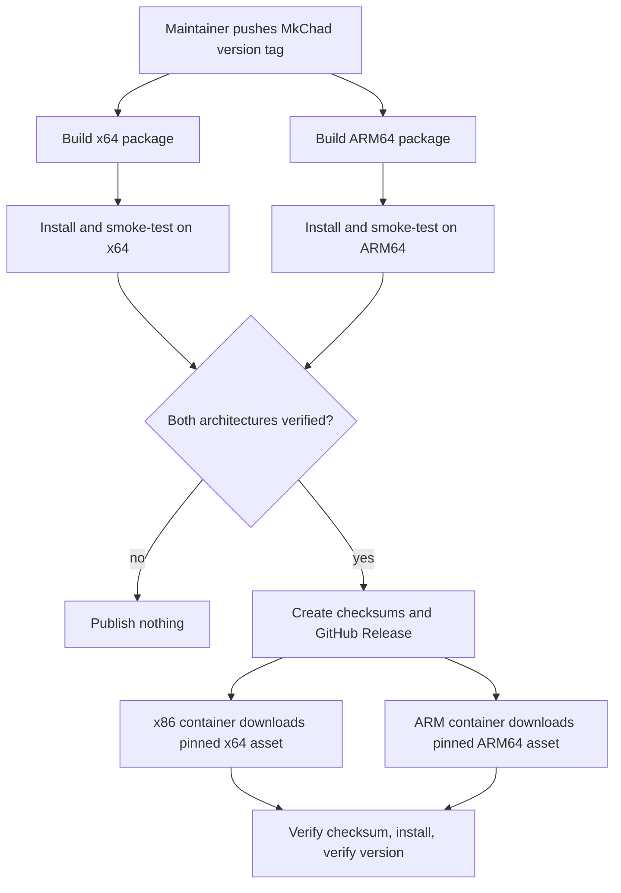
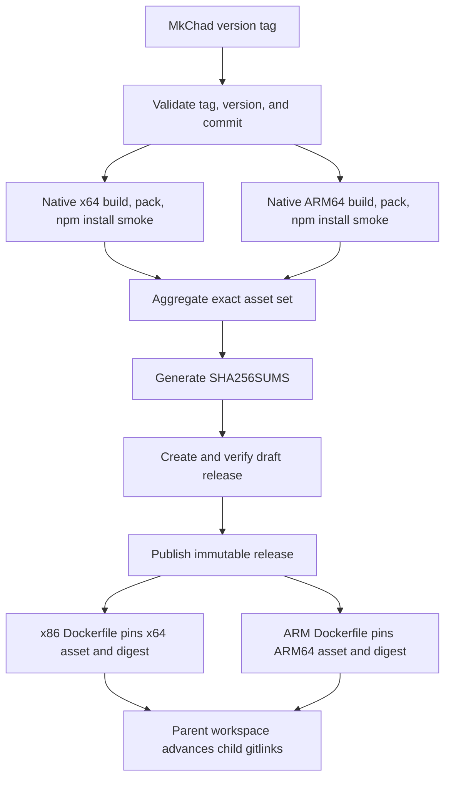

# MkChad OpenCode Release Packages - Plan

## Goal Capsule

- **Objective:** Build OpenCode once in GitHub and distribute versioned npm tarballs for MkChad's Linux x64 and ARM64 platforms.
- **Product authority:** This Product Contract governs fork release assets and their consumption by `msk_containers`; upstream release behavior remains authoritative outside the narrowed MkChad distribution path.
- **Scope:** Tag-driven GitHub Releases provide two glibc packages and checksums, and both MkChad container architectures install pinned assets instead of compiling source.
- **Open blockers:** None. GitHub's standard `ubuntu-24.04` and `ubuntu-24.04-arm` runners provide the required native execution path.

---

## Product Contract

### Summary

Create a fork-specific GitHub release path that turns each MkChad version tag into npm-installable Linux x64 and ARM64 packages.
Use those immutable release assets as the pinned OpenCode source for both MkChad container architectures.

### Problem Frame

MkChad currently compiles the OpenCode fork independently inside each container image build.
That repeats a large toolchain workload, makes distribution depend on source-build prerequisites, and leaves no reusable package for other x64 or ARM64 deployments.
The upstream release workflow already knows how to build native packages, but it is gated to the upstream repository and also publishes unrelated desktop, container, Homebrew, and AUR products under upstream-owned identities.

### Key Decisions

- **Distribute through GitHub Release assets.** (session-settled: user-directed — chosen over public npmjs and GitHub Packages: release assets avoid registry credentials and upstream package-name collisions.)
- **Support MkChad's two glibc architectures.** (session-settled: user-directed — chosen over the full Linux matrix: the immediate distribution need is Fedora-based Linux x64 and ARM64.)
- **Release from MkChad version tags.** (session-settled: user-directed — chosen over manual or every-push builds: tags provide an immutable source revision and package version.)
- **Publish direct architecture packages.** (session-settled: user-approved — chosen over a registry-style meta package: direct tarballs remain npm-installable without resolving native dependencies from a package registry.)
- **Adopt release packages in both container builds.** (session-settled: user-directed — chosen over workflow-only delivery: building once should remove repeated source compilation from x64 and ARM64 images.)
- **Fail closed on unavailable or mismatched assets.** (session-settled: user-approved — chosen over source-build fallback: a silent fallback would defeat package provenance and reproducibility.)
- **Disable self-update in MkChad builds.** (session-settled: user-directed — chosen over GitHub-release updates or upstream npm behavior: reviewed release and container pins remain the only update authority.)

### Actors

- A1. **Fork maintainer:** Selects an OpenCode revision and pushes a MkChad version tag.
- A2. **GitHub release automation:** Builds, verifies, and publishes the two packages and their checksums.
- A3. **MkChad container builder:** Downloads the package for its architecture, verifies it, and installs the `opencode` command.
- A4. **MkChad user:** Receives the same tested OpenCode version through either supported container architecture or a direct npm tarball install.

### Requirements

**Release identity and trigger**

- R1. A tag matching the MkChad OpenCode version convention must trigger one release for the exact tagged commit.
- R2. The package version and embedded `opencode --version` value must match the triggering tag after removal of the tag prefix.
- R3. A release rerun must not silently replace assets built from a different revision or version.

**Package outputs**

- R4. Each release must contain one npm-installable Linux x64 tarball and one npm-installable Linux ARM64 tarball.
- R5. Each package must expose the `opencode` executable through npm global installation and reject installation on the wrong operating-system architecture.
- R6. Each package must contain the embedded web client and the same MkChad fork behavior as the tagged source.
- R7. Release asset names must identify the package version and target architecture without requiring release-page context.
- R8. Each release must include a machine-readable SHA-256 checksum manifest covering every package asset.

**Verification and publication safety**

- R9. Each package must be installed and smoke-tested on its matching architecture before the release becomes public.
- R10. Smoke verification must prove the npm-installed command is executable and reports the expected version.
- R11. The release must remain unpublished if either architecture build, package, checksum, or smoke test fails.
- R12. Release automation must use only the permissions needed to read source, attest the tagged revision, and publish GitHub Release assets; it must not require npm registry credentials.

**Container adoption**

- R13. The x86 container must install the pinned x64 release package, and the ARM container must install the pinned ARM64 release package.
- R14. Each container build must pin the release version and expected package checksum in reviewed source.
- R15. Container builds must verify the downloaded asset before installation and verify the installed `opencode --version` afterward.
- R16. A missing asset, checksum mismatch, architecture mismatch, or version mismatch must fail the container build without compiling OpenCode from source as a fallback.
- R17. Removing source compilation must also remove the OpenCode-only Bun and source-checkout work from the container build unless another selected tool still requires it.

**Fork update boundary**

- R18. A MkChad-versioned build must perform no automatic upstream update lookup, notification, or installation.
- R19. The explicit OpenCode upgrade command in a MkChad-versioned build must refuse package-manager replacement and direct the user to the GitHub Release or managed container update path.
- R20. Non-MkChad OpenCode builds must retain their existing update behavior.

### Key Flows

- F1. **Tagged release:** A maintainer pushes a valid MkChad version tag; GitHub builds both packages from that commit, verifies each on its target architecture, generates checksums, and publishes one complete release.
- F2. **Failed architecture:** One architecture fails to build or smoke-test; GitHub reports failure and publishes no partial release.
- F3. **Container installation:** A container build downloads its pinned architecture asset, validates the reviewed checksum, installs it through npm, and verifies the expected version without a source checkout.
- F4. **Tampered or missing asset:** A package is absent or does not match the pinned checksum or version; the container build stops without fallback.

### Acceptance Examples

- AE1. **Covers R1-R12.** Given tag `v1.18.3-mkchad.6` points to an eligible fork commit, when the release workflow succeeds, then one public release contains versioned x64 and ARM64 npm tarballs plus a checksum manifest, and both installed commands report `1.18.3-mkchad.6`.
- AE2. **Covers R4-R5, R9-R11.** Given the ARM64 package is accidentally built with an x64 binary, when matching-architecture smoke verification runs, then the release fails and no partial package set is published.
- AE3. **Covers R3, R7-R8.** Given a release tag or asset already exists, when automation is rerun from inconsistent source or content, then it refuses silent replacement and reports the conflict.
- AE4. **Covers R13-R17.** Given the x86 container build pins a valid release and checksum, when it builds, then it installs the x64 package, verifies the expected version, and performs no OpenCode source compilation.
- AE5. **Covers R13-R17.** Given the ARM container build pins a valid release and checksum, when it builds, then it installs the ARM64 package, verifies the expected version, and performs no OpenCode source compilation.
- AE6. **Covers R14-R16.** Given a container's pinned checksum differs from the downloaded package, when installation begins, then the build fails before npm installation and does not clone the OpenCode source.
- AE7. **Covers R18-R20.** Given a MkChad release package is installed through npm, when startup update checks or the explicit upgrade command run, then neither queries nor installs upstream `opencode-ai`; an ordinary upstream build remains unchanged.

### Scope Boundaries

- The initial release supports Linux glibc x64 and ARM64 only; musl, non-AVX2 baseline x64, macOS, Windows, and PPC64LE packages are excluded.
- The workflow does not publish to npmjs, GitHub Packages, GHCR, Homebrew, or AUR.
- The workflow does not release desktop applications or inherit upstream's full publication pipeline.
- The package remains a MkChad fork distribution and does not claim the upstream package namespace in a public registry.
- The initial release does not implement self-update from GitHub Releases or publish build attestations; reviewed versions and SHA-256 pins are authoritative.
- Existing `1.18.3-mkchad.5` installation evidence remains valid, but the automated release path begins with a new tag that contains the workflow unless planning proves a safe backfill path.

### Dependencies And Assumptions

- GitHub's standard `ubuntu-24.04` and `ubuntu-24.04-arm` runners remain available for native package execution.
- GitHub Release assets are publicly downloadable without package-registry authentication.
- Supported containers retain npm and a compatible Node.js runtime for global tarball installation.
- The fork's existing Bun build can produce both native binaries with the embedded web client from an immutable tagged revision.
- GitHub remains the source of truth for release tags and attached package assets.

### Sources And Research

- `opencode/.github/workflows/publish.yml` contains upstream's repository-gated build and multi-product publication flow.
- `opencode/packages/opencode/script/build.ts` defines Linux x64 and ARM64 native build targets and generated native package metadata.
- `opencode/packages/opencode/script/publish.ts` defines the upstream meta-package and registry publication behavior that the fork-specific workflow must not inherit wholesale.
- `opencode/packages/opencode/script/postinstall.mjs` and `opencode/packages/opencode/bin/opencode` show how upstream registry packages resolve native dependencies; direct release tarballs intentionally avoid that registry dependency graph.
- `opencode/packages/opencode/src/installation/index.ts`, `opencode/packages/opencode/src/cli/upgrade.ts`, and `opencode/packages/opencode/src/cli/cmd/upgrade.ts` contain the upstream npm lookup and replacement paths that MkChad builds must bypass.
- `msk_containers/nvim/x86/nvim_container_x86.dockerfile` and `msk_containers/nvim/aarch64/nvim_container_aarch64.dockerfile` contain the current duplicated OpenCode source-build path.
- GitHub's hosted-runner reference documents native `ubuntu-24.04` x64 and `ubuntu-24.04-arm` ARM64 labels for public repositories: `https://docs.github.com/en/actions/reference/runners/github-hosted-runners`.
- GitHub's release guidance recommends assembling draft assets before publication, especially for immutable releases: `https://docs.github.com/en/repositories/releasing-projects-on-github/managing-releases-in-a-repository`.

---

## Planning Contract

**Product Contract preservation:** changed: R18-R20 and AE7 — planning surfaced the upstream npm self-update path, and the user confirmed that MkChad builds must disable it.

### Key Technical Decisions

- KTD1. **Use a dedicated fork workflow.** Add a MkChad-only workflow rather than relaxing repository guards or extracting pieces from upstream's multi-product publisher. This keeps npm, GHCR, desktop, Homebrew, and AUR credentials and behavior outside the release path.
- KTD2. **Build and execute natively on GitHub-hosted runners.** Use `ubuntu-24.04` for x64 and `ubuntu-24.04-arm` for ARM64 so `--single` selects the matching glibc target and the packed binary executes without emulation.
- KTD3. **Pack a direct CLI package after the existing build.** A narrow release packer rewrites the generated native manifest with the tag-derived version, `os`, `cpu`, glibc, and `bin.opencode`, then emits `opencode-ai-<version>-linux-<arch>.tgz`. It does not use the upstream optional-dependency meta-package or registry publisher.
- KTD4. **Publish all assets atomically through a draft.** Matrix jobs upload workflow artifacts; one dependent job validates the exact two-tarball set, creates `SHA256SUMS`, creates a draft release without `--clobber`, verifies its assets, and only then publishes it. A pre-existing release or draft blocks rerun until explicitly accounted for.
- KTD5. **Derive fork management from the embedded version.** MkChad update suppression keys on the existing `InstallationVersion` containing the MkChad prerelease marker, avoiding a second build identity source. Automatic and explicit upgrade paths share this predicate; ordinary builds remain unchanged.
- KTD6. **Keep reviewed checksums in each container definition.** Each architecture uses its own immutable asset URL and SHA-256 argument. The downloaded file is verified before npm installation, and the installed command must report the exact pinned version.
- KTD7. **Use checksums without attestations initially.** SHA-256 pins satisfy the current container trust and reproducibility contract without adding `id-token` or `attestations` permissions. Artifact attestations remain a later hardening option.
- KTD8. **Respect cross-repository publication order.** OpenCode packaging and update suppression land first; an explicitly authorized tag publishes release assets; `msk_containers` pins those real asset digests second; the parent workspace advances gitlinks last.

### High-Level Technical Design

The existing OpenCode build remains responsible for compilation, embedded web assets, and the binary-level version smoke test. The new packer owns only direct npm package metadata, tarball naming, content validation, and deterministic output location.
The release workflow owns tag identity, native npm-install smoke tests, artifact aggregation, checksum generation, and draft-to-public publication. Container definitions consume published artifacts only; they do not participate in release construction or fallback builds.

### Implementation Constraints

- Use the repository-pinned Bun declared in `opencode/package.json` through `opencode/.github/actions/setup-bun/action.yml`; do not download an unrelated runtime version.
- Pin third-party GitHub actions by immutable commit, matching `opencode/.github/workflows/publish.yml` conventions.
- Give build jobs `contents: read`; grant `contents: write` only to the final publication job. Do not grant `packages`, npm-token, GHCR, or attestation permissions.
- Validate the peeled tagged commit and exact tag-derived version before build work. Annotated and lightweight tags must identify the same checked-out commit contract.
- Never overwrite an existing release asset or silently adopt a pre-existing draft. Recovery requires explicit accounting and a clean rerun.
- Keep all package smoke installs in isolated runner prefixes and compare `opencode --version` exactly.
- Preserve the PPC64LE exclusion and the existing x64/ARM container parity gate.

### Sequencing And Publication

1. Implement and locally verify OpenCode package generation and fork update suppression.
2. Add and push the fork-only release workflow with package documentation.
3. At an explicit publication checkpoint, push the next MkChad tag and wait for both native jobs and the release job to succeed.
4. Download the published assets, independently verify `SHA256SUMS`, and record the x64 and ARM64 digests.
5. Replace both container source builds with their corresponding release assets, update parity tests and the package-selection ADR, then verify supported image builds where runtimes are available.
6. Commit each child repository before advancing the parent workspace gitlinks.

### Risks And Mitigations

- **Partial public release:** Only the aggregate job can create a release, and it publishes the draft after verifying all three expected assets.
- **Wrong architecture or metadata:** Native runner npm-install smoke tests and `os`/`cpu` package fields fail before publication.
- **Tag/version drift:** One validation output supplies the exact version and commit to every job; packed and installed versions must match.
- **Upstream replacement:** MkChad version detection blocks automatic and explicit upstream package upgrades.
- **Mutable or missing assets:** No-clobber publication plus reviewed container checksums makes mismatches fail closed.
- **Cross-repository deadlock:** Container changes begin only after a real release exists and its checksums are independently observed.

---

## Implementation Units

### U1. Direct MkChad npm release packer

- **Goal:** Turn one existing native build directory into a direct, architecture-restricted npm tarball with a stable asset name.
- **Requirements:** R2, R4-R8, R10
- **Files:** `opencode/packages/opencode/script/package-mkchad-release.ts`; `opencode/packages/opencode/test/script/package-mkchad-release.test.ts`; `opencode/packages/opencode/package.json` only if a script entry materially improves local and CI invocation.
- **Approach:** Keep package-manifest derivation and validation testable without compiling a binary. Accept only `linux-x64` and `linux-arm64`, require a MkChad version and expected binary, emit package name `opencode-ai`, set Linux/glibc and matching CPU metadata, expose `./bin/opencode`, and pack to `opencode-ai-<version>-linux-<arch>.tgz`.
- **Test scenarios:**
  - x64 input produces Linux/x64/glibc metadata, the expected bin mapping, and the expected asset name.
  - ARM64 input produces Linux/arm64/glibc metadata and the expected asset name.
  - Unsupported platform, unsupported architecture, malformed version, absent binary, or mismatched generated version fails before packing.
  - Packed contents contain only the package manifest and executable payload required for direct npm installation.
- **Verification:** Focused packer tests pass; a native x64 build can be packed, installed into an isolated npm prefix, and reports the supplied version.
- **Dependencies:** None.

### U2. MkChad-managed update boundary

- **Goal:** Prevent MkChad release packages from querying or replacing themselves through upstream update channels.
- **Requirements:** R18-R20
- **Files:** `opencode/packages/core/src/installation/version.ts`; `opencode/packages/opencode/src/cli/upgrade.ts`; `opencode/packages/opencode/src/cli/cmd/upgrade.ts`; `opencode/packages/opencode/test/installation/installation.test.ts`; `opencode/packages/opencode/test/cli/upgrade.test.ts` if command-level coverage cannot fit the installation suite.
- **Approach:** Derive one exported managed-distribution predicate from `InstallationVersion`. Automatic startup checks return before method or network discovery, and the explicit upgrade command exits with actionable GitHub Release/container guidance before prompting or invoking a package manager. Preserve every existing path for non-MkChad versions.
- **Test scenarios:**
  - MkChad versions match the managed predicate while upstream, local, and unrelated prerelease versions do not.
  - Automatic update flow for a MkChad version performs no registry or GitHub request and emits no upstream update event.
  - Explicit upgrade for a MkChad version invokes no package manager, including when a target or method is supplied.
  - Explicit upgrade for a MkChad version reports the GitHub Release or managed-container update path.
  - Existing npm latest-version lookup and upgrade behavior remains unchanged for ordinary builds.
- **Verification:** Focused installation and CLI tests pass with both MkChad and ordinary version fixtures; package and core typechecks pass.
- **Dependencies:** None.

### U3. Native tag release workflow

- **Goal:** Publish one complete GitHub Release containing verified x64 and ARM64 npm tarballs and `SHA256SUMS`.
- **Requirements:** R1-R12
- **Files:** `opencode/.github/workflows/mkchad-release.yml`; `opencode/README.md`; the U1/U2 files only when workflow integration exposes a verified gap.
- **Approach:** Trigger on MkChad version tags, validate exact tag/commit/version identity, run a two-entry native matrix on official GitHub-hosted runners, reuse `setup-bun`, build with `--single`, invoke U1, npm-install and execute the tarball, and upload one workflow artifact per architecture. A final job downloads the exact pair, generates sorted SHA-256 entries, creates and verifies a draft release without replacement flags, then publishes it.
- **Test scenarios:**
  - A valid tag produces matching version outputs and both native jobs consume the same tagged commit.
  - Malformed tags or a checkout/tag mismatch fail before compilation.
  - Either architecture's build, pack, npm install, or version mismatch prevents the publication job.
  - Missing, duplicate, or unexpected aggregate assets prevent draft creation.
  - A pre-existing public release or draft blocks publication rather than overwriting assets.
  - A complete draft exposes exactly two tarballs and `SHA256SUMS` before becoming public.
- **Verification:** Workflow syntax is accepted by GitHub; a first authorized tag run succeeds on `ubuntu-24.04` and `ubuntu-24.04-arm`; downloaded release assets pass checksum and exact-version verification.
- **Dependencies:** U1, U2.

### U4. First automated MkChad package release

- **Goal:** Produce the first authoritative package set and capture its immutable version, commit, asset names, and checksums for container adoption.
- **Requirements:** R1-R12
- **Files:** Git tag and GitHub Release assets; no source file is modified in this unit.
- **Approach:** After U1-U3 are committed and pushed, obtain explicit publication authorization, push the next unused MkChad tag, watch all workflow jobs to completion, download the public assets, verify `SHA256SUMS`, and retain the x64 and ARM64 digests as inputs to U5. Do not backfill `1.18.3-mkchad.5` unless the tagged commit already contains the workflow and exact package contract.
- **Test scenarios:**
  - Both release tarballs install and report the tag-derived version on their native runners.
  - Independent checksum verification of downloaded public assets matches the release manifest.
  - Release target commit equals the pushed tag's peeled commit.
  - Failure leaves no public partial release and no checksum is promoted into container source.
- **Verification:** GitHub reports all release jobs green; `gh release view` shows the exact asset set and target tag; downloaded checksums and versions match.
- **Dependencies:** U3 and explicit user authorization for tag publication.

### U5. Checksum-pinned container adoption

- **Goal:** Replace x86 and ARM64 OpenCode source builds with their corresponding release npm tarballs.
- **Requirements:** R13-R17
- **Files:** `msk_containers/nvim/x86/nvim_container_x86.dockerfile`; `msk_containers/nvim/aarch64/nvim_container_aarch64.dockerfile`; `msk_containers/tests/nvim_container_tooling_test.sh`; `msk_containers/docs/adr/002-package-selections.md`.
- **Approach:** Pin the common version plus per-architecture asset and SHA-256 values from U4. Download with failure-preserving curl options, validate the reviewed digest before npm installation, install into the existing immutable baseline, and compare the installed version exactly. Remove OpenCode-only Bun installation, source clone, revision checkout, build, and fallback behavior while retaining unrelated browser and Node tooling.
- **Test scenarios:**
  - x86 references only the x64 asset/checksum and ARM references only the ARM64 asset/checksum.
  - Both definitions share equivalent download, checksum-before-install, npm install, and exact-version verification structure.
  - Wrong or malformed checksums, missing failure flags, source-build commands, or fallback logic fail the structural test.
  - PPC64LE remains OpenCode-free.
  - Supported x86 and ARM image builds install the expected command when their container runtimes are available.
- **Verification:** `tests/nvim_container_tooling_test.sh` passes; shell lint passes where available; native or supported cross-platform image builds report the pinned OpenCode version.
- **Dependencies:** U4.

### U6. Cross-repository integration closeout

- **Goal:** Publish coherent child revisions and advance only their parent workspace gitlinks after all package and container evidence is complete.
- **Requirements:** R1-R20
- **Files:** `opencode` gitlink; `msk_containers` gitlink.
- **Approach:** Verify that the OpenCode commit and U4 release publication preceded the `msk_containers` commit, then advance the parent gitlinks without mixing unrelated parent documentation. Confirm the recorded release tag resolves to the published OpenCode child commit.
- **Test scenarios:**
  - Both child worktrees are clean and their commits are reachable from their intended remotes.
  - Parent gitlinks equal the verified child commits and no unrelated parent paths enter the integration commit.
  - Release tag, OpenCode child commit, package versions, container version pins, and checksums form one traceable chain.
- **Verification:** Child and parent Git status/diffs show only intended revisions; remote ancestry and GitHub Release target checks pass.
- **Dependencies:** U5.

---

## Verification Contract

| Gate | Command or evidence | Proves | Units |
|---|---|---|---|
| OpenCode package tests | From `opencode/packages/opencode`: `bun test test/script/package-mkchad-release.test.ts test/installation/installation.test.ts test/cli/upgrade.test.ts` with the absent optional path omitted | Direct package metadata/failure handling, MkChad update suppression, and actionable managed-update guidance | U1, U2 |
| OpenCode package typecheck | From `opencode/packages/opencode`: `bun typecheck` | Packer, installation, and CLI changes satisfy package types | U1, U2 |
| Native x64 package smoke | Build with `OPENCODE_VERSION=<version> bun run build --single --skip-install`, pack, isolated `npm install -g`, exact `opencode --version` | Embedded web build and direct npm install work on x64 | U1, U3 |
| GitHub native matrix | Successful `ubuntu-24.04` and `ubuntu-24.04-arm` jobs for the tagged commit | Each packaged binary installs and executes on its declared architecture | U3, U4 |
| Release asset audit | `gh release view <tag>` plus downloaded `sha256sum -c SHA256SUMS` and exact-version checks | Public release is complete, immutable-by-policy, and internally consistent | U4 |
| Container structural suite | From `msk_containers`: `bash tests/nvim_container_tooling_test.sh` | Architecture parity, checksum-before-install ordering, no fallback, and PPC exclusion | U5 |
| Container image smoke | Build each supported image with its repository script where Docker/Podman/Apptainer support is available, then run `opencode --version` | Published packages integrate into real x86 and ARM images | U5 |
| Full OpenCode pre-push gate | From `opencode`: `bun turbo typecheck` through the repository hook | No cross-package TypeScript regressions | U1-U3 |
| Integration audit | Git status, diff, remote ancestry, release target commit, and parent gitlink inspection | Publication and commit order preserve one traceable release chain | U6 |

Verification uses the repository-provisioned Bun described in `AGENTS.md`. ARM64 execution must occur on the native GitHub-hosted runner; a local x64-only environment cannot substitute for U3/U4's ARM gate.

---

## Definition of Done

- R1-R20 are traced to completed units and AE1-AE7 have corresponding automated or release-runtime evidence.
- `v<version>` produces exactly `opencode-ai-<version>-linux-x64.tgz`, `opencode-ai-<version>-linux-arm64.tgz`, and `SHA256SUMS` from one tagged OpenCode commit.
- Both release tarballs pass isolated npm installation and exact-version execution on native GitHub-hosted architectures before publication.
- MkChad builds perform no automatic or explicit upstream package replacement and explicit upgrade reports the GitHub Release or managed-container update path, while ordinary OpenCode builds retain existing updater behavior.
- x86 and ARM container definitions pin the same release version, their architecture-specific asset checksums, and no OpenCode source-build fallback.
- Container structural tests pass, and supported real image builds pass wherever the required runtimes are available; unavailable runtime gates are reported rather than claimed.
- OpenCode and `msk_containers` documentation describe the release source, supported architectures, checksum verification, and update boundary accurately.
- OpenCode is committed and pushed before the release tag; `msk_containers` is committed and pushed after release evidence; parent gitlinks advance last.
- No npm registry credential, package publication, GHCR push, AUR update, Homebrew update, desktop release, musl package, baseline x64 package, or artifact-attestation permission enters the implementation.
- Dead-end workflow, packaging, or fallback experiments are removed from the final diff.
