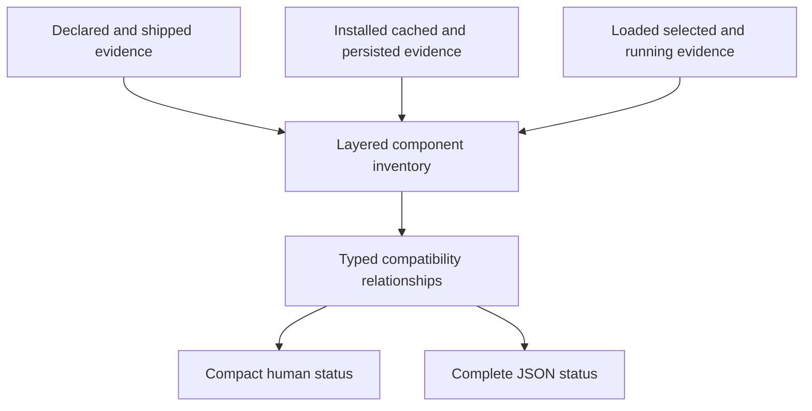
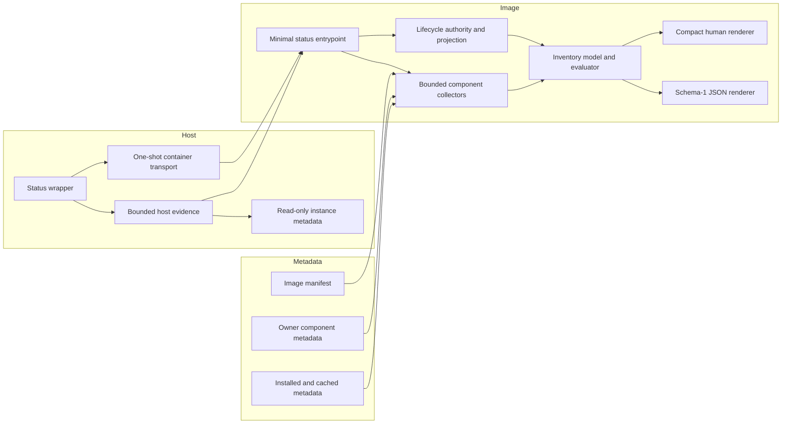

# MkChad Version Visibility Status - Plan

## Goal Capsule

- **Objective:** Expand `mkchad-opencode-server status` into the authoritative read-only view of declared, installed, cached, loaded, persisted, and running component identities across the MkChad runtime.
- **Product authority:** This contract defines inventory coverage, compatibility meaning, output behavior, and failure behavior. Planning decides how each component is discovered and how bounded evidence is collected.
- **Open blockers:** None. Unknown or unprovable identities are valid observations rather than planning blockers.

**Product Contract preservation: unchanged**

---

## Product Contract

### Summary

`mkchad-opencode-server status` will report a consolidated component inventory and evaluate version drift through component-owned compatibility contracts.
Human output stays compact, while JSON exposes the complete evidence and evaluation model for diagnostics and automation.

### Problem Frame

Version evidence is currently fragmented across lifecycle state, container identity, installed binaries, plugin metadata, caches, compatibility constants, and component-local health commands.
An operator diagnosing a mismatch must know which commands and files to inspect, whether to enter the container, and whether two unequal versions are genuinely incompatible.
Matching version labels are also insufficient for Git-installed or cached content, so version-only checks can conceal stale code.

### Key Decisions

- **Expand the existing status command.** (session-settled: user-directed -- chosen over a separate diagnostic command or Neovim-only view: operators need one authoritative shell entry point.)
- **Use typed compatibility contracts.** (session-settled: user-directed -- chosen over global exact equality or an unevaluated inventory: exact pins, supported ranges, and tested-with declarations have different meanings.)
- **Cover both persisted and live evidence.** (session-settled: user-directed -- chosen over inspecting only records or only active installations: drift is visible only when the layers can be compared.)
- **Keep human output compact and JSON complete.** (session-settled: user-directed -- chosen over an always-expanded matrix or warnings-only output: routine status must remain readable without withholding machine evidence.)
- **Represent optional components explicitly.** (session-settled: user-directed -- chosen over limiting the report to the core server stack: the inventory must distinguish installed, absent, unavailable, and not-discoverable optional components.)
- **Include immutable identity where version labels are insufficient.** (session-settled: user-directed -- chosen over version labels or Git commits alone: image and cache drift can exist under the same displayed version.)

The inventory and judgment model is:

The diagram summarizes the model; the requirements below remain authoritative.

### Actors

- A1. **MkChad operator:** Uses the shell command to diagnose the active or inactive runtime, including HPC and containerized installations.
- A2. **Automation or support consumer:** Reads JSON to collect evidence, compare environments, and identify stale or unsupported components.
- A3. **Component owner:** Declares whether a relationship means shipped-with, required, supported, tested-with, or loaded-from.

### Inventory Coverage

| Component group | Required identity coverage |
|---|---|
| MkChad configuration and lifecycle | Installed configuration identity plus relevant persisted lifecycle evidence |
| Container runtime and image | Selected image identity, baked product baseline, and persistent-instance identity |
| OpenCode | Image-shipped baseline, selected installation, persisted launch identity, and live server identity |
| `opencode.nvim` | Installed content identity, loaded identity when provable, and tested compatibility declaration |
| `opencode-project-reload` | Installed package and content identity, loaded identity when provable, and supported OpenCode contract |
| Compound Engineering | Installed package/plugin version, cache and content identity, loaded identity when provable, and tested SDK relationship |
| Sprint-loop controller | Installed package identity, status-reported controller identity, and supported OpenCode contract when discoverable |
| Sprint-loop Neovim plugin | Installed content identity and loaded identity when provable |
| Runtime prerequisites | Versions for the deployed path's container runtime, Neovim, Git, Python, Node, and curl when required by the discovered components |

### Requirements

**Inventory and evidence**

- R1. `mkchad-opencode-server status` must remain observational and must not start, stop, repair, refresh, or create lifecycle, cache, or installation state.
- R2. Status must preserve its existing lifecycle result while adding the product components and directly required runtime prerequisites listed in Inventory Coverage.
- R3. Each component must distinguish applicable declared, shipped, installed, cached, selected, loaded, persisted, and running observations rather than collapsing them into one current version.
- R4. Each observation must identify its evidence class and report semantic version, immutable identity, or both according to what the source can prove.
- R5. An unavailable, absent, unqueried, timed-out, or unprovable observation must be represented explicitly and must not be inferred from another layer.
- R6. Every named optional component must appear in the inventory with an installed, absent, unavailable, or not-discoverable state.

**Compatibility and drift**

- R7. Compatibility evaluation must use typed relationships including `ships`, `requires`, `supports`, `tested-with`, and `loaded-from`.
- R8. Each relationship must be evaluated according to the owning component's declared exact pin, range, baseline, or content identity semantics.
- R9. Unequal versions must not be labeled incompatible solely because their strings differ.
- R10. Distribution and prerelease suffixes must remain part of identity; equivalence to an upstream version must require an explicit component contract.
- R11. Matching version labels with differing immutable identities must produce a stale or mismatch warning where the evidence supports that conclusion.
- R12. Ambiguous or undocumented compatibility must produce an unknown evaluation rather than an inferred pass or failure.
- R13. Version and identity warnings must not convert an otherwise healthy lifecycle result into a lifecycle failure or change existing status exit behavior.

**Output and resilience**

- R14. Plain status output must account for every inventory component in a compact summary and expand the evidence for mismatches, unsupported relationships, stale state, and unknowns.
- R15. JSON status must expose the full component inventory, observations, typed relationships, evaluations, and bounded diagnostics regardless of whether the human view is collapsed.
- R16. Existing human fields and JSON consumers must remain usable; the expanded contract must be additive unless planning proves an incompatible schema revision is necessary.
- R17. A failed or timed-out component probe must return partial inventory, mark the affected evidence unavailable, and preserve all independently collected results.
- R18. Collection and rendering must remain bounded so optional or unhealthy components cannot stall routine lifecycle status.
- R19. Output must not expose credentials, configuration contents, private transcripts, or other secrets while reporting identity provenance.

### Key Flows

- F1. **Routine healthy inspection**
  - **Trigger:** A1 runs plain `status` while the server and discovered components agree with their contracts.
  - **Steps:** Status observes lifecycle health, gathers bounded identity evidence, evaluates typed relationships, and collapses agreeing detail.
  - **Outcome:** A1 sees the lifecycle headline and a concise component summary; A2 can obtain the complete JSON inventory.
  - **Covered by:** R1-R4, R7-R9, R14-R16, R18-R19.

- F2. **Cross-layer drift inspection**
  - **Trigger:** Installed, cached, persisted, selected, loaded, or running identities differ.
  - **Steps:** Status preserves each observation, evaluates owner-declared contracts, and explains the relationship where evidence permits.
  - **Outcome:** A1 can identify where drift occurred without treating every unequal version as incompatible.
  - **Covered by:** R3-R13, R14-R16.

- F3. **Partial or inactive inspection**
  - **Trigger:** The server is inactive, an optional component is absent, or one probe cannot complete.
  - **Steps:** Status returns all available persisted and installed evidence, marks live or failed observations explicitly, and does not create or repair state.
  - **Outcome:** A1 receives useful partial diagnostics and existing lifecycle semantics remain unchanged.
  - **Covered by:** R1-R6, R12-R19.

### Acceptance Examples

- AE1. **Healthy aligned stack**
  - **Covers R2, R3, R7, R14, R15.**
  - **Given:** All discovered observations satisfy their component-owned contracts.
  - **When:** An operator runs status.
  - **Then:** Human output shows a compact component summary and JSON includes every collected observation and successful evaluation.

- AE2. **Mounted runtime differs from running server**
  - **Covers R3, R8-R10, R14, R15.**
  - **Given:** The selected OpenCode installation differs from the persisted launch or live server identity.
  - **When:** Status evaluates the OpenCode evidence chain.
  - **Then:** It identifies the differing layers and reports drift without discarding either identity.

- AE3. **Matching CE version with stale cache content**
  - **Covers R4, R11, R14, R15.**
  - **Given:** The installed and cached CE entries share a version label but have different trustworthy content identities.
  - **When:** Status compares those observations.
  - **Then:** It warns that the cache is stale despite the matching version.

- AE4. **Distribution suffix lacks declared equivalence**
  - **Covers R8, R10, R12.**
  - **Given:** A consumer declares support for upstream `1.18.3` while the observed server reports `1.18.3-mkchad.7`, and no equivalence rule is declared.
  - **When:** Status evaluates the relationship.
  - **Then:** It reports unknown or unsupported according to the consumer's contract and never strips the suffix silently.

- AE5. **Optional controller is not installed**
  - **Covers R5, R6, R17.**
  - **Given:** The core MkChad stack is available but the sprint-loop controller is absent.
  - **When:** Status performs discovery.
  - **Then:** Core inventory remains available and the optional controller is represented as absent rather than causing failure.

- AE6. **One probe times out**
  - **Covers R5, R17, R18.**
  - **Given:** One discovered component does not answer within its bound.
  - **When:** Status completes.
  - **Then:** It returns the other evidence, marks that observation timed out, and includes a bounded diagnostic.

- AE7. **Inactive server inspection**
  - **Covers R1, R5, R13, R17.**
  - **Given:** Installed and persisted evidence exists but no OpenCode server is running.
  - **When:** Status runs.
  - **Then:** It reports inactive lifecycle state, preserves available inventory, marks running identity unavailable, and creates no state.

### Success Criteria

- An operator can answer what is declared, installed, cached, selected, loaded, persisted, and running from one command without entering the container or inspecting state files manually.
- An operator can distinguish compatible variation, unsupported relationships, stale content, and unknown evidence without treating all unequal strings as failures.
- Automation can consume a stable, complete JSON inventory while existing lifecycle-status consumers continue to work.
- Missing or unhealthy optional components reduce evidence quality without suppressing independently available diagnostics.

### Scope Boundaries

- Do not inventory every package pinned in the container image, including language servers and browser tooling that do not determine MkChad product operation.
- Do not refresh caches, reload plugins, restart services, alter container instances, or repair mismatches from `status`.
- Do not claim a currently loaded plugin or configuration identity from install or cache evidence alone.
- Do not redefine lifecycle health around version compatibility warnings.
- Do not establish a new repository-wide release-version scheme; this feature observes and evaluates existing component identities and contracts.

### Dependencies and Assumptions

- Component-owned compatibility declarations remain the authority for relationship semantics; ambiguous declarations yield unknown evaluations until clarified.
- Some active-process identities cannot be proven by an external status command and will remain unknown unless the owning process exposes trustworthy evidence.
- Immutable identity forms differ by component and may include release identity, Git commit, image digest, or bounded content digest.
- Existing command redaction, bounded-output, and observational-status guarantees continue to apply to the expanded inventory.

### Outstanding Questions

**Deferred to Planning**

- Which immutable identity is both trustworthy and affordable for each component and cache surface?
- Which component probes can reuse existing status or health contracts, and which need an additive identity surface?
- What per-probe and total time bounds preserve routine status responsiveness?
- Can the inventory remain additive under JSON schema 1, or does a schema revision provide a safer consumer contract?

### Sources and Research

- `mkchad/README.md` documents observational lifecycle status, persisted state, process-cached configuration, and existing server-version visibility.
- `mkchad/lua/mkchad/opencode/command.lua` defines current human and schema-1 JSON status output.
- `msk_containers/container_tools/ct_instance_exec.sh` defines persistent container and image filesystem identity.
- `opencode/packages/core/src/installation/version.ts` and the global health handler define OpenCode installation and live-server version evidence.
- `opencode.nvim/lua/opencode/health.lua` demonstrates installed plugin and tested-through compatibility reporting.
- `opencode-project-reload/src/version.ts` defines an exact OpenCode compatibility set.
- `opencode_sprint_loop/src/opencode_sprint_loop/status.py` exposes controller package identity in status JSON.
- `compound-engineering/AGENTS.md` documents why a matching cache version does not prove matching content.
- `compound-engineering/scripts/routing/protocol-schema.json` records CE's tested OpenCode SDK relationship.

---

## Planning Contract
### Inherited Product Decisions
These stable aliases cite the preserved Key Decisions without changing them:
| ID | Inherited decision |
|---|---|
| KTD-PC1 | Expand the existing `mkchad-opencode-server status` command. |
| KTD-PC2 | Use component-owned typed compatibility contracts. |
| KTD-PC3 | Preserve distinct persisted and live evidence layers. |
| KTD-PC4 | Keep human output compact and JSON complete. |
| KTD-PC5 | Represent every named optional component explicitly. |
| KTD-PC6 | Include immutable identity where versions cannot prove freshness. |

### Planning Decisions
| ID | Decision | Consequence |
|---|---|---|
| PTD1 | Retain top-level command schema `1` and add `inventory.schema = 1`. | Existing lifecycle fields and consumers remain additive and usable. |
| PTD2 | Keep lifecycle authority in `mkchad/lua/configs/opencode.lua` and expose a sanitized observation projection. | Inventory cannot duplicate private validation or reinterpret lifecycle health. |
| PTD3 | Separate the pure inventory model/evaluator from collectors and render both views from one validated model. | Evaluation and output are deterministic and fixture-testable. |
| PTD4 | Branch host `status` before state-creating setup and use one-shot container execution. | Status creates no instance, lock, identity record, cache, npm prefix, or lifecycle path. |
| PTD5 | Treat loaded plugin identity as `unprovable` without current owner-process attestation. | Install, cache, and persisted load history never masquerade as loaded evidence. |
| PTD6 | Add credential-free owner metadata where compatibility currently exists only in source or presentation logic. | Consumers do not parse documentation or execute plugin loaders. |
| PTD7 | Use a single monotonic status deadline with concurrent independent collectors. | Optional failures cannot serially stall lifecycle status. |
| PTD8 | Restrict discovery to fixed roots, exact package names, bounded metadata, and exact argv probes. | Status does not scan arbitrary user trees or invoke package resolution. |
| PTD9 | Make no initial `opencode/` change. | Existing health, executable, cache, and lifecycle evidence suffice; loaded plugin identity remains unprovable. |
| PTD10 | Preserve complete version strings, including prerelease and distribution suffixes. | Equivalence exists only when an owner contract explicitly declares it. |
| PTD11 | Once inventory collection begins, every completed status observation carries inventory, including `inactive`, `unhealthy`, `stopping`, and `blocked`. | Inventory omission is allowed only for invalid invocation or transport/pre-collection failure; lifecycle result and exit behavior remain unchanged. |

### Stable Vocabulary
The fixed component IDs are `mkchad`, `container-runtime`, `nvim-image`,
`opencode`, `opencode-nvim`, `opencode-project-reload`,
`compound-engineering`, `sprint-loop-controller`, `sprint-loop-nvim`,
`prereq-neovim`, `prereq-git`, `prereq-python`, `prereq-node`, and
`prereq-curl`.

Observation layers are `declared`, `shipped`, `installed`, `cached`,
`selected`, `loaded`, `persisted`, and `running`. Observation states are
`present`, `absent`, `not_applicable`, `unavailable`, `not_discoverable`,
`unqueried`, `timed_out`, and `unprovable`.

- `absent`: all applicable allowlisted locations were checked and no component exists.
- `not_applicable`: the source does not apply to the discovered deployment path.
- `not_discoverable`: this invocation has no safe locator for the evidence.
- `unavailable`: a known source could not be safely read or validated.
- `unqueried`: an applicable source was not started before the shared deadline expired.
- `timed_out`: a started bounded probe exceeded its deadline.
- `unprovable`: nearby evidence cannot prove the requested layer.

Relationship types are `ships`, `requires`, `supports`, `tested-with`, and
`loaded-from`. Evaluation results are `satisfied`, `unsupported`, `stale`,
`mismatch`, `unknown`, and `not_applicable`.

### Compatibility Rules
| Relationship | Owner rule | Evaluation rule |
|---|---|---|
| `ships` | Producer exact version, build identity, or checksum | Match is `satisfied`, contradictory comparable evidence is `mismatch`, and missing evidence is `unknown`. |
| `requires` | Requiring component exact pin or range | In-contract is `satisfied`, outside is `unsupported`, and malformed/incomparable is `unknown`. |
| `supports` | Consumer exact set or range | Apply the complete version and only declared suffix equivalence. |
| `tested-with` | Consumer tested baseline | Match is `satisfied`; outside the tested matrix is `unknown`, not automatically unsupported. |
| `loaded-from` | Loader/cache owner identity profile | Equal identities satisfy; equal versions with distinct comparable identities are stale; incomparable evidence is unknown. |

Runtime-enforced declarations outrank looser package metadata, but both remain
visible and disagreement produces a bounded diagnostic.

### Identity and Owner Metadata
| Surface | Evidence contract |
|---|---|
| MkChad configuration | Safely resolved Git commit plus dirty qualification; non-Git installs remain valid versionless evidence. |
| Container runtime | Bounded version and executable identity when safely available. |
| Selected image | Image build ID plus canonical `host-file-stat-v1` identity; file-stat identity is not called a cryptographic image digest. |
| Persisted image instance | Existing safe instance name and `host-file-stat-v1` identity, read without rewrite. |
| OpenCode | Image manifest baseline/checksum, selected executable version/identity, validated persisted launch, and live health version as separate layers. |
| Git-installed Neovim plugins | Git commit plus dirty qualification; loaded identity remains unprovable without attestation. |
| Project reload | Package version, support contract, and `opencode-project-reload-tui-v1` digest of its packaged runtime artifact. |
| Compound Engineering | Package/plugin version, tested SDK, and `compound-engineering-plugin-v1` bounded tree digest. |
| Sprint-loop controller | Package/controller version, supported OpenCode contract, and identity profile when the owner supplies one. |
| Prerequisites | Exact bounded version output only when required by the discovered deployment path. |

`host-file-stat-v1` is the exact `LC_ALL=C` GNU stat tuple
`%d:%i:%s:%y:%z` for a resolved regular host file; the path is not part of the
reported value. For images it matches the identity already persisted by
`ct_instance_exec.sh`. It is a bounded local replacement detector, not a
content hash or cryptographic image digest. Persisted values must match that
grammar and are read without rewriting legacy records.

Owner digest profiles cap regular files, total bytes, per-file bytes, and
elapsed time. They sort canonical relative ASCII paths and frame path length,
path bytes, content length, and content bytes before SHA-256. Unsafe files,
limit overflow, or changed-during-read evidence yields `unprovable` or
`unavailable`, never a best-effort digest.

Serialized owner metadata is bounded schema-versioned JSON. MkChad's internal
`contracts.lua` is the one format exception: it exposes the same validated
logical fields as a Lua module so plugin declaration and inventory can consume
one reviewed revision without parsing serialized content.

Owner JSON schema `1` has these normative fields and bounds:

| Field | Contract |
|---|---|
| `schema` | Required integer `1`. |
| `component_id` | Required fixed component ID from Stable Vocabulary, at most 64 bytes. |
| `component_version` | Optional complete version string, at most 128 bytes. |
| `relationships` | Required array of at most eight declarations for `nvim-image` and at most four for every other owner. |
| `relationships[].id` | Required owner-stable ASCII ID, unique within the artifact, at most 64 bytes. |
| `relationships[].type` | One of `ships`, `requires`, `supports`, or `tested-with`; `loaded-from` is emitted by the inventory from identity evidence rather than asserted by package metadata. |
| `relationships[].target_component` | Required fixed component ID. |
| `relationships[].contract` | Required object with `kind`, its kind-specific value, and suffix policy for version-bearing kinds. |
| `identity_profile` | Optional object naming a supported profile and its exact limits/framing. |

Contract `kind` is one of `exact`, `exact-set`, `range`, `tested-baseline`, or
`identity`. `exact` and `tested-baseline` carry one complete `version`;
`exact-set` carries one to four unique complete `versions`; `range` carries one
to eight structured clauses, each with a required complete `min_inclusive` and
optional complete `max_exclusive`; and `identity` carries one named profile.
Range clauses are ORed, their bounds use numeric SemVer precedence only after
the suffix policy has accepted the complete observed string, and no
owner-specific expression language is accepted. Every version-bearing contract carries
`suffix_policy` equal to `literal` or `explicit-equivalence`. The latter also
carries at most four exact `equivalences`, each with one `observed` string and one
`equivalent_to` string; no pattern or implicit suffix stripping is allowed.

Each normalized relationship encodes to at most 768 bytes. The owner-specific
relationship limits cap the complete inventory at 28 owner declarations, below
the output contract's 32-relationship limit; U1 may add at most four fixed
`loaded-from` relationships for the plugin/cache identity chains, reaching 32
total. An identity profile names its
profile ID, `sha256`, included roots, exclusions,
maximum regular-file count, maximum total bytes, maximum per-file bytes,
maximum elapsed milliseconds, and the framing ID described above. Owner
artifacts are at most 16 KiB decoded; arrays reject duplicates; all strings are
UTF-8 without control characters and obey their field bounds. Unknown fields
are tolerated. Duplicate keys, unsupported schema, unknown enum values,
malformed required fields, or exceeded limits make only that artifact
unavailable. Each owner unit tests a valid canonical fixture and malformed,
duplicate, oversized, suffix-policy, and unknown-field fixtures; U1 repeats the
same fixtures against the consumer validator.

| Owner | Parent-workspace-relative artifact | Synchronization rule |
|---|---|---|
| MkChad | `mkchad/lua/mkchad/opencode/contracts.lua` | The plugin declaration and inventory consume one reviewed revision. |
| Container image | `msk_containers/nvim/component-manifest.json` build source | Both supported image builds derive metadata from reviewed install inputs. |
| `opencode.nvim` | `opencode.nvim/opencode-component.json` | Health consumes the same tested-with declaration. |
| Project reload | `opencode-project-reload/opencode-component.json` | Runtime support, package metadata, and packaged artifact remain in parity. |
| Sprint loop | `opencode_sprint_loop/src/opencode_sprint_loop/component.json` | CLI, validators, preflight, package data, and durable docs share one contract. |
| Compound Engineering | `compound-engineering/component.json` | Package/plugin metadata, routing protocol, and digest profile remain in parity. |

### Controller Component-Info Contract
`sprint-loop component-info --json` is a credential-free, no-sprint-root
interface. It reads packaged component metadata only, performs no server,
repository, state, event-log, cache, credential, or network access, and creates
no files or directories.

Schema `1` emits exactly one JSON document on standard output with these
minimum stable fields:
| Field | Contract |
|---|---|
| `schema` | Integer `1`. |
| `component_id` | Exact string `sprint-loop-controller`. |
| `controller_version` | Complete installed controller version. |
| `supported_opencode` | Owner contract with relationship kind, complete range/set, and explicit suffix policy. |
| `identity_profile` | Present when packaged metadata declares an identity profile; otherwise omitted rather than invented. |

Success writes no other standard-output bytes. Diagnostics and errors are
bounded, redacted, and written separately. Missing, duplicate, oversized,
unsupported-schema, or malformed packaged metadata fails nonzero and emits no
partial success document. Existing `status --json` remains unchanged and may
be collected separately only when a valid sprint root is already discoverable.

### Inventory Output Contract
The existing successful schema-1 status envelope retains `schema`, `ok`,
`command`, `status`, `state`, and lifecycle `diagnostic`. Its additive
`inventory` contains schema, completeness, ordered components, observations,
typed relationships, bounded diagnostics, and summary counts.

Each observation carries stable ID, layer, terminal state, evidence class,
optional complete version, optional typed immutable identity, and diagnostic
IDs. Provenance uses stable enums rather than raw paths. Each relationship
carries stable ID, type, owner, source/target observation IDs, normalized owner
contract, evaluation result, and diagnostic IDs.

The fixed limits are 14 components, 48 observations, 32 relationships, and 24
diagnostics. Versions and identity values are at most 128 bytes, labels 64
bytes, diagnostic codes 64 bytes, and diagnostic messages 256 bytes. Encoded
command output remains below 60 KiB. `complete` means every applicable slot
reached a terminal evidence state; source failure, timeout, unsafe evidence,
not-discoverable applicable evidence, or deadline skip makes it `partial`.

Human output retains lifecycle lines first, then one component summary.
Agreeing components are grouped by terminal disposition in deterministic ID
order so every component is accounted for without one routine row per healthy
component. Warnings, unknowns, timeouts, and unsafe evidence receive individual
lines and expand with stable IDs linking details to JSON. Expected optional
absence is not a compatibility warning.

The component summary visibly labels `complete` or `partial`. `present`,
`not_applicable`, satisfied relationships, expected optional `absent`, and
policy-expected loaded `unprovable` observations remain in compact grouped
lines; optional absence is labeled as optional and intentional unattestability
is labeled `not attested`. `unavailable`, `not_discoverable`, `unqueried`, `timed_out`,
unsafe evidence, `stale`, `mismatch`, and `unsupported` expand with stable
diagnostic IDs. An `unknown` evaluation also expands, but an unknown caused
only by an explicitly unattestable loaded slot is informational rather than a
compatibility warning. Only source failure, timeout, unsafe evidence,
not-discoverable applicable evidence, or deadline-skipped `unqueried` evidence
makes the inventory `partial`; `not_applicable`, expected `absent`, and a
terminal `unprovable` slot do not.

---

## High-Level Technical Design
### Architecture

The host observes runtime, selected-image, and existing safe instance evidence.
It neither evaluates compatibility nor authors final output. The in-image
command validates transported evidence, coordinates lifecycle and component
collection, evaluates contracts, and renders both views.

### Collection Lifecycle
Invalid invocation is rejected before transport. A transport or bootstrap
failure before in-image collection begins preserves current failure output and
may omit inventory. Once collection begins, lifecycle observation and static,
installed, cached, selected, and prerequisite collection proceed independently.
Every completed status result then includes inventory, even when lifecycle is
inactive, unhealthy, stopping, or blocked. Warnings never alter lifecycle
status, diagnostic authority, or exit behavior.

Host `status` performs no directory creation, installation, refresh, persistent
instance execution, or metadata write. Mutating lifecycle commands retain their
current persistent-instance transport. Host evidence crosses the boundary only
as bounded validated scalar fields; raw paths and stderr are never rendered.

### Host-Evidence Transport Contract
The host wrapper reuses the installed `ct_exec.sh` foreground executor and
invokes the image command as `mkchad-opencode-server-image status [--json]
--host-evidence-v1 <base64url-json>`. The payload is canonical UTF-8 JSON,
base64url without padding, at most 4 KiB decoded and 6 KiB encoded. It has
required integer `schema: 1` and exactly these optional evidence objects:

| Object | Allowed fields |
|---|---|
| `container_runtime` | `state`, runtime `family`, complete `version`, and optional paired `executable_identity_kind: host-file-stat-v1` plus `executable_identity`. |
| `selected_image` | `state`, `identity_kind: host-file-stat-v1`, and bounded identity value. |
| `persisted_instance` | `state`, optional safe instance label, `identity_kind: host-file-stat-v1`, and bounded identity value read from existing metadata. |

Each object state is `present`, `absent`, `unavailable`, or
`not_discoverable`; family is an allowlisted runtime enum; labels are at most
64 bytes; and version/identity values are at most 128 bytes. The payload
contains no paths, environment values, stderr, or arbitrary diagnostic text.
Every object requires `state`. A `present` runtime additionally requires
`family` and `version`; its executable identity pair is optional but atomic. A `present`
selected image requires the fixed identity kind and identity value. A
`present` persisted instance requires the fixed identity kind and identity
value and may carry the safe label. Every non-`present` object forbids all
fields other than `state`, so failed evidence cannot be mistaken for a partial
identity.
Unknown fields, duplicate keys, malformed encoding, unsupported schema,
invalid UTF-8/control bytes, or exceeded bounds make all transported host
observations `unavailable` with one stable diagnostic while lifecycle
collection continues. A direct in-image invocation that omits the option marks
the host-only slots `not_discoverable`. Repeated transport options are invalid.
Tests cover canonical round-trip, omission, every malformed class, process-list
visibility containing no secrets, and preservation of independent image-side
evidence.

### Collector and Safety Boundary
Collectors may read fixed owner/package manifests, fixed MkChad and Lazy roots,
exact known packages in the mounted npm prefix, and at most 64 package roots in
the allowlisted OpenCode cache. They may run exact bounded version or
component-info probes, calculate owner-profile digests, and consume the
sanitized lifecycle projection.

Collectors do not load user configuration or plugins, execute hooks, install or
resolve packages, parse presentation text, scan arbitrary home trees, or read
credentials, prompts, sessions, transcripts, or unrelated cache entries.
User-owned evidence is accepted only beneath allowlisted roots after type,
ownership, symlink, size, entry-count, and changed-during-read checks.

All subprocess probes use exact argv without a shell, closed standard input and
extra file descriptors, a fixed safe working directory, a minimal allowlisted
environment, and HOME/XDG/config paths set to an image-owned read-only empty
root or a nonexistent path without creating either. Tests substitute isolated
paths beneath `TASK_ROOT`. Every probe runs in a new process group subject to
bounded TERM-to-KILL cleanup. Git probes disable
system/global configuration, hooks, and optional locks. A probe executable must
come from an image-owned path or a source-specific owner/mode-validated fixed
installation path; cache content is never executed. Only allowlisted stdout
formats are parsed, and raw stdout/stderr, metadata fragments, control bytes,
and invalid UTF-8 never enter diagnostics.

Evidence readers define expected ownership per source: image-owned manifests
and executables must not be writable by the invoking user; host-selected image
and instance metadata must match the invoking user or trusted system owner; and
user package/cache evidence must match the invoking effective user. Every
ancestor from the allowlisted root and the leaf is checked without accepting
symlinks or special files, except the canonical managed `neovim.sif` selector.
That one link must pass the installer's `safe_link_target` confinement pattern;
the link and its resolved regular-file target beneath the trusted container
directory are validated separately. Readers compare opened-object type, owner, device,
inode, link count, size, and timestamps before and after bounded reads; a
rename, replacement, hard link, ownership/mode mismatch, or changed object
invalidates only that evidence. This is same-user disclosure hardening, not a
claim to resist a hostile process with equivalent discretionary access.

### Timing and Availability
- Host evidence has a combined 2-second pre-transport budget.
- The whole host status path has a 39-second monotonic deadline.
- Lifecycle observation retains its existing 30-second authority.
- Each optional external probe gets at most 2 seconds and the concurrent collector phase at most 4 seconds.
- In-image output completes within the existing 35-second allowance.
- Timeout termination uses existing bounded TERM-to-KILL behavior.
- A timeout degrades only affected evidence and cannot suppress the inventory or change lifecycle exit behavior.

### Discovery Summary
| Component | Fixed evidence sources |
|---|---|
| MkChad | Configuration Git identity, declared plugin revision, sanitized lifecycle projection. |
| Runtime/image | Host runtime, selected image identity, image manifest, existing safe instance record. |
| OpenCode | Shipped manifest/executable, selected executable, persisted launch, live health. |
| `opencode.nvim` | Declared revision, fixed Lazy checkout, owner metadata; loaded is unprovable. |
| Project reload | Fixed npm prefix, bounded package cache, owner metadata, persisted load history; loaded is unprovable. |
| Compound Engineering | Fixed npm/cache locations, package/plugin metadata, owner-profile digest; loaded is unprovable. |
| Sprint loop | Controller version and component-info; ordinary status only with a discovered valid root; plugin checkout identity. |
| Prerequisites | Exact version probes only when required by the deployed/discovered path. |

---

## Implementation Units
### U1. MkChad Inventory Model and Status Integration
**Goal:** Implement the authoritative layered model, bounded collectors,
compatibility evaluation, and additive human/JSON status in MkChad.
**Requirements:** R1-R19, F1-F3, AE1-AE7. Implements KTD-PC1 through KTD-PC6
through PTD1-PTD3, PTD5, PTD7-PTD11.
**Dependencies:** U2-U6 owner contracts and image evidence; retain useful
`unavailable` evidence while those surfaces are absent during incremental work.
**Files:**
- `mkchad/lua/configs/opencode.lua`
- `mkchad/lua/mkchad/opencode/lifecycle.lua`
- `mkchad/lua/mkchad/opencode/command.lua`
- `mkchad/lua/mkchad/opencode/contracts.lua`
- `mkchad/lua/mkchad/opencode/inventory.lua`
- `mkchad/lua/mkchad/opencode/inventory_collectors.lua`
- `mkchad/lua/plugins/init.lua`
- `mkchad/tests/opencode_inventory_spec.lua`
- `mkchad/tests/opencode_inventory_collectors_spec.lua`
- `mkchad/tests/opencode_standalone_command_spec.lua`
- `mkchad/tests/opencode_command_adapter_spec.lua`
- `mkchad/tests/opencode_subprocess_spec.py`
- `mkchad/tests/opencode_disclosure_spec.py`
- `mkchad/README.md`
**Approach:** Build a pure validated inventory and evaluator, then connect fixed
collectors and a sanitized lifecycle projection. Start lifecycle and inventory
collection independently, preserve fixed observation slots, evaluate only owner
contracts, and render both views from one model. Keep declared `opencode.nvim`
revision canonical between plugin configuration and inventory.
**Patterns to follow:** Pure table-driven transformations, stable IDs,
dependency-injected collectors, additive schema evolution, fixed roots,
bounded subprocesses, and existing lifecycle validation/redaction.
**Test scenarios:**
- **Happy:** Complete aligned inventory renders compact human output and full deterministic JSON with exact/range/tested-with relationships.
- **Edge:** Compatible unequal versions, suffixes with explicit equivalence, optional absence, legacy image metadata, and unprovable loaded plugins retain correct states.
- **Failure:** Timeouts, unsafe cache entries, malformed/oversized metadata, duplicate IDs, changed-during-read files, maximal schema-valid owner artifacts, and simultaneous failures yield bounded partial inventory without disclosure and remain below the output cap.
- **Integration:** Healthy, inactive, unhealthy, stopping, and blocked completed status results all carry inventory with unchanged lifecycle result and exit behavior; selected/persisted/running OpenCode drift is visible.
**Verification:** Run the U1 focused MkChad gates and full lifecycle, adapter,
subprocess, disclosure, formatting, and isolated-environment gates in the
Verification Contract. MkChad owns the assertion that equal CE versions with
distinct valid owner-profile digests evaluate as `stale`.
### U2. `opencode.nvim` Owner Metadata
**Goal:** Make the tested OpenCode relationship machine-readable and shared by
health output and external inventory without loading the plugin during status.
**Requirements:** R4, R7-R10, R12, R15, R19, AE1, AE4. Implements KTD-PC2,
KTD-PC4, and KTD-PC6 through PTD5, PTD6, and PTD10.
**Dependencies:** None; U1 consumes the resulting artifact.
**Files:**
- `opencode.nvim/opencode-component.json`
- `opencode.nvim/lua/opencode/health.lua`
- `opencode.nvim/tests/compatibility_spec.lua`
- `opencode.nvim/README.md`
**Approach:** Declare schema, component ID, tested baseline, and suffix policy in
one owner artifact. Make health validate and present that contract while
preserving current health behavior and documenting tested-with versus support.
**Patterns to follow:** Owner-owned bounded JSON, fail-closed validation,
presentation over shared metadata, and no process-loaded identity claim.
**Test scenarios:**
- **Happy:** Valid metadata and health agree on component ID and tested baseline.
- **Edge:** Newer same-major and explicitly treated suffix versions remain tested-matrix judgments rather than invented support.
- **Failure:** Missing, malformed, oversized, or unsupported-schema metadata produces a bounded health diagnostic.
- **Integration:** U1 reads the artifact from the installed checkout without loading plugin code and reports loaded identity as unprovable.
**Verification:** Run the `opencode.nvim` compatibility, security, SSE,
formatting, and type-check gates; documentation must match the owner artifact.
### U3. Project Reload Support and Content Metadata
**Goal:** Package project reload's exact OpenCode support contract and
comparable runtime content identity with the shipped TUI artifact.
**Requirements:** R4, R6-R12, R15, R19, AE4. Implements KTD-PC2,
KTD-PC5, and KTD-PC6 through PTD5, PTD6, and PTD10.
**Dependencies:** None; U1 consumes installed and cached copies.
**Files:**
- `opencode-project-reload/opencode-component.json`
- `opencode-project-reload/src/version.ts`
- `opencode-project-reload/package.json`
- `opencode-project-reload/test/package.test.ts`
- `opencode-project-reload/test/reload.test.ts`
- `opencode-project-reload/test/build.ts`
- `opencode-project-reload/dist/tui.js`
- `opencode-project-reload/README.md`
**Approach:** Keep one exact support set in parity with runtime enforcement and
package metadata. Package owner metadata and define the
`opencode-project-reload-tui-v1` artifact digest without weakening existing
rejection or loaded-state semantics.
**Patterns to follow:** Canonical owner data, exact support, reproducible
packaging, complete version strings, and metadata inspection without import.
**Test scenarios:**
- **Happy:** Supported versions pass and package contents include matching metadata and reproducible runtime identity.
- **Edge:** Prerelease and MkChad-suffixed versions pass only when explicitly present in the exact owner set.
- **Failure:** Malformed metadata cannot weaken runtime checks; unsupported versions fail before disposal.
- **Integration:** U1 compares installed/cache copies only under the same profile and keeps persisted load history separate from loaded identity.
**Verification:** Run type checking, deterministic tests, build/package tests,
package preview, and available opt-in compatibility gates listed below.
### U4. Sprint-Loop Component Metadata and Identity Surface
**Goal:** Consolidate controller compatibility and expose package identity
through `sprint-loop component-info --json` without a sprint root or state.
**Requirements:** R1, R4-R10, R12, R15, R17-R19, AE4-AE7. Implements
KTD-PC2, KTD-PC5, and KTD-PC6 through PTD6, PTD8, PTD10, and PTD11.
**Dependencies:** The durable controller specification remains authoritative;
no sprint selection is needed or inferred for component-info.
**Files:**
- `opencode_sprint_loop/src/opencode_sprint_loop/component.json`
- `opencode_sprint_loop/src/opencode_sprint_loop/__init__.py`
- `opencode_sprint_loop/src/opencode_sprint_loop/cli.py`
- `opencode_sprint_loop/src/opencode_sprint_loop/state.py`
- `opencode_sprint_loop/src/opencode_sprint_loop/events.py`
- `opencode_sprint_loop/src/opencode_sprint_loop/opencode_runner.py`
- `opencode_sprint_loop/src/opencode_sprint_loop/status.py`
- `opencode_sprint_loop/pyproject.toml`
- `opencode_sprint_loop/tests/unit/test_component_info.py`
- `opencode_sprint_loop/tests/unit/test_state_contract.py`
- `opencode_sprint_loop/tests/unit/test_opencode_execution.py`
- `opencode_sprint_loop/tests/integration/test_foundation.py`
- `opencode_sprint_loop/scripts/wheel_smoke.py`
- `opencode_sprint_loop/docs/v1_final_software_specification.md`
- `opencode_sprint_loop/README.md`
**Approach:** Package one schema-1 owner artifact and make version recognizers
consume or mechanically validate it. Add the exact component-info contract from
Planning Contract while preserving ordinary status and controller version.
**Patterns to follow:** Packaged resource metadata, one-document JSON,
standard-output purity, bounded stderr, no-root read-only CLI, and fail-closed
metadata validation.
**Test scenarios:**
- **Happy:** With no sprint root and isolated empty HOME/XDG paths, component-info emits exactly one credential-free schema-1 document with all required fields and creates no state.
- **Edge:** Optional identity profile is emitted only when declared; complete suffix policy and range strings survive round-trip; wheel install works outside the checkout.
- **Failure:** Missing, duplicate, oversized, malformed, or unsupported-schema metadata exits nonzero, emits no partial JSON, and leaves unrelated CLI commands usable.
- **Integration:** Package version, controller version, metadata, recognizers, preflight, README, specification, and ordinary status remain in parity; U1 can collect component-info without a sprint root.
**Verification:** Run
`python3 -m unittest tests.unit.test_component_info -v` as the exact focused
component-info gate, then the complete controller suite, lint, formatting,
typing, build, and clean-wheel smoke in the Verification Contract.
### U5. Compound Engineering Identity Contract
**Goal:** Make equal-version installed/cache comparisons trustworthy and expose
CE's tested OpenCode SDK relationship through owner metadata.
**Requirements:** R4, R8, R11-R12, R15, R17-R19, AE3, AE6. Implements
KTD-PC2 and KTD-PC6 through PTD6, PTD8, and PTD10.
**Dependencies:** U1 owns stale evaluation; this unit supplies comparable valid
digests and metadata without changing release-owned versions.
**Files:**
- `compound-engineering/component.json`
- `compound-engineering/package.json`
- `compound-engineering/.claude-plugin/plugin.json`
- `compound-engineering/.github/release-please-config.json`
- `compound-engineering/scripts/routing/protocol-schema.json`
- `compound-engineering/scripts/release/validate.ts`
- `compound-engineering/tests/component-identity.test.ts`
- `compound-engineering/tests/routing-assets-parity.test.ts`
- `compound-engineering/tests/release-metadata.test.ts`
- `compound-engineering/README.md`
**Approach:** Define `compound-engineering-plugin-v1` included roots,
exclusions, bounds, and hash framing. Keep tested SDK metadata in parity and
validate that runtime-affecting plugin inputs are covered while dependencies,
VCS data, generated scratch, and runtime state are excluded. Add
`component.json`'s `component_version` to the root release component's
release-please JSON extra-files so automated releases retain package/plugin
parity without manual version changes.
**Patterns to follow:** Owner-defined deterministic tree identity, mechanical
release parity, no cache mutation, and no manual release-version bump.
**Test scenarios:**
- **Happy:** Traversal order and timestamp differences retain one digest; package/plugin/component, release-please extra-files, and tested SDK metadata remain aligned.
- **Edge:** Content edits, additions, removals, and renames change identity while excluded non-runtime paths do not.
- **Failure:** Symlinks, special files, oversized files, excessive entries, and changed-during-read files cannot produce valid identities.
- **Integration:** Two equal-version fixtures with different covered content produce distinct valid owner-profile digests; U1 separately proves those observations evaluate as stale.
**Verification:** Use the resolved `BUN` executable directly for focused
identity tests, the full deterministic suite, release validation, and
conditional plugin schema validation in the Verification Contract.
### U6. Image Manifest and Nonpersistent Host Status
**Goal:** Supply image, host runtime, and persisted-instance evidence while
making `status` observational from first use through existing instances.
**Requirements:** R1-R8, R13-R19, F1, F3, AE5-AE7. Implements KTD-PC1,
KTD-PC3, KTD-PC4, and KTD-PC6 through PTD4, PTD7-PTD9, and PTD11.
**Dependencies:** U1 consumes the validated host evidence and image manifest;
no initial `opencode/` modification is planned.
**Files:**
- `msk_containers/nvim/x86/nvim_container_x86.dockerfile`
- `msk_containers/nvim/x86/nvim_container_x86_build_docker.sh`
- `msk_containers/nvim/aarch64/nvim_container_aarch64.dockerfile`
- `msk_containers/nvim/aarch64/nvim_container_aarch64_build_docker.sh`
- `msk_containers/nvim/bin/mkchad-opencode-server`
- `msk_containers/nvim/bin/mkchad-opencode-server-image`
- `msk_containers/nvim/bin/mkchad-status-host-evidence`
- `msk_containers/nvim/component-manifest.json`
- `msk_containers/bin/install_nvim.sh`
- `msk_containers/tests/nvim_container_tooling_test.sh`
- `msk_containers/tests/opencode_server_wrapper_test.sh`
- `msk_containers/tests/opencode_server_runtime_test.sh`
- `msk_containers/README.md`
**Approach:** Generate the installed image manifest from the same reviewed x86
and ARM64 build inputs used for OpenCode and prerequisites, including
schema-valid `ships` declarations for every covered baked baseline. Change both
architecture build scripts to use `nvim/` as their shared Docker context with
architecture-qualified Dockerfile paths. Collect bounded host runtime,
selected-image, and safe existing-instance evidence, then route status through
the already-installed `ct_exec.sh` foreground executor before any
state-creating setup. Preserve persistent transport for lifecycle-mutating
commands and keep PPC64LE limitations explicit.
**Patterns to follow:** Build-derived metadata, architecture parity, validated
scalar handoff, one-shot read-only transport, legacy-image partial evidence,
and no host-authored final JSON.
**Test scenarios:**
- **Happy:** Both supported images expose aligned manifests with typed `ships` contracts, and wrapper fixtures deliver selected, shipped, persisted, and runtime host evidence without mutation.
- **Edge:** Wrapper fixtures cover the canonical confined `neovim.sif` selector, legacy manifest absence, image rotation, inactive service, and unavailable optional probes; U1 owns final inventory rendering for those transported states.
- **Failure:** Malformed/oversized host evidence, unsafe instance roots, symlinks, wrong ownership, ambiguity, and timeout degrade only affected evidence.
- **Integration:** Clean-home wrapper status creates no runtime/cache/npm/instance/lock/identity/lifecycle paths; existing metadata bytes and timestamps remain unchanged; start/stop/clear/kill keep existing transport. U1 integration tests own end-to-end inventory presence and rendering after U6 evidence is available.
**Verification:** Run shell syntax and ShellCheck including
`msk_containers/bin/install_nvim.sh`, deterministic tooling/wrapper tests, and
the opt-in real runtime matrix when its reviewed prerequisites are available.

---

## Verification Contract
`TASK_ROOT` must be a fresh task-specific path beneath the workspace-approved
temporary root. Every gate isolates HOME and all XDG paths beneath it and must
not read or mutate live MkChad state, credentials, sessions, or unrelated
caches. Commands are run from the named child repository unless stated.

All Bun gates first set
`BUN=/tmp/opencode-mkchad/bun-runtime/node_modules/.bin/bun` and invoke that
executable directly. If it is unavailable, check `bun` on PATH once and set
`BUN` to that resolved executable; if neither exists, report the gate
unavailable and never install, download, or substitute another runtime.
Tool-specific optional gates follow the same report-unavailable rule.

### MkChad Gates
| Gate | Command |
|---|---|
| Pure inventory | `nvim --headless -u NONE -l tests/opencode_inventory_spec.lua` |
| Collectors | `nvim --headless -u NONE -l tests/opencode_inventory_collectors_spec.lua` |
| Standalone status | `nvim --headless -u NONE -l tests/opencode_standalone_command_spec.lua` |
| Adapter compatibility | `nvim --headless -u NONE -l tests/opencode_command_adapter_spec.lua lua/configs/opencode.lua` |
| Lifecycle regression | `nvim --headless -u NONE -l tests/opencode_lifecycle_spec.lua lua/configs/opencode.lua` |
| State validation | `nvim --headless -u NONE -l tests/opencode_state_validation_spec.lua lua/configs/opencode.lua` |
| Subprocess bounds | `MKCHAD_TEST_ROOT="$TASK_ROOT/subprocess" python3 tests/opencode_subprocess_spec.py` |
| Disclosure bounds | `MKCHAD_TEST_ROOT="$TASK_ROOT/disclosure" python3 tests/opencode_disclosure_spec.py` |
| Formatting | `stylua --check lua/configs/opencode.lua lua/mkchad/opencode tests` |

Fixtures explicitly cover healthy, inactive, unhealthy, stopping, and blocked
completed observations with inventory present and lifecycle exits unchanged;
only invalid invocation and transport/pre-collection failure may omit it.

### Container Gates
| Gate | Command |
|---|---|
| Shell syntax | `bash -n nvim/x86/nvim_container_x86_build_docker.sh nvim/aarch64/nvim_container_aarch64_build_docker.sh nvim/bin/mkchad-opencode-server nvim/bin/mkchad-opencode-server-image nvim/bin/mkchad-status-host-evidence bin/install_nvim.sh tests/opencode_server_wrapper_test.sh tests/opencode_server_runtime_test.sh` |
| ShellCheck | `shellcheck nvim/x86/nvim_container_x86_build_docker.sh nvim/aarch64/nvim_container_aarch64_build_docker.sh nvim/bin/mkchad-opencode-server nvim/bin/mkchad-opencode-server-image nvim/bin/mkchad-status-host-evidence bin/install_nvim.sh tests/opencode_server_wrapper_test.sh tests/opencode_server_runtime_test.sh` |
| Manifest parity | `tests/nvim_container_tooling_test.sh` |
| Wrapper/install contract | `tests/opencode_server_wrapper_test.sh "$TASK_ROOT/wrapper" nvim/bin/mkchad-opencode-server` |

The opt-in runtime gate is
`MKCHAD_OPENCODE_RUNTIME_TEST=1 tests/opencode_server_runtime_test.sh "$TASK_ROOT/runtime" nvim/bin/mkchad-opencode-server`
with reviewed image/source/npm inputs supplied through the test's documented
environment. Separate recorded runs are required for Apptainer and
SingularityCE support claims; unavailable runtimes produce no claim.

### `opencode.nvim` Gates
| Gate | Command |
|---|---|
| Compatibility artifact | `nvim --headless -u NONE -l tests/compatibility_spec.lua .` |
| Security regression | `nvim --headless -u NONE -l tests/curl_security_spec.lua .` |
| SSE regression | `nvim --headless -u NONE -l tests/sse_connect_spec.lua .` |
| Formatting | `stylua --check .` |
| Type checking | `lua-language-server --configpath .luarc.ci.json --check=.` |

If documented Lua language-server runtime libraries are unavailable, report
that gate unavailable instead of substituting another configuration.

### Project Reload Gates
| Gate | Command |
|---|---|
| Type checking | `"$BUN" run typecheck` |
| Deterministic tests | `"$BUN" run test` |
| Reproducible build | `"$BUN" run test:build` |
| Package contract | `"$BUN" run test:package` |
| Package preview | `npm pack --dry-run` |
| Compatibility 1.18.3 | `"$BUN" run test:compat -- 1.18.3` |
| Compatibility 1.18.4 | `"$BUN" run test:compat -- 1.18.4` |

Compatibility runs are opt-in network evidence when exact releases are not
already available; deterministic package and support-set tests remain offline.

### Sprint-Loop Gates
| Gate | Command |
|---|---|
| Focused component-info | `python3 -m unittest tests.unit.test_component_info -v` |
| Full suite | `python3 -m unittest discover -s tests -v` |
| Bytecode | `python3 -m compileall -q src` |
| Lint | `python3 -m ruff check src tests` |
| Formatting | `python3 -m ruff format --check src tests scripts` |
| Strict typing | `python3 -m mypy` |
| Distribution | `python3 -m build --no-isolation` |
| Clean-wheel smoke | `python3 scripts/wheel_smoke.py "$TASK_ROOT/wheel-smoke"` |

The focused test must assert one JSON document, required schema-1 fields,
credential-free output, no sprint-root requirement, no filesystem creation,
bounded diagnostics, and nonzero malformed-metadata failure. Distribution
verification uses the repository-owned smoke script to create an isolated
environment, require exactly one built wheel, install it with no index and no
dependencies, and verify version, component-info, and packaged metadata from
outside the checkout. No sprint-loop Neovim plugin change is planned; if owner
attestation later requires one, its nested repository gates and
child-before-parent order become mandatory.

### Compound Engineering Gates
| Gate | Command |
|---|---|
| Focused identity | `"$BUN" test tests/component-identity.test.ts tests/routing-assets-parity.test.ts tests/release-metadata.test.ts` |
| Full deterministic suite | `"$BUN" test` |
| Release validation | `"$BUN" run release:validate` |
| Plugin schema | `"$BUN" run plugin:validate` |

The focused identity fixtures must prove equal versions can produce distinct
valid owner-profile digests. `plugin:validate` is required only when the
repository-pinned `claude` executable is available; otherwise report it
unavailable without installation or substitution.

### Conditional OpenCode Gates
No initial `opencode/` change or gate is required. If implementation evidence
forces a separately approved OpenCode change, run from `opencode/packages/opencode/`
using the resolved `BUN`: `"$BUN" test` and `"$BUN" typecheck`.
Do not run tests from the `opencode/` repository root.

### Traceability
| Contract | Primary units | Proof |
|---|---|---|
| R1-R6 | U1, U4, U6 | Observational clean-home status, fixed inventory, explicit optional states. |
| R7-R12 | U1-U6 | Owner and image-manifest parity, evaluator matrix, suffix and identity fixtures. |
| R13-R16 | U1, U6 | Lifecycle matrix, human/JSON parity, additive adapter acceptance. |
| R17-R19 | U1, U4-U6 | Timeout/concurrency bounds, malformed evidence, redaction. |
| AE1-AE2 | U1, U6 | Healthy inventory and selected/persisted/running drift. |
| AE3 | U1, U5 | Distinct CE digests plus MkChad stale evaluation. |
| AE4 | U1-U4 | Complete suffix policy across owner declarations and evaluation. |
| AE5 | U1, U4, U6 | Optional controller absence without core-status failure. |
| AE6-AE7 | U1, U4, U6 | Timed-out probe and inactive observational status. |

---

## Cross-Repository Commit Order
1. Complete `opencode.nvim/` owner metadata, health parity, tests, and docs.
2. Complete `opencode-project-reload/` owner metadata, package/runtime parity, tests, and docs.
3. Complete `compound-engineering/` owner identity profile, parity tests, and docs.
4. Complete `opencode_sprint_loop/` component metadata, CLI/specification, tests, and docs.
5. Complete `msk_containers/` image manifest, nonpersistent transport, installer, tests, and docs.
6. Complete `mkchad/` model, collectors, lifecycle integration, tests, and docs after owner contracts are available.
7. Record changed direct-child gitlinks and the finalized plan in the parent workspace last.

If a sprint-loop Neovim plugin change becomes necessary, its nested repository
precedes `opencode_sprint_loop/`. No initial `opencode/` change is planned; any
separately approved change precedes its parent gitlink. Each child remains
independently verifiable before its parent records the child revision.

---

## Risks and Mitigations
| Risk | Mitigation |
|---|---|
| Status creates persistent state | Branch before setup, use one-shot transport, and snapshot clean-home and existing metadata. |
| Failed lifecycle suppresses useful inventory | Start collection independently and require inventory on every completed observation after collection begins. |
| Lifecycle behavior changes | Keep lifecycle authority and exits unchanged; inventory warnings are informational. |
| Metadata drifts from runtime | Make owners consume one artifact or enforce mechanical parity and package tests. |
| Same-version stale content passes | Require comparable owner-profile digests; MkChad owns stale evaluation. |
| Loaded identity is overstated | Report unprovable until a current owner process attests it. |
| Suffixes are normalized silently | Preserve complete strings and require explicit owner equivalence. |
| Optional probes stall status | Use concurrent bounded probes under one monotonic deadline. |
| Unsafe cache evidence races or leaks | Allowlist roots, cap reads, validate ownership/types, and check changed-during-read identity. |
| Existing consumers break | Keep top-level schema 1 and lifecycle fields; add nested inventory schema 1. |
| Output views diverge or overflow | Render one model, use stable IDs/fixed counts, and enforce the 60 KiB bound. |
| Legacy images lack metadata | Mark only affected evidence unavailable and preserve independent inventory. |
| Controller identity requires mutable context | Use credential-free no-root component-info with no state creation. |

---

## Definition of Done
- The artifact is `ce-unified-plan/v1`, implementation-ready, and the Product Contract is unchanged.
- Host status creates or rewrites no lifecycle, cache, npm, instance, lock, or identity state.
- Invalid invocation and transport/pre-collection failure are the only inventory-omission cases.
- Every completed status after collection begins, including inactive, unhealthy, stopping, and blocked, carries inventory with unchanged lifecycle result and exit behavior.
- Top-level schema remains `1`; additive `inventory.schema = 1` is deterministic, bounded, and complete or explicitly partial.
- Every fixed component and applicable observation slot has an explicit terminal state.
- Human and JSON output derive from one model and stable IDs connect expanded details.
- Owner semantics and complete version strings govern typed compatibility; equal labels cannot conceal differing comparable identities.
- Loaded plugin identity remains unprovable without owner-process attestation.
- Owner metadata is packaged and synchronized for `opencode.nvim`, project reload, sprint loop, Compound Engineering, and both supported images.
- Owner artifacts and host evidence satisfy their normative schema, bounds, malformed-input, and suffix-policy contracts.
- Maximal schema-valid owner contracts remain within the 32-relationship and 60 KiB command-output limits.
- Subprocess probes run with credential-minimized environments and cache content is never executed.
- `sprint-loop component-info --json` satisfies its schema-1, credential-free, no-root, one-document, bounded-error, nonzero-failure, and no-state contract.
- CE tests produce distinct valid digests for equal-version fixtures and MkChad tests classify that evidence as stale.
- CE release automation updates `component.json` with the other root component versions.
- Image manifest and one-shot host status cover selected, shipped, persisted, and runtime evidence without an initial `opencode/` change.
- The confined managed `neovim.sif` selector is accepted without allowing symlinks on other evidence paths.
- Disclosure and size tests exclude credentials, config contents, raw paths, prompts, sessions, transcripts, and unbounded stderr.
- Required deterministic child-repository gates pass; unavailable optional/tool gates are reported without installation, substitution, or unsupported claims.
- Documentation in each owning component matches shipped metadata, output, limitations, and verification.
- Changed child repositories are completed before the parent workspace records their revisions.
