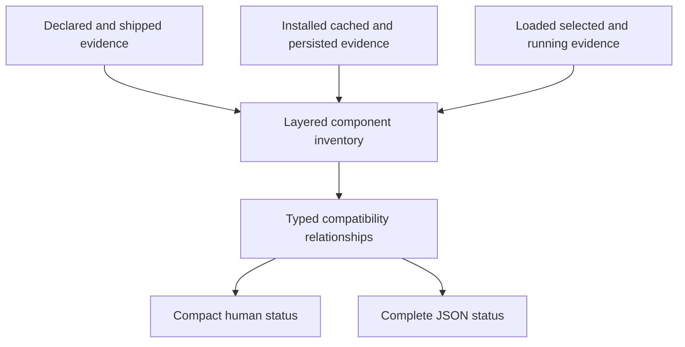

# MkChad Version Visibility Status - Plan

## Goal Capsule

- **Objective:** Expand `mkchad-opencode-server status` into the authoritative read-only view of declared, installed, cached, loaded, persisted, and running component identities across the MkChad runtime.
- **Product authority:** This contract defines inventory coverage, compatibility meaning, output behavior, and failure behavior. Planning decides how each component is discovered and how bounded evidence is collected.
- **Open blockers:** None. Unknown or unprovable identities are valid observations rather than planning blockers.

---

## Product Contract

### Summary

`mkchad-opencode-server status` will report a consolidated component inventory and evaluate version drift through component-owned compatibility contracts.
Human output stays compact, while JSON exposes the complete evidence and evaluation model for diagnostics and automation.

### Problem Frame

Version evidence is currently fragmented across lifecycle state, container identity, installed binaries, plugin metadata, caches, compatibility constants, and component-local health commands.
An operator diagnosing a mismatch must know which commands and files to inspect, whether to enter the container, and whether two unequal versions are genuinely incompatible.
Matching version labels are also insufficient for Git-installed or cached content, so version-only checks can conceal stale code.

### Key Decisions

- **Expand the existing status command.** (session-settled: user-directed -- chosen over a separate diagnostic command or Neovim-only view: operators need one authoritative shell entry point.)
- **Use typed compatibility contracts.** (session-settled: user-directed -- chosen over global exact equality or an unevaluated inventory: exact pins, supported ranges, and tested-with declarations have different meanings.)
- **Cover both persisted and live evidence.** (session-settled: user-directed -- chosen over inspecting only records or only active installations: drift is visible only when the layers can be compared.)
- **Keep human output compact and JSON complete.** (session-settled: user-directed -- chosen over an always-expanded matrix or warnings-only output: routine status must remain readable without withholding machine evidence.)
- **Represent optional components explicitly.** (session-settled: user-directed -- chosen over limiting the report to the core server stack: the inventory must distinguish installed, absent, unavailable, and not-discoverable optional components.)
- **Include immutable identity where version labels are insufficient.** (session-settled: user-directed -- chosen over version labels or Git commits alone: image and cache drift can exist under the same displayed version.)

The inventory and judgment model is:

The diagram summarizes the model; the requirements below remain authoritative.

### Actors

- A1. **MkChad operator:** Uses the shell command to diagnose the active or inactive runtime, including HPC and containerized installations.
- A2. **Automation or support consumer:** Reads JSON to collect evidence, compare environments, and identify stale or unsupported components.
- A3. **Component owner:** Declares whether a relationship means shipped-with, required, supported, tested-with, or loaded-from.

### Inventory Coverage

| Component group | Required identity coverage |
|---|---|
| MkChad configuration and lifecycle | Installed configuration identity plus relevant persisted lifecycle evidence |
| Container runtime and image | Selected image identity, baked product baseline, and persistent-instance identity |
| OpenCode | Image-shipped baseline, selected installation, persisted launch identity, and live server identity |
| `opencode.nvim` | Installed content identity, loaded identity when provable, and tested compatibility declaration |
| `opencode-project-reload` | Installed package and content identity, loaded identity when provable, and supported OpenCode contract |
| Compound Engineering | Installed package/plugin version, cache and content identity, loaded identity when provable, and tested SDK relationship |
| Sprint-loop controller | Installed package identity, status-reported controller identity, and supported OpenCode contract when discoverable |
| Sprint-loop Neovim plugin | Installed content identity and loaded identity when provable |
| Runtime prerequisites | Versions for the deployed path's container runtime, Neovim, Git, Python, Node, and curl when required by the discovered components |

### Requirements

**Inventory and evidence**

- R1. `mkchad-opencode-server status` must remain observational and must not start, stop, repair, refresh, or create lifecycle, cache, or installation state.
- R2. Status must preserve its existing lifecycle result while adding the product components and directly required runtime prerequisites listed in Inventory Coverage.
- R3. Each component must distinguish applicable declared, shipped, installed, cached, selected, loaded, persisted, and running observations rather than collapsing them into one current version.
- R4. Each observation must identify its evidence class and report semantic version, immutable identity, or both according to what the source can prove.
- R5. An unavailable, absent, unqueried, timed-out, or unprovable observation must be represented explicitly and must not be inferred from another layer.
- R6. Every named optional component must appear in the inventory with an installed, absent, unavailable, or not-discoverable state.

**Compatibility and drift**

- R7. Compatibility evaluation must use typed relationships including `ships`, `requires`, `supports`, `tested-with`, and `loaded-from`.
- R8. Each relationship must be evaluated according to the owning component's declared exact pin, range, baseline, or content identity semantics.
- R9. Unequal versions must not be labeled incompatible solely because their strings differ.
- R10. Distribution and prerelease suffixes must remain part of identity; equivalence to an upstream version must require an explicit component contract.
- R11. Matching version labels with differing immutable identities must produce a stale or mismatch warning where the evidence supports that conclusion.
- R12. Ambiguous or undocumented compatibility must produce an unknown evaluation rather than an inferred pass or failure.
- R13. Version and identity warnings must not convert an otherwise healthy lifecycle result into a lifecycle failure or change existing status exit behavior.

**Output and resilience**

- R14. Plain status output must account for every inventory component in a compact summary and expand the evidence for mismatches, unsupported relationships, stale state, and unknowns.
- R15. JSON status must expose the full component inventory, observations, typed relationships, evaluations, and bounded diagnostics regardless of whether the human view is collapsed.
- R16. Existing human fields and JSON consumers must remain usable; the expanded contract must be additive unless planning proves an incompatible schema revision is necessary.
- R17. A failed or timed-out component probe must return partial inventory, mark the affected evidence unavailable, and preserve all independently collected results.
- R18. Collection and rendering must remain bounded so optional or unhealthy components cannot stall routine lifecycle status.
- R19. Output must not expose credentials, configuration contents, private transcripts, or other secrets while reporting identity provenance.

### Key Flows

- F1. **Routine healthy inspection**
  - **Trigger:** A1 runs plain `status` while the server and discovered components agree with their contracts.
  - **Steps:** Status observes lifecycle health, gathers bounded identity evidence, evaluates typed relationships, and collapses agreeing detail.
  - **Outcome:** A1 sees the lifecycle headline and a concise component summary; A2 can obtain the complete JSON inventory.
  - **Covered by:** R1-R4, R7-R9, R14-R16, R18-R19.

- F2. **Cross-layer drift inspection**
  - **Trigger:** Installed, cached, persisted, selected, loaded, or running identities differ.
  - **Steps:** Status preserves each observation, evaluates owner-declared contracts, and explains the relationship where evidence permits.
  - **Outcome:** A1 can identify where drift occurred without treating every unequal version as incompatible.
  - **Covered by:** R3-R13, R14-R16.

- F3. **Partial or inactive inspection**
  - **Trigger:** The server is inactive, an optional component is absent, or one probe cannot complete.
  - **Steps:** Status returns all available persisted and installed evidence, marks live or failed observations explicitly, and does not create or repair state.
  - **Outcome:** A1 receives useful partial diagnostics and existing lifecycle semantics remain unchanged.
  - **Covered by:** R1-R6, R12-R19.

### Acceptance Examples

- AE1. **Healthy aligned stack**
  - **Covers R2, R3, R7, R14, R15.**
  - **Given:** All discovered observations satisfy their component-owned contracts.
  - **When:** An operator runs status.
  - **Then:** Human output shows a compact component summary and JSON includes every collected observation and successful evaluation.

- AE2. **Mounted runtime differs from running server**
  - **Covers R3, R8-R10, R14, R15.**
  - **Given:** The selected OpenCode installation differs from the persisted launch or live server identity.
  - **When:** Status evaluates the OpenCode evidence chain.
  - **Then:** It identifies the differing layers and reports drift without discarding either identity.

- AE3. **Matching CE version with stale cache content**
  - **Covers R4, R11, R14, R15.**
  - **Given:** The installed and cached CE entries share a version label but have different trustworthy content identities.
  - **When:** Status compares those observations.
  - **Then:** It warns that the cache is stale despite the matching version.

- AE4. **Distribution suffix lacks declared equivalence**
  - **Covers R8, R10, R12.**
  - **Given:** A consumer declares support for upstream `1.18.3` while the observed server reports `1.18.3-mkchad.7`, and no equivalence rule is declared.
  - **When:** Status evaluates the relationship.
  - **Then:** It reports unknown or unsupported according to the consumer's contract and never strips the suffix silently.

- AE5. **Optional controller is not installed**
  - **Covers R5, R6, R17.**
  - **Given:** The core MkChad stack is available but the sprint-loop controller is absent.
  - **When:** Status performs discovery.
  - **Then:** Core inventory remains available and the optional controller is represented as absent rather than causing failure.

- AE6. **One probe times out**
  - **Covers R5, R17, R18.**
  - **Given:** One discovered component does not answer within its bound.
  - **When:** Status completes.
  - **Then:** It returns the other evidence, marks that observation timed out, and includes a bounded diagnostic.

- AE7. **Inactive server inspection**
  - **Covers R1, R5, R13, R17.**
  - **Given:** Installed and persisted evidence exists but no OpenCode server is running.
  - **When:** Status runs.
  - **Then:** It reports inactive lifecycle state, preserves available inventory, marks running identity unavailable, and creates no state.

### Success Criteria

- An operator can answer what is declared, installed, cached, selected, loaded, persisted, and running from one command without entering the container or inspecting state files manually.
- An operator can distinguish compatible variation, unsupported relationships, stale content, and unknown evidence without treating all unequal strings as failures.
- Automation can consume a stable, complete JSON inventory while existing lifecycle-status consumers continue to work.
- Missing or unhealthy optional components reduce evidence quality without suppressing independently available diagnostics.

### Scope Boundaries

- Do not inventory every package pinned in the container image, including language servers and browser tooling that do not determine MkChad product operation.
- Do not refresh caches, reload plugins, restart services, alter container instances, or repair mismatches from `status`.
- Do not claim a currently loaded plugin or configuration identity from install or cache evidence alone.
- Do not redefine lifecycle health around version compatibility warnings.
- Do not establish a new repository-wide release-version scheme; this feature observes and evaluates existing component identities and contracts.

### Dependencies and Assumptions

- Component-owned compatibility declarations remain the authority for relationship semantics; ambiguous declarations yield unknown evaluations until clarified.
- Some active-process identities cannot be proven by an external status command and will remain unknown unless the owning process exposes trustworthy evidence.
- Immutable identity forms differ by component and may include release identity, Git commit, image digest, or bounded content digest.
- Existing command redaction, bounded-output, and observational-status guarantees continue to apply to the expanded inventory.

### Outstanding Questions

**Deferred to Planning**

- Which immutable identity is both trustworthy and affordable for each component and cache surface?
- Which component probes can reuse existing status or health contracts, and which need an additive identity surface?
- What per-probe and total time bounds preserve routine status responsiveness?
- Can the inventory remain additive under JSON schema 1, or does a schema revision provide a safer consumer contract?

### Sources and Research

- `mkchad/README.md` documents observational lifecycle status, persisted state, process-cached configuration, and existing server-version visibility.
- `mkchad/lua/mkchad/opencode/command.lua` defines current human and schema-1 JSON status output.
- `msk_containers/container_tools/ct_instance_exec.sh` defines persistent container and image filesystem identity.
- `opencode/packages/core/src/installation/version.ts` and the global health handler define OpenCode installation and live-server version evidence.
- `opencode.nvim/lua/opencode/health.lua` demonstrates installed plugin and tested-through compatibility reporting.
- `opencode-project-reload/src/version.ts` defines an exact OpenCode compatibility set.
- `opencode_sprint_loop/src/opencode_sprint_loop/status.py` exposes controller package identity in status JSON.
- `compound-engineering/AGENTS.md` documents why a matching cache version does not prove matching content.
- `compound-engineering/scripts/routing/protocol-schema.json` records CE's tested OpenCode SDK relationship.
