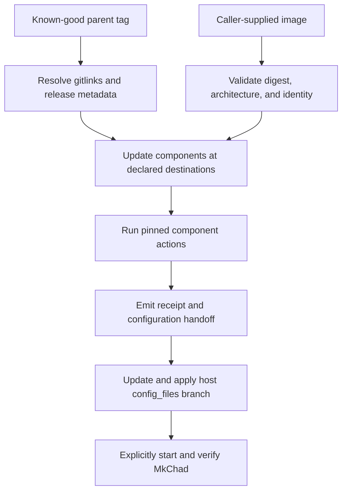
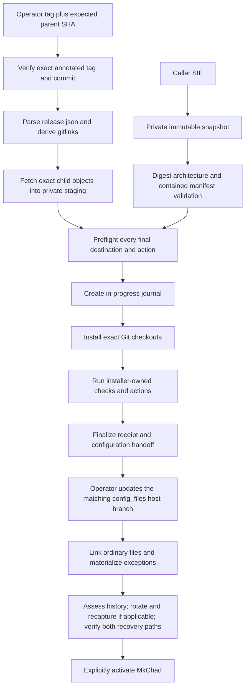

# Reproducible Host Deployment - Plan

## Goal Capsule

- **Objective:** Make a known-good MkChad v1 release reproducible on an HPC host without requiring a development-environment checkout, while retaining the existing branch-per-host dotfile model.
- **Product authority:** The MkChad parent release defines host-neutral components and artifacts; `config_files` defines host-specific configuration and materialization.
- **Execution profile:** Implement and verify each repository serially. Child commits precede parent gitlink updates; live-state migration, credential-history assessment and any applicable rotation, pushes, image binding, and annotated-tag publication are explicit operator gates.
- **Stop conditions:** Stop before final-path mutation on unverified release identity, destination ambiguity, local work, unsafe ownership or path types, active managed services, artifact mismatch, malformed materialization state, missing recovery evidence, or an interrupted operation whose process quiescence has not been independently confirmed.
- **Tail ownership:** The implementation run owns local code, tests, documentation, and coherent commits. The operator provisions the bootstrap through a trusted channel, supplies the release tag and expected full parent SHA, release SIF, age recipient and identity, live-state authorization, credential-history assessment and any applicable rotation, process-quiescence confirmation after uncatchable interruption, and any push or tag authorization.
- **Open blockers:** None. Publication inputs are explicit gates rather than unresolved design questions.

---

## Product Contract

### Summary

Provide a deterministic two-phase rollout: deploy pinned MkChad components and a checksummed local container image first, then update and apply host-specific configuration through `config_files`.

### Problem Frame

Current host rollout requires several manual operations across container installation, host scripts, Git components, OpenCode configuration, Compound Engineering configuration, and files that cannot remain symlinks.
The process does not provide one authoritative release identity, destination map, configuration handoff, or deployment receipt, so omissions and version mismatches are difficult to diagnose.

### Key Decisions

- **Parent release as component lock** (session-settled: user-approved — chosen over a duplicate commit list: parent gitlinks already identify exact child revisions). A known-good MkChad annotated parent tag paired with an operator-supplied expected full parent SHA is the normal deployment authority, while an explicit development mode may accept a full parent commit SHA without a tag.
- **Keyless release authority** (session-settled: user-directed — chosen over SSH-signed tags and local signer trust files: the operator will supply the exact tag and parent SHA at invocation). Release publication uses an ordinary annotated tag. No signing key, allowlist, revocation file, signature verification, or runtime trust-root directory participates in release selection.
- **Persistent final checkouts** (session-settled: user-directed — chosen over an isolated temporary deployment checkout: HPC hosts need Git components updated directly at their deployment locations). Temporary space is used only for release metadata, validation, downloads, and build artifacts.
- **Separate components, artifacts, and actions** (session-settled: user-approved — chosen over treating scripts and installed files as components: existing installers already own their outputs). Git components declare repositories, revisions, destinations, and optional actions; artifacts declare integrity metadata; scripts are actions supplied by pinned components.
- **Local container input** (session-settled: user-directed — chosen over deployment-time download: the image is copied to the host separately). Deployment validates the supplied image against release metadata before invoking the existing installer.
- **Independent configuration phase** (session-settled: user-directed — chosen over deployment-managed dotfile migration: host configuration remains under the user's manual and agent-assisted `config_files` workflow). Component deployment emits configuration requirements and leaves services stopped.
- **Manifest-controlled materialization** (session-settled: user-approved — chosen over replacing the dotfile manager: ordinary files continue using existing symlinks). Only exceptional files are copied or decrypted to regular files.
- **Whole-file age encryption** (session-settled: user-directed — chosen over a tracked template plus separately provisioned secret: the host branch should contain a deployable encrypted representation). Secret-bearing files are stored as ciphertext and materialized with strict ownership and mode checks.
- **No delegated cgroup requirement** (session-settled: user-directed — chosen over cgroup-v2 containment for deployment and age subprocesses: avoid administrator approval while accepting weaker guarantees after supervisor death or descendant escape). Trusted pinned subprocesses run with bounded direct-process and process-group supervision; interrupted recovery requires explicit operator quiescence confirmation when process absence cannot be proven automatically.

### Actors

- A1. The operator selects a known-good release, copies its container image to the host, and controls service activation.
- A2. The MkChad deployment command resolves release metadata, updates components, invokes component actions, and produces verification evidence.
- A3. Existing component installers own their installation destinations and internal behavior.
- A4. The `config_files` tooling links ordinary dotfiles and materializes exceptional files.
- A5. An agent may prepare a reviewable host-branch configuration migration, but does not participate inside the deterministic deployment command.

### Requirements

**Release and component authority**

- R1. Normal deployment must accept an operator-supplied annotated parent tag only when it peels to the separately supplied expected full parent commit SHA; an explicit development override may accept a full parent commit SHA without a tag.
- R2. Child revisions must be derived from the selected parent's Git gitlinks rather than duplicated in release metadata.
- R3. Every Git component selected for host deployment must declare its repository identity, exact revision, persistent destination, and optional ordered actions.
- R4. Deployment must clone an absent Git component at its destination or fetch and check out the exact revision in an existing verified clone.
- R5. Deployment must not use `git pull`, merge remote movement, reset local work, stash changes, or continue through unexplained tracked or untracked conflicts.
- R6. Frozen historical components must be excluded from routine deployment.

**Artifacts and actions**

- R7. Every non-Git artifact must declare its required integrity metadata, including SHA-256 and architecture when applicable.
- R8. Container deployment must require a caller-supplied local image path and reject digest, architecture, or expected component-identity mismatches before installation.
- R9. Installation actions must be relative script paths supplied by verified Git components and must execute as argument arrays rather than shell command strings.
- R10. Existing high-level installers must remain authoritative for their outputs; release metadata must not duplicate internal output paths or lower-level steps already invoked by those installers.
- R11. The pinned `msk_containers` component must supply container and host-tool installation through its existing public entrypoints.

**Host-specific configuration**

- R12. MkChad component deployment must not read, switch, edit, capture, or apply `config_files` state.
- R13. Deployment must emit the selected release's configuration-contract version and migration guidance, then leave managed services stopped.
- R14. The current branch-per-host `config_files` model and ordinary symlink behavior must remain unchanged.
- R15. A checked-in manifest must identify only files requiring regular-file materialization and must keep those targets out of normal symlink creation.
- R16. Initial materialization must support ordinary copy and whole-file age decryption, with non-mutating verification and deliberate capture back into the repository.
- R17. Sensitive targets must be created atomically as current-user-owned regular files with exact declared modes, without exposing plaintext through arguments, logs, or automatic backups.
- R18. An existing symlink may be converted automatically only when it resolves to the expected repository source; unexplained links or files must block replacement.

**Safety and observability**

- R19. Deployment must validate all component destinations before mutation, reject incompatible ownership or types, and detect conflicting exclusive ownership between components.
- R20. Deployment must record each component's repository, intended revision, previous revision when present, resolved destination, action results, artifact digest, and configuration-contract handoff.
- R21. Deployment must provide a human-readable summary and stable machine-readable receipt without credentials or private configuration content.
- R22. Repeating deployment for an already compliant release must be safe and must not rewrite unchanged components, artifacts, or materialized files.
- R23. A failure must identify the failed phase and leave enough verified state to retry or deliberately restore a recorded prior component revision.
- R24. An interrupted deployment, recovery, or materialization operation must distinguish machine-observed process-group cleanup from operator-confirmed quiescence, keep later mutation blocked when neither is available, and provide actionable recovery guidance without representing a human assertion as machine proof.

### Key Flows

- F1. **Publish a known-good release.** An annotated parent tag plus its expected full parent SHA identifies exact child gitlinks, while release metadata identifies artifact integrity, deployable components, destinations, actions, verification, and the configuration contract.
- F2. **Deploy components on an HPC host.** The operator supplies the tag, expected full parent SHA, and local image; deployment validates all inputs and destinations, updates Git components at their final locations, runs pinned actions, verifies results, emits a receipt, and leaves services stopped.
- F3. **Migrate and apply host configuration.** The operator uses the emitted contract and migration guidance to update the correct `config_files` host branch, optionally with agent assistance, then runs link and materialization operations.
- F4. **Activate and diagnose.** After configuration verification, the operator explicitly starts MkChad and uses component/status reporting to compare the selected release, installed components, running components, and configuration contract.
- F5. **Recover an interrupted operation.** The operator independently quiesces related processes after supervisor or host loss, invokes the state-bound recovery command with explicit confirmation, and receives a receipt that distinguishes that assertion from machine-observed cleanup before later mutation is allowed.



### Acceptance Examples

- AE1. **Covers R1-R4, R19.** Given a fresh HPC host, an annotated parent tag, and its expected full parent SHA, when deployment runs, then the tag must peel to that SHA and every selected Git component is cloned to its declared destination at the exact gitlink-derived revision.
- AE2. **Covers R4-R5, R20, R23.** Given an existing clean component checkout at an older revision, when deployment runs, then it fetches and checks out the pinned revision and records both revisions; given local conflicting work, it stops without resetting, stashing, or overwriting it.
- AE3. **Covers R7-R11.** Given a local image with the wrong digest or architecture, when deployment preflight runs, then no installer action executes and the mismatch is reported without activating the image.
- AE4. **Covers R9-R11.** Given a verified `msk_containers` checkout, when actions run, then deployment invokes its declared high-level scripts from that checkout and does not separately reproduce their internal installation steps.
- AE5. **Covers R12-R13.** Given component installation succeeds while host configuration is still old, when deployment finishes, then it reports the required configuration contract and leaves the managed service stopped without modifying `config_files`.
- AE6. **Covers R14-R18.** Given an age-encrypted manifest entry for `opencode-server.json`, when configuration is applied, then the target becomes an atomic regular mode-`0600` file and ordinary non-manifest dotfiles remain symlinks.
- AE7. **Covers R18-R19.** Given an exceptional target is an unexplained symlink or has unsafe ownership, when materialization preflight runs, then it refuses replacement and reports the exact target condition.
- AE8. **Covers R20-R22.** Given a host already matches the selected release and configuration state, when both deployment phases are repeated, then no compliant checkout, artifact, link, or regular file is unnecessarily rewritten and receipts still describe the verified state.
- AE9. **Covers R23-R24.** Given supervisor loss leaves an operation `in_progress`, when a later mutating command or recovery runs without independently established process quiescence, then it remains blocked with actionable guidance; after the operator quiesces related processes and explicitly confirms that fact, recovery records operator-confirmed rather than machine-observed evidence and reconciles only known state.

### Success Criteria

- A new HPC host can reach a verified, configuration-pending MkChad state from an annotated release tag, expected full parent SHA, and local image without a development-environment checkout.
- Every deployed Git component has one explicit destination and one authoritative revision source.
- Existing component installers remain the sole authority for their internal outputs.
- Host-specific configuration changes are reviewable in the correct `config_files` branch and no longer require remembered manual copying for link-incompatible files.
- Failure reports identify component, revision, destination, phase, and safe recovery information without exposing secrets.

### Scope Boundaries

- MkChad v2 architecture changes are not part of this work.
- Deployment does not download container images, automatically migrate dotfiles, invoke an agent, start managed services, or rewrite Git history.
- This work does not replace the branch-per-host dotfile repository with another manager.
- This work does not require all pinned source components to be host-installed; each release declares whether a component is deployed, supplies actions, is embedded and verified, is configuration-owned, or is disabled.
- Historical planning artifacts and frozen controller repositories remain unchanged.

### Dependencies And Assumptions

- The parent repository remains the source of exact child gitlinks for a known-good release.
- Existing component installers continue to expose stable top-level entrypoints suitable for noninteractive invocation.
- The target host can access declared Git remotes and has the required Git and age tooling.
- Release-required parent, child, and nested-child commits remain fetchable from their declared remotes for the supported lifetime of the release. Publication validation proves current reachability but does not archive external Git objects.
- A host age identity and recovery recipient can be provisioned outside the tracked repository.
- The target host provides POSIX session and process-group signaling semantics plus current-user access to Linux procfs process identity and session/group metadata. No delegated cgroup or user service-manager scope is required.
- Release actions, Git, the container runtime, installers, and age are trusted not to deliberately daemonize, double-fork, or escape their process group. The tooling detects and bounds direct children but cannot prove escaped descendants absent after supervisor or host failure.
- U3 and U4 are pre-release, and the authorized target-host inspection found no unresolved cgroup-backed deployment or materialization journal. New readers reject a record carrying the removed cgroup fields with guidance to recover it using the exact prior implementation; they do not silently reinterpret or automatically migrate it.
- If a real credential has appeared in plaintext Git history, it will be rotated when encrypted materialization is adopted.

### Planning Resolutions

- `msk_containers` and `mkchad` are the only persistent deployed Git components. Their destinations and every other component disposition are fixed in KTD2.
- OpenCode is image-embedded. `opencode.nvim`, `opencode-project-reload`, and Compound Engineering are configuration-owned; the frozen sprint-loop is disabled.
- Parent-tracked `deploy/release.json` and `docs/deployment/configuration-contract-v1.md` bind release behavior to the exact parent commit selected by the operator-supplied tag and full SHA.
- A separately provisioned bootstrap runs the deployment command from a temporary parent release checkout only after the fetched annotated tag peels to the operator-supplied expected full SHA; it creates no persistent parent checkout.
- Recovery accepts both failed and interrupted records, restores recorded Git revisions deliberately, restores retained host-tool bytes, and uses the container installer's existing previous-image rollback. An interrupted record additionally requires the operator's explicit process-quiescence confirmation because process absence is not machine-provable without cgroups.

### Sources

- `config_files_scripts/config_management_lib.sh` provides the current symlink-only deployment behavior and the extension point for manifest exclusions and materialization.
- `config_files_scripts/add_config_file_to_repo.sh` provides the current capture behavior that materialized files must complement rather than silently replace.
- `msk_containers/nvim/bin/install_nvim_container` owns validated image installation and activation.
- `msk_containers/bin/install_nvim.sh` owns host launcher and container-tool installation and already invokes its lower-level tool installer.
- `.gitmodules` and the parent release commit provide the authoritative child repository identities and revisions.

---

## Planning Contract

**Product Contract preservation:** changed: cgroup-free supervision adds R24, F5, and AE9 plus corresponding Key Decisions, Dependencies and Assumptions, and operator stop/tail boundaries; the user-selected keyless release authority revises R1, F1-F2, AE1, the release Key Decisions, and operator tail ownership while preserving R2-R23 and AE2-AE8.

Path references below are parent-repository-relative unless qualified as `config_files:` or `config_files_scripts:` for the two independent repositories outside this workspace.

### Key Technical Decisions

- KTD1. **Use an annotated parent tag plus an operator-supplied expected full SHA.** (session-settled: user-directed — chosen over SSH-signed tags and local trust files: release selection should require only explicit CLI authority.) The separately provisioned bootstrap fetches only `refs/tags/<name>`, requires an annotated tag object, peels it to one commit, and rejects it unless that commit equals `--expected-parent-commit FULL_SHA`. Immediately before candidate execution it fetches the exact remote tag into a second private ref and requires the same tag object and peeled commit, so movement during acquisition fails closed. It records the tag name, stable tag object ID, validated parent commit, and an `annotated-tag-plus-sha` authority kind. A tag signature is neither required nor consulted. Development mode accepts only `--development-commit FULL_SHA`, requires that commit to be fetchable from the canonical parent remote, labels development authority, and never treats a branch as a release.
- KTD2. **Deploy only the two host checkouts that own runtime files.** `msk_containers` deploys to `xdg_data_home/mkchad/components/msk_containers`; `mkchad` deploys to `xdg_config_home/mkchad`. OpenCode is embedded in the SIF. `opencode.nvim`, `opencode-project-reload`, and Compound Engineering are configuration-owned. `opencode_sprint_loop` is disabled. Every parent submodule must have exactly one disposition.
- KTD3. **Keep one release manifest at the tagged parent commit.** `deploy/release.json` schema 1 declares dispositions, root-relative destinations, ordered actions, artifact variants, configuration-contract version, and guidance path. It must not contain child revisions; the deployer derives those from `160000` gitlinks and `.gitmodules` at the peeled parent commit.
- KTD4. **Provision a minimal bootstrap separately from candidate release code.** `deploy/mkchad_release_bootstrap.py` is installed once through the operator's trusted provisioning channel. On every run it validates that its installed path and ancestors are safe and that the script is a current-user-owned regular file without group/world write, but no bootstrap digest sidecar, signing key, signer allowlist, revocation file, or runtime trust root exists. The default rejects every group- or world-writable ancestor except root-owned sticky shared roots. An explicit `--trust-bootstrap-group-writable-ancestors` invocation may accept group-write access only on root- or current-user-owned ancestors when the operator trusts every principal granted group-class or ACL write access; foreign ownership, ordinary world-write access, unsafe file mode, and linked path components remain rejected. It creates a private temporary clone and validates the selected tag-plus-SHA authority before executing candidate `deploy/mkchad_deploy.py`. After the second tag observation, the bootstrap writes the closed authority evidence and a minimal parent Git object bundle as current-user-owned mode-`0600` files beneath its mode-`0700` temporary directory, flushes them, records the bundle digest in the evidence, and passes their paths to the candidate. The candidate opens both with no-follow and owner/type/mode/inode revalidation, verifies the digest and exact checked-out HEAD, and copies those exact bytes into the initial durable recovery stub before its first supervised subprocess. This handoff relies on the workspace threat model's trusted same-user operator and any explicitly trusted bootstrap-ancestor writers rather than claiming cryptographic bootstrap provenance. Before final-path mutation, the candidate expands the integrity-bound recovery bundle under deployment state; the temporary checkout is then removable and no parent development workspace persists.
- KTD5. **Resolve every desired child object before final-path mutation.** The deployer fetches exact gitlink commits into private temporary bare repositories, validates action paths and desired trees there, and then preflights every final destination. It also derives the sole `container_tools` nested gitlink and remote from the pinned `msk_containers` tree, stages that exact commit, installs or updates the nested checkout before any installer action, and retains its old and intended objects for recovery. Existing compliant clones perform no fetch or checkout. Existing noncompliant clones fetch from the temporary repository and detach at the exact SHA; absent clones are prepared independently and installed with Linux no-replace rename semantics.
- KTD6. **Treat one ignored MkChad path as configuration-owned.** `opencode-server.json` is the sole initial preserved path inside the MkChad checkout. It may be absent, the expected legacy symlink, or a current-user-owned regular file; its contents are never read by deployment. Every other ignored or untracked MkChad path blocks deployment unless a later release contract names it.
- KTD7. **Make installer preflight an installer-owned API.** `msk_containers/bin/install_nvim.sh --check` validates all host-tool outputs before any write. Apply repeats validation under one installer lock, installs each file atomically, and skips byte-identical compliant files. `install_tools.sh` participates in the same check/apply contract rather than being duplicated in parent metadata.
- KTD8. **Snapshot and authenticate the supplied image before executing it.** The deployer copies the SIF through a no-follow file descriptor into mode-`0700` private staging, flushes the file and directory, and compares its SHA-256 to release metadata from the exact operator-authorized parent commit before invoking a container runtime. It then validates normalized architecture and extracts `/usr/share/mkchad/component-manifest.json` with a clean-environment, no-home, no-host-bind, bounded Apptainer or Singularity invocation. It compares the parsed manifest to the pinned `msk_containers/nvim/component-manifest.json`, revalidates staged inode metadata and digest immediately before installation, writes the expected checksum sidecar, and verifies the installed digest afterward.
- KTD9. **Extend the image installer only for detached transport.** `install_nvim_container` gains `--source-revision FULL_SHA` for raw transported images. The value supplies the managed filename's source label when the image is no longer inside its build checkout; the release SIF digest remains the artifact identity. Existing behavior without the option remains unchanged and a detached raw image still fails without it.
- KTD10. **Journal before supervised work and reconcile after failure.** A current-user global lock lives under `/run/user/<uid>` when safe, otherwise a current-user mode-`0700` directory under `/tmp`. Before the first candidate-controlled supervised subprocess, the deployer durably writes a schema-1 mode-`0600` in-progress journal under `xdg_state_home/mkchad/deployments/` with verified release identity, a minimal integrity-bound recovery stub, and `final_mutation_started: false`. Before the first final-path mutation it expands the retained bundle, records verified pre-state, and sets the mutation marker; each later outcome update follows file and directory `fsync` ordering. Catchable post-mutation failures finalize to `failed`; supervisor or host loss may honestly leave `in_progress`. Both states block later deployment until `recover` classifies each resource as pre-state, intended-state, or unknown, and `in_progress` additionally requires explicit process-quiescence confirmation. An interrupted pre-mutation record permits only `restore`, which removes integrity-bound private staging after quiescence confirmation and never touches final resources.
- KTD11. **Use a strict TSV manifest for exceptional dotfiles.** `config_files:.materialization.tsv` begins with a schema-1 marker and has five required tab-separated fields: `target`, `kind`, `source`, `mode`, and `expected_link_source`. Targets are home-relative; sources and expected link sources are repository-relative; kinds are `copy` or `age`. Modes are limited to `0600`, `0644`, `0700`, and `0755`; age entries require exactly `0600`. The fifth field lets an age ciphertext source differ from the legacy plaintext source an existing symlink is allowed to reference.
- KTD12. **Keep linking and materialization explicit.** Existing link commands remain link-only but parse the whole manifest and exclude every manifest-owned path. `config_files_scripts:materialize_config_files.sh` owns `apply`, `verify`, and `capture`. `add_config_file_to_repo.sh` refuses manifest targets instead of guessing whether to copy or encrypt them.
- KTD13. **Bind configuration mutation to repository, branch, scripts revision, and target domain.** Mutating commands require canonical repository identity `github.com/krafczyk/config_files`, the exact Git top level, a current branch equal to the short hostname by default, and a `config_files_scripts` HEAD equal to the parent gitlink. A deterministic expected-host option exists for fixtures. A per-user lock keyed by the canonical target home, not the worktree, serializes all mutating commands across independent clones.
- KTD14. **Model initial secret migration as a resumable state transition.** Initial age capture accepts only the declared expected symlink and legacy repository plaintext. Before creating a named private plaintext stage, it durably records the random stage name and expected inode state. Only `apply` or `capture`, while reconciling an interrupted journal after required process-quiescence confirmation, cleans the journal-owned mode-`0600` remnant; `verify` remains strictly non-mutating. Initial capture replaces the home symlink first, installs and verifies ciphertext second, and removes the legacy plaintext source last. Unsupported safe staging or unclassifiable residue fails closed rather than promising cleanup after SIGKILL.
- KTD15. **Assess history and rotate any exposed credential before staging the migration.** Encryption prevents future plaintext commits but does not remove old Git history. After initial migration, the operator determines whether the former tracked file contained a real credential and records that assessment. If it did, the operator rotates it, updates the now-regular live target, and recaptures it before staging. In either case, the operator decrypts and compares the final ciphertext through the intended host identity and completes a recovery-recipient drill or records equivalent operator evidence.
- KTD16. **Validate configuration pins before publication.** The parent release validator requires the MkChad `opencode_nvim_revision` declaration to equal the parent `opencode.nvim` gitlink and emits configuration-owned revisions from gitlinks into the handoff. The current mismatch is corrected before creating a release candidate.
- KTD17. **Make recovery an explicit state-bound bootstrap operation.** The installed bootstrap accepts only a deployment UUID, opens the canonical record relative to the validated mode-`0700` state directory, and requires matching deployer ID, filename, recovery directory, verified release identity, and resource allowlist. It validates the retained bundle and recorded annotated-tag-plus-SHA or explicit development-SHA authority evidence before invoking that release's internal recovery command; recovery requires no network, advertised remote ref, trust root, or re-entered authority tuple. Destinations and actions are re-derived from the verified contract rather than journal paths. Recovery itself runs through a detached supervisor. Before its first subprocess or final-path mutation it durably changes either source record to `in_progress` with a `recovering` phase and attempt identifier. A catchable recovery failure returns to `failed` only after machine-observed process-group cleanup; supervisor or host loss leaves `in_progress` and requires explicit quiescence confirmation on the next attempt. Both `failed` and `in_progress` records block new deployment; later user edits and malformed/future records remain untouched.
- KTD18. **Share deployment/start locks across current and legacy revisions.** The deployer holds the new host-visible interlock exclusively from status preflight through verification, while every new managed start takes it non-exclusively through startup. U3 contains one explicit first-upgrade adapter for current MkChad revision `e91cbc39224d0637d9da59e1500cce6a355191c2` and its legacy startup lock; later lock-aware revisions self-identify their interlock schema. Deployment acquires the applicable legacy lock before the new interlock and proves inactivity. An unknown pre-interlock revision blocks unattended deployment and requires an explicit operator-controlled maintenance/quiescence run.
- KTD19. **Run Git under a constrained configuration profile.** Bootstrap tag verification, child staging, existing-checkout updates, and diff inspection disable system/global configuration and templates. Existing local configuration is read with `--no-includes`, dangerous transport/helper/filter/hook/fsmonitor/textconv keys are rejected, remotes are passed explicitly, hooks are disabled, and secret-bearing diffs use `--no-ext-diff --no-textconv`.
- KTD20. **Version receipts and journals independently of release metadata.** `deploy/receipt-v1.schema.json` defines required authority, component, artifact, action, handoff, phase, process-cleanup evidence, recovery, and diagnostic fields. `authority` is a closed discriminated object: `annotated-tag-plus-sha` requires exactly `kind`, `tag`, `tag_object`, and `parent_commit`; `development-sha` requires exactly `kind` and `parent_commit`. The release form's `parent_commit` is the operator-supplied SHA after equality with the peeled commit has been proven. The bootstrap evidence additionally requires the parent-bundle SHA-256; journals and receipts retain the authority object without signer-era aliases. Strict CLI and schema handling reject unknown legacy trust-root, signer, signature, fingerprint, and trust fields without dedicated compatibility logic. Readers reject future schemas and malformed or truncated files without mutation; successful, failed, and in-progress records remain distinguishable. Because the cgroup-backed implementation has not shipped and no unresolved target-host records exist, the cgroup-free correction remains schema 1; a record containing legacy cgroup fields is rejected with prior-implementation recovery guidance rather than reinterpreted.
- KTD21. **Align embedded OpenCode by its MkChad release tag.** Publication fetches `v*-mkchad.*` tags for the parent `opencode` gitlink, requires exactly one release tag at that commit, and requires its version to equal the SIF's `ships-opencode` declaration and bounded `opencode --version` output. A stale image or ambiguous source tag blocks the parent release candidate.
- KTD22. **Anchor every sensitive mutation to revalidated filesystem identity.** Immediately before an existing checkout update, receipt write, installer replacement, or materialization rename, revalidate owner, type, device/inode, and ancestor identity relative to previously opened directories. Any replacement after preflight blocks rather than redirecting the write.
- KTD23. **Bound direct subprocesses without delegated cgroups.** (session-settled: user-directed — chosen over delegated cgroup-v2 containment: avoid administrator approval while accepting weaker interruption and descendant guarantees.) An operation-owned supervisor retains the applicable deployment or target-home lock and durable journal when the user-facing controller exits. Each Git, installer, runtime, or encryption action starts as a new POSIX session leader with closed standard input, a minimal environment, fixed-memory output capture, and a fixed timeout. Diagnostic stdout and stderr are streamed through separate 1 MiB bounds; declared data streams use their subsystem content bound and never enter diagnostics. The supervisor observes terminal state with Linux `waitid(..., WNOWAIT)` so the direct child remains an unreaped PID/PGID identity anchor until all signaling finishes; it never signals that group after reaping the leader. It revalidates the leader's owner, start time, session, group, and zombie state and enumerates current-user Linux procfs entries in that same session/group before deciding no live member remains. On timeout, nonzero exit, signal, output overflow, or unexpected live same-group survivor it sends `TERM`, allows 5 seconds, sends `KILL`, and allows a final 5 seconds. It records `failed` only after procfs shows no live member other than the unreaped leader, then reaps that leader. A live child or group member still present at the final deadline leaves the operation `in_progress` with cleanup-unconfirmed evidence, deletes no recovery evidence, and requires operator-confirmed quiescence before reconciliation. This bounds the direct child and descendants that remain in its process group only while the supervisor is alive; daemonized, double-forked, or new-session descendants cannot be authoritatively discovered or contained. Recovery never signals a PID from durable state and does not claim process-tree emptiness. An `in_progress` record left by supervisor or host loss blocks automated reconciliation until the operator independently quiesces related processes and passes `--confirm-processes-quiesced`; the recovery receipt records the assertion and rejects that flag when no interrupted record requires it.

The operator runbook derives a redacted action kind, executable identity, and start window from the integrity-bound journal, then requires the operator to inspect same-user host process and scheduler/session evidence, terminate or await matching work, and verify that no related action remains before supplying confirmation. Journal PIDs are hints only and are never signaled by recovery. If the host does not expose enough evidence for the operator to establish quiescence, the record remains blocked.
- KTD24. **Retain a self-contained integrity-bound recovery bundle until resolution.** Before the first candidate-controlled subprocess, the deployer durably stores a minimal stub containing the exact deployer, release manifest and schemas, parent tag/commit objects, and tag-plus-SHA or development-SHA authority evidence beneath the deployment's protected state directory. Before final mutation it expands that stub with old and intended child objects, the staged SIF, action inputs, and replaced host-tool bytes. The record binds every file by digest. Success deletes the bundle only after final verification and receipt durability; failed or interrupted runs retain it until complete/restore recovery finalizes. Missing or mismatched bundle content blocks automated recovery without deleting evidence.

### Component And Artifact Contract

| Component | Disposition | Destination or verification | Release behavior |
|---|---|---|---|
| `msk_containers` | deployed | `xdg_data_home/mkchad/components/msk_containers`, including its exact nested `container_tools` checkout | Update the parent and nested gitlink first; run installer check, host-tool apply, and image installation from this checkout. |
| `mkchad` | deployed | `xdg_config_home/mkchad` | Detach at the gitlink SHA while preserving only declared configuration-owned paths. |
| `opencode` | embedded | SIF component manifest plus bounded `opencode --version` evidence | No host checkout; release validation aligns the image declaration with the parent child source. |
| `opencode.nvim` | configuration-owned | MkChad `opencode_nvim_revision` and Lazy installation | No direct deployment; publication requires the MkChad pin and parent gitlink to match. |
| `opencode-project-reload` | configuration-owned | Configuration contract and OpenCode package/cache evidence | No direct checkout; the handoff emits the gitlink-derived revision. |
| `compound-engineering` | configuration-owned | Configuration contract and OpenCode package/cache evidence | No direct checkout; the handoff emits the gitlink-derived revision. |
| `opencode_sprint_loop` | disabled | Parent gitlink recorded as excluded | No fetch, checkout, action, or migration. |

`deploy/release.json` uses named roots (`home`, `xdg_config_home`, `xdg_data_home`, and `xdg_state_home`) plus validated relative paths. It never evaluates shell expressions. Action arguments may contain only documented typed tokens such as the staged image path and a resolved component revision; arbitrary interpolation is rejected.

The `nvim-image` artifact has one entry per supported architecture. Each entry records the full SIF SHA-256, normalized architecture, expected source filename class, and expected component-manifest digest. A real digest is added only from the exact image selected for release publication.

The independently provisioned bootstrap and parent CLI have four stable entrypoints:

- `python3 ~/.local/libexec/mkchad-release-bootstrap [--trust-bootstrap-group-writable-ancestors] --release TAG --expected-parent-commit FULL_SHA --image PATH` fetches only the exact annotated tag, re-fetches it into a second private ref, requires both observations to identify the same tag object peeling to the expected SHA, and executes only the candidate deployer from that checkout. The mutually exclusive development form uses `--development-commit FULL_SHA`. The optional bootstrap-path trust flag is permitted only under the KTD4 trust-boundary exception.
- `python3 deploy/mkchad_deploy.py validate-release --release TAG --expected-parent-commit FULL_SHA --image PATH` requires the candidate checkout HEAD to equal the expected SHA and validates the tag syntax, every non-disabled gitlink required by its disposition, configuration pins, and the real SIF without final-path installation. It does not require the tag to be published yet.
- `python3 deploy/mkchad_deploy.py deploy --verified-release FILE --verified-parent-bundle FILE --image PATH` consumes the bootstrap's private owner-checked evidence and matching digest-bound parent object bundle and performs deployment; direct normal-release invocation without both inputs fails.
- `python3 ~/.local/libexec/mkchad-release-bootstrap [--trust-bootstrap-group-writable-ancestors] recover --deployment-id UUID --mode complete|restore [--confirm-processes-quiesced]` validates the canonical failed or in-progress record and its retained integrity-bound bundle, then invokes the matching internal recovery without network access before another deployment may begin. The confirmation flag is required only for `in_progress` and rejected for a finalized `failed` record.

### High-Level Technical Design



The deployment command never opens or changes the `config_files` repository. It reports the configuration contract and gitlink-derived required revisions, but the independent configuration phase owns branch selection, manifest changes, decryption, capture, and live target replacement.

### Deployment State Machine

1. **Acquire:** Validate the operator's tag and expected full SHA, fetch only the exact annotated tag ref, require its stable tag object to peel to that SHA, and reject ref movement, lightweight tags, or branch fallback. Development mode requires a full SHA and a conspicuous receipt disposition.
2. **Resolve:** Validate schema 1, classify every parent submodule once, read exact gitlinks, canonicalize supported GitHub SSH/HTTPS repository identities, and reject any revision duplicated in release metadata.
3. **Journal:** Start the durable supervisor, then persist the in-progress operation record and minimal integrity-bound recovery stub before its first candidate-controlled subprocess. The record explicitly says no final mutation has started.
4. **Stage:** Fetch each deployed child revision and the `msk_containers` nested `container_tools` revision to private bare storage and snapshot the caller's SIF. Validate desired trees, action paths, image digest, architecture, and contained component manifest without touching final destinations.
5. **Preflight:** Acquire supported legacy startup locks and the new deployment/start interlock exclusively; validate state roots, service inactivity, destination ancestors, ownership, repository identity, constrained Git configuration, worktree state, preserved paths, output paths, and conflicts across components. Expand and verify the digest-bound complete recovery bundle and set the final-mutation marker before Apply. Unknown legacy revisions block unattended mutation; no cgroup delegation is required.
6. **Apply:** Install `msk_containers`, then `mkchad`; run `install_nvim.sh --check`, host-tool apply with a journal-owned recovery directory, and `install_nvim_container --source-revision <msk-sha> <staged-image>` as bounded argv subprocesses in separate POSIX sessions. Catchable timeout terminates the action process group before journal finalization.
7. **Verify:** Recheck exact HEADs, repository identities, installed host tools, active image digest and component manifest, and public lifecycle evidence. No deployment action starts a managed service.
8. **Finalize:** Atomically finalize the receipt, print a compact summary and configuration guidance, retain prior revisions for deliberate recovery, and remove only private staging.

An existing deployment must prove the managed service inactive through the public observational lifecycle interface after acquiring the exclusive interlock. Missing tooling and absent lifecycle state on a fresh host is distinct from an unavailable or ambiguous status on an existing installation; the latter blocks rather than guessing. The status result, selectively dead process state, PID reuse, and startup attempts are validated without trusting a bare PID.

At startup, the deployer scans only its validated state directory for schema-1 `failed` or `in_progress` records. A catchable failure terminates and waits for the direct action process group before finalizing to `failed`; controller death leaves the supervisor responsible for the lock, process-group timeout, and final evidence. Supervisor or host loss may leave `in_progress`, and cgroup-free recovery cannot prove that no action escaped or survived. Both states block later deployment until bootstrap recovery opens the canonical record by deployment ID and validates its local annotated-tag-plus-SHA or explicit-development-SHA bundle. A pre-mutation `in_progress` record accepts only `restore`, requires operator-confirmed quiescence, removes only integrity-bound private staging, and leaves final paths untouched. Post-mutation recovery also observes every Git tree/index, host-tool digest, image link/digest, and action result. Recovery of any `in_progress` record requires a deliberate operator confirmation that related processes were independently quiesced; the receipt records that assertion without treating it as machine proof. `complete` advances only known pre/intended mixtures; `restore` returns only known deployment-owned mixtures to pre-state. Network failure, deleted refs, unknown bytes, later user edits, malformed files, copied records, future schemas, missing bundle bytes, and absent quiescence confirmation never cause evidence deletion or unsafe fallback.

### Git And Filesystem Safety

- Canonical repository identity accepts the declared GitHub SSH and HTTPS forms for the same owner/repository, with optional `.git`, but rejects local paths, different hosts, and rewritten owners.
- Git commands set `GIT_CONFIG_NOSYSTEM=1`, disable global configuration and templates, and use explicit remote URLs. Existing local config is enumerated with includes disabled; URL rewriting, external remote helpers, credential helpers, custom SSH commands, filters, hooks, fsmonitor, textconv, and ext-diff settings block or are overridden according to the fixed command profile.
- Existing destinations must be real current-user-owned directories whose Git top level equals the destination. External Git directories, linked worktrees, submodule layouts, unsafe ancestors, and foreign-owned metadata block.
- Worktree checks include ignored and untracked paths. Only release-declared preserved paths may remain, and the desired tree must not begin tracking or replacing them.
- A checkout whose canonical origin, HEAD, tree, and allowed worktree state already comply is a no-op. It does not fetch, update `FETCH_HEAD`, rewrite the index, or run checkout hooks.
- New clones use no shared object alternates or user templates, set the canonical declared remote after staging, disable hooks, verify object independence, and use `renameat2(RENAME_NOREPLACE)` for final installation. Unsupported no-replace semantics fail closed on the Linux HPC target.
- Existing updates disable hooks, fetch only the staged exact commit, revalidate cleanliness and filesystem identity, and use detached checkout without reset, merge, stash, or branch movement. The journal records old and intended trees before checkout; recovery accepts a partial checkout only when every worktree and index entry is byte-identical to one of those trees.
- Action paths must be normalized repository-relative regular executable files present in the pinned tree. Symlink escape, `..`, shell strings, inherited Git control variables, and unbounded subprocesses are rejected.

### Materialization Contract

The initial manifest shape is:

```text
# config-files-materialization-v1
# target<TAB>kind<TAB>source<TAB>mode<TAB>expected_link_source
.config/mkchad/opencode-server.json	age	.materialized/.config/mkchad/opencode-server.json.age	0600	.config/mkchad/opencode-server.json
```

The parser validates the complete manifest before linking, applying, verifying, or capturing. It rejects duplicate or canonically equivalent targets, absolute paths, empty fields, `.` or `..` segments, control characters, unsupported kinds, modes outside the fixed allowlist, non-`0600` age entries, overlapping targets, source escape, symlinked source parents, missing sources, and unexpected source types. A malformed manifest blocks normal link commands so exceptional files cannot fall back to symlinks.

Every mutating command validates the canonical `config_files` remote, top level, host branch, scripts gitlink, and manifest identity before taking one exclusive per-user lock derived from the canonical target home. Same-directory private temporary files, pre-recorded random stage names, no-follow path checks, exact current-user ownership, exact modes, file/directory `fsync`, inode revalidation, and atomic rename protect regular targets. `apply` compares compliant content before replacement. `verify` never mutates and compares copy content directly or hashes a bounded age decryption stream without storing plaintext. `capture` first decrypts and compares an existing age source so unchanged plaintext does not produce randomized ciphertext churn.

Age invocations use the same cgroup-free subprocess contract as deployment actions. Plaintext and ciphertext data streams preserve the existing 64 MiB content bound and bypass diagnostic capture only into descriptor-bound hashing or private staging destinations; age stderr retains the 1 MiB diagnostic bound. A nonzero exit, timeout, signal, data or diagnostic overflow, or unexpected live same-group survivor fails the operation without replacing the final target or ciphertext; cleanup retains the unreaped leader identity, terminates the direct age process group, and requires procfs to show no other live session/group member before reaping. If the materialization supervisor or host dies, the durable migration journal identifies only tool-owned plaintext remnants and cannot prove an escaped age descendant absent. Subsequent mutation remains blocked until the operator independently quiesces related processes and passes `--confirm-processes-quiesced`; the flag is accepted only when an interrupted materialization journal requires it. Recovery then removes only journal-owned remnants and reconciles filesystem state.

The initial `opencode-server.json` migration requires an externally provisioned age identity and recovery recipient plus explicit authorization to mutate the protected live target. The tool verifies newly written ciphertext through the host identity before removing the legacy source. The operator assesses whether the historical plaintext contained a real credential and records that no rotation was applicable when none existed; any credential that did exist must be rotated in the regular live target and recaptured before staging. The operator verifies the final ciphertext and performs or attests a recovery-recipient decrypt. Identities, recipients, plaintext, and private configuration values never enter the manifest, command output, receipt, Git commit message, textconv, ext-diff, or automatic backup.

### Repository Ownership Matrix

| Repository | Checkout and remote | Planning anchor | Intended transition |
|---|---|---|---|
| MkChad parent | `.`; `git@github.com:krafczyk/mkchad_dev.git` | `5a1cd8427bac519001f8f0cf01b6ae61606f21ec` | Revise U3 to remove cgroups in one focused parent commit. Preserve the unrelated dirty `opencode` gitlink, historical documents, generated cache, and log. |
| `msk_containers` | `msk_containers`; `git@github.com:krafczyk/msk_containers` | `2ca81b72ebec11a49483ba467fbd30c252272f30` | No cgroup-removal change; retain the verified U1 installer seam for final integration. |
| `mkchad` | `mkchad`; `git@github.com:krafczyk/mkchad` | `98d553d9ca075baba132aa1d5056d2551106edc0` | No cgroup-removal change; retain the verified U2 pin and deployment interlock for final integration. |
| `config_files_scripts` | `~/config_files/config_files_scripts`; `git@github.com:krafczyk/config_files_scripts` | `39bd6ab7dfc4a608c4580a9d8d017594204eb9bf` | Revise U4 to remove cgroups in one focused child commit. |
| `config_files` | `~/config_files`; `git@github.com:krafczyk/config_files.git`; branch `schumann` | `10ced9a3bc5f282a594e28ad17b32231173d7f16` | Preserve the existing `.config/opencode/opencode.jsonc` modification and unstaged scripts gitlink; after U4 correction and authorization, add only U5 manifest/ciphertext/deletion and the corrected scripts gitlink. |

These anchors detect concurrent movement; they are not reset targets. Before every edit and commit, re-read root, HEAD, branch, status, staged and unstaged diffs, and relevant gitlinks. If a repository moved, reconcile compatible work or stop on direct conflict. Stage explicit intended paths only. Before a parent gitlink commit, verify the child commit independently and inspect a gitlink-only diff.

### Sequencing And Commit Boundaries

1. Revise and verify U3 in the parent repository: replace cgroup execution and recovery with the KTD23 process-group contract, extend schema/CLI evidence, and commit without staging unrelated parent changes.
2. Revise and verify U4 in `config_files_scripts`: replace cgroup execution and recovery with the same contract, update fixtures and documentation, and commit independently.
3. Re-run the focused U1 and U2 gates only after both corrections pass, then run the parent integration suite once to detect cross-repository regressions.
4. At an explicit operator push gate, push every child and nested-child commit that the candidate will reference, then verify each exact object is fetchable from its declared remote. No parent candidate may reference an unpublished child commit.
5. Bind a real SIF digest into `deploy/release.json`, run all checkout-valid precommit gates and the isolated rehearsal, and commit the host-neutral release candidate after the U3/U4 corrections. Then run exact candidate-SHA release validation; any failure is corrected in a new commit and the replacement SHA is revalidated.
6. At a separate explicit publication gate, push the validated parent commit, create an ordinary annotated tag at that exact SHA with ambient signing disabled, verify locally that it is a tag object peeling to the validated SHA, push only that exact tag ref without force, and fetch it back into a private verification ref. Publication is complete only when the remote tag object peels to the same SHA and every release-required parent, child, and nested-child object remains remotely fetchable.
7. Independently of candidate publication, use the already-authorized age inputs to maintain the `config_files` host branch, record the historical-credential assessment and any applicable rotation/recapture, and keep the corrected scripts gitlink before activation on that host. U5 does not gate candidate creation or publication.
8. Before the first deployment on a host, provision the bootstrap through the operator's trusted channel and verify its documented installed path, owner, regular-file type, and mode. If a root- or current-user-owned ancestor must remain group-writable, also verify and explicitly trust every principal with group-class or ACL write access before using the bootstrap trust option. Bootstrap provisioning is not a release-repository action.

### Risks And Mitigations

- **Wrong or moved tag:** Require the operator's expected full SHA independently of the tag, require an annotated tag object, recheck that object during verification, and record the tag name, tag object, expected SHA, and matching peeled commit before executing repository code.
- **Unsigned metadata mistaken for identity:** Treat the operator-supplied full SHA, not tag annotation text or any incidental signature, as code authority. The ordinary annotated tag is a release label and evidence handle; same-user compromise of the installed bootstrap or CLI inputs remains outside the workspace threat model.
- **Required group-writable home ancestor:** Reject it by default. The explicit bootstrap trust option accepts only root- or current-user-owned group-writable ancestors and warns that every principal with group-class or ACL write access joins the trusted bootstrap-provisioning boundary; foreign-owned and ordinary world-writable ancestors remain blocked, while root-owned sticky shared roots retain their protected exception.
- **Partial host-tool overwrite:** Installer-owned full preflight, one lock, atomic file replacement, and content-based no-op behavior prevent a late conflict from creating a mixed installation.
- **Failure after mutation:** Preserve versioned failed or in-progress evidence, block new deployment, and require explicit complete/restore reconciliation against known old/new bytes.
- **Cgroup-free descendant escape:** Direct children and same-group descendants are bounded while the supervisor lives, but daemonized or new-session descendants and processes surviving supervisor death cannot be proven absent. Impact is high, likelihood is low for trusted pinned non-daemonizing tools, confidence is high, priority is P1, and disposition is user-accepted in order to avoid administrator delegation. Interrupted recovery blocks for independently established operator quiescence, never signals journal PIDs, and records the human assertion rather than presenting it as machine evidence.
- **Concurrent service start:** Share one lock between deployment and every managed startup transition, then prove inactive under the exclusive deployment hold.
- **Git configuration execution:** Disable broad config sources, reject dangerous local keys, use explicit remotes, and disable hooks, filters, fsmonitor, textconv, and ext-diff where applicable.
- **Concurrent destination creation:** Hold the user deployment lock and use no-replace final rename; never overwrite a path that appeared after preflight.
- **Image replacement after hashing:** Install only the private staged snapshot with its full checksum sidecar.
- **Partial deployment:** Update the journal before and after each mutation and retain prior component revisions plus previous-image evidence.
- **Configuration-owned path collision:** Allow only exact declared paths, preserve them without reading content, and reject a desired Git tree that starts owning them.
- **Secret exposure:** Keep age identity external, never log content, pre-record mode-`0600` temporary plaintext, recover honest SIGKILL residue before later work, assess historical credential exposure, and rotate and recapture any credential that actually existed.
- **Manifest bypass:** Parse the complete manifest before normal linking and refuse malformed or ambiguous entries.
- **Unreachable child commit:** Release validation fetches every selected child and nested-child gitlink from its declared remote before publication; parent candidate creation follows explicit child publication, and parent tags cannot precede child reachability checks. Long-term remote retention remains an explicit external-service assumption.

---

## Implementation Units

### U1. Transactional `msk_containers` installers

- **Goal:** Give the parent deployer a safe, idempotent installer-owned preflight and detached-image handoff.
- **Requirements:** R7-R11, R19, R22-R23; AE3-AE4, AE8
- **Files:** `msk_containers/bin/install_nvim.sh`; `msk_containers/bin/install_tools.sh`; `msk_containers/nvim/bin/install_nvim_container`; `msk_containers/tests/install_nvim_test.sh`; `msk_containers/tests/install_nvim_container_test.sh`; `msk_containers/tests/nvim_container_tooling_test.sh`; `msk_containers/docs/host-installation.md`.
- **Approach:** Add `--check` to the high-level host installer and its delegated tool installer. Validate the complete source/output set before mutation, repeat checks under one safe lock, retain replaced bytes in a caller-supplied private recovery directory, atomically replace only current-user-owned regular outputs, and skip byte-identical mode-correct files. Add `--source-revision FULL_SHA` only for raw image naming outside a Git checkout. Keep `install_nvim.sh` authoritative over `install_tools.sh` and every copied launcher.
- **Test scenarios:** A late incompatible output causes zero writes; compliant outputs remain unchanged; concurrent installs serialize; a kill between file replacements leaves each output at known old/new bytes and recovery assets sufficient for complete/restore; symlink, directory, foreign-owned, and unsafe-parent outputs fail; a detached raw image succeeds only with a valid full source revision; wrong revision forms and legacy detached behavior fail; managed image behavior remains unchanged.
- **Verification:** Run the new host-installer test and the existing image-installer test from fresh task directories under `/tmp/mkchad-v1`; run the existing container tooling assertions.
- **Dependencies:** None.

### U2. MkChad configuration-owner alignment

- **Goal:** Make the MkChad runtime pin agree with the parent-authoritative `opencode.nvim` gitlink and interlock managed startup with deployment.
- **Requirements:** R2-R3, R13, R19; AE1, AE5
- **Files:** `mkchad/lua/mkchad/opencode/contracts.lua`; `mkchad/lua/configs/opencode.lua`; `mkchad/tests/opencode_contracts_spec.lua`; `mkchad/tests/opencode_deployment_interlock_spec.lua`; `mkchad/tests/opencode_inventory_collectors_spec.lua`; `mkchad/tests/opencode_test_paths.lua`.
- **Approach:** Update `opencode_nvim_revision` to `37033dc157ac4c05c1e1525fe2fc9e87ae83e2ac` and assert that the plugin spec consumes it. Extend the existing flock-based lifecycle boundary so every start takes the host-visible deployment lock non-exclusively through startup; deployment holds it exclusively. Keep process identity checks and the existing startup lock authoritative rather than adding PID-only cleanup. Move touched test scratch roots to `/tmp/mkchad-v1`.
- **Test scenarios:** The owner declaration and Lazy specification use the exact full revision; an exclusive deployment lock blocks start without creating service state; a start transition blocks deployment lock acquisition; selective process death and PID reuse never authorize signaling; release of either side permits the next bounded operation.
- **Verification:** Run the two new focused headless Neovim specs and the inventory collector spec that reports the declared plugin identity.
- **Dependencies:** The intended `opencode.nvim` revision is already present as a parent gitlink.

### U3. Parent release resolver and deployment engine

- **Goal:** Implement deterministic release resolution, destination preflight, deployment, journaling, and receipt output without a persistent parent checkout.
- **Requirements:** R1-R5, R7-R13, R19-R24; F1-F2, F4-F5; AE1-AE5, AE8-AE9
- **Files:** `deploy/mkchad_release_bootstrap.py`; `deploy/mkchad_deploy.py`; `deploy/release-v1.schema.json`; `deploy/receipt-v1.schema.json`; `tests/test_mkchad_release_bootstrap.py`; `tests/test_mkchad_deploy.py`; `tests/run_deployment_tests.sh`; `tests/fixtures/deployment/`; `docs/deployment/README.md`.
- **Approach:** Use Python standard library plus explicit argv subprocesses. Keep the separately installed bootstrap minimal: validate its installed owner/type/path safety; verify the exact annotated tag against the operator-supplied expected full SHA; create private mode-`0600` closed authority evidence and a digest-bound parent object bundle; and pass their owner-checked paths to candidate code. Remove self-digest and signer trust files rather than retaining an unused trust-root mode. Implement the exact `validate-release`, `deploy`, and state-bound `recover` commands; strict release/receipt validation; parent and nested gitlink extraction; canonical repository identity; constrained Git configuration; private child/image staging; digest-before-runtime image checks; all-destination preflight; current/legacy service interlocks; Linux no-replace clone installation; journal-aware existing-checkout updates; supervisor-owned direct-process and process-group bounds; pre-subprocess operation journaling; detached recovery supervision; recovery reconciliation with the narrowly accepted `--confirm-processes-quiesced` interrupted-run assertion; and redacted human/JSON output. Extend schema-1 receipt/recovery fields to distinguish machine-observed process-group cleanup from operator-confirmed quiescence and replace signer-derived trust evidence with the closed annotated-tag-plus-SHA authority object. Remove cgroup setup, environment requirements, journal fields, and recovery logic rather than retaining an optional cgroup mode.
- **Test scenarios:** Bootstrap path, owner, type, and replacement races; matching and mismatched expected full SHA; moved, lightweight, malformed, and branch-substitution tag policy; unsigned annotated tag acceptance; stable tag-object evidence; parent-bundle digest and evidence replacement; forbidden simultaneous release/development options; development labeling and diagnostic failure for an unfetchable development SHA; strict rejection of unknown CLI arguments and authority fields; malformed/future and legacy-cgroup release and receipt records; prepublication `validate-release` success with an absent planned tag and matching HEAD plus mismatch failure; outside/copied/moved recovery records; forged resource paths; forbidden revision fields; missing/duplicate dispositions; absent, dirty, and unreachable nested `container_tools`; OpenCode tag/image mismatch; malicious Git config and helpers; wrong origin and dirty/ignored conflicts; preserved `opencode-server.json`; compliant no-op; clone and existing-path races; image digest mismatch without runtime invocation; staged inode replacement; controller death while the durable supervisor finishes or times out an action; unreaped-leader identity during immediate child exit and forced PID/PGID reuse; timeout escalation from `TERM` to `KILL` for direct and same-group descendants; output overflow; final cleanup deadline leaving `in_progress`; supervisor death before Stage, during Apply, and during detached recovery; a fixture-owned `setsid` escape demonstrating that recovery does not signal a recorded PID and blocks without explicit quiescence confirmation; required confirmation for `in_progress` and rejection of the flag for `failed`; operation without cgroup environment or delegation; current and actual previous-release startup races; unknown legacy revision; pre-mutation restore and post-mutation complete/restore after remote outage, deleted tag, and unadvertised development commit; missing/tampered bundle bytes; later user edits; lock contention; unsafe state paths; receipt collision; and secret-sentinel absence.
- **Verification:** Run Python compilation and the focused unittest suite. Tests use local fixture remotes, fake runtimes/installers, and deterministic crash points; they require no network, credentials, live paths, or real SIF.
- **Dependencies:** U1 defines the final installer CLI; U2 defines the pin invariant validated at publication.

### U4. Manifest-aware `config_files_scripts`

- **Goal:** Preserve ordinary symlinks while adding safe apply, verify, capture, and initial age migration for exceptional regular files.
- **Requirements:** R14-R18, R22-R24; F3, F5; AE6-AE9
- **Files:** `config_files_scripts:config_management_lib.sh`; `config_files_scripts:create_links.sh`; `config_files_scripts:move_and_link.sh`; `config_files_scripts:add_config_file_to_repo.sh`; `config_files_scripts:materialize_config_files.sh`; `config_files_scripts:materialize_config_files.py`; `config_files_scripts:tests/materialization_test.sh`; `config_files_scripts:tests/fake_age.sh`; `config_files_scripts:README.md`.
- **Approach:** Fast-forward exactly through `e4ceb12` and `822bdb5`. Add strict schema-1 TSV parsing, canonical parent-repository and scripts-gitlink validation, host-branch validation, path/ownership helpers, a target-home-keyed cross-clone lock, pre-recorded plaintext staging, atomic regular-file writes, copy and age handlers, non-mutating verification, deliberate capture, and resumable initial age migration. The Python engine owns bounded age execution in a new POSIX session, timeout escalation, direct-child waiting, and durable staging; the shell entrypoint preserves repository command style. `apply` and `capture` accept `--confirm-processes-quiesced` only while reconciling an interrupted journal; routine runs and finalized catchable failures reject it. Existing link commands exclude all manifest-owned paths and abort on malformed manifests; the legacy add command rejects manifest targets. Remove cgroup environment variables, schema fields, fixtures, and documentation without preserving an optional mode.
- **Test scenarios:** Ordinary link plus copy/age exception; correct host and wrong-host branch; wrong remote/top-level/scripts gitlink; two independent clones targeting one home; malformed fields, traversal, duplicate and overlapping paths; forbidden modes and non-`0600` age; expected and unexpected links; broken links, directories, unsafe or replaced parents, wrong owner/mode; repeated no-op apply; verify without writes; unchanged capture without ciphertext churn; age nonzero exit before replacement; unreaped-leader identity during immediate age exit and forced PID/PGID reuse; diagnostic and 64 MiB data overflow; timeout escalation for a TERM-resistant direct child and same-group descendant; final cleanup deadline leaving an interrupted journal; controller death while the supervisor completes bounded cleanup; supervisor SIGKILL at each transition followed by blocked recovery until explicit quiescence confirmation; required confirmation for an interrupted journal and rejection during routine or finalized-failure runs; a fixture-owned `setsid` escape proving that durable PIDs are never signaled; operation without cgroup environment or delegation; no plaintext in arguments, environment captures, output, staged index entries, newly created Git objects, or post-recovery residue after confirmed recovery. Pre-existing historical objects are explicitly outside this assertion.
- **Verification:** Run the new shell fixture suite from a fresh `/tmp/mkchad-v1` directory and ShellCheck on changed scripts when available. Tests provide a fake age binary for deterministic failure coverage and may run an opt-in real-age round trip when `age` and `age-keygen` are present.
- **Dependencies:** None; implementation is independent of component deployment.

### U5. Host-branch encrypted configuration migration

- **Goal:** Adopt the materialization manifest for `opencode-server.json` without losing the live configuration or claiming that Git history was sanitized.
- **Requirements:** R12-R18, R21-R24; F3-F5; AE5-AE9
- **Files:** `config_files:.materialization.tsv`; `config_files:.materialized/.config/mkchad/opencode-server.json.age`; deletion of `config_files:.config/mkchad/opencode-server.json`; the `config_files_scripts` gitlink.
- **Approach:** Update only canonical `github.com/krafczyk/config_files` branch `schumann` from the verified planning anchor or a reconciled descendant. After explicit authorization, run U4's initial capture with an externally provisioned identity and recovery recipient. Assess whether a historical credential existed; record that no rotation was applicable when none did, otherwise rotate the credential in the now-regular live file and capture again. Verify the final ciphertext through the host identity, complete the recovery-recipient check, and only then stage ciphertext, manifest, legacy-source deletion, and the scripts gitlink. Inspect with external diff and text conversion disabled.
- **Test scenarios:** Legacy expected symlink migrates; unexpected link or file blocks; interruption before target replacement, before ciphertext install, and before legacy-source deletion is resumable; a real historical credential requires verified post-rotation ciphertext before staging while a no-credential assessment permits the verified initial ciphertext; resulting Git diff contains ciphertext rather than a readable configuration; ordinary files still link.
- **Verification:** Run `verify` against the live target only after authorization, confirm exact owner/mode/type without printing content, confirm canonical repository/branch/scripts gitlink and intended staged paths, record the recovery-recipient check and historical-credential assessment plus any applicable rotation, and ensure unrelated work remains unstaged. Do not rewrite repository history.
- **Dependencies:** U4; operator-provided age inputs; explicit live-state authorization; operator-controlled historical-credential assessment and any applicable rotation.

### U6. Release contract, integration, and candidate publication

- **Goal:** Bind the verified implementation and a real local SIF into one parent release candidate with complete configuration handoff.
- **Requirements:** R1-R3, R6-R13, R19-R24; F1-F5; AE1-AE9
- **Files:** `deploy/release.json`; `docs/deployment/configuration-contract-v1.md`; `docs/deployment/README.md`; parent `mkchad` and `msk_containers` gitlinks.
- **Approach:** Classify every parent submodule, set the two named-root destinations and ordered installer actions, bind the real architecture-specific SIF digest and component-manifest digest, and document the pre-execution annotated-tag-plus-SHA bootstrap and separate configuration phase. Advance only intended verified child gitlinks after those child commits are remotely reachable. After the candidate commit exists, run the exact `validate-release` command with its planned tag and full HEAD SHA to validate candidate identity, the `opencode.nvim` pin, the unique MkChad OpenCode source tag and image identity, every non-disabled gitlink and nested `container_tools` gitlink required by its disposition, artifact snapshot, destination ownership map, and stopped-service handoff. A failed exact validation requires a new corrective commit and complete revalidation; the validated commit is the only SHA eligible for the later operator-authorized tag. Publication explicitly disables ambient tag signing, rejects an existing remote tag, verifies local tag type and peel before a no-force exact-ref push, and fetches the published tag back to verify its remote object and peeled SHA.
- **Test scenarios:** Full fresh-host fixture deployment; older clean checkout update; dirty checkout refusal; wrong image refusal before final writes; action failure with finalized recovery journal; repeated compliant deployment; configuration contract output with gitlink-derived pins; disabled historical component exclusion; `validate-release` with an absent planned tag and matching or mismatched candidate SHA; local fixture publication with ambient signing enabled but explicitly suppressed; pre-existing remote tag refusal; and remote annotated-tag object and peeled-SHA verification.
- **Verification:** Run U1-U4 focused suites, the parent integration suite once, exact candidate-SHA release validation against the real SIF, and a credential-free isolated-home deployment rehearsal. A real HPC deployment, pushes, and ordinary annotated-tag creation remain explicit operator actions.
- **Dependencies:** U1-U4 for a host-neutral release candidate; a real release SIF; explicit authorization and remote reachability for every referenced child and nested-child commit before candidate creation and exact validation. U5 is required before activation on the migrated host, not before creating or publishing the release candidate.

---

## Verification Contract

### Focused Commands

Run only one resource-intensive suite at a time. Use fresh task-specific directories under `/tmp/mkchad-v1`.

```bash
# msk_containers
bash tests/install_nvim_test.sh /tmp/mkchad-v1/install-nvim
bash tests/install_nvim_container_test.sh /tmp/mkchad-v1/install-nvim-container nvim/bin/install_nvim_container
bash tests/nvim_container_tooling_test.sh

# mkchad
nvim --headless -u NONE -l tests/opencode_contracts_spec.lua "$PWD"
nvim --headless -u NONE -l tests/opencode_deployment_interlock_spec.lua "$PWD"
nvim --headless -u NONE -l tests/opencode_inventory_collectors_spec.lua "$PWD"

# parent workspace
python3 -m py_compile deploy/mkchad_deploy.py deploy/mkchad_release_bootstrap.py
bash tests/run_deployment_tests.sh /tmp/mkchad-v1/parent-deployment

# config_files_scripts
bash tests/materialization_test.sh /tmp/mkchad-v1/config-files-materialization

# parent release candidate; operator supplies these paths
python3 deploy/mkchad_deploy.py validate-release --release "$MKCHAD_RELEASE_TAG" --expected-parent-commit "$MKCHAD_RELEASE_PARENT_SHA" --image "$MKCHAD_RELEASE_IMAGE"
```

Commands run from the repository named by the preceding comment. Test scripts must create or require fresh per-test subdirectories, set `HOME`, all XDG roots, runtime state, Git config paths, installer destinations, and temporary paths beneath that directory, and reject resolution into protected live roots. They never delete the shared `/tmp/mkchad-v1` root.

### Required Gates

- **Release authority:** Prove exact annotated-tag fetch, required operator-supplied expected full SHA, equality of expected and peeled commits before code execution, stable tag object recording, development-SHA labeling and fetchability diagnostics, closed authority objects, parent-bundle integrity, and strict rejection of mismatched SHA, branch, lightweight-tag, malformed-tag, or unknown CLI/schema substitution.
- **Release consistency:** Prove every submodule has one disposition, deployed revisions come only from gitlinks, action files belong to pinned trees, configuration-owned pins agree, the unique MkChad OpenCode source tag equals image identity, frozen components are disabled, and selected commits are fetchable from declared remotes.
- **Failure atomicity:** Inject failure and real process death before and after initial operation journaling, each bundle expansion, checkout transition, host-tool file, image activation, materialization rename, and recovery transition. Catchable post-mutation failures terminate and wait for the direct action process group before finalizing to recoverable `failed`; supervisor or host loss may leave valid `in_progress`. Recovery preserves prior revisions, cleans only journal-owned private plaintext, chooses complete/restore only for known old/new state, and requires explicit process-quiescence confirmation for interrupted records.
- **Idempotence:** Capture inode/mtime or equivalent evidence before a repeated compliant run. Git checkouts, host tools, installed image, links, regular materialized files, and existing ciphertext must remain unchanged; only a new receipt may be written.
- **Security:** Exercise unsafe owners, symlinked or replaced ancestors, special files, path traversal, hostile Git environment and system/global/local config, action symlink escape, malformed/future/legacy-cgroup JSON and malformed TSV, digest mismatch before runtime invocation, staged-image replacement, fixed-memory output overflow, unreaped-leader PID/PGID identity, process-group timeout escalation, fixture-owned descendant escape, refusal to trust or signal durable PIDs, and secret sentinel redaction.
- **Concurrency:** Exercise deployment/start lock contention, startup at every mutation boundary, installer lock contention, materialization contention across two independent clones targeting one home, and final-destination creation races.
- **Recovery:** Exercise truncated, malformed, future, and legacy-cgroup journals; pre-mutation interruption; mixed Git index/worktree old/new state; later user edits; missing or tampered recovery-bundle bytes; remote outage and deleted refs; selectively dead and TERM-resistant subprocesses; supervisor death during deployment, materialization, and recovery; absent and recorded operator quiescence confirmation; descendant escape; and PID/PGID reuse. Unknown state must remain untouched with actionable diagnostics.
- **Live-state boundary:** Default automated tests use isolated homes and fake runtimes. Real image validation, live configuration migration, service status, historical-credential assessment, and any applicable rotation are opt-in operator gates.

### Release Rehearsal

Before annotated-tag publication, create an isolated home and state root, use local fixture remotes for Git components, and run the real release manifest with a fake action layer. Then run exact candidate-SHA release validation against the real SIF without installing it into the user's live container directory. A real HPC smoke deployment is the final evidence for host-specific runtime and filesystem behavior.

---

## Definition of Done

### Global

- An operator-supplied annotated parent tag that peels to the separately supplied expected full parent SHA, plus a caller-supplied SIF, can produce exact `msk_containers` and `mkchad` checkouts, verified host tools and image, a succeeded/failed/in-progress schema-1 machine record, and a configuration-pending stopped state without a persistent parent workspace or runtime trust files.
- Every parent submodule has one reviewed disposition; no release metadata duplicates a child revision; every deployed destination and action owner is explicit.
- A failed preflight changes no final destination. A catchable failure after mutation finalizes an atomic journal only after machine-observed process-group cleanup; uncatchable interruption leaves a durable in-progress journal that blocks until operator-confirmed process quiescence and explicit complete/restore reconciliation.
- A compliant repeat does not rewrite checkouts, tools, images, symlinks, materialized files, or ciphertext.
- `config_files` ordinary files retain existing symlink behavior while manifest entries support copy, age apply, non-mutating verify, deliberate capture, and resumable initial migration.
- The migrated secret is current-user-owned, regular, mode `0600`, absent as plaintext from the new Git tree, covered by a recorded historical-credential assessment, rotated and recaptured when a real historical credential existed, and decryptable through both the host path and verified recovery procedure.
- User-facing deployment, bootstrap, configuration handoff, recovery, and materialization documentation matches the implemented commands and failure behavior, including how to establish quiescence independently and how receipts distinguish operator assertion from machine observation.
- All focused and integration gates pass; unavailable real-host or real-image gates are reported rather than simulated as success.
- Abandoned helpers, temporary fixtures, debug output, placeholder digests, plaintext, and dead-end implementation attempts are absent from every final diff.
- Child commits are coherent and precede parent gitlink commits. No unrelated dirty file or gitlink is staged, reverted, or committed.
- Successful deployment removes its integrity-bound recovery bundle only after final receipt durability; failed or interrupted deployment remains recoverable offline from retained digest-bound evidence.

### Per Unit

- U1 is done when host-tool preflight proves zero-write conflict handling, apply is atomic/idempotent under lock, detached raw SIFs accept only a valid explicit source revision, and existing image behavior still passes.
- U2 is done when the MkChad owner pin and intended parent `opencode.nvim` gitlink agree and focused runtime/inventory tests prove one authority.
- U3 is done when fixture tests cover annotated-tag-plus-SHA authority, stable tag-object and exact-commit checks, strict unknown-input rejection, closed authority schema, parent-bundle integrity, nested `container_tools` authority, constrained Git, image trust ordering, current/legacy service interlocks, unreaped-leader PID/PGID identity, fixed process-group cleanup deadlines, bounded output, pre-subprocess journaling, supervisor interruption during deployment and recovery, explicit quiescence-gated bootstrap recovery, receipt reconciliation, redaction, concurrency, interruption, and no-op behavior without touching live paths.
- U4 is done when malformed manifests block linking, repository/branch/scripts/target-lock identity is enforced, exceptional targets round-trip through apply/verify/capture, ordinary links remain compatible, unreaped-leader PID/PGID identity and fixed cleanup deadlines bound age failure while the supervisor lives, data and diagnostics remain bounded, catchable failures leave no plaintext, and uncatchable residue remains journal-owned and blocked until confirmed recovery.
- U5 is done only after authorized live migration, recorded historical-credential assessment and any applicable rotation/recapture, host-identity verification, and recovery-recipient evidence; code completion alone does not satisfy this operational unit.
- U6 is done when every referenced child and nested-child object is remotely reachable, a real digest-backed release manifest validates against the candidate's exact full parent SHA, intended gitlinks are advanced, the isolated rehearsal passes, and that immutable candidate is ready for the separately authorized parent push and unsigned annotated-tag publication gate.
