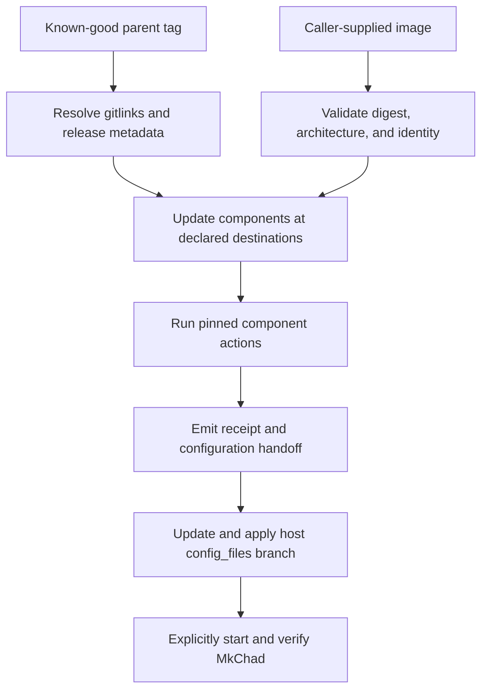

# Reproducible Host Deployment - Plan

## Goal Capsule

- **Objective:** Make a known-good MkChad v1 release reproducible on an HPC host without requiring a development-environment checkout, while retaining the existing branch-per-host dotfile model.
- **Product authority:** The MkChad parent release defines host-neutral components and artifacts; `config_files` defines host-specific configuration and materialization.
- **Open blockers:** None. Exact component destinations and release metadata representation are deferred to planning, but every deployed Git component must have an explicit destination.

---

## Product Contract

### Summary

Provide a deterministic two-phase rollout: deploy pinned MkChad components and a checksummed local container image first, then update and apply host-specific configuration through `config_files`.

### Problem Frame

Current host rollout requires several manual operations across container installation, host scripts, Git components, OpenCode configuration, Compound Engineering configuration, and files that cannot remain symlinks.
The process does not provide one authoritative release identity, destination map, configuration handoff, or deployment receipt, so omissions and version mismatches are difficult to diagnose.

### Key Decisions

- **Parent release as component lock** (session-settled: user-approved — chosen over a duplicate commit list: parent gitlinks already identify exact child revisions). A known-good MkChad parent tag is the normal deployment authority, while an explicit development mode may accept a full parent commit SHA.
- **Persistent final checkouts** (session-settled: user-directed — chosen over an isolated temporary deployment checkout: HPC hosts need Git components updated directly at their deployment locations). Temporary space is used only for release metadata, validation, downloads, and build artifacts.
- **Separate components, artifacts, and actions** (session-settled: user-approved — chosen over treating scripts and installed files as components: existing installers already own their outputs). Git components declare repositories, revisions, destinations, and optional actions; artifacts declare integrity metadata; scripts are actions supplied by pinned components.
- **Local container input** (session-settled: user-directed — chosen over deployment-time download: the image is copied to the host separately). Deployment validates the supplied image against release metadata before invoking the existing installer.
- **Independent configuration phase** (session-settled: user-directed — chosen over deployment-managed dotfile migration: host configuration remains under the user's manual and agent-assisted `config_files` workflow). Component deployment emits configuration requirements and leaves services stopped.
- **Manifest-controlled materialization** (session-settled: user-approved — chosen over replacing the dotfile manager: ordinary files continue using existing symlinks). Only exceptional files are copied or decrypted to regular files.
- **Whole-file age encryption** (session-settled: user-directed — chosen over a tracked template plus separately provisioned secret: the host branch should contain a deployable encrypted representation). Secret-bearing files are stored as ciphertext and materialized with strict ownership and mode checks.

### Actors

- A1. The operator selects a known-good release, copies its container image to the host, and controls service activation.
- A2. The MkChad deployment command resolves release metadata, updates components, invokes component actions, and produces verification evidence.
- A3. Existing component installers own their installation destinations and internal behavior.
- A4. The `config_files` tooling links ordinary dotfiles and materializes exceptional files.
- A5. An agent may prepare a reviewable host-branch configuration migration, but does not participate inside the deterministic deployment command.

### Requirements

**Release and component authority**

- R1. Normal deployment must accept an immutable known-good parent tag; an explicit development override may accept a full parent commit SHA.
- R2. Child revisions must be derived from the selected parent's Git gitlinks rather than duplicated in release metadata.
- R3. Every Git component selected for host deployment must declare its repository identity, exact revision, persistent destination, and optional ordered actions.
- R4. Deployment must clone an absent Git component at its destination or fetch and check out the exact revision in an existing verified clone.
- R5. Deployment must not use `git pull`, merge remote movement, reset local work, stash changes, or continue through unexplained tracked or untracked conflicts.
- R6. Frozen historical components must be excluded from routine deployment.

**Artifacts and actions**

- R7. Every non-Git artifact must declare its required integrity metadata, including SHA-256 and architecture when applicable.
- R8. Container deployment must require a caller-supplied local image path and reject digest, architecture, or expected component-identity mismatches before installation.
- R9. Installation actions must be relative script paths supplied by verified Git components and must execute as argument arrays rather than shell command strings.
- R10. Existing high-level installers must remain authoritative for their outputs; release metadata must not duplicate internal output paths or lower-level steps already invoked by those installers.
- R11. The pinned `msk_containers` component must supply container and host-tool installation through its existing public entrypoints.

**Host-specific configuration**

- R12. MkChad component deployment must not read, switch, edit, capture, or apply `config_files` state.
- R13. Deployment must emit the selected release's configuration-contract version and migration guidance, then leave managed services stopped.
- R14. The current branch-per-host `config_files` model and ordinary symlink behavior must remain unchanged.
- R15. A checked-in manifest must identify only files requiring regular-file materialization and must keep those targets out of normal symlink creation.
- R16. Initial materialization must support ordinary copy and whole-file age decryption, with non-mutating verification and deliberate capture back into the repository.
- R17. Sensitive targets must be created atomically as current-user-owned regular files with exact declared modes, without exposing plaintext through arguments, logs, or automatic backups.
- R18. An existing symlink may be converted automatically only when it resolves to the expected repository source; unexplained links or files must block replacement.

**Safety and observability**

- R19. Deployment must validate all component destinations before mutation, reject incompatible ownership or types, and detect conflicting exclusive ownership between components.
- R20. Deployment must record each component's repository, intended revision, previous revision when present, resolved destination, action results, artifact digest, and configuration-contract handoff.
- R21. Deployment must provide a human-readable summary and stable machine-readable receipt without credentials or private configuration content.
- R22. Repeating deployment for an already compliant release must be safe and must not rewrite unchanged components, artifacts, or materialized files.
- R23. A failure must identify the failed phase and leave enough verified state to retry or deliberately restore a recorded prior component revision.

### Key Flows

- F1. **Publish a known-good release.** A parent tag identifies exact child gitlinks and release metadata identifies artifact integrity, deployable components, destinations, actions, verification, and the configuration contract.
- F2. **Deploy components on an HPC host.** The operator supplies a tag and local image; deployment validates all inputs and destinations, updates Git components at their final locations, runs pinned actions, verifies results, emits a receipt, and leaves services stopped.
- F3. **Migrate and apply host configuration.** The operator uses the emitted contract and migration guidance to update the correct `config_files` host branch, optionally with agent assistance, then runs link and materialization operations.
- F4. **Activate and diagnose.** After configuration verification, the operator explicitly starts MkChad and uses component/status reporting to compare the selected release, installed components, running components, and configuration contract.

### Acceptance Examples

- AE1. **Covers R1-R4, R19.** Given a fresh HPC host and a known-good parent tag, when deployment runs, then every selected Git component is cloned to its declared destination at the exact gitlink-derived revision.
- AE2. **Covers R4-R5, R20, R23.** Given an existing clean component checkout at an older revision, when deployment runs, then it fetches and checks out the pinned revision and records both revisions; given local conflicting work, it stops without resetting, stashing, or overwriting it.
- AE3. **Covers R7-R11.** Given a local image with the wrong digest or architecture, when deployment preflight runs, then no installer action executes and the mismatch is reported without activating the image.
- AE4. **Covers R9-R11.** Given a verified `msk_containers` checkout, when actions run, then deployment invokes its declared high-level scripts from that checkout and does not separately reproduce their internal installation steps.
- AE5. **Covers R12-R13.** Given component installation succeeds while host configuration is still old, when deployment finishes, then it reports the required configuration contract and leaves the managed service stopped without modifying `config_files`.
- AE6. **Covers R14-R18.** Given an age-encrypted manifest entry for `opencode-server.json`, when configuration is applied, then the target becomes an atomic regular mode-`0600` file and ordinary non-manifest dotfiles remain symlinks.
- AE7. **Covers R18-R19.** Given an exceptional target is an unexplained symlink or has unsafe ownership, when materialization preflight runs, then it refuses replacement and reports the exact target condition.
- AE8. **Covers R20-R22.** Given a host already matches the selected release and configuration state, when both deployment phases are repeated, then no compliant checkout, artifact, link, or regular file is unnecessarily rewritten and receipts still describe the verified state.

### Success Criteria

- A new HPC host can reach a verified, configuration-pending MkChad state from a release tag and local image without a development-environment checkout.
- Every deployed Git component has one explicit destination and one authoritative revision source.
- Existing component installers remain the sole authority for their internal outputs.
- Host-specific configuration changes are reviewable in the correct `config_files` branch and no longer require remembered manual copying for link-incompatible files.
- Failure reports identify component, revision, destination, phase, and safe recovery information without exposing secrets.

### Scope Boundaries

- MkChad v2 architecture changes are not part of this work.
- Deployment does not download container images, automatically migrate dotfiles, invoke an agent, start managed services, or rewrite Git history.
- This work does not replace the branch-per-host dotfile repository with another manager.
- This work does not require all pinned source components to be host-installed; each release declares whether a component is deployed, supplies actions, is embedded and verified, is configuration-owned, or is disabled.
- Historical planning artifacts and frozen controller repositories remain unchanged.

### Dependencies And Assumptions

- The parent repository remains the source of exact child gitlinks for a known-good release.
- Existing component installers continue to expose stable top-level entrypoints suitable for noninteractive invocation.
- The target host can access declared Git remotes and has the required Git and age tooling.
- A host age identity and recovery recipient can be provisioned outside the tracked repository.
- If a real credential has appeared in plaintext Git history, it will be rotated when encrypted materialization is adopted.

### Outstanding Questions

**Deferred to Planning**

- Which active components require persistent host checkouts, and what are their exact current destinations?
- Which components are embedded or configuration-owned and therefore need verification rather than a deployed checkout?
- Where should release metadata and migration guidance live, and how should tags bind to it?
- How should the deployment command itself be distributed to a host with no MkChad workspace?
- What rollback operations can existing installers support beyond restoring recorded Git revisions and the container installer's previous image?

### Sources

- `config_files_scripts/config_management_lib.sh` provides the current symlink-only deployment behavior and the extension point for manifest exclusions and materialization.
- `config_files_scripts/add_config_file_to_repo.sh` provides the current capture behavior that materialized files must complement rather than silently replace.
- `msk_containers/nvim/bin/install_nvim_container` owns validated image installation and activation.
- `msk_containers/bin/install_nvim.sh` owns host launcher and container-tool installation and already invokes its lower-level tool installer.
- `.gitmodules` and the parent release commit provide the authoritative child repository identities and revisions.
