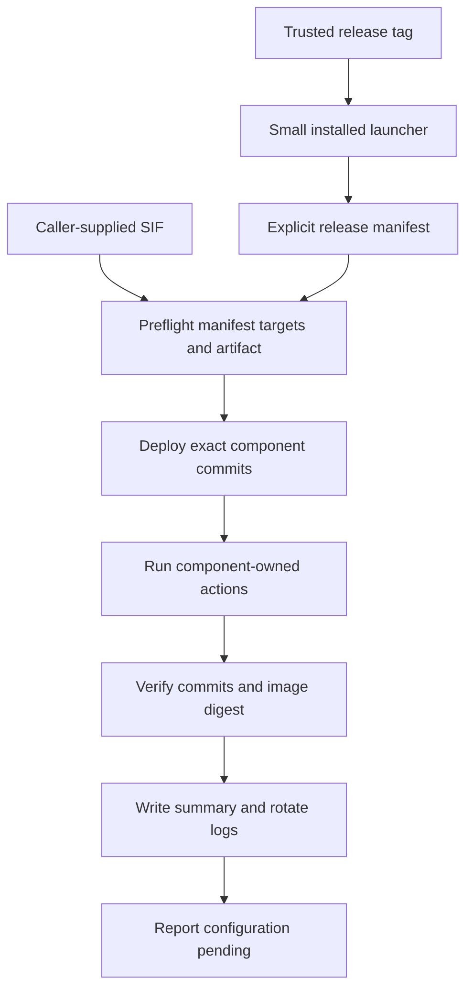
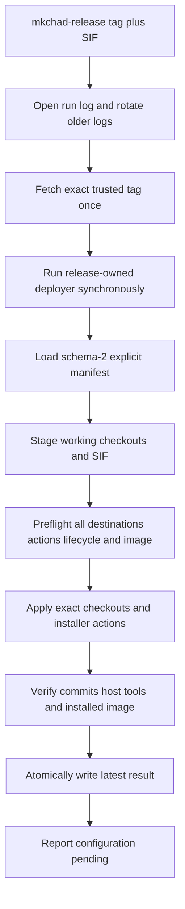

# Simplified Release Deployment - Plan

## Goal Capsule

- **Objective:** Deploy the component set declared by a trusted MkChad release onto a target machine with exact commit and image verification, without the adversarial hardening and automatic recovery machinery of the first deployment design.
- **Product authority:** The selected release's explicit manifest is the sole authority for component repositories, commits, dispositions, destinations, actions, and image metadata; parent submodule gitlinks are development conveniences only.
- **Operating profile:** One trusted operator uses a trusted account, host, canonical Git remote, release tag, local SIF, and destination roots.
- **Scope:** This plan owns host-neutral release deployment. Host-specific `config_files` changes remain a separate configuration phase and are not active scope.
- **Execution profile:** Replace the parent launcher, deployer, schemas, tests, and deployment documentation without changing child installer or MkChad lifecycle internals.
- **Stop conditions:** Stop before checkout or installer mutation on malformed metadata, unavailable commits, dirty or unexpected destinations, active managed services, or image mismatch; stop at the first apply failure without rollback.
- **Tail ownership:** Implementation owns local code, tests, documentation, and coherent commits. The operator installs the renamed launcher, supplies release pins and a real SIF for the next release, and performs any live deployment or service activation.
- **Open blockers:** None.

---

## Product Contract

### Summary

Replace the current security-heavy deployment framework with a focused manifest runner.
A small installed launcher fetches a trusted release tag, and the release-owned deployer installs the manifest's exact component commits and SIF, verifies the resulting pinned state, and records concise diagnostics.

### Problem Frame

The existing implementation treats release deployment as an adversarial trust and crash-recovery system.
It includes independent SHA authority, double tag observation, bootstrap path hardening, integrity-bound evidence bundles, filesystem identity checks, detached process supervision, durable recovery journals, and automatic complete/restore reconciliation.
Those controls impose substantial implementation, testing, and operational cost without matching the actual single-user use case.

The useful core is smaller: record the desired component set, deploy exact revisions without overwriting local work, validate the supplied image, run known installers, and show enough output to repair and rerun an ordinary failure.

### Key Decisions

- **Trusted single-user safety model** (session-settled: user-directed — chosen over adversarial local hardening: the operator is the only user and does not need defenses against hostile local writers or substituted repositories). The design protects against routine mistakes, unexpected local state, incorrect release inputs, and ordinary command failures.
- **Explicit release manifest authority** (session-settled: user-directed — chosen over deriving deployment revisions from parent gitlinks: the release should directly write down the components it intends to deploy). Manifest revisions may intentionally differ from parent submodule gitlinks.
- **Focused manifest runner** (session-settled: user-approved — chosen over a hard-coded installer and versioned release directories: the manifest should remain authoritative without rebuilding transactional deployment). The runner uses a preflight, apply, verify, and report flow.
- **Small installed launcher** (session-settled: user-directed — chosen over requiring a parent development checkout: a target machine needs one simple entrypoint that fetches and runs the selected release). The launcher trusts the configured canonical remote and exact release tag.
- **Stop, repair, and rerun** (session-settled: user-directed — chosen over automatic rollback: successful steps remain applied when a later step fails). The same release can be rerun idempotently after the operator repairs the reported issue.
- **Pinned state defines success** (session-settled: user-approved — chosen over runtime smoke testing or full inventory parity: deployment certainty comes from exact checkout commits, successful installer actions, and the installed image digest). Host configuration and service activation remain later steps.
- **Small diagnostic record** (session-settled: user-directed — chosen over recovery journals and append-only receipts: deployment records exist for inspection, not control flow). Each run has a log, the current log plus two previous logs are retained, and the latest completed result has one JSON summary.
- **No legacy deployment compatibility** (session-settled: user-directed — chosen over retaining `v1.0.1` authority and recovery formats: the next release may establish the simplified contract). Old authority, receipt, journal, and recovery schemas do not constrain the replacement.

<!-- ce-section: work-relationships -->
### How This Work Fits Together

This plan owns release deployment only; the surrounding areas are separate work and not a committed roadmap.

- **Can proceed independently of release deployment:** `config_files` linking, regular-file materialization, encrypted secret handling, and host-branch maintenance.
- **Follows successful deployment:** host-specific MkChad configuration updates and explicit service activation.
- **Remains independently owned:** container image construction, OpenCode package publication, runtime lifecycle/status, and component-owned installer internals.

### Actors

- A1. The operator selects a release tag and local SIF, runs deployment, repairs reported failures, updates host configuration separately, and activates services explicitly.
- A2. The installed launcher fetches the exact release from the configured canonical remote and invokes that release's deployer from temporary storage.
- A3. The release-owned deployer validates the manifest and target state, installs exact component revisions, invokes declared actions, verifies pinned state, and records diagnostics.
- A4. Component-owned installers remain responsible for their own outputs and idempotence.

### Initial Component Model

| Component | Disposition | Release expectation |
|---|---|---|
| `msk_containers` | Deployed | Persistent host checkout at the manifest's exact commit; supplies host-tool and image installation actions. |
| `container_tools` | Deployed dependency | Exact manifest commit required by the selected `msk_containers` release. |
| `mkchad` | Deployed | Persistent host checkout at the manifest's exact commit. |
| `opencode` | Embedded | Supplied by the pinned SIF; the SIF digest is the deployment identity. |
| `opencode.nvim` | Configuration-owned | Exact required revision is reported for the later configuration phase. |
| `opencode-project-reload` | Configuration-owned | Exact required revision is reported for the later configuration phase. |
| `compound-engineering` | Configuration-owned | Exact required revision is reported for the later configuration phase. |
| `opencode_sprint_loop` | Disabled | Intentionally absent from deployment. |

`config_files` is workspace-only and is not a release component.

### Requirements

**Release selection and manifest**

- R1. Normal deployment accepts an exact release tag and caller-supplied local SIF path without requiring a separately supplied parent commit SHA.
- R2. A small installed launcher fetches the exact tag from its configured canonical remote into temporary storage and invokes only the deployer contained in that release.
- R3. The release manifest explicitly records every component's name, disposition, repository, and full commit when a source revision applies.
- R4. Deployed components additionally declare fixed destinations and ordered installer actions, while configuration-owned components declare revisions to report in the configuration handoff.
- R5. The manifest is the sole deployment authority and may differ from parent submodule gitlinks without warning or failure.
- R6. Unknown manifest schemas, fields, dispositions, action forms, or duplicate components fail before destination mutation.

**Preflight and apply**

- R7. The deployer validates the complete manifest, local SIF, component destinations, and declared actions before changing a final destination.
- R8. An absent deployed component is cloned at its declared destination, while an existing expected checkout is fetched and detached at the exact manifest commit.
- R9. Dirty worktrees, unexpected repositories, unexpected path types, destination conflicts, and missing component commits block deployment without reset, stash, merge, or overwrite.
- R10. Installer actions execute as fixed argument arrays from their pinned component checkout and never as shell command strings.
- R11. Component-owned installers remain authoritative for their outputs and must support safe repeated invocation.
- R12. The supplied SIF must match the manifest's architecture and SHA-256 before image installation, and the installed image digest must match afterward.
- R13. One ordinary deployment lock prevents two release deployments from mutating the same target concurrently.
- R14. Deployment requires the managed service to be inactive before any checkout or installer mutation, but an active service may remain running when complete preflight proves the target already compliant and the invocation performs verification only.

**Failure and rerun behavior**

- R15. The deployer stops at the first failed component or action and retains earlier successful changes without automatic rollback.
- R16. A failed run reports the completed steps, failing step, command status, and repair-and-rerun guidance.
- R17. Repeating the same release after success or repair is safe, skips already compliant component and image state, and may verify a fully compliant active target without mutation.
- R18. Commands have finite timeouts and can be interrupted without creating a claim that the full deployment was rolled back or recovered.

**Verification and diagnostics**

- R19. Success requires every deployed checkout to match its manifest commit, every executed action to succeed, every apply action omitted by complete compliance to be recorded as `skipped-compliant`, and the installed image digest to match the selected artifact.
- R20. Deployment reports embedded, configuration-owned, and disabled components distinctly rather than claiming that configuration-owned components were installed.
- R21. Each run streams its subprocess stdout and stderr to the terminal while recording the same output in a deployment log.
- R22. Log rotation retains the current deployment log and the two immediately preceding logs.
- R23. Each completed run replaces one latest-result JSON summary containing the release tag, outcome, component commits and dispositions, image digest, action results, and log path.
- R24. Logs and summaries omit credentials, private configuration contents, and secret-bearing environment values.
- R25. Successful component deployment ends in a clearly reported configuration-pending state and does not read or modify `config_files`.

### Key Flows

- F1. **Deploy a release on a fresh target.** The operator supplies a tag and SIF; the launcher fetches the release; the deployer validates the manifest and artifact, creates exact component checkouts, runs installers, verifies pinned state, and records success with configuration pending.
- F2. **Update an existing target.** The deployer validates clean expected checkouts, fetches exact manifest commits, updates only noncompliant components, runs required idempotent actions, and verifies the final state.
- F3. **Refuse unsafe local state.** Preflight finds local work or an unexpected destination and stops before mutation with the exact path and reason.
- F4. **Handle an ordinary failure.** A component action fails; deployment stops, records the output and partial completion, and exits nonzero; the operator repairs the issue and reruns the same release.
- F5. **Hand off to configuration.** Successful deployment reports the configuration-owned component revisions and guidance, then leaves service activation to the operator.

### Acceptance Examples

- AE1. **Covers R1-R8, R19.** Given a fresh target, trusted release tag, and matching SIF, deployment creates the declared checkouts at the manifest commits, installs the image, and reports verified success without an expected-parent-SHA argument.
- AE2. **Covers R5, R8, R19.** Given a manifest revision that differs from the parent workspace's submodule gitlink, deployment uses and verifies the manifest revision.
- AE3. **Covers R8-R9.** Given an existing clean expected checkout at an older commit, deployment updates it to the manifest commit; given local tracked or untracked work, preflight stops without modifying it.
- AE4. **Covers R7, R12.** Given a SIF with the wrong digest or architecture, deployment stops before installer actions and records the mismatch.
- AE5. **Covers R10-R18.** Given an installer action fails after an earlier component succeeds, deployment stops without rollback, records both outcomes, and succeeds when rerun after the issue is repaired.
- AE6. **Covers R14, R17, R19.** Given the target already matches the selected release, a repeated run verifies the same pinned state without unnecessary checkout or image replacement, including while the managed service remains active.
- AE7. **Covers R20-R25.** Given component deployment succeeds, the summary distinguishes deployed, embedded, configuration-owned, and disabled components, points to the run log, and reports configuration pending without touching `config_files`.
- AE8. **Covers R21-R24.** After four deployment attempts, only the current and two immediately preceding logs remain, and the latest-result JSON describes the most recently completed attempt without secret content.

### Success Criteria

- A target machine with the installed launcher can deploy a release using only a trusted tag and local SIF path.
- The release manifest directly answers which components, repositories, commits, destinations, actions, and image are intended.
- Successful deployment proves exact deployed checkout commits and installed image digest.
- Dirty or unexpected local state is not overwritten.
- Ordinary failures are diagnosable from terminal output, the retained log, and the latest-result summary, then recoverable by repair and idempotent rerun.
- The replacement is materially smaller and easier to reason about because it contains no adversarial bootstrap chain, automatic rollback engine, or crash-recovery state machine.

### Scope Boundaries

- No compatibility with the `v1.0.1` bootstrap authority, receipt, journal, or recovery formats is required.
- No independent parent SHA, tag signature, signer allowlist, authority evidence object, or parent object bundle is required.
- No hostile-local-writer, hostile-same-user, ACL trust, inode substitution, PID reuse, procfs process identity, or destination race defense is required.
- No automatic complete, restore, rollback, or interrupted-operation recovery command is required.
- No deployment-time `config_files` mutation, secret materialization, service activation, package publication, image construction, or runtime inventory redesign is included.
- The launcher and deployer may use ordinary owner-controlled files, directories, Git configuration, and process execution appropriate for a trusted single-user host.

### Assumptions

- The operator controls the configured canonical remote and chooses trustworthy release tags.
- The operator controls the destination account, paths, SIF, and local Git configuration.
- Component repositories retain the manifest commits for the supported release lifetime.
- Declared component installers are trusted, noninteractive, and idempotent for the supported arguments.
- Abrupt process or host interruption may require manual inspection and repair before rerunning; the deployer does not promise automated reconciliation.

---

## Planning Contract

**Product Contract preservation:** changed: R14, R17, R19, and AE6 clarify the user-approved active-service verify-only rerun, including explicit `skipped-compliant` apply results; mutation still requires inactivity.

### Key Technical Decisions

- KTD1. **Replace the old deployment implementation rather than pruning it.** `deploy/mkchad_deploy.py` currently couples release authority, Git staging, filesystem identity, detached supervision, journaling, and recovery across nearly 3,000 lines. Rewriting the launcher and deployer around the new contract avoids carrying hidden recovery dependencies or obsolete compatibility branches into the simpler system.
- KTD2. **Rename the launcher to `mkchad-release`.** Delete `deploy/mkchad_release_bootstrap.py`, add `deploy/mkchad_release.py`, and install it as `~/.local/bin/mkchad-release`. The public CLI is `mkchad-release --release TAG --image PATH`; there is no expected-SHA, development, custom-remote, trust, or recovery form.
- KTD3. **Use one fixed remote and one exact tag fetch.** The launcher initializes a temporary Git repository, fetches only `refs/tags/TAG` from `git@github.com:krafczyk/mkchad_dev.git`, resolves the fetched object to one commit, checks out that commit without submodules, and synchronously runs its `deploy/mkchad_deploy.py`. It does not re-fetch the tag or produce authority evidence.
- KTD4. **Introduce future-only release schema 2.** Replace `deploy/release-v1.schema.json` with `deploy/release-v2.schema.json`. Every release component explicitly records `name`, `disposition`, `repository`, and a full `commit`; deployed components additionally record a named-root destination, ordered phased actions, and any allowed preserved paths. Runtime validation remains authoritative and strict even though the JSON Schema documents the same closed shape.
- KTD5. **Make the manifest independent of parent and nested gitlinks.** Deployment never reads parent gitlinks to derive or compare revisions. The initial schema-2 manifest intentionally records the currently selected release set as explicit values, including `container_tools` as its own deployed component; future releases update those values directly.
- KTD6. **Keep the four existing disposition semantics.** `deployed` components become exact persistent checkouts, `embedded` components are represented by the verified SIF artifact, `configuration-owned` components are emitted in the handoff, and `disabled` components are reported but not fetched or installed. Only deployed commits are fetched during deployment; other commits are validated syntactically and retained as release metadata.
- KTD7. **Stage all deployed inputs before final-path mutation.** The deployer fetches each deployed manifest commit into temporary bare storage, creates temporary working checkouts, assembles the manifest-selected `container_tools` checkout inside staged `msk_containers`, validates and runs preflight actions there, copies the SIF to a correctly named temporary raw-image path, and verifies digest and architecture. This preserves complete installer and destination preflight without recovery machinery.
- KTD8. **Use ordinary exact-checkout updates.** An absent checkout is prepared in a temporary sibling directory and renamed into place after a final absence check. An existing checkout must be the declared repository with no tracked or untracked work outside declared preserved paths; apply fetches from staged storage and performs a detached checkout at the manifest commit. No reset, merge, pull, stash, alternate index, tree reconstruction, inode ledger, or rollback is used.
- KTD9. **Treat `container_tools` as an independently pinned nested checkout.** Apply order is `msk_containers`, `container_tools`, then `mkchad`. The parent `msk_containers` cleanliness check ignores submodule worktree state only for `container_tools`, while the nested destination receives its own repository, cleanliness, and exact-commit checks. The selected manifest commit may differ from the `msk_containers` tree's gitlink.
- KTD10. **Preserve only declared MkChad configuration paths.** Schema 2 lists `opencode-server.json` and `lazy-lock.json` as preserved paths for `mkchad`. They may remain ignored and untracked, are excluded from checkout cleanliness failures, and are never read, deleted, or rewritten by deployment; no other unexpected path receives this exception.
- KTD11. **Represent installer behavior as phased typed actions.** Actions retain `id`, normalized repository-relative executable `path`, and typed argument arrays, and add `phase` with `preflight`, `apply`, or `verify`. Host tools and the image installer both expose non-mutating preflight before their apply actions; final host-tool and image verification follows apply.
- KTD12. **Reuse child-owned installer interfaces without changing child repositories.** The deployer supplies a fresh temporary mode-`0700` recovery directory to staged `msk_containers/bin/install_nvim.sh --check` and to final-checkout apply because the current installer requires it when replacing outputs, then discards that directory after the run. The directory is an ephemeral child-interface input, not retained recovery state. Image installation remains `nvim/bin/install_nvim_container --source-revision MSK_COMMIT STAGED_SIF`.
- KTD13. **Keep one synchronous lifecycle boundary.** The deployer takes the existing `${XDG_STATE_HOME}/mkchad/deployment.lock` non-blockingly and reads `~/.local/bin/mkchad-opencode-server status --json` with a timeout greater than its documented 35-second bound. Existing targets require schema 1, `ok: true`, `command: status`, and a recognized status; `inactive` permits apply, while any active status permits only a fully compliant verify-only run. A missing lifecycle command is accepted only when all three checkout destinations, installer-owned host tools, and managed image paths are absent; any partial target blocks.
- KTD14. **Use simple bounded subprocess execution.** Git, lifecycle, runtime, and action commands execute synchronously with inherited working directories, fixed argument arrays, finite timeouts, and no shell interpolation. A timeout terminates the live command's process group and reports failure; no PID is persisted, rediscovered, or signaled during a later run. Image inspection follows the unchanged installer contract by resolving `apptainer` first and `singularity` second from `PATH`, then running only `uname -m` inside the staged image.
- KTD15. **Put diagnostic state under one XDG directory.** Use `${XDG_STATE_HOME:-$HOME/.local/state}/mkchad/deploy/`, with immutable run logs under `logs/` and one atomically replaced `latest-result.json`. At invocation start the launcher retains the two newest prior logs before creating the current log, yielding three logs including the active run.
- KTD16. **Let the launcher own terminal/log teeing and let the deployer own detailed results.** The launcher streams its Git output and the deployer process's stdout and stderr to the corresponding terminal streams and the current log. It passes release, image, log, and result paths to the internal deployer; the deployer atomically writes detailed terminal outcomes, while the launcher writes the same result schema for pre-handoff failures. Neither process serializes environment maps or action arguments, and recognizable credential assignments are redacted before the same filtered line reaches terminal and log.
- KTD17. **Replace recovery receipts with result schema 1.** Delete `deploy/receipt-v1.schema.json` and add `deploy/result-v1.schema.json`. A result records the release tag, timestamps, terminal outcome, phase, component requested/observed commits, artifact expected/observed digest, action statuses, configuration handoff, failed step, concise diagnostic, and log path. It never controls whether a later deployment may run.
- KTD18. **Record only completed terminal outcomes.** Normal success, caught failure, and caught interruption atomically replace `latest-result.json`. An uncatchable process or host interruption may leave the prior complete result and a newer incomplete run log; the next invocation performs fresh preflight rather than interpreting stale state.
- KTD19. **Record the release-specific trusted-host profile in project instructions.** Update `AGENTS.md` to state that `mkchad-release` supports one trusted operator on a trusted host and that malicious same-user writers, hostile local repository substitution, remote compromise, and adversarial filesystem races are outside this command's supported threat model. This is a release-deployment exception, not a redefinition of runtime server, credential, or cross-user network boundaries.
- KTD20. **Remove adversarial review and verification gates.** Planning and implementation verify ordinary correctness, idempotence, data preservation, bounded commands, and diagnostics. They do not run security-review personas or add hostile-writer, ACL, inode-race, PID-reuse, procfs, signer, or authority-chain acceptance gates.
- KTD21. **Serialize the entire public invocation before diagnostics mutate.** The launcher takes a nonblocking `${XDG_STATE_HOME}/mkchad/deploy/invocation.lock` before rotating logs, creating the current log, fetching a release, or replacing the latest result, and holds it through synchronous deployer completion. Contention exits nonzero with a terminal-only diagnostic and creates no run artifact; the deployer's existing deployment lock remains the lifecycle/startup interlock and protects direct internal invocation.
- KTD22. **Bind result publication to the admitted run.** Every admitted run has one run ID recorded in its log name and result. The launcher accepts a deployer-written result as current only when both run ID and log path match; if the child exits without that result, the launcher atomically publishes a fallback terminal result for the same run instead of mistaking the previous run's JSON for current output.

The initial phased action schedule is:

| ID | Phase | Command contract |
|---|---|---|
| `host-tools-preflight` | `preflight` | `bin/install_nvim.sh --check --recovery-dir RECOVERY_DIR` from staged `msk_containers`. |
| `image-install-preflight` | `preflight` | `nvim/bin/install_nvim_container --dry-run --source-revision MSK_COMMIT STAGED_SIF` from staged `msk_containers`. |
| `host-tools-install` | `apply` | `bin/install_nvim.sh --recovery-dir RECOVERY_DIR` from the final pinned checkout. |
| `image-install` | `apply` | `nvim/bin/install_nvim_container --source-revision MSK_COMMIT STAGED_SIF` from the final pinned checkout. |
| `host-tools-verify` | `verify` | `bin/install_nvim.sh --check` from the final pinned checkout. |

The deployer additionally verifies the active installed image digest after the verify phase. The compliance classifier compares all deployed HEADs, installer-owned host-tool bytes and modes, and the active image digest; only complete agreement permits the active-service verify-only path.

### Schema 2 Contract

The runtime parser and `deploy/release-v2.schema.json` define one closed top-level object with `schema`, `components`, `artifacts`, and `configuration`.

| Area | Required shape |
|---|---|
| Component identity | Unique known `name`, fixed `disposition`, canonical repository URL, and lowercase 40-character `commit`. |
| Deployed component | Named-root `destination`, ordered `actions`, and optional closed `preserved_paths`; ancestor/descendant overlap is rejected except for `container_tools` at `xdg_data_home/mkchad/components/msk_containers/container_tools` beneath its owning `msk_containers` checkout. |
| Non-deployed component | No destination, actions, or preserved paths; its repository and commit remain handoff or traceability metadata. |
| Action | Unique `id`, `phase` in `preflight`/`apply`/`verify`, executable repository-relative `path`, and arguments containing safe literals or known tokens. |
| Image artifact | One entry per supported architecture with `architecture`, `sha256`, and `source_filename_class: raw-nvim-container`. |
| Configuration | Contract version and normalized guidance path; configuration-owned repositories and commits come directly from component entries. |

The initial schema-2 manifest uses these explicit source pins as its migration baseline; implementation must re-read the intended release state before editing and may update a pin only when the selected release input requires it:

| Component | Repository | Baseline commit |
|---|---|---|
| `msk_containers` | `git@github.com:krafczyk/msk_containers` | `a084416bf54b113677f5227380916e9003591111` |
| `container_tools` | `git@github.com:krafczyk/container_tools` | `22ffd7f3e8a52ec5a40dd95cb7428a7128830bc7` |
| `mkchad` | `git@github.com:krafczyk/mkchad` | `fb089cf345b33c7fd87dcc1d56677766c5719708` |
| `opencode` | `git@github.com:krafczyk/opencode.git` | `a8a797ab717289fe30308b1e3bcc8dfa865beb4a` |
| `opencode.nvim` | `git@github.com:krafczyk/opencode.nvim` | `37033dc157ac4c05c1e1525fe2fc9e87ae83e2ac` |
| `opencode-project-reload` | `git@github.com:krafczyk/opencode-project-reload.git` | `4548302d5b79ab079b2a9d503a4556c6119cbab2` |
| `compound-engineering` | `git@github.com:krafczyk/compound-engineering-plugin.git` | `f07e820a4146963de4e3ae1197c82f6686507e6c` |
| `opencode_sprint_loop` | `git@github.com:krafczyk/opencode_sprint_loop` | `5e71e56e6fc471c7021a7e34a58485cb38c2ab49` |

### High-Level Technical Design

The deployer uses a small in-memory run model rather than a durable state machine. Each component advances through `pending`, `staged`, `compliant` or `updated`, and `verified`; each action advances through `pending`, `succeeded`, `skipped-compliant`, or `failed`. The model exists only to produce diagnostics and the terminal result. A verify-only run executes preflight and verify actions, executes no apply action, and records every omitted apply action as `skipped-compliant`.

The launcher creates one temporary root for the parent checkout, deployed-component bare repositories, disposable staged working checkouts, the staged SIF, and the installer recovery directory. The deployer prepares each absent final checkout in a temporary sibling beneath that destination's parent so the final rename stays on one filesystem. Normal exit removes owned temporary paths. Unexpected interruption may leave temporary files; later runs do not adopt or interpret them.

### Existing Patterns To Retain

- `deploy/mkchad_deploy.py:76-82` rejects duplicate JSON keys before semantic validation.
- `deploy/mkchad_deploy.py:290-303` resolves normalized relative destinations beneath named roots.
- `deploy/mkchad_deploy.py:426-442` validates action IDs, paths, literals, and typed tokens without shell interpolation.
- `deploy/mkchad_deploy.py:558-608` provides the behavioral baseline for wrong-origin and dirty-worktree refusal, stripped of ownership, external-Git-dir, hostile-config, and inode checks.
- `deploy/mkchad_deploy.py:954-1054` provides SHA-256 staging and installed-image verification patterns, simplified to ordinary regular-file handling.
- `deploy/mkchad_deploy.py:1608-1652` provides architecture selection, exact-commit staging, and pinned action-file validation.
- `msk_containers/bin/install_nvim.sh:145-150,219-229` defines the public host-tool check/apply interface and delegation to `container_tools`.
- `msk_containers/nvim/bin/install_nvim_container:318-463` defines raw-image naming, source-revision transport, idempotent image installation, and active-image links.
- `mkchad/lua/configs/opencode.lua:91-104,209-309` defines the deployment/start interlock shared with MkChad startup.
- `tests/run_deployment_tests.sh:1-30` defines isolated HOME, XDG, runtime, Git, and temporary roots beneath `/tmp/mkchad-v1`.

### Sequencing And Migration

1. Add the schema-2 and result schemas, a schema-2 fixture manifest, and the release-specific project instruction profile with parser tests while retaining schema-1 `deploy/release.json` and its schemas for the still-active old implementation.
2. Add the renamed launcher and its isolated tests alongside the still-active schema-1 bootstrap without installing either into the protected live path.
3. Rewrite the deployer from manifest load through complete preflight before adding final-path apply behavior.
4. Add checkout updates, lifecycle exclusion, phased actions, image installation, verification, and result publication in that order.
5. Atomically switch `deploy/release.json` to schema 2 and delete old authority, receipt, supervisor, journal, recovery, schema, and legacy tests only when replacement scenario coverage passes.
6. Update parent and child deployment documentation, advance the explicit `msk_containers` manifest pin to the resulting documentation commit, then run the isolated end-to-end rehearsal.
7. Commit child documentation first and parent replacement second. Push the replacement before preparing a future schema-2 release, and provision `~/.local/bin/mkchad-release` before that release's first target deployment.

Existing schema-1 journals and bundles are historical files. The replacement neither scans, deletes, migrates, nor blocks on them. The old installed bootstrap remains usable only for old releases and is not invoked by the schema-2 flow.

### Risks And Dependencies

- **Child installer recovery argument:** The current host-tool installer requires a private recovery directory when replacing files. The deployer supplies an ephemeral one and discards it, so abrupt interruption can require manual repair exactly as the Product Contract allows.
- **Nested checkout divergence:** A manifest-owned `container_tools` commit may differ from the parent tree's gitlink. Parent cleanliness and nested cleanliness must be evaluated separately or every legitimate rerun will appear dirty.
- **Preserved configuration paths:** Treating all ignored paths alike would either overwrite configuration or allow unrelated residue. Only the two manifest-declared MkChad paths receive an exception.
- **Partial apply:** A failed later action leaves earlier exact checkouts or installer outputs applied. The result and log must identify this honestly, and a repeat must preflight actual current state rather than relying on the prior result.
- **Uncatchable interruption:** No result update or cleanup is guaranteed after `SIGKILL` or host loss. Manual inspection and a fresh rerun are the supported recovery model.
- **Launcher cutover:** The first schema-2 release cannot be deployed by the old bootstrap. Documentation must make launcher provisioning an explicit prerequisite.

---

## Implementation Units

### U1. Define explicit release and result contracts

- **Goal:** Establish future-only machine-readable contracts without breaking the still-active schema-1 implementation before cutover.
- **Requirements:** R3-R6, R20, R23-R25; AE2, AE7-AE8
- **Files:** `AGENTS.md`; `deploy/release-v2.schema.json` (new); `deploy/result-v1.schema.json` (new); `tests/fixtures/deployment/release-v2.json` (new); `deploy/mkchad_deploy.py`; `tests/test_mkchad_deploy.py`.
- **Approach:** Record the trusted-host deployment exception in project instructions, then add strict schema-2 runtime validation and schema-1 result validation as small pure functions behind tests and a fixture. The fixture records all eight explicit repositories and commits, `container_tools`, phased actions, MkChad preserved paths, and manifest-derived configuration handoff. Retain schema-1 `deploy/release.json`, both v1 schemas, and their active consumers until U6 cutover.
- **Test scenarios:** Exact valid schema; duplicate component and action IDs; missing and unknown fields; malformed repository, commit, destination, preserved path, token, action phase, architecture, and digest; destination overlap; wrong disposition-specific fields; absent `container_tools`; inclusion of workspace-only `config_files`; manifest/gitlink disagreement accepted; valid succeeded, failed, and interrupted results; malformed/future result rejection.
- **Verification:** `python3 -m unittest -v tests.test_mkchad_deploy.DeploymentContractTests`
- **Dependencies:** None.

### U2. Replace the bootstrap with the installed launcher

- **Goal:** Provide the two-argument public release entrypoint, one trusted tag fetch, log rotation, and synchronous handoff.
- **Requirements:** R1-R2, R18, R21-R24; F1, F4; AE1, AE5, AE8
- **Files:** `deploy/mkchad_release.py` (new); `tests/test_mkchad_release.py` (new).
- **Approach:** Parse only `--release` and `--image`, create the XDG diagnostic directory and current log, prune to two prior logs, fetch one exact tag from the fixed remote into a temporary checkout, and invoke that checkout's deployer with internal release/image/log/result arguments. Stream both output channels to their matching terminal streams and the shared log. Write an atomic failed result when acquisition or handoff fails before the deployer can publish one.
- **Test scenarios:** Exact annotated or lightweight tag resolving to a commit; malformed tag; missing tag; tag resolving to a non-commit; no branch fallback; exactly one fetch; no submodule checkout; deployer selected from fetched release; unknown or removed options rejected; paths containing spaces; terminal/log channel capture; four invocations retain exactly three logs; pre-handoff failed result; successful and nonzero synchronous child status; child exit without result publication; stale result with a different run ID or log path; concurrent invocation refusal without log rotation or result replacement; temporary checkout cleanup after normal completion.
- **Verification:** `python3 -m unittest -v tests.test_mkchad_release`
- **Dependencies:** U1 result schema.

### U3. Build manifest staging and complete preflight

- **Goal:** Prove every deployed input and target is usable before final-path mutation.
- **Requirements:** R7, R9-R10, R12-R14; F1-F3; AE1, AE3-AE4
- **Files:** `deploy/mkchad_deploy.py`; `tests/test_mkchad_deploy.py`; `tests/fixtures/deployment/`.
- **Approach:** Replace the old deployer body with synchronous load, roots, staging, and preflight modules. Fetch each deployed commit into temporary bare storage, create disposable working checkouts, place staged `container_tools` at the nested path selected by the manifest, validate action blobs and executable bits, run phased preflight actions, stage and hash the local SIF under the installer-required architecture filename, validate all named destinations and existing checkout identities, acquire the shared lock, and require inactive lifecycle status before apply. Keep Git hooks disabled for deployment-owned checkouts but do not inspect or reject the operator's broader Git configuration.
- **Test scenarios:** Unavailable exact commit; action missing, non-executable, symlinked, or outside the tree; wrong image digest or architecture; Apptainer precedence, Singularity fallback, and no-runtime refusal; image dry-run rejection for malformed version, link conflict, or managed destination conflict; duplicate destinations, permitted `container_tools` nesting, and every other overlap; wrong origin; non-Git destination; dirty tracked and untracked paths; preserved paths accepted only when absent from the target tree and still ignored by that tree; all targets and preflight actions checked before any checkout; deployment-lock contention; inactive target; active compliant verify-only target; active noncompliant refusal; malformed and failed lifecycle status; lifecycle timeout above 35 seconds; completely fresh target and every partial-target missing-lifecycle refusal.
- **Verification:** `python3 -m unittest -v tests.test_mkchad_deploy.DeploymentPreflightTests`
- **Dependencies:** U1.

### U4. Apply and verify exact component checkouts

- **Goal:** Materialize the three deployed checkouts at manifest commits with safe idempotent reruns.
- **Requirements:** R8-R9, R15-R17, R19; F1-F4; AE1-AE3, AE5-AE6
- **Files:** `deploy/mkchad_deploy.py`; `tests/test_mkchad_deploy.py`; `tests/fixtures/deployment/`.
- **Approach:** Install absent checkouts from staged bare repositories through temporary sibling directories. Update existing clean checkouts with an exact local fetch and detached checkout. Apply in `msk_containers`, `container_tools`, `mkchad` order, ignore only nested submodule state in the parent check, preserve only manifest-declared MkChad paths, skip compliant HEADs, stop immediately on the first failure, and verify observed HEAD and origin for every deployed component.
- **Test scenarios:** Fresh three-checkout install; older clean checkout update; all-compliant no-op; manifest commit differs from parent and nested gitlinks; nested checkout independently clean/dirty/wrong-origin; MkChad preserved files survive update; update failure after an earlier checkout succeeds; rerun completes from partial state; destination appears before final rename; checkout interruption leaves a manually diagnosable Git state rather than triggering recovery behavior.
- **Verification:** `python3 -m unittest -v tests.test_mkchad_deploy.DeploymentCheckoutTests`
- **Dependencies:** U3.

### U5. Integrate phased actions, image installation, and diagnostics

- **Goal:** Complete the synchronous deployment flow and publish trustworthy terminal results.
- **Requirements:** R10-R25; F1-F5; AE1, AE4-AE8
- **Files:** `deploy/mkchad_deploy.py`; `tests/test_mkchad_deploy.py`; `tests/test_mkchad_release.py`; `tests/fixtures/deployment/`.
- **Approach:** Expand known action tokens, classify complete target compliance, run preflight/apply/verify phases in manifest order, provide one ephemeral installer recovery directory, install the staged SIF through the pinned `msk_containers` checkout, verify host tools and active image digest, build the manifest-derived configuration handoff, and atomically publish the run-bound result. Run commands in live process groups with timeouts; emit redacted concise diagnostics while the launcher records the same streamed output to terminal and log.
- **Test scenarios:** Host-tool preflight before checkout mutation; action argv/token expansion; first action failure stops later actions; timeout stops the live command and records failure; child output appears in terminal and log; existing host tools and image remain no-ops; an active compliant run executes preflight and verify actions but records both apply actions as `skipped-compliant`; wrong installed image digest fails verification; successful result records requested and observed state; partial failure records completed and failed steps; caught interruption records interrupted; uncatchable interruption leaves previous complete result; no recovery/journal state is created; configuration-owned pins and configuration-pending state are reported; action arguments, environment maps, and private configuration contents are absent from JSON.
- **Verification:** `python3 -m unittest -v tests.test_mkchad_deploy.DeploymentExecutionTests tests.test_mkchad_release.ReleaseLoggingTests`
- **Dependencies:** U2, U4.

### U6. Remove legacy surfaces and complete operator documentation

- **Goal:** Make the repository expose only the simplified future-release workflow and prove it end to end.
- **Requirements:** R1-R25; F1-F5; AE1-AE8
- **Files:** `deploy/release.json`; `deploy/release-v1.schema.json` (delete); `deploy/receipt-v1.schema.json` (delete); `deploy/mkchad_release_bootstrap.py` (delete); `deploy/mkchad_deploy.py`; `tests/test_mkchad_release_bootstrap.py` (delete); `tests/test_mkchad_deploy.py`; `tests/run_deployment_tests.sh`; `docs/deployment/README.md`; `docs/deployment/configuration-contract-v1.md`; `msk_containers/docs/host-installation.md`.
- **Approach:** Switch the live manifest to schema 2; remove the old bootstrap, validation, authority, evidence, bundle, supervisor, journal, receipt, recovery, maintenance-quiescence, trust-option APIs, and their tests in the same cutover. Document launcher provisioning, explicit pins, preflight/apply/verify behavior, log/result locations, active verify-only reruns, partial-failure repair and rerun, configuration handoff, and unsupported schema-1 history. Update child documentation without changing installer code, then advance the manifest's explicit `msk_containers` pin. Rebuild the isolated fixture rehearsal around local remotes redirected from fixed production URLs through task-local Git `url.<fixture>.insteadOf` rules, fake lifecycle/runtime/installers, and the renamed launcher.
- **Test scenarios:** Removed CLI options and subcommands fail as unknown; no old schema or recovery files are read or written; fixed production URLs resolve only through task-local fixture rewrites; fresh deployment, update, dirty refusal, wrong image, image dry-run failure, action failure, repair and rerun, inactive and active compliant repeat with explicit `skipped-compliant` apply results, public-launcher contention, three-log retention, run-bound latest-result replacement, and configuration-pending handoff all work through the public launcher; isolated tests never touch protected live paths.
- **Verification:** `bash tests/run_deployment_tests.sh /tmp/mkchad-v1/simplified-release-deployment`
- **Dependencies:** U1-U5.

---

## Verification Contract

Run one resource-intensive suite at a time from the repository that owns it, using fresh task-specific directories beneath `/tmp/mkchad-v1`.

| Gate | Command | Proves |
|---|---|---|
| Python syntax | `python3 -m py_compile deploy/mkchad_release.py deploy/mkchad_deploy.py` | Rewritten entrypoints compile. |
| Launcher | `python3 -m unittest -v tests.test_mkchad_release` | Exact-tag acquisition, synchronous handoff, logging, rotation, and early results. |
| Deployer | `python3 -m unittest -v tests.test_mkchad_deploy` | Manifest, preflight, checkout, action, image, result, and rerun behavior. |
| Parent integration | `bash tests/run_deployment_tests.sh /tmp/mkchad-v1/simplified-release-deployment` | Public launcher flow in isolated HOME/XDG/Git/runtime roots. |
| Host installer regression | From `msk_containers`: `bash tests/install_nvim_test.sh /tmp/mkchad-v1/simplified-host-installer` | Existing public check/apply/idempotence interface remains compatible. |
| Image installer regression | From `msk_containers`: `bash tests/install_nvim_container_test.sh /tmp/mkchad-v1/simplified-image-installer nvim/bin/install_nvim_container` | Transported raw-image and installed-link behavior remains compatible. |
| Lifecycle interlock regression | From `mkchad`: `nvim --headless -u NONE -l tests/opencode_deployment_interlock_spec.lua "$PWD"` | Existing startup/deployment lock contract remains compatible. |
| Diff hygiene | `git diff --check` | No whitespace errors in intended changes. |

Automated tests use local fixture remotes, fake SIF/runtime commands, fake lifecycle status, and fake installers. They cover routine correctness and user-work preservation, not adversarial threat-model or security-review scenarios. Real SIF validation and live deployment remain explicit operator-run gates after implementation and release preparation.

---

## Definition of Done

### Global

- `artifact_readiness` remains `implementation-ready`, and the Product Contract remains traceable through R1-R25, F1-F5, and AE1-AE8.
- `mkchad-release --release TAG --image PATH` is the only public deployment entrypoint and requires no development checkout or expected parent SHA.
- `deploy/release.json` explicitly records all eight component repositories, commits, dispositions, destinations, actions, preserved paths, and image metadata without deriving authority from gitlinks.
- A successful isolated deployment verifies exact deployed commits, successful actions, installed image digest, and configuration-pending handoff.
- Dirty or unexpected destinations block before final-path mutation, and a partial ordinary failure is repairable by rerunning the same release without rollback state.
- Exactly three run logs are retained, and `latest-result.json` is always either the prior complete document or one complete new terminal result.
- No launcher/deployer authority evidence, parent bundle, receipt, journal, detached supervisor, recovery command, trust option, ACL/inode/PID/procfs hardening, or schema-1 compatibility path remains.
- Parent, `msk_containers`, and `mkchad` focused and integration gates pass without changing child-owned installer or lifecycle behavior; the child host-installation documentation matches its simplified caller contract.
- Deployment and configuration documentation describes the renamed launcher, explicit manifest authority, diagnostics, partial-failure handling, and separate configuration phase accurately.
- Abandoned implementation attempts, obsolete tests, generated fixtures, debug output, and temporary artifacts are absent from the final diff; unrelated user work remains untouched.

### Per Unit

- U1 is done when schema-2 manifest and schema-1 result validation are strict, explicit, gitlink-independent, and fully covered.
- U2 is done when the renamed launcher fetches one exact tag, invokes the release deployer synchronously, and owns deterministic three-log diagnostics.
- U3 is done when every deployed commit, action, destination, lifecycle state, and SIF is preflighted before final-path mutation.
- U4 is done when fresh, update, no-op, nested-divergence, preserved-path, partial-failure, and rerun checkout scenarios pass.
- U5 is done when phased installers and image handling produce verified final state plus complete success, failure, and interruption results without recovery state.
- U6 is done when old surfaces are removed, public documentation is current, the isolated launcher rehearsal passes, and unchanged child interfaces pass their focused regressions.
