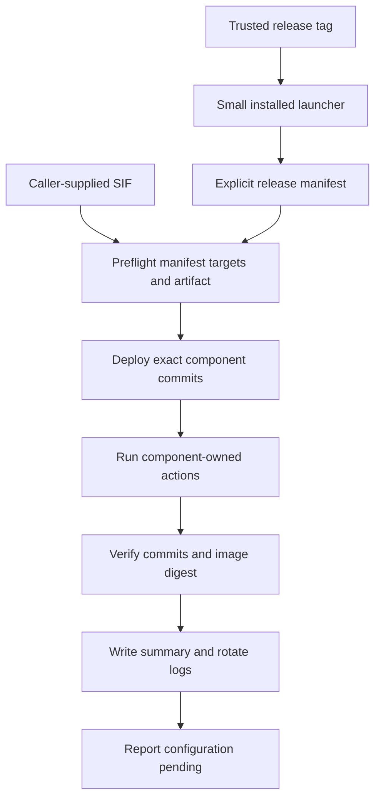

# Simplified Release Deployment - Plan

## Goal Capsule

- **Objective:** Deploy the component set declared by a trusted MkChad release onto a target machine with exact commit and image verification, without the adversarial hardening and automatic recovery machinery of the first deployment design.
- **Product authority:** The selected release's explicit manifest is the sole authority for component repositories, commits, dispositions, destinations, actions, and image metadata; parent submodule gitlinks are development conveniences only.
- **Operating profile:** One trusted operator uses a trusted account, host, canonical Git remote, release tag, local SIF, and destination roots.
- **Scope:** This plan owns host-neutral release deployment. Host-specific `config_files` changes remain a separate configuration phase and are not active scope.
- **Open blockers:** None.

---

## Product Contract

### Summary

Replace the current security-heavy deployment framework with a focused manifest runner.
A small installed launcher fetches a trusted release tag, and the release-owned deployer installs the manifest's exact component commits and SIF, verifies the resulting pinned state, and records concise diagnostics.

### Problem Frame

The existing implementation treats release deployment as an adversarial trust and crash-recovery system.
It includes independent SHA authority, double tag observation, bootstrap path hardening, integrity-bound evidence bundles, filesystem identity checks, detached process supervision, durable recovery journals, and automatic complete/restore reconciliation.
Those controls impose substantial implementation, testing, and operational cost without matching the actual single-user use case.

The useful core is smaller: record the desired component set, deploy exact revisions without overwriting local work, validate the supplied image, run known installers, and show enough output to repair and rerun an ordinary failure.

### Key Decisions

- **Trusted single-user safety model** (session-settled: user-directed — chosen over adversarial local hardening: the operator is the only user and does not need defenses against hostile local writers or substituted repositories). The design protects against routine mistakes, unexpected local state, incorrect release inputs, and ordinary command failures.
- **Explicit release manifest authority** (session-settled: user-directed — chosen over deriving deployment revisions from parent gitlinks: the release should directly write down the components it intends to deploy). Manifest revisions may intentionally differ from parent submodule gitlinks.
- **Focused manifest runner** (session-settled: user-approved — chosen over a hard-coded installer and versioned release directories: the manifest should remain authoritative without rebuilding transactional deployment). The runner uses a preflight, apply, verify, and report flow.
- **Small installed launcher** (session-settled: user-directed — chosen over requiring a parent development checkout: a target machine needs one simple entrypoint that fetches and runs the selected release). The launcher trusts the configured canonical remote and exact release tag.
- **Stop, repair, and rerun** (session-settled: user-directed — chosen over automatic rollback: successful steps remain applied when a later step fails). The same release can be rerun idempotently after the operator repairs the reported issue.
- **Pinned state defines success** (session-settled: user-approved — chosen over runtime smoke testing or full inventory parity: deployment certainty comes from exact checkout commits, successful installer actions, and the installed image digest). Host configuration and service activation remain later steps.
- **Small diagnostic record** (session-settled: user-directed — chosen over recovery journals and append-only receipts: deployment records exist for inspection, not control flow). Each run has a log, the current log plus two previous logs are retained, and the latest completed result has one JSON summary.
- **No legacy deployment compatibility** (session-settled: user-directed — chosen over retaining `v1.0.1` authority and recovery formats: the next release may establish the simplified contract). Old authority, receipt, journal, and recovery schemas do not constrain the replacement.

<!-- ce-section: work-relationships -->
### How This Work Fits Together

This plan owns release deployment only; the surrounding areas are separate work and not a committed roadmap.

- **Can proceed independently of release deployment:** `config_files` linking, regular-file materialization, encrypted secret handling, and host-branch maintenance.
- **Follows successful deployment:** host-specific MkChad configuration updates and explicit service activation.
- **Remains independently owned:** container image construction, OpenCode package publication, runtime lifecycle/status, and component-owned installer internals.

### Actors

- A1. The operator selects a release tag and local SIF, runs deployment, repairs reported failures, updates host configuration separately, and activates services explicitly.
- A2. The installed launcher fetches the exact release from the configured canonical remote and invokes that release's deployer from temporary storage.
- A3. The release-owned deployer validates the manifest and target state, installs exact component revisions, invokes declared actions, verifies pinned state, and records diagnostics.
- A4. Component-owned installers remain responsible for their own outputs and idempotence.

### Initial Component Model

| Component | Disposition | Release expectation |
|---|---|---|
| `msk_containers` | Deployed | Persistent host checkout at the manifest's exact commit; supplies host-tool and image installation actions. |
| `container_tools` | Deployed dependency | Exact manifest commit required by the selected `msk_containers` release. |
| `mkchad` | Deployed | Persistent host checkout at the manifest's exact commit. |
| `opencode` | Embedded | Supplied by the pinned SIF; the SIF digest is the deployment identity. |
| `opencode.nvim` | Configuration-owned | Exact required revision is reported for the later configuration phase. |
| `opencode-project-reload` | Configuration-owned | Exact required revision is reported for the later configuration phase. |
| `compound-engineering` | Configuration-owned | Exact required revision is reported for the later configuration phase. |
| `opencode_sprint_loop` | Disabled | Intentionally absent from deployment. |

`config_files` is workspace-only and is not a release component.

### Requirements

**Release selection and manifest**

- R1. Normal deployment accepts an exact release tag and caller-supplied local SIF path without requiring a separately supplied parent commit SHA.
- R2. A small installed launcher fetches the exact tag from its configured canonical remote into temporary storage and invokes only the deployer contained in that release.
- R3. The release manifest explicitly records every component's name, disposition, repository, and full commit when a source revision applies.
- R4. Deployed components additionally declare fixed destinations and ordered installer actions, while configuration-owned components declare revisions to report in the configuration handoff.
- R5. The manifest is the sole deployment authority and may differ from parent submodule gitlinks without warning or failure.
- R6. Unknown manifest schemas, fields, dispositions, action forms, or duplicate components fail before destination mutation.

**Preflight and apply**

- R7. The deployer validates the complete manifest, local SIF, component destinations, and declared actions before changing a final destination.
- R8. An absent deployed component is cloned at its declared destination, while an existing expected checkout is fetched and detached at the exact manifest commit.
- R9. Dirty worktrees, unexpected repositories, unexpected path types, destination conflicts, and missing component commits block deployment without reset, stash, merge, or overwrite.
- R10. Installer actions execute as fixed argument arrays from their pinned component checkout and never as shell command strings.
- R11. Component-owned installers remain authoritative for their outputs and must support safe repeated invocation.
- R12. The supplied SIF must match the manifest's architecture and SHA-256 before image installation, and the installed image digest must match afterward.
- R13. One ordinary deployment lock prevents two release deployments from mutating the same target concurrently.
- R14. Deployment confirms managed services are inactive when an installer or checkout update requires inactivity, and it never starts those services.

**Failure and rerun behavior**

- R15. The deployer stops at the first failed component or action and retains earlier successful changes without automatic rollback.
- R16. A failed run reports the completed steps, failing step, command status, and repair-and-rerun guidance.
- R17. Repeating the same release after success or repair is safe and skips already compliant component and image state when practical.
- R18. Commands have finite timeouts and can be interrupted without creating a claim that the full deployment was rolled back or recovered.

**Verification and diagnostics**

- R19. Success requires every deployed checkout to match its manifest commit, every declared action to succeed, and the installed image digest to match the selected artifact.
- R20. Deployment reports embedded, configuration-owned, and disabled components distinctly rather than claiming that configuration-owned components were installed.
- R21. Each run streams its subprocess stdout and stderr to the terminal while recording the same output in a deployment log.
- R22. Log rotation retains the current deployment log and the two immediately preceding logs.
- R23. Each completed run replaces one latest-result JSON summary containing the release tag, outcome, component commits and dispositions, image digest, action results, and log path.
- R24. Logs and summaries omit credentials, private configuration contents, and secret-bearing environment values.
- R25. Successful component deployment ends in a clearly reported configuration-pending state and does not read or modify `config_files`.

### Key Flows

- F1. **Deploy a release on a fresh target.** The operator supplies a tag and SIF; the launcher fetches the release; the deployer validates the manifest and artifact, creates exact component checkouts, runs installers, verifies pinned state, and records success with configuration pending.
- F2. **Update an existing target.** The deployer validates clean expected checkouts, fetches exact manifest commits, updates only noncompliant components, runs required idempotent actions, and verifies the final state.
- F3. **Refuse unsafe local state.** Preflight finds local work or an unexpected destination and stops before mutation with the exact path and reason.
- F4. **Handle an ordinary failure.** A component action fails; deployment stops, records the output and partial completion, and exits nonzero; the operator repairs the issue and reruns the same release.
- F5. **Hand off to configuration.** Successful deployment reports the configuration-owned component revisions and guidance, then leaves service activation to the operator.

### Acceptance Examples

- AE1. **Covers R1-R8, R19.** Given a fresh target, trusted release tag, and matching SIF, deployment creates the declared checkouts at the manifest commits, installs the image, and reports verified success without an expected-parent-SHA argument.
- AE2. **Covers R5, R8, R19.** Given a manifest revision that differs from the parent workspace's submodule gitlink, deployment uses and verifies the manifest revision.
- AE3. **Covers R8-R9.** Given an existing clean expected checkout at an older commit, deployment updates it to the manifest commit; given local tracked or untracked work, preflight stops without modifying it.
- AE4. **Covers R7, R12.** Given a SIF with the wrong digest or architecture, deployment stops before installer actions and records the mismatch.
- AE5. **Covers R10-R18.** Given an installer action fails after an earlier component succeeds, deployment stops without rollback, records both outcomes, and succeeds when rerun after the issue is repaired.
- AE6. **Covers R17, R19.** Given the target already matches the selected release, a repeated run verifies the same pinned state without unnecessary checkout or image replacement.
- AE7. **Covers R20-R25.** Given component deployment succeeds, the summary distinguishes deployed, embedded, configuration-owned, and disabled components, points to the run log, and reports configuration pending without touching `config_files`.
- AE8. **Covers R21-R24.** After four deployment attempts, only the current and two immediately preceding logs remain, and the latest-result JSON describes the most recently completed attempt without secret content.

### Success Criteria

- A target machine with the installed launcher can deploy a release using only a trusted tag and local SIF path.
- The release manifest directly answers which components, repositories, commits, destinations, actions, and image are intended.
- Successful deployment proves exact deployed checkout commits and installed image digest.
- Dirty or unexpected local state is not overwritten.
- Ordinary failures are diagnosable from terminal output, the retained log, and the latest-result summary, then recoverable by repair and idempotent rerun.
- The replacement is materially smaller and easier to reason about because it contains no adversarial bootstrap chain, automatic rollback engine, or crash-recovery state machine.

### Scope Boundaries

- No compatibility with the `v1.0.1` bootstrap authority, receipt, journal, or recovery formats is required.
- No independent parent SHA, tag signature, signer allowlist, authority evidence object, or parent object bundle is required.
- No hostile-local-writer, hostile-same-user, ACL trust, inode substitution, PID reuse, procfs process identity, or destination race defense is required.
- No automatic complete, restore, rollback, or interrupted-operation recovery command is required.
- No deployment-time `config_files` mutation, secret materialization, service activation, package publication, image construction, or runtime inventory redesign is included.
- The launcher and deployer may use ordinary owner-controlled files, directories, Git configuration, and process execution appropriate for a trusted single-user host.

### Assumptions

- The operator controls the configured canonical remote and chooses trustworthy release tags.
- The operator controls the destination account, paths, SIF, and local Git configuration.
- Component repositories retain the manifest commits for the supported release lifetime.
- Declared component installers are trusted, noninteractive, and idempotent for the supported arguments.
- Abrupt process or host interruption may require manual inspection and repair before rerunning; the deployer does not promise automated reconciliation.
