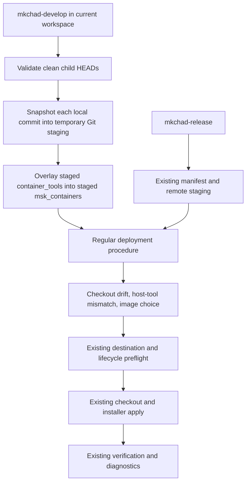

# Developer Tree Deployment - Plan

## Goal Capsule

- **Objective:** Let a developer deploy the clean committed contents of the checked-out `msk_containers`, nested `container_tools`, and `mkchad` repositories, with an optional test image and no release manifest.
- **Product authority:** `mkchad-develop` uses the three local child `HEAD`s and a fixed developer profile; `mkchad-release` remains governed only by its selected release manifest.
- **Operating profile:** One trusted developer runs the command from the current parent workspace and owns the selected child commits, target account, and optional SIF.
- **Open blockers:** None.

---

## Product Contract

### Summary

Add a repository-local developer command that snapshots the current clean child commits into temporary staging and then uses the established deployment preflight, checkout update, installer, verification, and diagnostic behavior.
The image is optional for developer deployment, and both deployment modes avoid image installation when supplied bytes already match the active image.

### Problem Frame

Release deployment requires a published parent tag, release manifest, exact published component pins, and an authorized image digest.
That is appropriate for repeatable releases but makes a small committed child change expensive to test.
The deployment engine also currently treats compliance globally, so a component or host-tool update can rerun image installation even when the supplied image is already active.

### Key Decisions

- **Use a separate developer command.** (session-settled: user-directed -- developer selection must not weaken release authority.)
- **Deploy clean committed child contents.** (session-settled: user-directed -- snapshot each selected child `HEAD`; do not deploy dirty or untracked bytes.)
- **Run from the current parent workspace.** (session-settled: user-directed -- no source-directory argument or configured workspace.)
- **Deploy all three known deployed components.** (session-settled: user-directed -- converge `msk_containers`, `container_tools`, and `mkchad` together.)
- **Allow a dirty parent but require clean children.** (session-settled: user-directed -- parent orchestration may be under test while child commit identity remains exact.)
- **Accept any child origin.** (session-settled: user-directed -- local forks and re-originated repositories are allowed; source origin is not deployment authority.)
- **Make the developer image optional.** (session-settled: user-directed -- omission preserves the current image without compatibility inference.)
- **Deduplicate only against the active image.** (session-settled: user-directed -- equal active bytes require no image action, rotation, or pruning in either mode.)
- **Preserve developer image inputs.** (session-settled: user-directed -- developer SIFs are never consumed or deleted.)
- **Prefer the existing deployment path.** (session-settled: user-directed -- use local staging as the source for the regular install procedure instead of adding a generalized authority, action, or launcher protocol.)

### Actors

- A1. The developer selects clean child commits, optionally supplies a SIF, and runs `mkchad-develop` from the parent repository root.
- A2. The developer command snapshots those local commits and supplies the fixed component and action profile.
- A3. The existing deployment engine validates destinations, updates persistent checkouts, runs component-owned installers, verifies selected state, and records diagnostics.
- A4. The release command continues to validate release authority while sharing the active-image digest no-op.

### Requirements

**Workspace and source selection**

- R1. `mkchad-develop` must be a separate repository-local command with no release-tag argument.
- R2. Its canonical current directory must equal the parent Git top level and contain the expected checked-out child paths.
- R3. It must select `HEAD^{commit}` independently from `msk_containers`, nested `container_tools`, and `mkchad`, even when parent or nested gitlinks record different commits.
- R4. Each selected child must be clean. `msk_containers` may differ only at the independently validated `container_tools` submodule path; all other tracked, staged, untracked, unmerged, or type-changing child work must block deployment.
- R5. Parent dirtiness must be permitted and reported because the current parent deployment code may itself be under test.
- R6. Child remote origin must not be an admission rule. The command may deploy clean commits from local forks or commits not reachable from any remote.
- R7. The command must snapshot each exact local commit into disposable staging without network access, then recheck child `HEAD`s and cleanliness before target mutation.
- R8. The staged `container_tools` snapshot must replace the nested path in staged `msk_containers`; no parent or nested gitlink commit equality is required.
- R9. Developer deployment must use one fixed code-owned component, destination, preservation, and action profile rather than reading or synthesizing release authority.
- R10. `mkchad-release` must retain manifest-only component and artifact authority.

**Regular deployment behavior**

- R11. Developer deployment must feed staged local sources into the existing destination preflight, checkout update, phased installer, verification, locking, logging, and rerun procedure.
- R12. Persistent `msk_containers`, `container_tools`, and `mkchad` checkouts must converge to the selected local commits, including unpublished commits.
- R13. Dirty destinations, unexpected destination origins, unsafe path types, and conflicting preserved paths must still block without reset, stash, merge, overwrite, or deletion.
- R14. Any checkout, host-tool, or image mutation must require the managed service to be inactive. An active service may succeed only when the run requires no mutation.
- R15. Existing bounded subprocesses, partial-target policy, stop-at-first-failure behavior, prior-success preservation, and observed-state rerun behavior must remain unchanged.

**Optional and identical images**

- R16. `--image` must be optional for developer deployment.
- R17. With no developer image, all image preflight, runtime validation, installation, activation, rotation, pruning, consumption, and image-change verification must be omitted. Safely observable active digest evidence may be reported without judging compatibility.
- R18. A supplied developer image that differs from the active image, or is supplied when no active selector exists, must follow the existing intrinsic SIF validation and image installer path without release-manifest validation.
- R19. Developer deployment must never consume, delete, or rewrite its caller-supplied image.
- R20. Before image installation in either mode, compare the admitted supplied-image SHA-256 with the regular file selected by the valid active `neovim.sif` link.
- R21. If those digests match, skip every image-dependent preflight, validation, installation, activation, rotation, pruning, consumption, and verification step while allowing required checkout or host-tool work.
- R22. Release mode must establish that both supplied and active digests equal its manifest digest before selecting reuse. Its existing schema-1 result remains valid and unchanged.
- R23. Only the active image qualifies for reuse; matching previous, retained, or otherwise inactive files do not suppress normal installation.

**Diagnostics**

- R24. Developer logs and a small mode-tagged developer result must identify parent revision and dirty state, selected child commits, outcome, action statuses, image choice and observed digests, failed step, diagnostic, and log path.
- R25. Release launcher handoff and `deploy/result-v1.schema.json` must remain unchanged; no launcher protocol negotiation or release result migration is introduced.
- R26. Release and developer commands must share the invocation lock, deployment lock, redaction, bounded diagnostics, log retention, and atomic latest-result publication behavior.

### Key Flows

- F1. **Deploy committed child changes without an image.** Snapshot the three clean local `HEAD`s, preserve the image, and run the regular checkout and host-tool procedure.
- F2. **Deploy with a changed test image.** Snapshot local commits and run the regular image validation and installation procedure without consuming the developer's SIF.
- F3. **Reuse the active image.** Hash the supplied and active images, skip image-dependent work when equal, and still apply required checkout or host-tool updates.
- F4. **Refuse ambiguous state.** Reject dirty child content, unsafe destinations, or an active service when any selected resource requires mutation.
- F5. **Repair and rerun.** Leave earlier successful work in place after failure and determine remaining work from actual target state.

### Acceptance Examples

- AE1. **Covers R1-R3, R5, R7, R9-R12, R24.** From the canonical parent root, clean unpublished child commits differing from recorded gitlinks deploy through the fixed regular procedure without network access or release metadata; the parent may be dirty and the result identifies the exact selected commits.
- AE2. **Covers R4, R6, R8.** Any dirty selected child blocks before target mutation, while a clean fork origin and clean independent nested commit are accepted, staged exactly, and overlaid without gitlink commit comparison.
- AE3. **Covers R16-R19.** Omitting the image performs no image work; supplying a changed image uses the regular installer and leaves the caller file intact.
- AE4. **Covers R20-R23.** A supplied image matching the active image causes zero image actions or link/file changes in developer mode and in release mode only when caller, active, and manifest digests agree; a previous-only match follows normal installation while unrelated inactive-service updates may proceed.
- AE5. **Covers R13-R15.** Dirty destination work or required mutation while active refuses safely; an ordinary later failure preserves earlier success and a repaired rerun completes from observed state.
- AE6. **Covers R25-R26.** Existing release handoff and schema-1 fixtures remain unchanged, release and developer invocations contend on the shared locks, and both modes retain redacted logs, bounded diagnostics, and atomic latest-result publication.

### Success Criteria

- A developer can test a committed child change without publishing a release or rebuilding an unchanged image.
- The implementation stages local committed contents and then follows the regular installation path rather than creating a second deployment engine.
- Release authority and result compatibility remain unchanged.
- Dirty child and destination work remain protected, and failed runs remain diagnosable and safely rerunnable.

### Scope Boundaries

- No dirty child bytes, arbitrary source directories, component lists, custom actions, or per-component revision arguments are supported.
- No source-origin restriction, remote fetch fallback, or parent/nested gitlink commit equality is required.
- No image compatibility inference occurs when the developer omits an image.
- No inactive or previous image is activated merely because its digest matches.
- No release manifest field, artifact digest, tag selection, launcher handoff, or release result schema is weakened or replaced.
- No service activation, image construction, package publication, `config_files` mutation, or live MkChad configuration editing is included.

### Dependencies And Assumptions

- The parent workspace contains the three expected child repositories in their established paths.
- The developer trusts the local parent code, selected child commits, target account, and optional image.
- Component installers remain idempotent and continue to own host-tool and image output details.
- Active-image equality uses SHA-256 of a contained regular file selected by the valid active managed link.

---

## Planning Contract

### Key Technical Decisions

- KTD1. **Snapshot local commits using Git objects.** Resolve each child `HEAD^{commit}`, fetch that exact commit from the local checkout into disposable bare staging, and create a detached staged worktree. This is the Git-safe equivalent of copying the committed child content: it excludes dirty and untracked bytes, preserves commit identity for the existing checkout updater, supports unpublished commits, and performs no network operation.
- KTD2. **Overlay the independently staged nested child.** Replace the `container_tools` path in staged `msk_containers` with a checkout from the independently staged `container_tools` object store. Do not compare either selected commit with a gitlink value.
- KTD3. **Reuse the current deployment specification shape.** Build one fixed in-memory developer component set with the established destinations, preserved MkChad paths, and current host-tool/image action schedule. Add local staged repositories as the component source; do not create an ephemeral release manifest.
- KTD4. **Keep one regular deployment procedure.** Refactor only the source selection and optional-image inputs needed to let release staging and developer staging enter the same destination preflight, checkout apply, installer, lifecycle, verification, and failure path.
- KTD5. **Use small fixed work decisions, not a generalized resource planner.** Determine checkout drift per component, host-tool mismatch from staged `msk_containers`, and image choice as omitted, reused, or install. Existing known host-tool actions run only when host tools differ; actions carrying the `staged_image` token run only for image installation.
- KTD6. **Classify the active image safely.** Reuse requires a contained regular active target whose identity remains stable across hashing. Omitted developer images preserve malformed or unavailable image state and report bounded evidence; supplied-image mutation refuses unsafe active-selector state.
- KTD7. **Preserve release compatibility.** Release mode still requires and validates its image against the manifest, invokes the same deployer contract, and publishes schema-1 results. Same-digest image actions are represented with the existing `skipped-compliant` status.
- KTD8. **Add only a developer result shape.** The developer command must directly construct and publish a mode-tagged result to the shared latest-result path. It contains only workspace, three-component, action, image, failure, diagnostic, and log evidence and is covered by focused field-level tests; no standalone developer schema, release-schema change, or protocol negotiation is added.
- KTD9. **Reuse launcher utilities without changing installation.** The repository-local developer entrypoint may import invocation-lock, redacted streaming, log rotation, and publication helpers from sibling source. The installed `mkchad-release` file remains self-contained.

### High-Level Technical Design

| Developer image input | Active image evidence | Image behavior |
|---|---|---|
| Omitted | Any | Preserve image state and omit all image-dependent work. |
| Supplied | Same valid active digest | Reuse active image and omit all image-dependent work. |
| Supplied | Different digest or absent selector | Validate and install through the regular image path. |
| Supplied | Unsafe or unstable selector | Refuse before target mutation. |

Release mode uses the same final three supplied-image cases but first requires the caller digest and any reused active digest to equal the manifest artifact digest.

### Risks And Mitigations

- **Source changes while staging:** Recheck every child `HEAD` and cleanliness after creating staged snapshots; mutate targets only from staged object stores afterward.
- **Dirty nested status:** Ignore only the exact `container_tools` submodule status in `msk_containers`, then validate `container_tools` independently.
- **Unsafe active selector:** Use non-following type and containment checks plus stable identity revalidation around hashing.
- **Accidental second engine:** Keep destination planning, apply, verification, locking, and failure handling in the existing deployment function; adapters differ only in authority and staging inputs.
- **Release regression:** Leave release CLI, manifest validation, handoff arguments, result schema, and old-tag behavior unchanged; add focused same-digest tests around the existing path.

### Sequencing

1. Add workspace validation and local commit staging, then prove an unpublished local commit reaches immutable staging without network access.
2. Feed that staging into the existing deployment procedure with optional image input and a minimal developer result.
3. Split the existing global compliance decision into fixed checkout, host-tool, and image booleans and add active-digest reuse.
4. Complete public-command integration tests and documentation.

---

## Implementation Units

### U1. Workspace Command And Local Snapshots

**Goal:** Snapshot the three clean local child commits and enter the existing deployment procedure without release metadata.

**Requirements:** R1-R15, R24-R26; KTD1-KTD4, KTD8-KTD9; AE1, AE2, AE5.

**Dependencies:** None.

**Files:** `deploy/mkchad_develop.py` (new); `deploy/mkchad_deploy.py`; `deploy/mkchad_release.py`; `tests/test_mkchad_develop.py` (new); `tests/test_mkchad_deploy.py`; `tests/run_deployment_tests.sh`.

**Approach:** Add a repository-local executable that requires the parent root as CWD, acquires existing diagnostics and invocation locking, records parent evidence, validates the three child worktrees, and invokes a developer entrypoint in the current deployer. Refactor staging so release mode fetches manifest commits remotely as before while developer mode fetches selected commits from local paths into the same bare/worktree representation. Overlay staged `container_tools`, recheck source state, construct the fixed developer component profile, and continue through existing target logic. Directly construct and field-test the small developer result without adding a schema file or changing release result validation.

**Test scenarios:**

- Clean child commits differing from parent and nested gitlinks are staged and deployed exactly.
- A child commit unreachable from remotes deploys while network access is disabled.
- Parent tracked, staged, and untracked work is recorded but permitted.
- Each dirty-child form blocks; `msk_containers` ignores only the nested child status and the nested repository must itself be clean.
- Child origins may be canonical, forked, missing, or reconfigured without changing admission.
- CWD descendants, missing children, non-Git children, symbolic child roots, or non-commit `HEAD`s fail before target mutation.
- A child changing during staging invalidates admission; changes after final recheck cannot alter staged bytes.
- Public release/developer invocation contention creates no contender mutation and succeeds after lock release.
- Release CLI, manifest validation, handoff, and schema-1 result tests remain unchanged.

**Verification:** The developer command deploys complete committed local content through the existing target procedure and cannot deploy ambiguous child bytes.

### U2. Optional Image And Active-Digest Reuse

**Goal:** Omit unselected developer image work and skip all image-dependent work when supplied bytes are already active.

**Requirements:** R14-R23, R26; KTD5-KTD7; AE3-AE5.

**Dependencies:** U1.

**Files:** `deploy/mkchad_deploy.py`; `tests/test_mkchad_deploy.py`; `tests/test_mkchad_release.py`; `tests/test_mkchad_develop.py`; `tests/run_deployment_tests.sh`.

**Approach:** Replace the single `_complete_compliance` gate with three small observations: per-checkout compliance, host-tool mismatch, and image choice. Keep the current action list and phases, but do not execute image-token actions unless installation is selected and omit host-tool apply when staged bytes and modes already match. Release same-digest results retain those image actions with the existing `skipped-compliant` status; developer results omit image actions when no image was selected and record same-digest image actions as `skipped-compliant`. Safely hash the active selected image before image staging; release mode retains manifest digest admission, while developer mode treats the supplied digest only as test input and never consumes it. Hold the existing deployment lock across final observation, lifecycle admission, apply, and verification.

**Test scenarios:**

- No developer image performs zero image actions for valid, absent, malformed, dangling, escaping, wrong-type, unreadable, or unstable active evidence, while reporting a digest only when safely available.
- A changed developer image follows existing intrinsic validation and installation and survives success, failure, and interruption at its caller path.
- Same-digest release and developer runs invoke no image preflight, runtime inspection, installer, activation, rotation, pruning, consumption, or image verification and leave image topology and bytes unchanged.
- Release reuse requires caller, active, and manifest digests to agree; mismatched release input still fails.
- Matching inactive or previous images do not qualify for reuse.
- Checkout drift and host-tool mismatch still apply while an image is omitted or reused.
- An active service succeeds only when checkout, host tools, and selected image all require no mutation.
- Failures after checkout, host-tool, image, and verification boundaries preserve earlier work; reruns use observed state rather than result history.

**Verification:** Optional and reused images cause no image mutation, ordinary changed-image deployment remains intact, and release compatibility tests stay green.

### U3. Public Workflow Documentation And Integration

**Goal:** Document and prove the complete developer workflow without presenting local state as a release.

**Requirements:** R1-R26; KTD1-KTD9; Success Criteria.

**Dependencies:** U1, U2.

**Files:** `docs/deployment/README.md`; `AGENTS.md`; `tests/run_deployment_tests.sh`.

**Approach:** Document repository-root invocation, clean-child requirements, allowed dirty parent and arbitrary child origins, unpublished commits, optional-image behavior, active-digest reuse, preserved caller images, shared lifecycle constraints, developer diagnostics, and repair/rerun guidance. Extend the trusted-operator deployment exception to the explicit developer command without changing runtime network or credential boundaries. Add one isolated public-command fixture that uses local-only commits and covers omitted, reused, and changed images.

**Verification:** A developer can predict exactly which local bytes, destinations, image actions, diagnostics, and recovery behavior the command will use, and the isolated harness proves that behavior end to end.

---

## Verification Contract

| Gate | Command | Proves | Units |
|---|---|---|---|
| Focused Python contracts | `python3 -m unittest -v tests.test_mkchad_release tests.test_mkchad_develop tests.test_mkchad_deploy` | Workspace admission, local staging, release compatibility, optional images, and same-digest reuse. | U1-U2 |
| End-to-end deployment | `tests/run_deployment_tests.sh /tmp/mkchad-v1/developer-tree-deployment-validation` | Local unpublished commits, both public commands, target convergence, lifecycle behavior, image choices, failures, and reruns in isolated homes. | U1-U3 |
| Python syntax | `PYTHONPYCACHEPREFIX=/tmp/mkchad-v1/developer-tree-deployment-pycache python3 -m py_compile deploy/mkchad_release.py deploy/mkchad_develop.py deploy/mkchad_deploy.py` | Every deployment entrypoint compiles without in-tree bytecode. | U1-U3 |
| Shell static analysis | `shellcheck tests/run_deployment_tests.sh` | The integration harness remains shell-safe. | U3 |
| Shell syntax | `bash -n tests/run_deployment_tests.sh` | The integration harness parses. | U3 |
| Diff hygiene | `git diff --check` | No whitespace or patch-format defects remain. | U1-U3 |

Verification must use task-specific HOME, XDG, container, cache, and bytecode roots beneath `/tmp/mkchad-v1`; fixtures must fail if deployment resolves a protected live root or writes outside the task root.
No `msk_containers` image-installer suite is required unless implementation changes that child repository; parent fixtures must prove same-digest reuse by proving the child installer was not invoked.

---

## Definition of Done

- `mkchad-develop` deploys exact clean local child commits, including unpublished and independently selected nested commits, through the regular deployment procedure.
- Source staging uses local Git objects only, admits arbitrary child origins, excludes dirty bytes, and rechecks source state before target mutation.
- Omitted developer images and active same-digest images perform zero image-dependent work; changed images retain existing installation behavior.
- Developer caller images survive every outcome.
- `mkchad-release`, release manifest validation, launcher handoff, `result-v1`, and old-tag compatibility remain unchanged except for same-digest image work being skipped with existing status vocabulary.
- Existing destination protections, lifecycle boundaries, locks, bounded subprocesses, redaction, log retention, atomic publication, failure preservation, and rerun behavior remain covered.
- Documentation and isolated tests describe and prove the public developer workflow without touching protected live state.
- Focused tests pass before the one final end-to-end suite; syntax, static, and diff-hygiene gates pass afterward.
