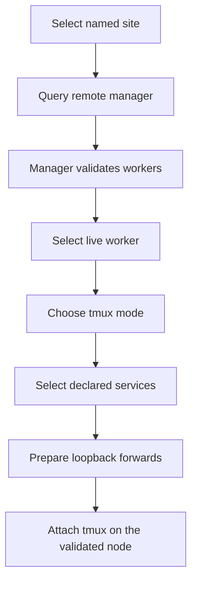

# MkChad Commander Existing Worker Connection - Plan

## Goal Capsule

- **Objective:** Prove the MkChad commander client-manager-worker model by connecting a client to an existing worker on one SSH-reachable remote node.
- **Product authority:** This Product Contract owns existing-worker discovery, tmux attachment, and service forwarding on one node. Broader MkChad v2 direction remains context rather than active scope.
- **Delivery boundary:** The client must support Linux x86_64, Linux ARM64, and ARM64 Termux. Remote roles must support Linux x86_64 and Linux ARM64.
- **Open blockers:** The interactive selection defaults and failure/retry semantics under Outstanding Questions must be resolved before implementation planning.
- **Stop conditions:** Stop rather than weaken the contract if discovery and attachment cannot be guaranteed to reach the same authenticated node, worker liveness cannot be distinguished from stale state, or lifecycle safety cannot be established under the workspace threat model.
- **Release stop condition:** Do not claim Termux support from Linux ARM64 or cross-build evidence alone; the Android/Bionic client must pass a smoke test under real ARM64 Termux.

---

## Product Contract

### Summary

Deliver the first MkChad commander vertical slice across client, manager, and worker roles on one remote node.
The user selects a named site and live worker, chooses tmux and service options, and lets commander establish the SSH connection.

### Problem Frame

MkChad v1 users must know which host, tmux session, service ports, and SSH forwarding arguments make up a working remote environment.
Connecting another device or rebuilding a lost local terminal setup requires repeating that knowledge by hand.
The larger MkChad v2 direction needs a stable control model before it adds bootstrap, Slurm, cross-node routing, or recovery.

### Key Decisions

- **Prove all three commander roles.** (session-settled: user-directed — chosen over a client-worker shortcut: the first cut should validate the long-term control topology.)
- **Limit workers to the manager's remote node.** (session-settled: user-directed — chosen over one-hop or arbitrary manager routing: same-node behavior proves the product without prematurely encoding HPC network topology.)
- **Keep the manager out of the data path.** (session-settled: user-directed — chosen over manager or worker protocol proxying: OpenSSH already provides terminal transport and service forwarding.)
- **Assume the manager and worker already run.** (session-settled: user-directed — chosen over one-shot start or bootstrap: the first cut is about discovery and connection rather than deployment.)
- **Provide an interactive CLI and stable JSON control contract.** (session-settled: user-directed — chosen over a presentation-only CLI, immediate TUI, or immediate web UI: future interfaces need a machine-readable product model.)
- **Support shared, independent, and takeover tmux attachment.** (session-settled: user-directed — chosen over one attachment policy: users need concurrent terminals with independent window selection and an explicit way to detach prior viewers.)
- **Forward worker-declared services.** (session-settled: user-directed — chosen over user-entered ports, forwarding everything, or a fixed OpenCode service: connection behavior should use named work-set capabilities.)
- **Support x86_64 and ARM64 environments.** (session-settled: user-directed — chosen over x86_64-only delivery: the real environment includes ARM64 Termux clients and ARM64 HPC systems.)

### Actors

- A1. **Operator:** Selects a site and worker, chooses attachment and service options, and interacts with the resulting terminal and local endpoints.
- A2. **Commander client:** Reads local site profiles, queries the remote manager, presents interactive or JSON results, and establishes the SSH connection.
- A3. **Commander manager:** Accounts for known workers on its node, validates their liveness, and returns connection metadata without proxying session traffic.
- A4. **Commander worker:** Represents one work-set, its canonical tmux session, and its declared services.
- A5. **OpenSSH:** Authenticates the remote host, carries the terminal connection, and owns local port forwarding.
- A6. **tmux:** Provides the persistent terminal session and the three attachment behaviors.

### Requirements

**Product and platform boundary**

- R1. Commander must provide client, manager, and worker roles as separately runnable parts of one product.
- R2. The client must be available for Linux GNU x86_64, Linux GNU ARM64, and Android/Bionic ARM64 under Termux.
- R3. The manager and worker must be available for Linux x86_64 and Linux ARM64.
- R4. The first cut must operate within one user identity on one SSH-reachable remote node without privileged installation.
- R5. The manager and at least one worker may be manually deployed and started before the client connects.

**Site selection and control interface**

- R6. The client must read named commander site profiles while leaving credentials, routing, identity, and host verification under OpenSSH ownership.
- R7. The client must provide an interactive flow for site, worker, tmux mode, and optional service selection.
- R8. Inventory, liveness, service, and resolved connection information must also be available through a stable versioned JSON contract with no prompts, presentation control sequences, or terminal bytes mixed into the output.
- R9. Client, manager, and worker control exchanges must detect incompatible peers before terminal attachment or forwarding begins.
- R10. Control and discovery operations must be bounded and identify whether failure came from commander validation, protocol handling, timeout, or SSH transport.

**Worker accounting and liveness**

- R11. Each worker must have a stable identity, a user-facing name, one canonical tmux session, and a set of declared services.
- R12. The manager must enumerate known workers as live, unavailable, or ambiguous and must not infer live authority from persisted process metadata alone.
- R13. The manager must refuse connection metadata for an unavailable, ambiguous, or incompatible worker.
- R14. A manually restarted manager must rediscover and validate a worker that remained alive without requiring that worker to restart.
- R15. A worker that dies must remain visible as unavailable with its identity and last safe descriptive metadata preserved.
- R16. Multiple clients must be able to inspect and connect to the same live worker without acquiring exclusive worker ownership.

**Terminal attachment**

- R17. After manager validation, the client must establish terminal and service connections to the validated worker's node without accepting route overrides from manager data.
- R18. Shared mode must attach another tmux client to the canonical session without detaching existing clients.
- R19. Independent mode must share the canonical session's windows and panes while giving the new client an independent current-window selection.
- R20. Takeover mode must detach the clients observed across the worker's session group before attaching the requester; its serialization guarantee applies only to commander-managed attachment changes.
- R21. Disconnecting or interrupting a commander client must close only that client's SSH connection and local forwards unless takeover explicitly detached other tmux clients during attachment.
- R22. Manager termination after attachment must not terminate the client terminal, tmux session, worker, or service forwards.
- R23. Worker or tmux loss during attachment must end the affected terminal connection with a bounded, observable failure and must not trigger automatic worker recovery in this cut.

**Service forwarding**

- R24. A worker service declaration must provide a stable name and enough credential-free endpoint information for the client to create an SSH local forward; each service remains responsible for its own authentication and authorization.
- R25. The user must be able to select zero, one, or multiple declared services when connecting to a worker.
- R26. The client must bind forwarded services to client loopback addresses only.
- R27. The client must choose an available local port by default, allow an explicit local-port override, and report each resulting local endpoint while it is active.
- R28. An unavailable requested local port must fail that forward clearly without silently substituting another port.
- R29. Independent clients must receive independent local forwards even when they select the same worker service.

**Safety and failure behavior**

- R30. Commander must delegate SSH authentication and host verification to OpenSSH and must not copy SSH credentials into commander profiles, output, logs, or state.
- R31. A failed discovery, compatibility check, tmux attachment, or forwarding setup must not stop the manager, worker, canonical tmux session, or unrelated client connections.
- R32. Automatic retries must be bounded and must not hide an unknown attachment or forwarding outcome.
- R33. Human-readable and JSON failures must identify the failed stage without interpreting localized SSH diagnostics as authentication or routing facts.

### Key Flows

- F1. **Interactive connection:** The operator selects a site, live worker, attachment mode, and services; the client reports active local endpoints and hands the terminal to the tmux attachment.
- F2. **Structured discovery:** An automation client requests JSON inventory; commander returns versioned manager, worker, liveness, tmux-mode, and service data without prompts or terminal control sequences.
- F3. **Concurrent independent views:** A second client selects independent mode for an already viewed worker; tmux shares the windows and panes while each client retains its own current-window selection.
- F4. **Takeover:** A client explicitly selects takeover; commander serializes managed attachments, detaches the observed clients across the worker's tmux session group, and attaches the requester without stopping the worker or tmux server.
- F5. **Manager restart:** The manager dies while a worker remains alive; after manual restart, it rediscovers and validates that worker, which becomes connectable without restart.
- F6. **Unavailable worker:** A worker dies; the manager retains its identity as unavailable, excludes it from connection choices, and rejects direct connection requests for it.

### Acceptance Examples

- AE1. **Covers R5-R13, R17, R24-R29.** Given a named site has a running compatible manager and worker, when the operator selects that worker, independent tmux mode, and two declared services, then commander allocates two loopback ports, reports their endpoints, and opens the tmux terminal on the validated node.
- AE2. **Covers R8-R10, R33.** Given a compatible manager with live and unavailable workers, when inventory is requested in JSON mode, then the output is one versioned structured result with distinct liveness states and no prompts, presentation control sequences, or terminal bytes.
- AE3. **Covers R16, R18, R29.** Given one client is attached in shared mode with a forwarded service, when a second client attaches in shared mode and selects the same service, then both remain attached and each receives its own loopback endpoint.
- AE4. **Covers R16, R19-R21.** Given two clients connect to one worker in independent mode, when each selects a different current window, then both see the shared panes and continue viewing their independently selected windows until they disconnect.
- AE5. **Covers R20-R21, R31.** Given commander-managed clients are viewing the worker's window set and no unmanaged direct attach races the operation, when a client selects takeover, then the observed clients detach, the requester attaches, and the worker and canonical tmux session continue running.
- AE6. **Covers R14, R22.** Given a worker and attached client remain alive while the manager is killed, when the manager is manually restarted, then the existing terminal and forwards remain active and the manager rediscovers the worker.
- AE7. **Covers R12-R15.** Given a known worker has died, when the manager reports inventory or a client requests connection, then the worker appears unavailable and no terminal or service route is opened.
- AE8. **Covers R27-R28, R31, R33.** Given an explicit local-port override is already occupied, when connection preparation runs, then commander reports a local-port conflict without changing the requested port or disturbing the remote worker.
- AE9. **Covers R9-R10, R30-R33.** Given the remote manager is incompatible or an SSH operation fails, when the client queries it, then commander reports the failed stage with bounded diagnostics, performs no tmux attachment, and persists no SSH credential.
- AE10. **Covers R1-R4.** Given the supported client and remote-role distributions, when each runs on its matching platform, then the roles complete a compatible control exchange without a preinstalled language runtime or privileged installation.
- AE11. **Covers R21-R23, R31-R33.** Given a client has an active terminal and forwarded service, when the worker or tmux server is lost, then the terminal and local forward close with a bounded failure while unrelated sessions and services remain intact and no worker recovery starts.

### Scope Boundaries

**Deferred for later**

- Uploading or installing commander executables on remote nodes.
- Starting, stopping, or supervising managers and workers from the client.
- Cross-node worker routing, manager-to-manager communication, Slurm integration, and compute allocation.
- Workspace snapshots, worker recovery, shell history, scrollback, editor sessions, and service-specific checkpoints.
- Layered configuration bundle compilation, synchronization, and secret delivery.
- TUI, local web, editor, and native mobile interfaces.
- Mosh, public relays, overlay networks, and non-SSH transports.

**Outside this product increment**

- Proxying terminal or service bytes through the commander manager.
- Restoring arbitrary process memory, file descriptors, or TTY kernel state.
- Supporting workers on a node other than their selected manager's node.
- Automatically reconnecting or recovering an unavailable worker.
- Guaranteeing takeover atomicity against tmux clients that bypass commander.

<!-- ce-section: work-relationships -->
### How This Work Fits Together

This plan owns only the first existing-worker connection slice.
The following areas are contextual candidates rather than a committed roadmap; later plans may revise, split, merge, or discard them.

- **Remote bootstrap** depends on the role and compatibility boundaries established here and would enable client-initiated manager installation.
- **Worker lifecycle** would extend worker identity and liveness into client-requested creation, stop, and restart operations.
- **Configuration bundles** would share site profiles and worker identity while adding layered dotfiles and authorized secret delivery.
- **Slurm orchestration** would depend on remote bootstrap and worker lifecycle to create managers and workers inside allocations.
- **Workspace recovery** would depend on stable worker identity and lifecycle operations to recreate tmux topology and declared services on replacement capacity.
- **Additional interfaces** could consume the structured control contract after that contract stabilizes.
- **Cross-node coordination** would extend same-node discovery into manager routing and remains intentionally unconstrained here.

### Dependencies And Assumptions

- The client environment provides a supported OpenSSH client and a controlling terminal for interactive connection.
- The selected remote node provides an OpenSSH server, tmux, and a supported Linux x86_64 or ARM64 environment.
- ARM64 Termux provides the process, terminal, filesystem, and OpenSSH behavior needed by the client role.
- The manager and worker run under the same remote user identity in this increment.
- The worker's canonical tmux session and declared services already exist when the worker reports itself live.
- Declared service endpoints are reachable from the remote SSH server on the worker's node.
- Named commander profiles may reference OpenSSH aliases, jump-host behavior, identities, and host verification configured outside commander.
- On a multi-user client, forwarded applications must provide strong authentication because loopback and SSH forwarding do not authorize application clients.

### Outstanding Questions

**Resolve Before Planning**

- What are the interactive defaults and selection rules when sites, workers, modes, or services are omitted, empty, unavailable, or refreshed?
- How can operators retrieve active forwarded endpoints after terminal handoff?
- Which setup failures may be retried, which must exit, and how are interruption and unknown outcomes distinguished?

**Deferred To Planning**

- Which implementation language, package shape, repository boundary, and release mechanism best satisfy the platform requirements?
- Which protocol, live-authority, persistence, and process-supervision designs satisfy the liveness and lifecycle requirements?
- Which OpenSSH and tmux capability floors are support requirements, and how will planning verify them?
- How should release evidence establish Linux and real-Termux support without overbuilding the first slice?

### Sources And Research

- `AGENTS.md` defines the supported HPC, shared-filesystem, process-identity, credential, and network threat model.
- `mkchad/README.md` documents the current OpenCode lifecycle behavior that commander must coexist with rather than silently replace.
- The official tmux manual defines attached clients, grouped-session window sharing with independent current windows, and explicit client detachment: `https://man.openbsd.org/tmux.1`.
- The OpenSSH manuals define remote commands, forwarding, and host-owned authentication: `https://man.openbsd.org/ssh.1` and `https://man.openbsd.org/ssh_config`.
- The Termux execution guide defines its Android/Bionic ABI and private executable-storage constraints: `https://github.com/termux/termux-packages/wiki/Termux-execution-environment`.
