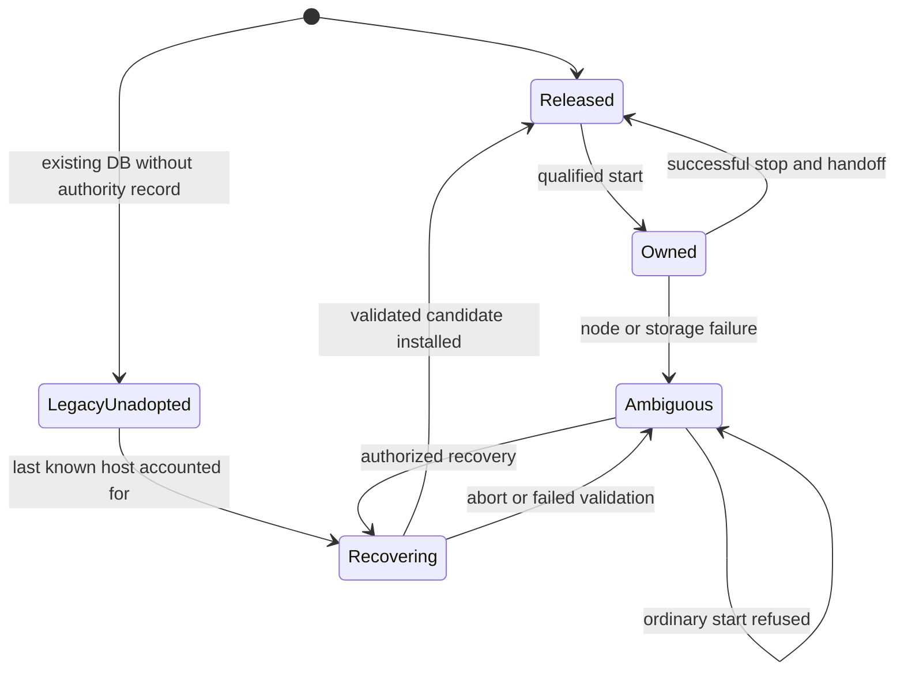
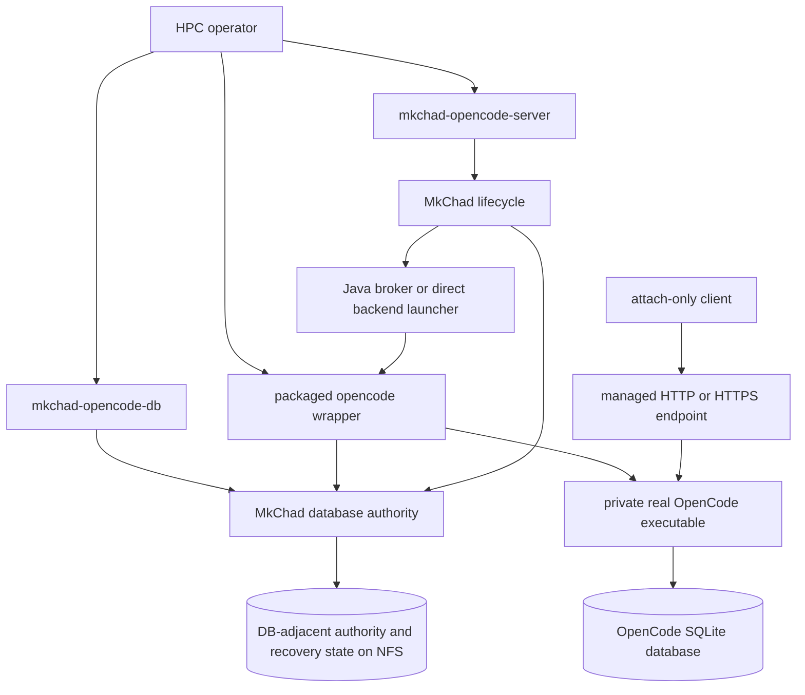
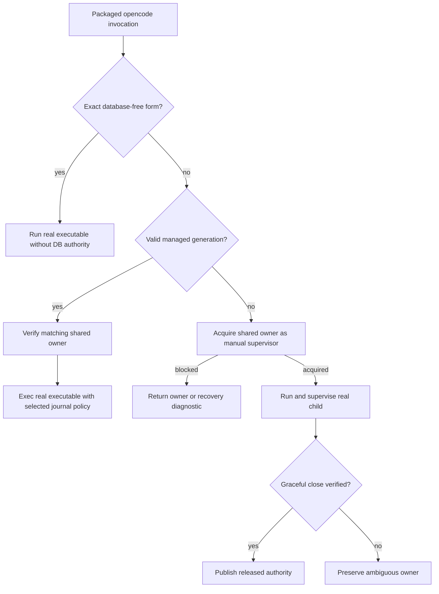
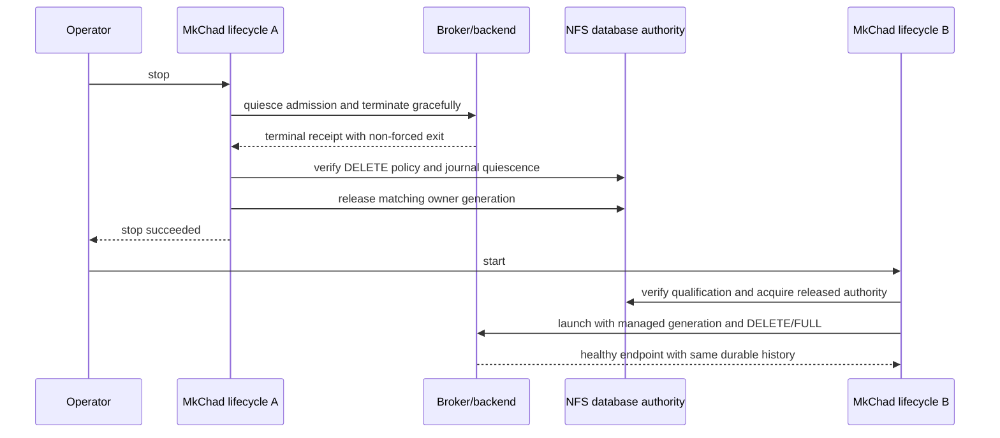
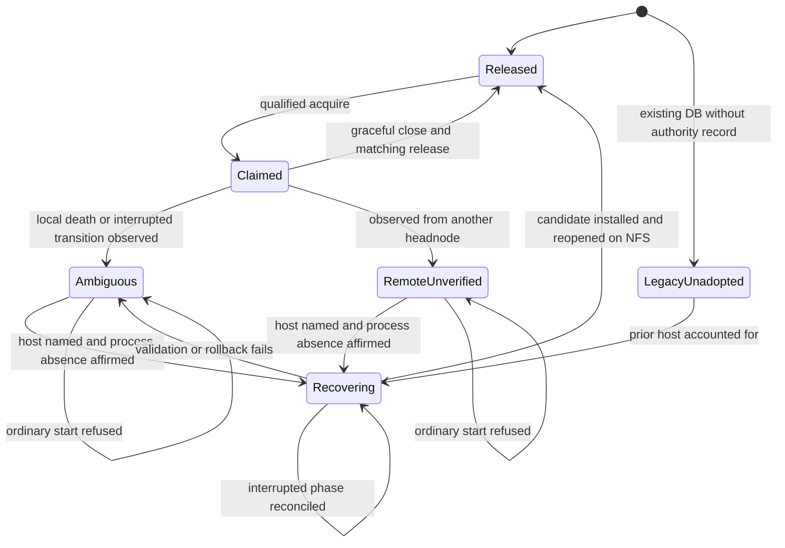
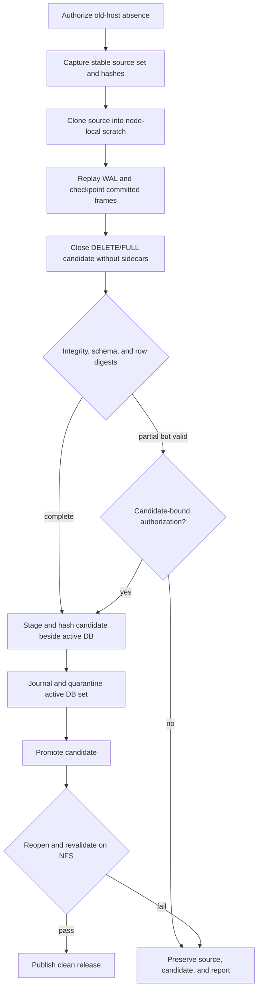

# NFS OpenCode Database Policy - Plan

> Superseded by `docs/plans/2026-08-05-001-feat-opencode-database-cleanup-tool-plan.md`. The replacement leaves OpenCode database behavior unchanged and scopes recovery as a standalone cleanup tool.

## Goal Capsule

- **Objective:** Preserve one durable OpenCode session history across sequential HPC headnodes by replacing unsupported WAL-on-NFS operation with a qualified NFS policy, exclusive database ownership, clean handoff, and reversible recovery.
- **Product authority:** MkChad owns filesystem policy, database ownership, handoff, diagnostics, and operator recovery; OpenCode provides only narrow support primitives that do not encode NFS policy: journal selection before first open, pure database-path introspection, genuinely database-free attach paths, and immutable capability metadata.
- **Execution profile:** Deep, cross-repository persistent-data work. Implement and verify one child repository at a time; publish the OpenCode capability before pinning it into an image.
- **Stop conditions:** Stop before mutating live OpenCode data, accepting an unqualified NFS profile, reclaiming ownership without the required operator assertion, installing an unvalidated candidate, or publishing an image whose OpenCode and wrapper contracts differ.
- **Tail ownership:** The coordinating agent owns child commits, authoritative serial verification, release and image compatibility evidence, and parent gitlink updates. Remote publication or deployment still requires the user-requested shipping path.
- **Open blockers:** None. The Planning Contract resolves the journal, authority, qualification, recovery, validation, and command-schema questions.

---

## Product Contract

**Product Contract preservation:** changed: the recovery Key Decision, state diagram, R23, R32, and AE3 clarify the unavoidable pre-authority recovery case and the narrow policy-free OpenCode primitives required to enforce it. An authority-era recovery names the recorded owner; the existing legacy database has no such record, so the command reports that absence and requires the operator to supply the last known headnode with the same process-absence affirmation.

### Summary

MkChad will support one durable OpenCode database on qualified NFS without WAL, owned by one database-opening OpenCode process at a time and available to any number of attached clients.
Clean headnode movement uses `stop` followed by ordinary `start`; unclean movement uses a separate copy-first recovery command that preserves originals and requires operator authorization.

### Problem Frame

OpenCode currently places its database under the XDG data root and normally enables WAL.
On the affected HPC system that root is NFS-mounted, and the same database has been opened across multiple headnodes after node failures.
The resulting `SQLITE_PROTOCOL` failure appears as `locking protocol`; managed startup then reports a secondary broker activation timeout because SQLite retries overlap the broker deadline.

WAL requires shared-memory coordination that is not supported across network-filesystem clients.
MkChad's lifecycle authority is host-specific, while the OpenCode database is shared through NFS, so the current lifecycle cannot prevent two headnodes from independently approaching the same database.
`clear` correctly leaves session data and general XDG data untouched, but that also means it cannot recover an unhealthy WAL database.

### Key Decisions

- **Use qualified NFS rollback journaling.** (session-settled: user-directed — chosen over node-local continuous synchronization: one canonical durable history is preferable when the NFS mount demonstrates the required locking and durability behavior.) WAL remains available for supported local filesystems but is prohibited for the shared NFS database.
- **Make clean stop the normal handoff.** (session-settled: user-directed — chosen over a separate planned-handoff command: routine movement between headnodes should remain `stop` on the owner followed by ordinary `start` elsewhere.) A failed or incomplete stop does not publish a clean release.
- **Require explicit recovery after unclean loss.** (session-settled: user-directed — chosen over timed takeover and administrator-only reset: an operator must account for the old headnode before a new node may replace ambiguous ownership.) Recovery names the recorded headnode and requires confirmation that its OpenCode process is no longer running. The pre-authority legacy database has no recorded owner, so its recovery reports that absence and requires the operator to supply the last known headnode under the same affirmation.
- **Keep recovery outside OpenCode.** (session-settled: user-directed — chosen over OpenCode-owned migration and recovery tooling: MkChad should own HPC filesystem and lifecycle policy.) Operator database operations live in a separate `mkchad-opencode-db` companion, while OpenCode accepts the selected journal policy.
- **Cover every packaged database opener.** (session-settled: user-directed — chosen over managed-server-only protection: manual packaged TUI or `serve` processes must not bypass the shared database policy.) Clients explicitly attached to the managed server remain unrestricted because they do not open SQLite.
- **Prompt before partial installation.** (session-settled: user-directed — chosen over unconditional abort or automatic best-effort replacement: an interactive operator may install a validated partial candidate after reviewing reported loss.) Non-interactive operation fails closed unless partial installation was authorized explicitly.
- **Retain recovery evidence.** (session-settled: user-directed — chosen over automatic count- or age-based retention: original database sets and validation reports remain until an explicit prune selects them.) Recovery never deletes its only rollback source.
- **Support NFS first.** (session-settled: user-directed — chosen over immediate Lustre and GPFS support: the first policy should match the confirmed failure environment.) Recognized but unsupported network filesystems fail with an actionable diagnostic rather than inheriting local-filesystem behavior.

The operating-state relationship is:

### Actors

- A1. **HPC operator:** Runs lifecycle and database commands, accounts for an unreachable prior headnode, and decides whether a partial recovery candidate is acceptable.
- A2. **Database-owning OpenCode process:** The sole process permitted to open the durable database for normal application work.
- A3. **Attached OpenCode client:** Uses the managed HTTP or HTTPS endpoint without opening the durable database.
- A4. **MkChad lifecycle and database tooling:** Enforces filesystem policy, ownership, handoff, recovery, validation, and bounded diagnostics.
- A5. **NFS service and administrators:** Trusted infrastructure under the workspace threat model; qualification establishes whether the available mount profile meets this feature's operational requirements.

### Requirements

**Filesystem and journal policy**

- R1. MkChad must identify the database filesystem before any packaged OpenCode process opens the persistent database.
- R2. A database on qualified NFS must use a rollback journal policy that does not create or depend on WAL shared-memory coordination.
- R3. A database on a supported local filesystem may retain the established WAL behavior unless an operator selects a stricter supported policy.
- R4. A recognized network filesystem without an adopted policy must be refused before database mutation and reported as unsupported.
- R5. Qualification must exercise the locking, durability, clean-close, and recovery behaviors required by the adopted NFS policy using disposable data rather than the session database.
- R6. Qualification results must identify the tested mount and applicable host scope without claiming support for untested NFS configurations.

**Ownership and clients**

- R7. Exactly one packaged OpenCode process may own and open the durable database across all headnodes at a time.
- R8. Any number of clients may attach to the owning server through its managed endpoint without acquiring database ownership.
- R9. Every packaged invocation that would open the persistent database must acquire the same ownership authority or fail before database access.
- R10. Client-only attach paths must not acquire database ownership or be blocked by the database owner's valid active state.
- R11. Ownership records and diagnostics must distinguish a clean release, a current owner, and ambiguous ownership left by interruption or storage failure.
- R12. Ownership ambiguity must block ordinary startup rather than infer that an old process is absent from elapsed time alone.

**Clean handoff**

- R13. Successful `stop` must close client admission, stop the backend, establish that the database-owning process is gone, complete the adopted journal's durable close, and only then publish a clean release.
- R14. A stop that cannot prove its database handoff conditions must preserve ownership evidence and return failure.
- R15. After a clean release on headnode A, ordinary `start` on qualified headnode B must acquire ownership and expose the same session history without a separate migration command.
- R16. `start` must not treat host-specific lifecycle inactivity as proof that the shared database is released.

**Operator database command**

- R17. MkChad must install `mkchad-opencode-db` beside `mkchad-opencode-server` as the operator surface for database status, qualification, recovery, validation, rollback, and explicit backup pruning.
- R18. Database status must report bounded metadata needed for action, including path, filesystem classification, journal policy, ownership phase, recorded headnode, and recovery availability, without exposing session content or credentials.
- R19. Mutating database operations must refuse while a managed database owner is live or while process absence remains ambiguous without the recovery authorization required by R23.
- R20. Human and machine-readable modes must distinguish complete success, partial candidate, unsupported filesystem, active owner, ambiguous owner, validation failure, and preserved rollback state.

**Recovery and existing WAL state**

- R21. Recovery must preserve the original database and all associated journal state as one timestamped recovery source before attempting conversion or repair.
- R22. Recovery must operate on a separate candidate and must not repair, delete, or detach WAL or shared-memory files in place.
- R23. Overriding authority from an unreachable headnode must display and require the recorded owner name when one exists. For a legacy database created before shared authority, recovery must report that no owner was recorded and require the operator to supply the last known headnode; both paths require affirmation that its OpenCode process is no longer running.
- R24. Recovery must support the current failure case in which an existing NFS database remains in WAL mode and normal OpenCode startup returns `locking protocol`.
- R25. Candidate validation must report database integrity and whether the session history satisfies the adopted completeness checks before installation is offered.
- R26. A complete candidate may replace the active database only through a durable operation that retains a rollback source if interruption occurs.
- R27. An interactive partial candidate must present the validation loss summary and offer install or abort; abort must leave the active database and recovery source unchanged.
- R28. Non-interactive or machine-readable recovery must refuse partial installation unless the invocation carries a deliberate partial-install authorization tied to the reported candidate.
- R29. Installing a recovery candidate must not automatically resume or retry provider work whose outcome was ambiguous when the prior process failed.
- R30. Recovery sources and reports must remain private to the user and persist until an explicit prune identifies the selected artifacts.
- R31. Prune must not target the active database, the only rollback source for an unresolved recovery, or files held by a live managed owner.

**Compatibility and failure behavior**

- R32. OpenCode must expose only policy-free primitives required for MkChad enforcement: journal selection before first open, pure database-path introspection, genuinely database-free attach paths, and immutable capability metadata. NFS detection, ownership, handoff, qualification, and operator recovery remain outside OpenCode.
- R33. Existing session, authentication, and configuration locations must remain unchanged unless the operator explicitly selects a supported database path override.
- R34. `mkchad-opencode-server clear` must remain lifecycle-authority cleanup and must not delete or rewrite the OpenCode database, journals, recovery sources, or session history.
- R35. NFS errors, command interruption, malformed ownership state, and failed validation must preserve the last recoverable database state and return bounded actionable failure.
- R36. The policy must not silently fall back to an ephemeral or in-memory database when the durable database is unavailable.

**Security disposition**

- R37. The policy must protect session history, database integrity, lifecycle ownership, and rollback artifacts from accidental cross-headnode concurrency and unsafe cleanup.
- R38. Recovery authorization is a trusted-operator assertion under the workspace threat model; it must not be presented as cryptographic proof that an unreachable remote process is absent.
- R39. NFS, the filesystem service, cluster administrators, and platform-provisioned project and state directories remain trusted, and the policy must not require ext4-specific inode, rename, or permission semantics.
- R40. The design must not broaden this work into defenses against malicious administrators, privileged host compromise, deliberate repository forgery, or malicious same-user runtime substitution.
- R41. Existing endpoint authentication, TLS, credential transport, and direct-HTTP deployment policies remain unchanged and must not be weakened by database recovery behavior.

### Security and Audit Calibration

Duplicate database owners, silent session loss, unsafe replacement, and unbounded recovery are completion-blocking availability or integrity failures under the inherited audit policy.
An NFS profile that cannot satisfy the adopted contract is a portability blocker and must fail closed; unsupported local-filesystem assumptions are not elevated into security findings without a reachable untrusted actor and concrete protected-asset impact.
Recovery sources contain private session history, so their confidentiality and user-only access are required, while inode pinning, recursive ownership repair, and adversarial race defenses remain unnecessary unless planning identifies an authority-bearing path or demonstrated trust-boundary crossing.

### Key Flows

- F1. **Clean cross-headnode handoff**
  - **Trigger:** A1 wants to move from headnode A to headnode B.
  - **Actors:** A1, A2, A4, A5.
  - **Steps:** A1 stops the server on A; A4 completes process and database handoff; A1 starts on B; B qualifies the mount, acquires released ownership, and opens the same history.
  - **Outcome:** One server owns the durable database on B, and attached clients can resume existing sessions.
  - **Covers:** R1-R3, R6-R16, R35-R36.
- F2. **Multiple attached clients**
  - **Trigger:** More than one editor or TUI attaches to the managed server.
  - **Actors:** A2, A3, A4.
  - **Steps:** Each client uses the managed endpoint; only A2 opens SQLite; A4 leaves valid client-only attachment outside database ownership.
  - **Outcome:** Clients operate concurrently without creating multiple database writers.
  - **Covers:** R7-R10.
- F3. **Unclean owner recovery**
  - **Trigger:** Headnode A becomes unreachable before clean stop, and A1 needs to continue on B.
  - **Actors:** A1, A4, A5.
  - **Steps:** Ordinary start on B refuses ambiguous ownership; A1 invokes recovery, names A, affirms process absence, preserves the source set, builds and validates a candidate, and chooses the permitted installation outcome.
  - **Outcome:** A validated database becomes cleanly released or the original ambiguous state remains recoverable.
  - **Covers:** R17-R30, R35-R40.
- F4. **Existing WAL database conversion**
  - **Trigger:** The current NFS database fails startup with `locking protocol` after cross-headnode use.
  - **Actors:** A1, A4, A5.
  - **Steps:** Recovery preserves the database, WAL, and shared-memory state together; reconstructs a candidate away from the active NFS path; validates history; and offers a rollback-journal replacement under the complete or partial rules.
  - **Outcome:** Session history is preserved to the validated extent without deleting the only source or manipulating WAL state in place.
  - **Covers:** R21-R30, R35-R36.
- F5. **Unsupported filesystem refusal**
  - **Trigger:** The database path resolves to a recognized network filesystem without an adopted policy, or NFS qualification fails.
  - **Actors:** A1, A4, A5.
  - **Steps:** A4 refuses before database mutation, preserves current state, and reports the failed policy boundary and available operator actions.
  - **Outcome:** Unsupported filesystem semantics cannot silently become session corruption or an ephemeral fallback.
  - **Covers:** R1-R6, R18-R20, R35-R36.

### Acceptance Examples

- AE1. **Covers R2-R3, R7-R10.** Given a qualified NFS database and one managed server, when several clients attach through the server endpoint, then all clients can operate while only the server owns a rollback-journal database.
- AE2. **Covers R13-R16.** Given headnode A owns the database, when `stop` completes successfully on A and `start` runs on qualified headnode B, then B opens the same session history without a recovery or handoff command.
- AE3. **Covers R12, R19, R23.** Given A disappeared without a clean release, when B runs ordinary `start`, then startup refuses; when A1 invokes recovery, then the command requires A's recorded name or, for a legacy-unadopted database, an operator-supplied last known headnode, plus an affirmation of process absence before replacing ownership.
- AE4. **Covers R21-R28.** Given recovery produces a partial candidate, when an interactive operator reviews it, then install and abort are available; when the same result occurs in machine-readable mode without candidate-bound authorization, then installation is refused.
- AE5. **Covers R21-R26, R30-R31.** Given a recovery candidate is installed, when the operation completes or is interrupted, then at least one recoverable original or rollback source remains and is not removed until an explicit safe prune.
- AE6. **Covers R24-R29.** Given the existing NFS database, WAL, and shared-memory files produce `locking protocol`, when recovery succeeds, then validated sessions are available from the rollback-journal candidate and no ambiguous provider operation resumes automatically.
- AE7. **Covers R4, R6, R35-R36.** Given a Lustre, GPFS, unknown network filesystem, or NFS mount that has not passed qualification, when a packaged database-opening command runs, then it fails before mutation with no in-memory or ephemeral fallback.
- AE8. **Covers R11-R16, R35.** Given NFS becomes unavailable during stop, when durable handoff cannot be established, then stop fails and preserves ownership evidence rather than publishing a clean release.
- AE9. **Covers R33-R34.** Given an operator runs `clear`, when lifecycle cleanup succeeds, then database, journal, recovery, authentication, configuration, and session data remain untouched.
- AE10. **Covers R38, R40-R41.** Given a trusted operator recovers after accounting for the old headnode, when recovery records that assertion, then diagnostics describe its trust basis accurately without claiming remote cryptographic proof or changing endpoint security policy.

### Success Criteria

- A qualified two-headnode NFS scenario repeatedly completes clean `start`, attached-client use, `stop`, and remote `start` without WAL files, SQLite lock errors, session loss, or duplicate database owners.
- Forced loss of the owning headnode always makes ordinary startup fail closed and leaves a copy-first recovery path that preserves the original database set.
- Recovery validation demonstrates that existing sessions remain readable after successful complete conversion; any partial loss is identified before operator authorization.
- Local-filesystem operation remains compatible with the existing WAL behavior and managed endpoint lifecycle.
- Diagnostics distinguish the primary database-policy failure from secondary broker or process symptoms without exposing private session content.

### Scope Boundaries

- Continuous local-database replication to NFS is deferred unless qualified rollback-journal operation proves unreliable on the supported site.
- Lustre and GPFS support are deferred until each filesystem has an explicit tested policy; they do not inherit NFS or local behavior.
- Automatic lease expiry, timed takeover, remote SSH probing, scheduler integration, and administrator-mediated reset are outside the first policy.
- Recovery restores durable history but does not design automatic post-crash provider continuation.
- General SQLite corruption repair unrelated to MkChad's supported database and journal states is outside this command's guarantee.
- The missing Lmod `/usr/bin/lua5.3` interpreter warning is a separate administrator-owned environment issue.

### Dependencies and Assumptions

- The intended operating model has one database-opening OpenCode process across headnodes and any number of clients attached to that process.
- The operator can determine whether an unreachable prior headnode still runs their OpenCode process; MkChad records but cannot independently prove that assertion.
- The NFS service and administrators are trusted, while network, dependency, and storage failures remain in scope.
- NFS qualification must be run against the mount profile and headnode coverage the operator intends to use.
- Existing OpenCode migration and session semantics remain authoritative; database recovery does not imply execution recovery.

### Planning Resolution Index

- Rollback journal and synchronization settings are resolved by KTD1.
- Shared ownership and clean release are resolved by KTD2-KTD4 and KTD12.
- Two-headnode qualification is resolved by KTD7.
- Complete and partial candidate validation is resolved by KTD8-KTD10.
- Machine results, partial authorization, rollback, and prune are resolved by KTD9 and KTD11 plus the Machine Command Contract.

### Sources and Research

- `opencode/packages/core/src/database/database.ts` defines the database path override and current core WAL initialization.
- `opencode/packages/core/src/database/sqlite.bun.ts` already has an adapter-level ability to skip automatic WAL when configured, although normal core startup does not use it.
- `opencode/packages/core/src/global.ts` locates OpenCode data under the XDG data root.
- `mkchad/lua/configs/opencode.lua` defines host-specific lifecycle authority and attached-client behavior.
- `mkchad/README.md` documents the shared server, brokered stop, and `clear` exclusion of session and XDG data.
- `mkchad/tests/opencode_standalone_command_spec.lua` verifies that lifecycle clear preserves unrelated data and cache content.
- SQLite documents that WAL does not work over network filesystems: <https://www.sqlite.org/wal.html>.
- Upstream OpenCode issue #14970 records NFS WAL corruption and cross-host reproduction: <https://github.com/anomalyco/opencode/issues/14970>.

---

## Planning Contract

### Key Technical Decisions

- KTD1. **Use `DELETE` journaling with `synchronous=FULL` on qualified NFS.** (session-settled: user-directed — chosen over node-local continuous synchronization: one qualified canonical history preserves the intended cross-headnode workflow.) OpenCode suppresses adapter-level WAL before the first database operation, requests `journal_mode=DELETE`, verifies SQLite's returned mode, applies connection-local `synchronous=FULL`, and never issues a WAL checkpoint in this mode. Local filesystems retain the existing WAL, `NORMAL`, and checkpoint behavior.
- KTD2. **Place shared authority beside the normalized database path.** A private `<database>.mkchad/` root contains the initialization/release record, qualification records, recovery artifacts, and a short-lived transaction fence; an `owner/` directory contains the durable owner record. Atomic creation of a transition directory named with sanitized hostname and random generation chooses one winner before any metadata write. Owner metadata is fully written in a similarly attributable pending directory before rename to `owner/`, and an immutable generation-named claimant record remains beside it for the full ownership generation. A crashed transition, pending owner, or wholly malformed owner payload therefore retains claimant identity, is never reclaimed by age, and blocks until recovery names that recorded host.
- KTD3. **Persist claimed versus released authority and derive observations.** (session-settled: user-directed — chosen over timed takeover: elapsed time cannot establish process absence across headnodes.) A valid initialization record plus no owner means released. An existing NFS database with no valid initialization/release record is `legacy_unadopted`, not released, and must enter explicit recovery authorization before ordinary startup. A valid owner is observed as `active_local`, `dead_local`, or `remote_unverified`; malformed, dead-local, interrupted-transition, and operator-declared unreachable states are ambiguous. Every non-released observation blocks ordinary acquisition, because node B cannot distinguish a live remote owner from a failed node without operator evidence.
- KTD4. **Use one authority API with two process modes.** (session-settled: user-directed — chosen over managed-server-only protection: manual packaged database openers must share the same exclusion.) Managed lifecycle acquires authority, launches an `opencode` wrapper in managed mode, and remains responsible for clean release. The wrapper validates the authority generation and then `exec`s the real executable so the tracked PID still owns the listener. Manual mode supervises the real child, forwards terminal signals, waits for exit, and asks the same authority API to release only after a clean close. Exact database-free forms bypass authority; every unknown form defaults to database-opening.
- KTD5. **Make attach-only and path-inspection paths genuinely database-free.** `opencode attach`, `opencode run --attach`, version/help output, and `opencode db path` must not initialize `AppRuntime` or SQLite before the wrapper may exempt them. OpenCode retains policy ignorance: it exposes pure path resolution and removes accidental database initialization, while MkChad classifies filesystem and ownership.
- KTD6. **Normalize one database identity before deriving authority.** Bootstrap first inspects immutable package metadata for the required journal/path capability without executing the selected payload and rejects unknown or incompatible side installations. It then consumes the compatible OpenCode payload's database-free path result, resolves the nearest existing parent, rejects a symlink final file, and requires the normalized result to remain under the exact qualified mountpoint. Qualification identity includes mount source/export plus the path relative to that mount, so alternate or unqualified mount aliases fail rather than create a second authority. Packaged launchers propagate the emitted canonical path, `XDG_DATA_HOME`, `OPENCODE_DB`, and selected policy identically. Direct invocation of the private real-binary path is unsupported under the trusted same-user threat model.
- KTD7. **Qualify the site profile with a coordinated two-headnode protocol.** (session-settled: user-directed — chosen over immediate Lustre and GPFS support: the first policy must match the confirmed NFS failure environment.) A primary command remains active on headnode A while a secondary command joins from the named headnode B through a disposable directory on the target mount. Qualification covers competing authority acquisition, SQLite byte-range writer exclusion, `DELETE`/`FULL` commit visibility, clean close, hot-journal recovery, same-directory replacement, sync behavior, reconnect reconciliation, measured read/write throughput for bounded-operation sizing, and actual packaged OpenCode opening a disposable policy database. The evidence-bound result records filesystem type, mountpoint, source/export, relevant mount options, kernel and NFS client/protocol versions, SQLite and OpenCode versions, policy, allowed host set, pair coverage, and outcomes. Every permitted host pairing must pass; an unlisted host is refused. Any observable profile mismatch or operator-known NFS client, server, export, or failover change requires requalification.
- KTD8. **Recover from an immutable source set in node-local scratch.** (session-settled: user-directed — chosen over in-place WAL manipulation: the original database set must remain available for rollback and diagnosis.) After the required owner-host assertion, recovery records presence, absence, size, and SHA-256 for the main DB and `-wal`, `-shm`, and `-journal`; accepts the capture only when source metadata is stable across the copy; then replays and checkpoints a local clone. SHM is retained as evidence but regenerated for replay. A complete replay checkpoints every valid committed WAL frame with zero busy frames, selects `DELETE`/`FULL`, closes without sidecars, and produces an immutable candidate.
- KTD9. **Define completeness by logical equality, not counts alone.** (session-settled: user-directed — chosen over unconditional abort or automatic best effort: a validated partial candidate requires an informed operator decision.) A complete candidate passes `integrity_check`, `foreign_key_check`, schema-object and migration-frontier checks, application-readability checks, identical user-table sets and counts, and canonical row-content digests for every user table against the successfully replayed source baseline. Session and related-ID set comparisons remain operator diagnostics. Any salvage path, unreadable comparison, unexplained schema difference, or row-digest mismatch is partial; a partial candidate must still be structurally valid and readable before installation can be considered.
- KTD10. **Do not migrate while proving recovery.** Recovery supports the packaged OpenCode schema and migration frontier represented by the captured database. Older, future, missing, or inconsistent migration states are `unsupported_schema`; normal OpenCode initialization is not used for validation because it can apply destructive migrations. Schema upgrade recovery is deferred from this fix.
- KTD11. **Install through a durable phase journal, not a claimed multi-file atomic swap.** (session-settled: user-directed — chosen over automatic retention limits: recovery and rollback evidence persists until an exact source is explicitly pruned.) Recovery authority remains held while the command stages and hashes the candidate beside the active DB, records each old path and hash, quarantines sidecars and the main file, promotes the candidate, and reopens it on NFS. Every phase is reconciled from recorded hashes after interruption or an ambiguous NFS result. Clean release occurs only after NFS validation; otherwise resume or rollback remains explicit and every source is retained.
- KTD12. **Require graceful database-close evidence for clean handoff.** (session-settled: user-directed — chosen over a separate planned-handoff command: normal movement remains successful `stop` followed by ordinary `start`.) A normal stop first closes admission, then obtains broker/direct-backend evidence that the database process exited without forced termination, verifies rollback-journal quiescence and the selected policy, removes matching host lifecycle metadata, and finally removes shared ownership. SIGKILL, timeout, storage failure, missing terminal receipt, or failed close verification preserves the owner record as ambiguous.

### High-Level Technical Design

The shared authority is a MkChad boundary used by lifecycle, operator tooling, and the packaged wrapper. OpenCode receives only the already-selected journal mode and managed-generation proof.

Invocation classification is fail-closed. Bypass is allowed only after an exact command form is proved not to initialize SQLite.

Clean handoff orders endpoint, process, database, and authority shutdown so host-local inactivity never substitutes for shared release.

The persistent authority never infers remote death. Recovery is the only transition from a non-released remote record to a replacement generation.

Recovery separates immutable evidence, local reconstruction, and NFS installation. The phase journal, not syscall success alone, determines resumability.

### Authority and Recovery Records

- The authority root, artifact directories, and node-local scratch directories are mode `0700`; report, database, sidecar, candidate, manifest, and journal files are mode `0600` before sensitive bytes are written. Failure to establish privacy aborts before copying. Exact scratch paths are journaled, removed after success or abort, and reconciled after interruption; NFS recovery and rollback sources remain until explicit prune.
- The owner record includes schema, generation, database path and identity, selected policy, qualification ID, hostname, owner kind, lifecycle phase, command summary, process evidence when available, and timestamps. It never includes command arguments that may carry prompts or credentials.
- The transaction fence contains the claimant hostname and generation as soon as possible. Missing or malformed fence metadata remains blocking rather than becoming reclaimable.
- Qualification records are immutable by ID and reusable only when their recorded mount and host profile matches the current observation.
- Recovery source IDs combine UTC time with a random generation. Their manifests record every expected sidecar as present or absent and hash every present file.
- Validation reports are immutable. Partial-install authorization binds both the final closed candidate SHA-256 and validation-report SHA-256.
- Installation progress uses a separate mutable journal with phases `source_committed`, `candidate_validated`, `candidate_staged`, `sidecars_quarantining`, `main_quarantined`, `candidate_promoted`, `nfs_validated`, and `validation_failed`.

### Machine Command Contract

`mkchad-opencode-db --json` returns one newline-terminated schema-1 JSON object. Every result includes `ok`, `command`, and a stable status code. Applicable results include bounded `database`, `filesystem`, `policy`, `qualification`, `ownership`, `recovery`, and `error` objects without session content or credentials.

Stable statuses are `released`, `legacy_unadopted`, `owned`, `ambiguous`, `recovering`, `complete_candidate`, `partial_candidate`, `unsupported_filesystem`, `unqualified`, `unsupported_schema`, `validation_failed`, and `rollback_preserved`. Mutating commands accept exact generated IDs rather than paths or globs. Interactive partial installation displays loss and unknown-state summaries; non-interactive installation requires the candidate/report digest authorization returned by validation.

| Persistent state | Derived observation | Machine status | Ordinary start |
|---|---|---|---|
| Valid initialization/release record; no owner | Released | `released` | May acquire after qualification checks. |
| Existing NFS DB; no valid initialization/release record | Legacy unadopted | `legacy_unadopted` | Refused; recovery authorization required. |
| Valid owner on current host with matching live process | Active local | `owned` | Reuses only the matching managed endpoint; no second DB opener. |
| Valid owner on current host with absent process | Dead local | `ambiguous` | Refused; recovery required. |
| Valid owner recorded on another host | Remote unverified | `owned` | Refused; clean remote stop or recovery required. |
| Attributable interrupted transition, malformed record, or failed stop | Ambiguous | `ambiguous` | Refused; recovery required. |
| Valid recovery/install journal | Recovering | `recovering` | Refused; resume or rollback required. |

### Sequencing and Cross-Repository Boundary

1. Land and verify U1 in `opencode/` and build an unpublished candidate package.
2. Land U2-U5 in `mkchad/` against fake and local disposable databases without touching live XDG paths.
3. Land U6 in `msk_containers/` against fake and unpublished candidate payloads, then return to `mkchad/` for U7.
4. Land U7, run qualification only against disposable data on every permitted pair in the intended NFS host set, and preserve the resulting profile evidence.
5. Run U8 release validation against the integrated wrapper contract, then publish the OpenCode capability exactly once.
6. Run U9 pinning and integrated SIF acceptance serially, update parent gitlinks after child commits, and only then offer the operator recovery flow for the existing WAL database.

### System-Wide Impact

- Operators gain a second public command and an explicit recovery workflow. Ordinary clean movement remains `stop` then `start`.
- Managed lifecycle stop semantics become stricter: forced termination is successful process cleanup but not a successful database handoff.
- Manual packaged OpenCode commands become mutually exclusive with the managed owner unless they are exact attach-only or metadata-only forms.
- Existing endpoint authentication, TLS, session locations, and `clear` behavior remain unchanged.
- Supported release sets are validated before publication and image activation. The new wrapper accepts metadata-compatible bundled or side-installed payloads and rejects unknown or incompatible payloads before executing them. A legacy wrapper with an independently upgraded payload is outside the supported release set and is prevented in normal rollout by shipping wrapper and bundled payload in one pinned image rather than by moving policy into OpenCode.

### Risks and Mitigations

| Risk | Impact | Mitigation |
|---|---|---|
| Qualification overstates NFS portability | Corruption or unavailable history on an untested mount | Bind evidence to export, mount options, hosts, versions, and exact required primitives; invalidate on mismatch. |
| A packaged invocation bypasses authority | Duplicate database owners | Put the immutable wrapper ahead of writable npm prefixes, default unknown commands to database-opening, test every public form, and document private-payload execution as unsupported. |
| Forced shutdown is mistaken for clean close | Hot journal or silent incomplete handoff | Carry graceful-versus-forced evidence through direct and broker stop paths; preserve ownership on anything except verified graceful close. |
| Recovery installation stops between sidecar and main-file moves | Active path is incomplete | Keep recovery authority, a hash-addressed phase journal, source copies, and deterministic resume/rollback reconciliation. |
| Equal row counts hide changed payloads | Partial recovery is mislabeled complete | Compare canonical row-content digests for every user table and retain session-ID comparisons only as diagnostics. |
| Validation initializes OpenCode and applies migrations | Recovery evidence is mutated | Validate with non-migrating SQLite access and require the current packaged migration frontier before installation. |
| Rollback journaling is too slow on the site | Poor interactive performance | Measure qualification and integrated use; reject the profile if durability or bounded-operation criteria fail rather than silently weakening sync. |
| Cross-repository release versions drift | Image starts with an unsupported policy contract | Publish OpenCode first, pin exact version and digest in the image, and assert wrapper/capability parity in package and runtime tests. |
| Recovery exhausts scratch or NFS quota | Persistent recovery authority blocks progress after partial work | Preflight and report required versus available bytes/inodes, require conservative scratch and NFS amplification headroom, recheck before each mutation phase, and inject ENOSPC/EDQUOT/deadline failures. |

### Deferred Implementation Details

- Exact internal Lua helper names and final JSON field ordering may follow existing MkChad conventions as long as the stable statuses, digest bindings, privacy bounds, and state transitions remain intact.
- The canonical row serializer may use a deterministic SQLite query/export strategy selected during implementation; it must cover all user tables, distinguish SQL types and `NULL`, define row ordering, and prove that one changed payload changes the digest.
- Qualification performance thresholds should be recorded from the site run, but correctness and bounded completion are release gates; no unmeasured performance promise is introduced.
- Recovery supports any database that passes preflight with at least three source-set sizes plus bounded report overhead free in node-local scratch and two source-set sizes plus overhead free on NFS. It reports required and available bytes and inodes, reserves journal space before mutation, and derives phase deadlines from source size and the qualification record's conservative throughput floor with an inactivity watchdog and progress reporting; exceeding either bound preserves recovery state for resume or rollback.

---

## Implementation Units

### U1. Add explicit OpenCode database policy and pure client paths

- **Goal:** Let MkChad select rollback journaling before first open while preserving local WAL behavior and making wrapper exemptions provably database-free.
- **Requirements:** R1-R4, R9-R10, R24, R32-R33, R36; F2, F4-F5; AE1, AE6-AE7; KTD1, KTD5-KTD6, KTD10.
- **Dependencies:** None.
- **Files:** `opencode/packages/core/src/database/database.ts`, `opencode/packages/core/src/database/sqlite.bun.ts`, `opencode/packages/core/src/database/sqlite.node.ts`, `opencode/packages/core/src/flag/flag.ts`, `opencode/packages/core/test/database-policy.test.ts`, `opencode/packages/opencode/src/cli/cmd/db.ts`, `opencode/packages/opencode/src/cli/cmd/run.ts`, `opencode/packages/opencode/src/cli/effect-cmd.ts`, `opencode/packages/opencode/script/package-mkchad-release.ts`, `opencode/packages/opencode/package.json`, `opencode/packages/opencode/test/cli/run/run-process.test.ts`, `opencode/packages/opencode/test/script/package-mkchad-release.test.ts`.
- **Approach:** Add a strict journal-policy input with `wal` as the compatibility default and `delete` as the MkChad-selected mode. Pass the choice into both SQLite adapters so DELETE never transiently enables WAL, apply and verify the chosen pragma once in the core layer, pair DELETE with FULL and WAL with NORMAL, and conditionally checkpoint only WAL. Refactor database path output and attached run mode so they do not construct the database-bearing application runtime. Extend the release packer to emit immutable journal/path/attach capability metadata and build an unpublished candidate from the reviewed source commit for U6-U7 compatibility testing; U9 remains the authoritative acceptance of U8's published artifacts.
- **Patterns to follow:** Keep environment parsing in `Flag`, database initialization in `Database.layerFromPath`, adapter configuration explicit, and CLI-only commands on the plain `cmd` pattern already used by `attach`.
- **Test scenarios:** Default local initialization returns WAL/NORMAL and preserves migration behavior; DELETE initialization creates no WAL/SHM, returns DELETE, uses FULL, and survives reopen; invalid policy fails before database mutation; unavailable journal selection fails instead of falling back; both Bun and Node adapters honor `disableWAL`; `db path`, `attach`, and `run --attach` complete with a deliberately unusable persistent DB path while local `run` and `serve` still require the database runtime; relative and absolute `OPENCODE_DB` resolution remains unchanged; candidate package metadata reports the exact supported primitives and is bound to the artifact digest.
- **Verification:** Focused core and CLI tests pass from their package directories, both affected packages typecheck, and the release package smoke proves the built executable honors DELETE without WAL artifacts.

### U2. Build the shared database authority and status command

- **Goal:** Provide one NFS-visible authority implementation and a bounded operator status surface before integrating lifecycle or recovery.
- **Requirements:** R1, R4, R7-R12, R17-R20, R30, R33, R35-R41; F2, F5; AE1, AE3, AE7, AE10; KTD2-KTD6.
- **Dependencies:** U1.
- **Files:** `mkchad/lua/mkchad/opencode/database.lua`, `mkchad/lua/mkchad/opencode/database_command.lua`, `mkchad/tests/opencode_database_authority_spec.lua`, `mkchad/tests/opencode_database_command_spec.lua`, `mkchad/tests/opencode_database_fence_spec.py`, `mkchad/tests/opencode_database_fence_worker.lua`.
- **Approach:** Resolve and normalize the database path through U1's pure interface, classify its mount from Linux mount information, create the private adjacent authority root, and implement one transaction-fenced state API for status, acquire, phase update, and matching-generation release. Persist claimed authority and derive local/remote/ambiguous observations without leases. Add the standalone database command parser and schema-1 human/JSON status output; keep all mutations inaccessible through status.
- **Execution note:** Start with state-machine and concurrent-acquisition tests using disposable directories; do not use protected live XDG roots.
- **Patterns to follow:** Mirror strict parsing, bounded output, private-file publication, future-schema refusal, and fresh-headless-Neovim command structure from `mkchad/lua/mkchad/opencode/command.lua` and lifecycle authority tests, but do not copy host-local lease reclamation into shared authority.
- **Test scenarios:** One of two concurrent headnodes acquires an initialized released authority; the loser reports the recorded owner; matching clean release succeeds; stale token release fails; an existing DB without initialization is `legacy_unadopted`; local live, local dead, remote-unverified, malformed owner, attributable ownerless transition, malformed fence, future schema, interrupted publication, symlink or mount alias, unsupported filesystem, missing qualification, and unavailable NFS each produce the required non-mutating status; JSON is one bounded object and excludes arguments, prompts, credentials, and session data; authority/report modes are private; `clear` fixtures do not include the adjacent root.
- **Verification:** Authority unit, command-contract, and cross-process fence tests prove one winner and fail-closed interruption behavior without timed reclamation.

### U3. Implement copy-first WAL replay and candidate validation

- **Goal:** Preserve the existing database set, reconstruct committed WAL state locally, and classify immutable candidates as complete, partial, invalid, or unsupported schema.
- **Requirements:** R19-R25, R27-R30, R35-R40; F3-F4; AE3-AE6, AE10; KTD8-KTD10.
- **Dependencies:** U2.
- **Files:** `mkchad/lua/mkchad/opencode/database_recovery.lua`, `mkchad/lua/mkchad/opencode/database_command.lua`, `mkchad/tests/opencode_database_recovery_spec.py`, `mkchad/tests/fixtures/opencode_database/`.
- **Approach:** Require recovery authority and the exact old-host/process-absence assertion before capture, distinguishing a recorded owner from the operator-supplied last known host for `legacy_unadopted`. Record stable pre/post source manifests, preserve the full set on NFS, clone it into node-local scratch, regenerate SHM, replay and explicitly checkpoint valid WAL, select DELETE/FULL, and close a sidecar-free candidate. Validate without OpenCode migration initialization. Produce immutable source and validation reports with schema, migration, integrity, foreign-key, table, row-digest, session-ID, engine-version, and known/unknown-loss evidence.
- **Execution note:** Build fixture databases with real SQLite WAL frames and corruption variants before implementing the recovery path.
- **Patterns to follow:** Use bounded subprocess handling and private artifact publication from the existing lifecycle; use generated fixture roots beneath the declared temp directory rather than repository or live state.
- **Test scenarios:** Covers F4 / AE6. Committed rows present only in WAL survive complete recovery; valid uncommitted trailing frames are excluded; clean DELETE, hot rollback journal, stale SHM, truncated/corrupt/missing WAL, simultaneous WAL/journal evidence, unstable source hashes, short copy, and unavailable source produce deterministic outcomes; one changed payload with equal counts and IDs fails row-digest equality; integrity failure, FK violation, missing/current/future migration states, schema-object drift, and application-readability failure block installation; structurally valid salvage is partial; structurally invalid salvage is rejected; reports never expose row content; unsafe scratch permissions, ENOSPC, EDQUOT, inode exhaustion, and deadline expiry fail closed and exact temporary paths are cleaned or reconciled.
- **Verification:** Recovery fixture tests prove immutable capture, exact logical comparison, partial classification, and preservation of every original artifact across success and failure.

### U4. Add resumable installation, rollback, partial authorization, and prune

- **Goal:** Install a validated candidate without relying on multi-file atomicity and preserve deterministic resume or rollback at every interruption point.
- **Requirements:** R17-R20, R23, R25-R31, R35-R40; F3-F4; AE3-AE6, AE10; KTD9, KTD11.
- **Dependencies:** U3.
- **Files:** `mkchad/lua/mkchad/opencode/database_recovery.lua`, `mkchad/lua/mkchad/opencode/database_command.lua`, `mkchad/tests/opencode_database_install_spec.py`, `mkchad/tests/opencode_database_command_spec.lua`.
- **Approach:** Add immutable candidate/report IDs, candidate-bound partial authorization, a separate durable install journal, same-directory staging, hash-recorded sidecar/main quarantine, candidate promotion, NFS reopen validation, clean release, explicit resume, and explicit rollback. Reconcile ambiguous NFS operations by comparing recorded hashes and paths. Prune accepts exact recovery IDs and refuses active, unresolved, or sole-rollback sources.
- **Test scenarios:** Covers AE4-AE5. Complete candidate installation reaches released state; interactive partial install presents loss summary and supports abort; JSON/non-interactive partial install fails without exact candidate/report authorization; candidate or report mutation invalidates authorization; death or timeout at every journal phase resumes or rolls back without ordinary startup; ambiguous rename result is reconciled by hash; failed NFS reopen retains recovery authority; rollback retains both prior active state and failed candidate evidence; unknown ID, active owner, unresolved recovery, sole rollback, path, and glob prune requests fail; selected safe source pruning removes only that ID.
- **Verification:** Phase-injection tests demonstrate that no interruption publishes clean release without a validated active candidate and that at least one reconstructible rollback source always remains.

### U5. Integrate authority with managed lifecycle and graceful stop

- **Goal:** Make managed start and stop acquire and release shared database authority in the correct process order for direct and brokered transports.
- **Requirements:** R1-R3, R7-R16, R19, R32-R36, R41; F1-F2, F5; AE1-AE3, AE7-AE10; KTD1-KTD6, KTD12.
- **Dependencies:** U1, U2.
- **Files:** `mkchad/lua/configs/opencode.lua`, `mkchad/lua/mkchad/opencode/lifecycle.lua`, `mkchad/lua/mkchad/opencode/command.lua`, `mkchad/java/MkChadTlsProxy.java`, `mkchad/tests/opencode_database_lifecycle_spec.lua`, `mkchad/tests/opencode_standalone_command_spec.lua`, `mkchad/tests/opencode_partial_stop_spec.lua`, `mkchad/tests/opencode_broker_startup_spec.lua`, `mkchad/tests/opencode_auth_disclosure_spec.lua`, `mkchad/tests/opencode_disclosure_spec.py`, `mkchad/tests/MkChadTlsProxyControlTest.java`, `mkchad/tests/tls_proxy_broker_stop_integration.py`.
- **Approach:** Preflight qualification and shared release before any launch intent or database process. Record one managed authority generation, pass its versioned contract and DELETE policy through direct and Java broker launch paths, and include authority identity in lifecycle state; unit tests use a fake executor until U6 implements the wrapper side. Extend direct termination and broker receipts to distinguish graceful exit from escalation. Stop quiesces clients, obtains terminal process evidence, verifies journal closure through the authority module, cleans matching host-local metadata, then releases shared ownership last. Failed startup releases only when child absence and clean DB closure are both proved.
- **Execution note:** Add characterization assertions around existing forced-stop behavior before changing the terminal receipt contract.
- **Patterns to follow:** Preserve existing launch-intent, pending-generation, exact process/listener identity, broker control, bounded deadline, and host-local lifecycle fence contracts. Shared DB authority adds a cross-host prerequisite; it does not replace host-local signal authority.
- **Test scenarios:** Covers F1 / AE2 and AE8. Qualified released start acquires one generation and reaches healthy; legacy-unadopted, remote/unverified, and malformed authority block before spawn; direct and TLS modes pass matching managed proof to a fake executor; normal broker/direct stop records graceful exit and releases; SIGKILL escalation, backend timeout, broker receipt loss, journal residue, NFS loss, and authority write failure preserve ambiguity; startup failure before database open releases safely; startup failure after uncertain open preserves authority; multiple attached clients do not acquire; authenticated HTTPS, hardened-profile direct-HTTP refusal, trusted-profile direct HTTP, and attach credentials remain unchanged; credentials never enter argv, owner records, logs, or diagnostics; `clear` leaves DB, sidecars, authority, qualification, and recovery untouched.
- **Verification:** Existing lifecycle, broker, partial-stop, standalone-command, process-identity, and new database-lifecycle suites pass, including Java lint/compile and broker stop integration.

### U6. Package an immutable wrapper and database companion

- **Goal:** Ensure every public packaged OpenCode invocation reaches the shared authority contract while preserving mutable side-installed OpenCode selection.
- **Requirements:** R1-R4, R7-R10, R17-R20, R32-R36; F1-F2, F5; AE1-AE3, AE7, AE9; KTD4-KTD6.
- **Dependencies:** U1, U2, U5.
- **Files:** `msk_containers/nvim/bin/mkchad-opencode`, `msk_containers/nvim/bin/mkchad-opencode-db`, `msk_containers/nvim/bin/mkchad-opencode-db-image`, `msk_containers/nvim/bin/mkchad-container-bootstrap`, `msk_containers/nvim/bin/mkchad-opencode-server`, `msk_containers/nvim/bin/mkchad-opencode-server-image`, `msk_containers/bin/install_nvim.sh`, `msk_containers/nvim/x86/nvim_container_x86.dockerfile`, `msk_containers/nvim/aarch64/nvim_container_aarch64.dockerfile`, `msk_containers/docs/adr/002-package-selections.md`, `msk_containers/docs/host-installation.md`, `msk_containers/tests/opencode_wrapper_test.sh`, `msk_containers/tests/opencode_server_wrapper_test.sh`, `msk_containers/tests/nvim_container_tooling_test.sh`.
- **Approach:** Install a public immutable wrapper before the writable npm prefix and keep the selected bundled or side-installed executable at a private payload path supplied by bootstrap. Inspect immutable payload metadata for the required capability before executing any payload command; reject unknown side installations. Classify only exact database-free forms as bypasses. Manual database-opening forms supervise the payload through `mkchad-opencode-db`; managed forms validate the U5 generation contract and exec under lifecycle authority. Install host/in-image database companions beside the server command, propagate all XDG/data/database variables consistently, and update package-selection documentation for the wrapper contract.
- **Execution note:** This unit is packaging-heavy; prefer shell contract tests and installed-image smoke evidence over duplicating Lua state-machine tests.
- **Patterns to follow:** Mirror the host/in-image split and strict JSON transport of `mkchad-opencode-server`, the writable npm selection in `mkchad-container-bootstrap`, and exact installer inventory assertions.
- **Test scenarios:** Default TUI, `serve`, local `run`, DB query, import/export, and unknown commands enter manual ownership; `attach`, attached run, version, help, and DB path bypass only after U1 proves no DB open; a managed launch validates and execs without changing listener PID; invalid generation and active remote owner refuse; unknown or incompatible side payload metadata is rejected before execution; signals and child exit codes propagate; wrapper remains first when a compatible side-installed payload exists; no recursion reaches the public wrapper; custom `XDG_DATA_HOME` and `OPENCODE_DB` identify the same path in host, image, managed, and manual paths; installer and both supported image architectures contain the full companion set.
- **Verification:** Wrapper, server-wrapper, installer, and container-tooling tests pass with fake payloads, followed by one built-image smoke that proves the public command cannot bypass authority.

### U7. Implement qualification and operator documentation

- **Goal:** Produce reusable, bounded evidence that a named NFS export and headnode set satisfy the exact authority, journal, and recovery primitives this policy requires.
- **Requirements:** R1-R6, R17-R20, R35-R40; F1, F3, F5; AE2-AE3, AE7-AE8, AE10; KTD2, KTD7, KTD11.
- **Dependencies:** U2, U4, U6.
- **Files:** `mkchad/lua/mkchad/opencode/database.lua`, `mkchad/lua/mkchad/opencode/database_command.lua`, `mkchad/tests/opencode_database_qualification_spec.py`, `mkchad/tests/opencode_database_qualification_worker.lua`, `mkchad/README.md`.
- **Approach:** Add coordinated primary/secondary qualification using only disposable paths under the target authority root. Keep both commands bounded, identify the expected peer, exercise contention and interruption from separate headnodes, run packaged OpenCode against a disposable DELETE database, and publish an immutable result only after both participants agree on mount identity and outcomes. Document initial qualification, clean handoff, status interpretation, explicit recovery, partial authorization, resume/rollback, and safe prune without presenting operator affirmation as remote proof.
- **Test scenarios:** Deterministic local fixtures cover matching and mismatched peer, every permitted host pair, unlisted-host refusal, one authority winner, writer exclusion then success, committed visibility after close, hot-journal recovery, same-directory replacement, sync failure, timeout/reconnect ambiguity, differing export/options/kernel/NFS client/protocol/version/host, operator-declared server/export/failover change, unsupported Lustre/GPFS, interrupted primary/secondary, stale run ID, and no publication after any failed check.
- **Verification:** Qualification fixtures pass locally, documentation matches the machine statuses, and a real two-headnode run records the exact mount/host/version profile or exits unavailable/failed without a support claim.

### U8. Publish the compatible OpenCode capability

- **Goal:** Publish one immutable OpenCode artifact after its journal, path, attach-only, package-metadata, and wrapper compatibility contracts pass.
- **Requirements:** R1-R4, R9-R10, R24, R32-R33, R36; F2, F4-F5; AE1, AE6-AE7; KTD1, KTD5-KTD6, KTD10.
- **Dependencies:** U1, U6-U7.
- **Files:** `opencode/package.json`, `opencode/.github/workflows/mkchad-release.yml`.
- **Approach:** Expose the governing `release:validate` root entry as the pre-publication aggregate, require the release workflow to build from the reviewed U1 source commit, and verify that its fresh artifacts carry the capability metadata exercised by U6-U7 before one publication. Record the published version and asset digests for U9; do not update container pins in this unit. U9's real-image and host-set gates, not candidate-byte identity, are the final evidence for the published artifacts.
- **Execution note:** This is the release boundary. Do not substitute an unpublished local payload in final image evidence and do not mutate protected live database or lifecycle paths.
- **Patterns to follow:** Use the existing `package-mkchad-release` artifact manifest and release workflow; the root validation entry aggregates only deterministic pre-publication gates.
- **Test scenarios:** Release artifact reports the expected version and capability metadata; the built payload uses WAL by default and DELETE only when selected; pure DB path and attach forms remain database-free; incompatible wrapper capability expectations fail package validation; release validation fails on missing tests, metadata, or asset mismatch.
- **Verification:** OpenCode focused tests, package typechecks, release validation, and immutable artifact inspection pass before publication.

### U9. Pin and prove the integrated rollout

- **Goal:** Pin U8 into supported images and prove clean handoff plus existing-WAL recovery before any live operator rollout.
- **Requirements:** R1-R41; F1-F5; AE1-AE10; KTD1-KTD12.
- **Dependencies:** U2-U8.
- **Files:** `msk_containers/nvim/component-manifest.json`, `msk_containers/nvim/x86/nvim_container_x86.dockerfile`, `msk_containers/nvim/aarch64/nvim_container_aarch64.dockerfile`, `msk_containers/tests/nvim_container_tooling_test.sh`, `msk_containers/tests/opencode_server_runtime_test.sh`, `msk_containers/docs/adr/002-package-selections.md`, `msk_containers/docs/host-installation.md`, `mkchad/lua/mkchad/opencode/contracts.lua`, `mkchad/tests/opencode_contracts_spec.lua`.
- **Approach:** Update exact image version and digest pins to U8, then build and verify supported images serially. Run isolated runtime scenarios for local WAL compatibility, qualified NFS DELETE behavior, managed/manual exclusion, clean cross-headnode handoff, forced-loss refusal, complete recovery, partial refusal, resource exhaustion, resume, rollback, endpoint-security preservation, and clear preservation. Update MkChad compatibility declarations in a separate child commit, then advance parent gitlinks only after each owning repository's gates pass.
- **Execution note:** This is the integration boundary. Final evidence must use U8's published payload and must not mutate protected live database or lifecycle paths.
- **Patterns to follow:** Use component-manifest digest pinning, package-selection ADR, contract declarations, and opt-in runtime harness unavailable exit behavior.
- **Test scenarios:** Image pin/hash and installed version agree on x86 and arm; package validation rejects unsupported wrapper/payload sets; local filesystem still uses WAL; NFS profile cannot start before qualification; every permitted headnode pair completes repeated A-to-B handoffs with canonical row digests and no WAL/SHM; abrupt owner loss blocks B; a legacy-unadopted copied WAL fixture requires recovery authorization and then recovers completely; partial fixture cannot install without exact authorization; ENOSPC/EDQUOT and interrupted promotion resume or roll back; endpoint auth/TLS/credential behavior is unchanged; `clear` preserves all durable DB artifacts; no provider work automatically resumes after recovery.
- **Verification:** All child focused gates, supported image builds, isolated SIF runtime tests, endpoint-disclosure regressions, and qualified host-set acceptance pass serially before parent integration is complete.

---

## Verification Contract

Use the provisioned Bun path for `opencode/`, fresh task-specific roots beneath `/tmp/mkchad-v1`, and one resource-intensive build or suite at a time. Tests must use fixtures or isolated HOME/XDG roots; none may inspect or mutate protected live MkChad or OpenCode state.

| Gate | Command | Proves |
|---|---|---|
| OpenCode core policy | From `opencode/packages/core`: `bun test test/database-policy.test.ts test/database-migration.test.ts` | WAL compatibility, DELETE/FULL selection before first open, no WAL sidecars, and migration regressions. |
| OpenCode CLI boundary | From `opencode/packages/opencode`: `bun test test/cli/run/run-process.test.ts test/script/package-mkchad-release.test.ts` | Attach/path database-free behavior and release artifact capability. |
| OpenCode type safety | From each affected OpenCode package: `bun typecheck` | Core and CLI changes satisfy package-local type contracts. |
| OpenCode release validation | From `opencode`: `bun run release:validate` | Governing release gate passes before publication. |
| MkChad authority | From `mkchad`: `nvim --headless -u NONE -l tests/opencode_database_authority_spec.lua` and `MKCHAD_TEST_ROOT=/tmp/mkchad-v1/nfs-db-authority python3 tests/opencode_database_fence_spec.py` | Shared owner state, one-winner acquisition, malformed/interrupted authority, and privacy. |
| MkChad recovery | From `mkchad`: `MKCHAD_TEST_ROOT=/tmp/mkchad-v1/nfs-db-recovery python3 tests/opencode_database_recovery_spec.py` and `MKCHAD_TEST_ROOT=/tmp/mkchad-v1/nfs-db-install python3 tests/opencode_database_install_spec.py` | WAL replay, complete/partial proof, phase interruption, resume, rollback, and prune. |
| MkChad command and lifecycle | From `mkchad`: run `tests/opencode_database_command_spec.lua`, `tests/opencode_database_lifecycle_spec.lua`, `tests/opencode_standalone_command_spec.lua`, `tests/opencode_partial_stop_spec.lua`, and `tests/opencode_broker_startup_spec.lua` with headless Neovim | Public schema, managed start/stop, graceful evidence, ambiguity, and clear preservation. |
| Java broker and endpoint security | From `mkchad`: compile with Java 21 `-Xlint:all -Werror`, run `tests/MkChadTlsProxyControlTest.java`, `tests/tls_proxy_broker_stop_integration.py`, `tests/opencode_auth_disclosure_spec.lua`, and `tests/opencode_disclosure_spec.py` in fresh fixture roots | Broker receipt, graceful-versus-forced termination, unchanged TLS/auth/direct-HTTP policy, and credential non-disclosure. |
| MkChad formatting | From `mkchad`: `stylua --check lua/configs/opencode.lua lua/mkchad/opencode tests` | Lua sources and tests match repository style. |
| Container wrappers | From `msk_containers`: run `tests/opencode_wrapper_test.sh`, `tests/opencode_server_wrapper_test.sh`, and `tests/nvim_container_tooling_test.sh` with fresh `/tmp/mkchad-v1` roots | Immutable wrapper precedence, XDG propagation, installed companion inventory, and version/digest parity. |
| Isolated SIF runtime | From `msk_containers`: opt in to `tests/opencode_server_runtime_test.sh` with the reviewed MkChad source, published npm payload, and built SIF | Public installed commands enforce authority and preserve lifecycle behavior in the real container. |
| NFS host-set acceptance | Run the documented primary/secondary qualification and acceptance flow on the intended export for every permitted host pair using disposable data | Site-specific locking, durability, recovery, clean handoff, no WAL artifacts, and one owner across the allowed host set. |
| Child release gates | From each changed child: run its required release/package validation before commit and publication | No child is pinned or integrated without its owning repository's release evidence. |
| Workspace hygiene | From each owning repository and then the parent: `git diff --check` | Intended diffs contain no whitespace errors or accidental generated debris. |

The real host-set gate is required before claiming NFS support for a site profile. An unavailable required headnode, runtime, published payload, or release validator is a blocked support/release gate rather than a fixture success. Local tests may prove fail-closed logic but cannot substitute for NFS qualification.

---

## Definition of Done

### Global

- `artifact_readiness` remains `implementation-ready`, and R1-R41, F1-F5, and AE1-AE10 remain traceable through KTD1-KTD12 and U1-U9.
- Qualified NFS uses verified DELETE/FULL from the first SQLite operation; supported local filesystems retain WAL behavior; unsupported or unqualified network filesystems fail before database mutation.
- Exactly one packaged database-opening process owns the durable DB across headnodes, while exact attach-only clients remain usable without authority.
- Clean stop proves graceful process exit, journal quiescence, and matching shared release; forced or unprovable shutdown preserves ambiguity.
- Existing WAL recovery preserves an immutable source set, proves complete logical equality or reports partial/unknown loss, and never installs an invalid or unauthorized candidate.
- Every interrupted install phase is resumable or rollback-capable by recorded hashes, and no path publishes released ownership before successful NFS reopen validation.
- Status, qualification, recovery, rollback, and prune emit bounded human and schema-1 machine results without private session content, credentials, prompt arguments, or mutable-report ambiguity.
- `clear` leaves database, journals, authority, qualification, recovery, rollback, authentication, configuration, and session history untouched.
- The published OpenCode payload, immutable wrapper, MkChad lifecycle, component manifest, image pin, documentation, and compatibility declarations describe one matching supported release set; unsupported skew is rejected by package/deployment validation rather than delegated to filesystem-aware OpenCode behavior.
- All focused, release, image, isolated-runtime, and qualified host-set gates pass serially; unavailable required gates are reported as blockers rather than support evidence.
- Abandoned attempts, debug output, temporary fixtures, and obsolete code are absent from final diffs; unrelated user work and protected live paths remain untouched.

### Per Unit

- U1 is done when OpenCode selects and verifies WAL or DELETE before first open and every exempt attach/path form is proven SQLite-free.
- U2 is done when one shared authority API produces one acquisition winner, persistent ambiguity, private bounded status, and no timed reclaim.
- U3 is done when copied WAL fixtures yield immutable complete or partial reports based on structural and full logical-content validation.
- U4 is done when every installation phase survives interruption with explicit resume/rollback and candidate-bound partial authorization plus safe exact-ID pruning.
- U5 is done when direct and broker lifecycle paths release only after graceful DB close and preserve ownership after every forced or unverifiable stop.
- U6 is done when all public packaged database openers reach the immutable wrapper, managed exec preserves PID/listener identity, and XDG/database identity is consistent.
- U7 is done when qualification records exact site scope, fails on every mismatch or failed primitive, and operator documentation matches command behavior.
- U8 is done when one OpenCode artifact passes release validation, carries immutable capability metadata, and is published exactly once for U9.
- U9 is done when U8 is pinned into supported images and the release set passes runtime, host-set handoff, forced-loss, resource-failure, endpoint-security, recovery, rollback, and clear-preservation acceptance evidence.
