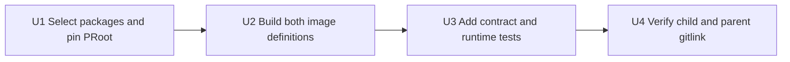

# Host Bridge Container Prerequisites - Plan

## Goal Capsule

- **Objective:** Equip the MkChad v1 x86_64 and AArch64 Neovim images to build and exercise the future C11 `host-bridge` launcher without changing current launcher behavior.
- **Product authority:** This plan owns image prerequisites only; the standalone launcher and its MkChad integration are separate plans.
- **Open blockers:** None for source work. Operational Bubblewrap and PRoot smoke tests require runners whose host policies permit user namespaces or ptrace respectively.
- **Stop conditions:** Stop if the PRoot source cannot be pinned reproducibly, either supported image cannot build the same tool surface, or a package-presence failure is hidden as a host-policy limitation.
- **Tail ownership:** Complete and verify `msk_containers` first, commit it independently, then update only its parent gitlink in a separate parent commit.

---

## Product Contract

### Summary

Add Bubblewrap, a pinned PRoot build, and a native musl C toolchain to the maintained x86_64 and AArch64 Neovim images. The images must expose the same commands while reporting runtime capability separately from installation success.

### Key Decisions

- **Prepare both supported architectures.** (session-settled: user-directed - chosen over x86_64-only provisioning: host-bridge must run in MkChad v1 x86_64 and AArch64 images.)
- **Do not extend PPC64LE.** (session-settled: user-directed - chosen over all-image parity: host-bridge scope is x86_64 and AArch64.)
- **Use Bubblewrap and PRoot as complementary full-root mechanisms.** (session-settled: user-directed - chosen over one backend: host policy may permit namespaces, ptrace, both, or neither.)
- **Build the future launcher in C11.** (session-settled: user-directed - chosen over Rust: the current images already provide the required C build environment and the launcher should have no language runtime.)

### Requirements

- R1. The x86_64 and AArch64 Neovim images must install Bubblewrap and expose `bwrap` on `PATH`.
- R2. Both images must build PRoot from one immutable upstream revision and expose `proot` on `PATH`.
- R3. PRoot must be pinned to release `v5.4.0`, commit `bd5a5f63d72f8210d8cee76195eb9f0749e5bd70`, with its required `lib/uthash` gitlink pinned to `e493aa90a2833b4655927598f169c31cfcdf7861`, unless implementation evidence proves either revision cannot build on a supported image and the plan is revised before substitution.
- R4. The image build must compile only PRoot, not CARE or unrelated upstream utilities.
- R5. Both images must provide native musl headers, static libraries, and compiler wrapper sufficient to build a static C11 executable for the image architecture.
- R6. Direct RPMs, PRoot and transitive source revisions, retained licenses, install locations, architecture scope, and rationale must be recorded in the package-selection ADR.
- R7. PPC64LE image definitions must remain unchanged and tests must make the exclusion explicit.
- R8. Image construction must fail when Bubblewrap is missing, the PRoot checkout differs from the pin, PRoot cannot start, or the native musl smoke build fails.
- R9. Runtime smoke tests must distinguish an unavailable executable from a host policy that denies user namespaces or ptrace.
- R10. A runtime must not be reported as Bubblewrap-capable until a nested mount-namespace command succeeds, or PRoot-capable until a traced child command succeeds.
- R11. No launcher, host projection, persistent-instance, deployment, or live MkChad behavior may change in this increment.
- R12. Build and test artifacts must remain under `/tmp/mkchad-v1/host-bridge-prerequisites` or runner-provided temporary storage.

### Acceptance Examples

- AE1. Given either supported Docker image is built, `bwrap --version`, `proot --version`, and a static musl hello-world build succeed without user-installed tools.
- AE2. Given a runner permits unprivileged user and mount namespaces, the image runs a minimal Bubblewrap command and reports the backend operational.
- AE3. Given a runner permits child ptrace, the image runs `/bin/true` beneath PRoot and reports the backend operational.
- AE4. Given a runner denies one backend's kernel mechanism, the smoke result identifies the policy denial while still proving that the executable is installed.
- AE5. Given the x86_64 and AArch64 Dockerfiles, source-level parity tests prove identical package names, PRoot pin, build steps, install layout, and validation commands.
- AE6. Given the PPC64LE Dockerfile, no Bubblewrap, PRoot, or host-bridge musl prerequisite is introduced.

### Scope Boundaries

**In scope**

- Fedora Bubblewrap package selection for x86_64 and AArch64.
- Pinned source build and installation of PRoot for both architectures.
- Native musl development and static-link tooling for both architectures.
- Source-contract tests, Docker image smoke tests, and capability-sensitive SIF smoke guidance.
- Child documentation and parent gitlink integration.

**Deferred**

- The `host-bridge` executable, configuration, backend selection, and releases.
- Host-path projection and MkChad launcher integration.
- Release-manifest installation of host-bridge artifacts.
- Real Slurm, mounted-root repair, and site-specific capability evidence.

**Out of scope**

- PPC64LE support.
- Installing PRoot CARE, QEMU, or foreign-architecture emulation.
- Changing host namespace, ptrace, seccomp, or LSM policy.
- Treating either backend as a security sandbox.

### Dependencies And Assumptions

- Fedora 43 supplies Bubblewrap and native musl development packages for both supported image architectures.
- PRoot `v5.4.0` and its pinned `lib/uthash` submodule build with the existing compiler, Make, Git, Python, and binutils plus directly selected talloc/pkg-config development support.
- Docker/Buildx and SIF conversion remain host or CI responsibilities rather than tools installed in the image.
- A native or correctly emulated AArch64 build environment is available for image construction; runtime support claims still require native AArch64 evidence.

### Sources And Research

- `msk_containers/AGENTS.md` requires package-selection ADR updates for every direct package and source component.
- `msk_containers/docs/adr/002-package-selections.md` requires x86_64/AArch64 parity and documents PPC64LE exceptions.
- `msk_containers/tests/nvim_container_tooling_test.sh` provides current package, parity, architecture-exclusion, and ADR synchronization patterns.
- PRoot release and source: `https://github.com/proot-me/proot/releases/tag/v5.4.0` and `https://github.com/proot-me/proot`.
- Bubblewrap behavior and namespace requirements: `https://github.com/containers/bubblewrap`.

---

## Planning Contract

**Product Contract preservation:** Product decisions from the confirmed brainstorm are captured unchanged; planning adds only package, source-build, test, and repository sequencing details.

### Key Technical Decisions

- KTD1. **Use Fedora Bubblewrap.** Select the Fedora 43 update-stream package in both maintained Dockerfiles rather than downloading another binary.
- KTD2. **Build PRoot from the exact recursive Git revision.** Clone the upstream repository, detach at `bd5a5f63d72f8210d8cee76195eb9f0749e5bd70`, initialize only the required `lib/uthash` submodule, verify `HEAD` plus gitlink/submodule commit `e493aa90a2833b4655927598f169c31cfcdf7861`, and build `make -C src proot`; do not depend on a mutable branch, unverified transitive checkout, source archive without Git metadata, or unverified static artifact.
- KTD3. **Install PRoot under an isolated prefix.** Install under `/opt/msk/proot`, expose only the `proot` executable through `/usr/bin`, and retain upstream license material in the image.
- KTD4. **Use Fedora's native musl toolchain.** Install `musl-gcc`, `musl-devel`, and `musl-libc-static` on both architectures so the next plan can produce host-native static binaries in the current images.
- KTD5. **Keep capability checks two-stage.** Image builds prove presence and basic startup; runtime smokes separately prove host namespace or ptrace support.
- KTD6. **Do not alter SIF definitions.** The architecture `.def` files consume exported Docker archives and need no package-specific change.
- KTD7. **Keep the component manifest narrow.** `nvim/component-manifest.json` remains unchanged because no current runtime component consumes backend versions as a compatibility contract.

### Expected Package And Source Additions

| Selection | Architectures | Source policy | Purpose |
|---|---|---|---|
| `bubblewrap` | x86_64, AArch64 | Fedora 43 stream | Kernel mount-namespace backend |
| `libtalloc-devel` | x86_64, AArch64 | Fedora 43 stream | PRoot build and runtime dependency closure |
| `pkgconf-pkg-config` | x86_64, AArch64 | Fedora 43 stream | Explicit PRoot dependency discovery |
| `musl-gcc` | x86_64, AArch64 | Fedora 43 stream | Native static C compiler wrapper |
| `musl-devel` | x86_64, AArch64 | Fedora 43 stream | musl headers and development metadata |
| `musl-libc-static` | x86_64, AArch64 | Fedora 43 stream | Static musl libc |
| PRoot | x86_64, AArch64 | `v5.4.0` / exact commit | ptrace-backed full-root fallback |
| PRoot `lib/uthash` | x86_64, AArch64 | exact gitlink/submodule commit | Required PRoot header dependency |

### Implementation Constraints

- Keep x86_64 and AArch64 Dockerfile blocks structurally identical so existing parity normalization does not gain broad exceptions.
- Do not install downloaded executables without immutable source identity and build-time verification.
- Do not run capability-sensitive namespace or ptrace tests as unconditional Docker build steps; builders may prohibit mechanisms that deployed hosts allow.
- Build-time PRoot validation is limited to source identity, linkage, and `proot --version`; every traced-child command belongs to the capability-sensitive runtime smoke.
- Runtime smoke output must expose `installed`, `operational`, and bounded failure reason as separate facts.
- Add no fallback that downloads tools at container startup.

### Sequencing

### Requirement Traceability

| Unit | Requirements | Acceptance examples |
|---|---|---|
| U1 | R1-R7 | AE1, AE5-AE6 |
| U2 | R1-R8, R12 | AE1, AE5 |
| U3 | R8-R10, R12 | AE1-AE6 |
| U4 | R11-R12 | AE5-AE6 |

### Risks And Mitigations

| Risk | Impact | Mitigation | Required proof |
|---|---|---|---|
| Builder denies user namespaces | False image-build failure | Keep Bubblewrap capability smoke runtime-gated | Presence passes; capable runner operational smoke passes |
| Outer runtime denies ptrace | PRoot unavailable on some hosts | Report capability, do not treat installation as operation | Denied-policy fixture plus capable-host smoke |
| PRoot source drifts | Non-reproducible or changed binary | Exact commit checkout and verification | Source-contract test and build log identity |
| PRoot links missing talloc runtime | Installed command fails at startup | Keep dependency closure and execute the installed binary | `proot --version` in each built image |
| AArch64 source diverges | Architecture-specific behavior | Existing normalized parity test plus native smoke | Source parity and native AArch64 evidence |
| Musl package exists but static link fails | Next plan remains blocked | Compile and execute a minimal native static C program | `file`/`ldd`-independent static smoke |

---

## Implementation Units

### U1. Add Package Selections And PRoot Provenance

- **Goal:** Declare identical x86_64/AArch64 package inputs and one immutable PRoot source.
- **Files:** `msk_containers/nvim/x86/nvim_container_x86.dockerfile`; `msk_containers/nvim/aarch64/nvim_container_aarch64.dockerfile`; `msk_containers/docs/adr/002-package-selections.md`.
- **Approach:** Add Bubblewrap, PRoot build dependencies, and musl packages to both DNF blocks. Add identical PRoot version/revision arguments, a detached verified checkout, and initialization plus exact verification of the required `lib/uthash` gitlink. Document architecture scope, direct and transitive source policy, retained licenses, install path, and PPC64LE exclusion.
- **Test scenarios:** Detect one-sided package additions, mutable PRoot refs, root or `lib/uthash` revision mismatch, uninitialized transitive source, CARE build commands, undocumented direct selections, missing license installation, and accidental PPC64LE additions.
- **Verification:** Run `tests/nvim_container_tooling_test.sh` from `msk_containers/`.
- **Dependencies:** None.

### U2. Build And Validate The Image Tool Surface

- **Goal:** Install working backend executables and prove native static C compilation in each maintained image.
- **Files:** `msk_containers/nvim/x86/nvim_container_x86.dockerfile`; `msk_containers/nvim/aarch64/nvim_container_aarch64.dockerfile`.
- **Approach:** Build only PRoot under `/opt/msk/proot` from the verified root and `lib/uthash` commits, link `/usr/bin/proot`, retain both applicable licenses, and add deterministic presence/startup checks that do not trace a child. Compile a temporary C11 hello-world with `musl-gcc -static`, verify it is statically linked, run it, then remove it in the build layer.
- **Test scenarios:** Missing PRoot dependency, failed exact checkout, failed build/install, wrong symlink, dynamic instead of static musl output, architecture mismatch, or a successful command that reports the wrong version.
- **Verification:** Build x86_64 with `msk_containers/nvim/x86/nvim_container_x86_build_docker.sh` and AArch64 with `msk_containers/nvim/aarch64/nvim_container_aarch64_build_docker.sh`, one resource-intensive build at a time.
- **Dependencies:** U1.

### U3. Add Source Contracts And Capability-Sensitive Runtime Smokes

- **Goal:** Prevent package drift and distinguish installed backends from usable host capabilities.
- **Files:** `msk_containers/tests/nvim_container_tooling_test.sh`; `msk_containers/tests/host_bridge_backend_runtime_test.sh`.
- **Approach:** Extend static assertions for package parity, exact PRoot revision, isolated install, build checks, ADR content, and PPC exclusion. Add a fixture-friendly runtime script that records executable presence and attempts bounded Bubblewrap and PRoot child commands without mutating live state.
- **Test scenarios:** Both backends operational; Bubblewrap denied with PRoot operational; PRoot denied with Bubblewrap operational; both policy-denied but installed; command absent; timeout; malformed version output; x86/ARM result attribution; Docker and SIF invocation.
- **Verification:** Run the tooling test, shellcheck the new runtime test, execute it in each native Docker image, then execute it in each native SIF where Apptainer/Singularity is provisioned.
- **Dependencies:** U2.

### U4. Close The Child-First Integration Boundary

- **Goal:** Record the verified `msk_containers` commit in MkChad v1 without including unrelated work.
- **Files:** `msk_containers` gitlink.
- **Approach:** Commit the child after focused and image verification. In the parent, stage only the gitlink after confirming the exact child commit and preserving every unrelated dirty child gitlink and untracked parent file present at implementation time.
- **Test scenarios:** Parent gitlink points at the verified child commit; existing unrelated child gitlinks remain untouched; recursive submodule status resolves; parent diff contains only this plan's intended gitlink when integration is performed.
- **Verification:** `git submodule status --recursive`; `git diff --check`; child and parent `git status --short --branch` inspections.
- **Dependencies:** U3.

---

## Verification Contract

### Focused Gates

| Gate | Command or action | Success signal |
|---|---|---|
| Static container contract | `msk_containers/tests/nvim_container_tooling_test.sh` | Package, pin, parity, ADR, and PPC exclusions pass |
| Shell quality | `shellcheck msk_containers/tests/host_bridge_backend_runtime_test.sh` | No diagnostics |
| x86_64 image | Run the x86 Docker build script | Image builds and embedded checks pass |
| AArch64 image | Run the ARM Docker build script | Image builds and embedded checks pass |
| Runtime backends | Run the runtime test in each native image | Presence is true; operational status matches host policy |
| SIF behavior | Run the runtime test in each converted SIF | Packaged tools start and permitted backends operate |

### Completion Interpretation

- A policy-denied Bubblewrap or PRoot smoke is acceptable only when the result proves the executable is installed and a separate supported runner proves that backend operational on each architecture.
- Source parity is not a substitute for native AArch64 execution.
- No live MkChad configuration, state, credentials, or user SSH material may be read or changed.
- Full repository or image suites run only after focused source checks pass, and only one image build runs at a time.

---

## Definition of Done

- Both maintained Neovim images expose Bubblewrap, PRoot, and native musl static-build tooling.
- PRoot and its required `lib/uthash` source are exactly pinned and verified, CARE is absent, and applicable license material is retained.
- Build-time checks prove installed commands start and a static C11 executable builds and runs.
- Runtime tests distinguish package presence from namespace and ptrace capability.
- At least one supported x86_64 and one supported AArch64 environment provide operational Bubblewrap and PRoot evidence, with policy-denied environments reported honestly.
- Package-selection documentation and source-contract tests match the implementation.
- PPC64LE remains unchanged and explicitly excluded.
- `msk_containers` is committed and verified before any separate parent gitlink commit.
- No host-bridge launcher, host projection, deployment, or live runtime behavior is introduced by this plan.
