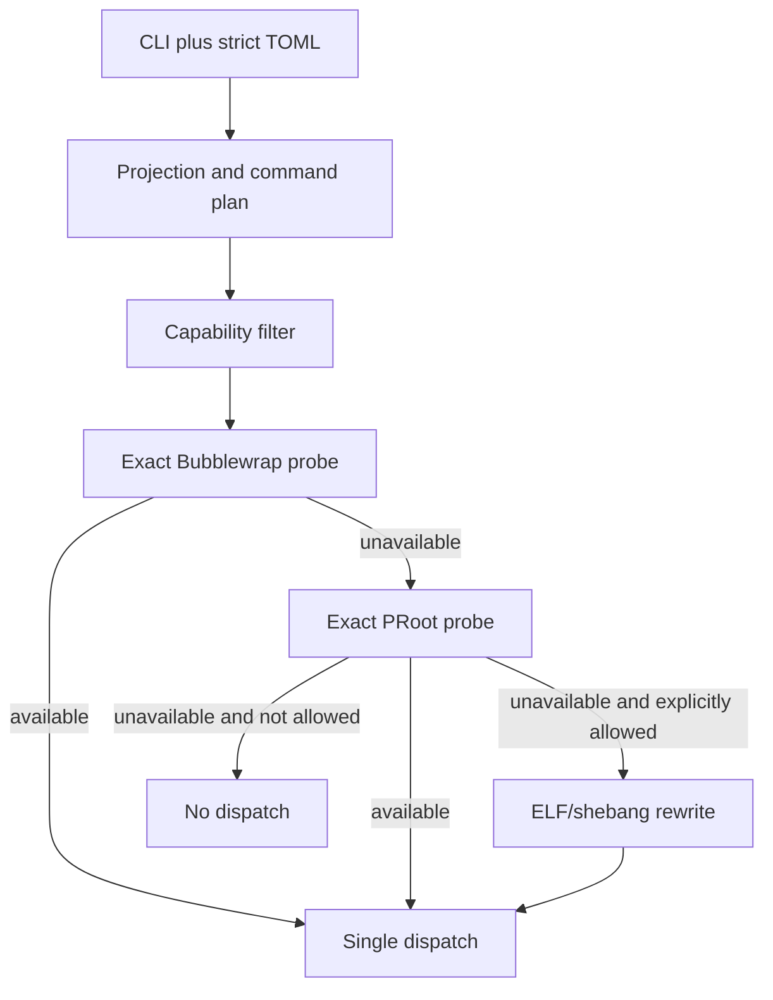
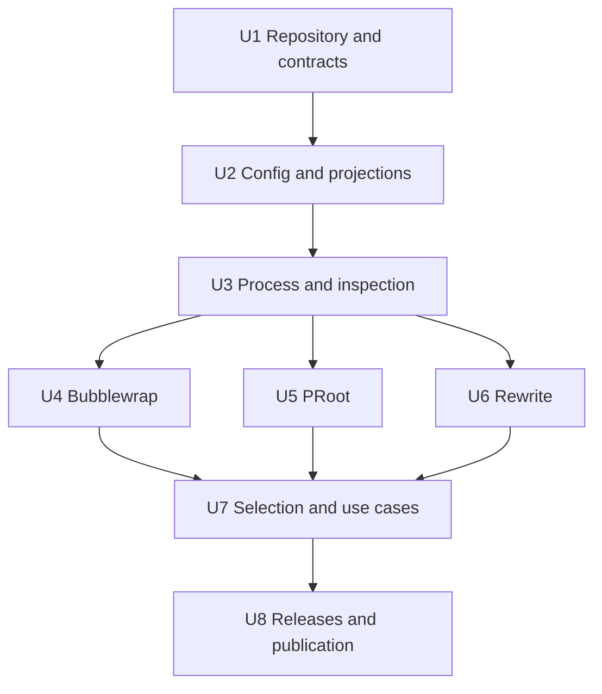

# Standalone Host Bridge - Plan

## Goal Capsule

- **Objective:** Build a runtime-neutral Linux command launcher that executes ELF binaries and shebang scripts against configured filesystem roots already visible to the caller, optionally layering an exact bound semantic caller-mount plan over that root.
- **Product authority:** This plan owns the standalone `host-bridge` product and releases; MkChad image provisioning and launcher integration remain separate plans.
- **Execution profile:** One C11 package and executable, built in the current MkChad images and released as static musl x86_64 and AArch64 artifacts.
- **Open blockers:** None for source work. U8 publication requires explicit remote authorization plus native x86_64 and AArch64 runners on which both real backend suites pass; unavailable release gates block publication rather than being replaced by weaker evidence.
- **Stop conditions:** Stop if full-root backend failure can lead to an unannounced rewrite launch, a command can be dispatched more than once, argument boundaries cannot remain exact, or the static artifacts cannot run on their native architecture baselines.
- **Tail ownership:** Complete and verify the child repository before any remote publication or later parent submodule registration.

---

## Product Contract

### Summary

`host-bridge` launches a command using a configured Linux root or prefix projection without depending on a particular container runtime. When a profile names a bound `ct-mount-plan-v1` selector, the configured root supplies the host runtime filesystem and eligible caller data mounts are replayed over it, preserving workspaces and other outer-launch inputs. It prefers a real Bubblewrap mount namespace, falls back to PRoot syscall translation, and offers bounded ELF/shebang rewriting only when the caller explicitly accepts weaker semantics.

### Problem Frame

Tools installed outside the current filesystem root may be visible but unusable because their ELF interpreter, libraries, scripts, configuration, plugins, and absolute paths resolve against the wrong root. This affects host-installed Cargo tools inside development containers, site Slurm clients, and commands from mounted Linux installations. Manually reconstructing loader and path settings is fragile and does not express when semantics have weakened.

### Key Decisions

- **Make the product runtime-neutral.** (session-settled: user-directed - chosen over an Apptainer wrapper: the same launcher should work with any already-visible root, including mounted Linux installations.)
- **Use C11.** (session-settled: user-directed - chosen over Rust: the current MkChad images can build it immediately and the result requires no language runtime.)
- **Use explicit invocation.** (session-settled: user-directed - chosen over PATH shims: users and agents call `host-bridge -- COMMAND` when host/root execution is intended.)
- **Support x86_64 and AArch64.** (session-settled: user-directed - chosen over PPC64LE or open-ended architecture support for the first release.)
- **Guarantee ELF and shebang entry points.** (session-settled: user-directed - chosen over ELF-only behavior: ordinary host tools include interpreter scripts.)
- **Prefer Bubblewrap, then PRoot.** (session-settled: user-directed - chosen over one full-root backend: hosts differ in namespace and ptrace policy.)
- **Require explicit semantic degradation.** (session-settled: user-directed - chosen over silent fallback: rewrite mode does not project descendant filesystem access.)
- **Keep security policy light.** (session-settled: user-directed - chosen over container trust classification, allowlists, ownership checks, and symlink hardening: this tool is a compatibility launcher for trusted paths and callers.)
- **Layer caller mounts over the selected root.** (session-settled: user-approved - chosen over replacing the complete caller namespace with a pure host root: outer workspace, home, and explicit data mounts remain available to nested host commands through the exact bound semantic plan.)

### Actors

- A1. **Caller:** Selects a profile and command and receives the command's terminal behavior and exit result.
- A2. **Host bridge:** Parses configuration, resolves the command, probes compatible backends, and dispatches exactly once.
- A3. **Configured root:** A Linux filesystem tree already visible at a caller-side path.
- A4. **Full-root backend:** Bubblewrap or PRoot, providing projected descendant path semantics at different fidelity and cost.
- A5. **Rewrite backend:** A bounded entry-point compatibility mechanism for ELF and shebang launch when explicitly permitted.
- A6. **Semantic mount plan:** An optional exact bound `ct-mount-plan-v1` record describing caller-visible paths and their selected-root targets without exposing outer host-source paths.

### Requirements

**CLI and configuration**

- R1. Execution syntax must be `host-bridge [options] -- COMMAND [ARG...]`; the separator is mandatory and arguments are never interpreted by a shell.
- R2. The CLI must support an explicit profile, configuration path, forced backend, explicit rewrite degradation consent, verbose diagnostics, and `doctor` human/JSON capability output.
- R3. Configuration must be strict, versioned TOML and describe paths visible to the current process, not container runtimes or inaccessible host paths.
- R4. Each profile must define requested semantics, one visible root with explicit access semantics, target command search paths, current-directory policy, environment changes, and zero or more visible-path-to-target-path projections.
- R5. Configuration discovery must use explicit CLI, `HOST_BRIDGE_CONFIG`, XDG configuration, then the user's standard configuration path; it must never load from the current directory implicitly.
- R6. Configuration and command argv must preserve non-UTF-8 process arguments where Linux permits them; path fields in TOML may require normalized UTF-8.

**Projection semantics**

- R7. Full-root semantics mean the launched command and descendants observe the configured root as `/` and every required projection at its configured target path.
- R8. Prefix mappings must use deterministic longest-prefix matching, reject ambiguous duplicate targets, and map the current directory or fail before dispatch.
- R9. Normal symlink resolution and caller permissions apply; host-bridge must not add ownership, inode-identity, anti-symlink, allowlist, or trust-policy validation.
- R10. Read-only root or projection access must be enforced when requested; a backend incapable of enforcement must be excluded rather than silently weakening access.
- R11. Host bridge must not create network, PID, IPC, UTS, or cgroup isolation unless a future explicit configuration contract adds it.
- R12. Host bridge must not imply real root, setuid, file-capability, service-management, mount, or block-device authority.

**Semantic caller-mount layering**

- R33. A profile may name one absolute caller-visible `mount_plan` path; omission disables semantic-plan consumption, while a configured missing path fails before probing.
- R34. Host bridge must parse only the closed NUL-delimited `ct-mount-plan-v1` grammar, enforce the 1 MiB/4096-entry bounds, final NUL, canonical decimal count, normalized paths, role/access/recursion enums, and lowercase SHA-256 digest over the record with the digest field omitted.
- R35. The configured profile root is the lower runtime filesystem. Ordered `detected-automatic`, caller-data `explicit`, and `persistent-automatic-cwd` entries whose target is not `/` are replayed from `caller_path` to `target_path` over that root; `generated-host-root` establishes root-selection evidence and `bootstrap-internal` is never replayed. Producer-omitted launcher-internal binds, protection masks, and the manifest bind are not semantic entries. A replayable entry or configured projection targeting `/` is invalid because only the profile root may establish the lower root.
- R36. Manifest-derived and configured projections form one deterministic overlay plan after the root: one stable parent-before-child target ordering applies across both sources; between unrelated targets, manifest entries precede configured projections and each source retains declaration order. Exact duplicate targets are rejected, and cwd mapping uses longest-prefix matching over the combined plan.
- R37. A malformed, future, digest-mismatched, truncated, semantically inconsistent, or changed configured manifest fails before any backend probe or command dispatch. Host bridge reads the exact configured bound file and must never scan state directories or infer an active digest.
- R38. Manifest consumption must use only caller-visible and selected-root target paths. It must not require or reconstruct outer host-source paths, backend argv, mountinfo, stat identities, credentials, or container-runtime APIs.
- R39. A full-root profile with `mount_plan` configured requires `completeness = complete`, strategy `direct` or `fallback`, and at least one `generated-host-root` entry whose `caller_path` equals the normalized join of the configured root and its `target_path`. Every generated entry must satisfy that relation. A valid partial or `none` plan remains diagnosable but is not eligible for full-root dispatch.
- R40. Bubblewrap is eligible only when every overlay destination and required parent already exists beneath the configured root with a source-compatible file or directory type, including the internal trampoline destination. Missing or mismatched targets fail its probe without modifying the configured root; PRoot eligibility remains governed by its independently tested translation behavior.
- R41. Doctor JSON must represent disabled, ready, absent, partial, `none`, malformed, future, digest-mismatched, semantically invalid, and changed-during-read mount-plan states as completed capability diagnoses. These states dispatch no command; exit 125 remains reserved for failures that prevent a trustworthy complete report.

**Backend selection and execution**

- R13. Automatic full-root selection must probe Bubblewrap first with the exact profile, then PRoot when compatible.
- R14. Version presence alone must not establish backend capability; each candidate must execute a bounded no-side-effect probe under the planned root and projections.
- R15. Forced backend selection must never fall through to another backend.
- R16. Rewrite may run only when the profile requests rewrite semantics or the invocation explicitly permits degradation from full-root semantics.
- R17. A degradation warning must identify requested semantics, failed full-root candidates, selected rewrite behavior, and the descendant-path limitations.
- R18. No backend may be attempted after command dispatch begins, including when command-start outcome is uncertain.
- R19. stdin, stdout, stderr, controlling terminal behavior, process status, umask, resource limits, supplementary groups, and relevant inherited file descriptors must remain usable by the command.
- R20. Host bridge must preserve ordinary signal behavior and return the exact normal exit status or a documented shell-compatible signal status.
- R32. Every probe must run beneath a fresh supervisor that remains the process-group leader and PID/PGID identity anchor until all adopted probe descendants are reaped, with a fixed five-second deadline. Backend timeout may fall through only after bounded TERM-then-KILL cleanup succeeds; caller SIGINT/SIGTERM cleans up and returns the corresponding signal result without probing or dispatching another backend. Cleanup failure aborts selection and must never signal an unrelated process.

**Executable compatibility**

- R21. The launcher must resolve bare commands against the configured target PATH and treat commands containing `/` as target-side paths.
- R22. Bubblewrap and PRoot must launch supported ELF and shebang commands through their normal target-root execution behavior.
- R23. Rewrite mode must support native static ELF, native glibc dynamic ELF with a target PT_INTERP, absolute shebang interpreters, `/usr/bin/env NAME`, and GNU `env -S` for x86_64 and AArch64.
- R24. Rewrite mode must bound ELF size/structure parsing, shebang length, interpreter recursion, library-path expansion, diagnostics, and subprocess setup.
- R25. Rewrite mode must reject malformed, foreign-architecture, unsupported-loader, missing-interpreter, setuid/file-capability, and ambiguous secure-execution cases before launch.
- R26. Rewrite mode must state that arbitrary descendant `execve`, `open`, `dlopen`, plugin, configuration, socket, `/proc`, and target `/etc` accesses are not projected.

**Use cases and portability**

- R27. A full-root profile must support host-installed Cargo/Rustup tools and their compiler/linker descendants when required filesystems and environment are projected.
- R28. A full-root profile must support Slurm `sbatch`, `squeue`, `sinfo`, and read-oriented `scontrol` when site libraries, configuration, authentication socket, network, cwd, and scripts are visible.
- R29. A writable full-root profile must support unprivileged file-level repair of a mounted same-architecture Linux root within the caller's real permissions.
- R30. The first release must not claim interactive `srun`, QEMU/foreign architecture, bootloader repair, block-device operations, real ownership changes, service startup, or privilege elevation.
- R31. Releases must provide checksum-addressed static musl executables for x86_64 and AArch64 at conservative CPU baselines.

### Key Flows

- F1. **Full-root automatic execution:** The caller selects a profile; host-bridge validates its configured root, optional exact semantic plan, and combined overlays, probes Bubblewrap then PRoot with those exact mappings, selects the first compatible backend, and dispatches once.
- F2. **Explicit rewrite:** The caller requests or permits rewrite; host-bridge resolves and inspects the entry point, reports degraded semantics, and directly launches the supported ELF or interpreter chain.
- F3. **Capability diagnosis:** `host-bridge doctor --json` reports installed candidates, exact probe results, supported profile capabilities, architecture, and bounded reasons without launching the requested command.
- F4. **Cargo tool:** A profile maps a visible host toolchain and project; Cargo and its descendants execute against that root while preserving jobserver and terminal descriptors.
- F5. **Slurm submission and inspection:** A profile maps site Slurm paths and the Munge socket; the caller submits a script or inspects scheduler state using the site's client stack.
- F6. **Mounted-root repair:** A profile makes a mounted Linux tree the target root and explicitly supplies required `/proc`, `/dev`, `/sys`, `/run`, or workspace projections for a file-level repair command.

### Acceptance Examples

- AE1. Given Bubblewrap can construct the configured root, when `host-bridge -- tool --flag 'two words'` runs, exact argv and terminal descriptors reach the tool and its status returns unchanged.
- AE2. Given Bubblewrap is denied but child ptrace works, when a full-root command is requested, the exact-profile PRoot probe passes and the command runs once through PRoot.
- AE3. Given both full-root probes fail and no degradation is permitted, host-bridge reports both reasons and dispatches nothing.
- AE4. Given rewrite is explicitly permitted, when both full-root probes fail, a supported glibc ELF launches through the target loader after a visible warning; unsupported descendant projection remains explicitly unclaimed.
- AE5. Given a read-only mapping and unavailable Bubblewrap, PRoot is excluded because it cannot enforce the requested access, and host-bridge dispatches nothing unless a separately compatible backend exists.
- AE6. Given a host Cargo toolchain and project are visible, a fixture Cargo-like process launches compiler and linker children while preserving its inherited jobserver pipe.
- AE7. Given a fake Slurm tree with configuration and Unix authentication socket, `sbatch`, `squeue`, `sinfo`, and read-oriented `scontrol` fixtures receive exact paths, environment, and argv through both full-root backends.
- AE8. Given a mounted-root fixture with `root_access = "inherit"`, a repair command changes only fixture files permitted to the current user; with `root_access = "read-only"`, the same write is refused and PRoot is ineligible unless read-only access is already enforced outside host-bridge and represented as `inherit`.
- AE9. Given malformed ELF, a foreign machine type, an overlong/recursive shebang, or a missing interpreter, rewrite exits before launch with a typed diagnostic.
- AE10. Given released x86_64 and AArch64 archives, each binary runs `--version`, parses the example config, and completes native Bubblewrap/PRoot fixture smokes without a dynamic language runtime.
- AE11. Given root `/host`, a valid bound manifest, and caller workspace `/workspace`, Bubblewrap and PRoot observe host `/usr` from `/host/usr` while `/workspace` resolves to the caller mount recorded by the manifest; image-only paths do not replace either layer.
- AE12. Given a missing, future, truncated, self-consistently malformed, digest-mismatched, or concurrently changed configured manifest, host-bridge probes no backend and dispatches no command.
- AE13. Given a replayable entry targeting `/`, host-bridge rejects the plan before probing; given a valid child target absent from the lower root, Bubblewrap reports an incompatible profile without creating the target while an independently compatible PRoot may still be selected.

### Scope Boundaries

**Deferred**

- Interactive `srun --pty` and scheduler mutation beyond submission.
- Foreign-architecture execution and QEMU integration.
- Additional full-root backends or a host-side execution broker.
- Package-manager integrations, distro packages, shell completion, and GUI/TUI surfaces.
- Persistent daemon, Unix control socket, command authorization, and policy prompts.

**Outside the product identity**

- A security sandbox or container trust boundary.
- Discovery of host paths not visible to the current process.
- Automatic container-runtime invocation or bind creation.
- Real privilege escalation, kernel replacement, or transparent hardware emulation.
- A promise that rewrite mode is equivalent to chroot, Bubblewrap, or PRoot.

### Dependencies And Assumptions

- Linux is the only supported kernel.
- The caller or surrounding runtime makes every configured root and projection visible before invocation.
- A configured semantic mount plan is already bound at the exact caller-visible path by the surrounding launcher; standalone host-bridge never searches launcher state or chooses among manifests.
- Bubblewrap requires host support for unprivileged user/mount namespaces and an outer policy that permits the needed operations.
- PRoot requires ptrace/process-memory behavior permitted by host and outer-runtime policy.
- Full-root backends use the caller's real kernel, identity, network, and permissions.
- The container-prerequisites plan provides Bubblewrap, PRoot, and native musl tooling in MkChad images, but standalone users may supply compatible external backends themselves.

### Sources And Research

- Bubblewrap root construction and namespace behavior: `https://github.com/containers/bubblewrap`.
- PRoot chroot/bind emulation and ptrace model: `https://proot-me.github.io/` and `https://github.com/proot-me/proot`.
- Linux executable behavior: `https://man7.org/linux/man-pages/man2/execve.2.html`.
- glibc loader invocation and search behavior: `https://man7.org/linux/man-pages/man8/ld.so.8.html`.
- GNU `env -S`: `https://www.gnu.org/software/coreutils/manual/html_node/env-invocation.html`.
- Cargo environment and home behavior: `https://doc.rust-lang.org/cargo/reference/environment-variables.html` and `https://doc.rust-lang.org/cargo/guide/cargo-home.html`.
- Slurm submission semantics: `https://slurm.schedmd.com/sbatch.html`.

---

## Planning Contract

**Product Contract preservation:** changed: the user-approved layered namespace adds A6, R33-R41, AE11-AE13, and corresponding F1 detail. Existing standalone behavior remains unchanged when `mount_plan` is omitted; planning retains the prior C package, backend, release, and scope decisions.

### Key Technical Decisions

- KTD1. **Create one independent C repository.** `host-bridge/` owns source, tests, documentation, CI, and releases; MkChad integration consumes releases later.
- KTD2. **Use C11 and CMake/CTest.** One executable and internal modules are enough; do not create a public library before another consumer exists.
- KTD3. **Vendor one pinned TOML parser.** Vendor `tomlc17` tag `R260618`, commit `7813bdd218b2b5f54940a9759ec0ffb3b60c1d1f`, retain its MIT license, and wrap it behind the strict host-bridge config module.
- KTD4. **Keep the backend contract capability-based.** Version strings are diagnostic only; exact-profile executable probes decide compatibility.
- KTD5. **Use an internal static trampoline.** Backend probes and launches invoke the current host-bridge binary through a read-only projection and internal subcommand so cwd, argv, architecture, and filesystem observations are measured inside the selected root.
- KTD6. **Use `bwrap` without extra isolation.** Construct only the requested mount view and cwd; do not unshare network, PID, IPC, UTS, or cgroups or create a new session.
- KTD7. **Use minimal PRoot options.** Use `-r`, explicit `-b` mappings, and `-w`; do not use `-R`, `-S`, `-0`, QEMU, or PRoot-defined convenience binds.
- KTD8. **Name the weak backend `rewrite`.** It covers ELF and shebang entry points, not a complete root, and therefore cannot be mistaken for full-root operation.
- KTD9. **Launch once.** Probe before dispatch, then commit to one backend; setup or child failure after dispatch never retries elsewhere.
- KTD10. **Ship static musl artifacts.** Build native x86-64-v1 and generic AArch64 binaries, with no bundled Bubblewrap or PRoot.
- KTD11. **Treat the bound mount plan as an optional input contract.** Add a bounded internal `ct-mount-plan-v1` parser and internal SHA-256 implementation; profiles opt in with one absolute `mount_plan` path, and absence of that field preserves standalone root/projection behavior.
- KTD12. **Compose one layered namespace.** Build backend argv from the configured root first, then merge eligible manifest entries and configured projections into one stable parent-before-child target order. For unrelated targets, emit manifest entries before configured projections and preserve declaration order within each source. Reject exact-target collisions instead of guessing precedence, and never replay bootstrap-internal; launcher-internal binds, protection masks, and the manifest bind are absent from semantic entries by producer contract.
- KTD13. **Do not let Bubblewrap materialize overlay targets in the lower root.** Validate destination existence and type before probing and mark Bubblewrap incompatible when its setup would create a path. This preserves writable host-root semantics without allowing a capability probe to mutate that root; PRoot is evaluated separately.

### High-Level Design



### Configuration Contract

```toml
version = 1
default_profile = "host"

[profiles.host]
root = "/host"
root_access = "inherit"
semantics = "full-root"
mount_plan = "/.container-tools-mount-plan"
cwd_unmapped = "error"
path = ["/home/user/.cargo/bin", "/usr/local/bin", "/usr/bin", "/bin"]
environment_remove = ["LD_PRELOAD"]

[[profiles.host.projections]]
visible = "/host-run/munge"
target = "/run/munge"
access = "inherit"
required = true

[profiles.host.environment]
SLURM_CONF = "/etc/slurm/slurm.conf"
```

- `root` and `visible` paths are paths in the caller's current namespace.
- `target` paths are paths in the selected execution root.
- `version = 1` is required. The root object accepts only `version`, `default_profile`, and the `profiles` table; `default_profile` must name an existing profile and may be overridden only by `--profile`.
- Each profile requires `root`, `root_access`, `semantics`, `cwd_unmapped`, and `path`; `mount_plan`, `environment_remove`, `environment`, and `projections` are optional. A configured `mount_plan` is an absolute normalized caller-visible path to a required `ct-mount-plan-v1` record. `root_access` and projection `access` accept only `inherit` or `read-only`; PRoot is ineligible when host-bridge itself must enforce either read-only value.
- `semantics` accepts only `full-root` or `rewrite`. `cwd_unmapped` accepts only `error` or `root`; `root` maps an otherwise unmapped caller cwd to target `/`. PATH entries and projection targets are absolute target-side paths.
- `[profiles.NAME.environment]` sets string-valued variables. `environment_remove` is an array of variable names; setting and removing the same name is invalid. `PATH` is reserved and is invalid in both environment collections: host bridge exports the colon-joined profile `path` as `PATH` for initial command lookup and every descendant. Host bridge applies other removals, then sets, to the inherited environment.
- A projection requires `visible`, `target`, `access`, and `required`. A missing required source fails before probing; a missing optional source is omitted and reported without inspecting its contents.
- Discovery order is `--config PATH`, `HOST_BRIDGE_CONFIG`, `$XDG_CONFIG_HOME/host-bridge/config.toml` when set, then `$HOME/.config/host-bridge/config.toml`. A selected explicit path that is absent is an error; implicit candidates are skipped only when absent, and the first existing malformed candidate fails without fallback. No candidate means the typed missing-config diagnostic.
- Profiles may explicitly use `semantics = "rewrite"`; a full-root profile still requires an invocation-level `--allow-degraded=rewrite` before rewrite selection.
- Unknown fields, duplicate profile names, duplicate targets across configured and manifest-derived projections, a replayable target `/`, malformed enums, relative paths, `..`, NUL, oversized files, and excessive mapping counts fail before probing.
- Paths are not canonicalized and symlinks are not rejected.
- Initial bounds: 1 MiB config, 64 profiles, 256 projections per profile, 256 PATH entries, 128 environment changes, 4 shebang recursion levels, and 8 KiB diagnostics per backend.

### Doctor JSON Contract

`host-bridge doctor --json` writes exactly one UTF-8 JSON object to stdout and no human prose. Version 1 has these required fields:

```json
{
  "schema_version": 1,
  "profile": "host",
  "architecture": "x86_64",
  "requested_semantics": "full-root",
  "mount_plan": {"configured": true, "status": "ready", "digest": "64-lowercase-hex", "strategy": "direct", "completeness": "complete", "detail": ""},
  "backends": [
    {"name": "bubblewrap", "installed": true, "eligible": true, "operational": "yes", "reason_code": "ready", "detail": ""},
    {"name": "proot", "installed": true, "eligible": true, "operational": "not-probed", "reason_code": "earlier-backend-ready", "detail": ""},
    {"name": "rewrite", "installed": true, "eligible": false, "operational": "not-probed", "reason_code": "degradation-not-authorized", "detail": ""}
  ]
}
```

- Backend entries are always ordered `bubblewrap`, `proot`, `rewrite`; `operational` is `yes`, `no`, or `not-probed`.
- `mount_plan.status` is `disabled`, `ready`, `absent`, `partial`, `none`, `malformed`, `future`, `digest-mismatch`, `semantic-invalid`, or `changed-during-read`. Digest, strategy, and completeness are strings only when trustworthy and otherwise null; `detail` is bounded and credential-free.
- Version-1 `reason_code` values are `ready`, `not-installed`, `incompatible-profile`, `mount-plan-unavailable`, `policy-denied`, `probe-timeout`, `probe-failed`, `earlier-backend-ready`, and `degradation-not-authorized`. `detail` is opaque, escaped, credential-free, and limited to 8 KiB per backend.
- A valid completed diagnosis exits 0 even when no backend is operational. Invalid configuration or inability to produce a complete report exits 125 with a typed stderr diagnostic and no partial JSON object.

### Backend Contracts

| Capability | Bubblewrap | PRoot | Rewrite |
|---|---|---|---|
| Full descendant root | Kernel mount namespace | ptrace translation | No |
| Read-only root | Yes | No | No |
| Read-only projection | Yes | No | No |
| Static ELF and children | Yes | Yes | Entry only |
| Dynamic ELF and children | Yes | Yes | glibc entry only |
| Shebang and children | Yes | Yes | Bounded entry chain |
| User namespaces required | Yes | No | No |
| ptrace required | No | Yes | No |
| Debugger compatibility | Usually | Not promised | Possible |
| Foreign architecture | No | Out of scope | No |

### CLI And Exit Contract

| Interface | Behavior |
|---|---|
| `host-bridge -- COMMAND...` | Execute with default profile and automatic compatible backend selection |
| `host-bridge --profile NAME -- COMMAND...` | Execute with one explicit profile |
| `host-bridge --backend NAME -- COMMAND...` | Force `bubblewrap`, `proot`, or `rewrite`; no fallback |
| `host-bridge --allow-degraded=rewrite -- COMMAND...` | Permit full-root request to use rewrite after both full-root probes fail |
| `host-bridge doctor [--profile NAME] [--json]` | Probe and report without dispatching a user command |
| `host-bridge --version` | Print product, config-schema version, architecture, and immutable source commit; `--version --json` emits the release-verification object |

`--version --json` writes exactly `{"schema_version":1,"product_version":"VERSION","config_schema":1,"architecture":"x86_64|aarch64","source_commit":"40-hex"}` with concrete values and no additional fields or stdout text.

| Exit | Meaning |
|---:|---|
| 0-255 after dispatch | Exact command exit value, including 125-127 and values that resemble signal statuses |
| 125 before dispatch | Host-bridge configuration, probe, cleanup, or setup failure with a typed diagnostic |
| 126 before dispatch | Target found but not executable or compatible, with a typed diagnostic |
| 127 before dispatch | Target command not found, with a typed diagnostic |
| 128+signal after mediated signal termination | Shell-compatible signal result; numerically indistinguishable from a command that explicitly exits with that value |

Exit numbers identify a phase-sensitive process result, not a globally unique error taxonomy. Machine consumers use typed diagnostics before dispatch and doctor JSON for capability decisions; host-bridge never rewrites a dispatched command's normal exit value.

### Output Structure

```text
host-bridge/
  CMakeLists.txt
  AGENTS.md
  README.md
  LICENSE-APACHE
  LICENSE-MIT
  cmake/
  docs/
  src/
    mount_plan.c
    mount_plan.h
    sha256.c
    sha256.h
  tests/
    fixtures/
  vendor/tomlc17/
  .github/workflows/
```

### Implementation Constraints

- Use bounded allocation and typed error enums; do not abort on malformed external files.
- Preserve argv as byte strings and use `execve`/`posix_spawn`-appropriate arrays without shell reconstruction.
- Prefer direct syscalls/libc interfaces over parsing presentation output, except backend diagnostics that remain opaque and bounded.
- Do not write to configured roots during probes.
- Do not inspect credentials; pass configured sockets, environment, and descriptors through without logging contents.
- Keep module headers private under `src/`; document the public CLI, configuration, doctor JSON, installer, and release schemas without creating a public C API.
- Host bridge enables Linux child-subreaper behavior, then forks a supervisor that remains the process-group leader and catches cleanup TERM without exiting before its children. Retain the unreaped supervisor as the PGID identity anchor; on backend timeout, signal only that anchored group, wait at most 500 ms, send KILL if needed, and have the surviving supervisor or adopting host-bridge parent reap every descendant before fallback. Caller SIGINT/SIGTERM performs the same cleanup but terminates without fallback. Test leader-exits-first and forced PID-reuse pressure; uncatchable launcher `SIGKILL` or host loss remains a documented residual.
- Keep disposable builds beneath `/tmp/mkchad-v1/host-bridge`; GitHub runners may use runner-local temporary roots.
- Default tests remain deterministic, credential-free, cluster-free, and network-free.

### Sequencing



### Requirement Traceability

| Unit | Requirements | Flows | Acceptance examples |
|---|---|---|---|
| U1 | R1-R6, R31 | F1-F3 | AE10 |
| U2 | R3-R12, R33-R41 | F1-F6 | AE1, AE5-AE8, AE11-AE13 |
| U3 | R1, R18-R25, R32 | F1-F3 | AE1, AE9 |
| U4 | R7-R15, R18-R22, R32-R40 | F1, F3-F6 | AE1, AE5-AE8, AE11-AE13 |
| U5 | R7-R15, R18-R22, R32-R40 | F1, F3-F6 | AE2, AE6-AE8, AE11-AE13 |
| U6 | R16-R26 | F2-F3 | AE3-AE4, AE9 |
| U7 | R13-R30, R32-R41 | F1-F6 | AE1-AE9, AE11-AE13 |
| U8 | R31 | F3-F6 | AE10 |

### Risks And Mitigations

| Risk | Impact | Mitigation | Required proof |
|---|---|---|---|
| Full-root setup succeeds during probe but launch outcome is unclear | Duplicate side effects | Never retry after dispatch boundary | Injected setup/exec failures and dispatch-count test |
| PRoot cannot enforce read-only root or mapping | Silent write exposure | Capability-filter it out unless the profile says externally enforced access is inherited | Read-only root/projection selection tests |
| Outer policy blocks both full-root mechanisms | Feature unavailable | Doctor output plus explicit rewrite consent | Namespace/ptrace denial fixtures |
| Rewrite appears to work but descendants use caller root | Incorrect operations | Mandatory warning and explicit non-guarantees | Child exec/open characterization tests |
| Config cwd maps to wrong target | Wrong files submitted or modified | Longest-prefix mapping and unmapped-cwd refusal | Overlap and Slurm script-path tests |
| TOML parser or ELF parser accepts malformed input | Crash or wrong command | Pin parser; bound every parse and fuzz corpora | Sanitizer/fuzz fixture gate |
| Static binary loses terminal or descriptor behavior | Cargo/interactive breakage | Preserve process contract and native PTY tests | Jobserver, PTY, signal, and status tests |
| PRoot is older and misses a new syscall | Partial root semantics | Exact-profile descendant probe and documented residual | Representative file-operation integration suite |
| A denied or wedged probe leaves descendants | Persistent availability loss | Owned process group, bounded TERM/KILL, complete reap before fallback | Stubborn-child timeout and unrelated-process tests |
| Bound manifest is malformed, stale, or interpreted differently | Wrong caller data overlays or cross-project routing | Closed parser, digest/framing validation, exact configured selector, and no state discovery | Golden vector, malformed matrix, changed-during-read, and layered workspace tests |
| Bubblewrap creates a missing overlay target in the writable lower root | Capability checks mutate host state | Require pre-existing type-compatible targets and use an existing internal destination | Missing parent/leaf, type mismatch, read-only, and unchanged-root tests |

---

## Implementation Units

### U1. Bootstrap The Independent C Package

- **Goal:** Create the standalone repository, C11 build, CLI skeleton, public documentation, and pinned TOML dependency.
- **Files:** `host-bridge/CMakeLists.txt`; `host-bridge/AGENTS.md`; `host-bridge/README.md`; `host-bridge/LICENSE-APACHE`; `host-bridge/LICENSE-MIT`; `host-bridge/src/main.c`; `host-bridge/src/cli.c`; `host-bridge/src/cli.h`; `host-bridge/vendor/tomlc17/tomlc17.c`; `host-bridge/vendor/tomlc17/tomlc17.h`; `host-bridge/vendor/tomlc17/LICENSE`; `host-bridge/tests/test_cli.c`.
- **Approach:** Use one executable and internal static objects. Pin and provenance-check the vendored parser. Establish warnings-as-errors, sanitizers in test builds, architecture detection, strict `--` handling, exit constants, and `/tmp/mkchad-v1/host-bridge` build guidance.
- **Test scenarios:** Missing separator, empty command, options after separator, arguments beginning with hyphens, non-UTF-8 argv, x86_64/AArch64 detection, unsupported architecture, vendored revision/license drift, and version output.
- **Verification:** Configure and run CTest with the system compiler, then configure a static musl release build in the provisioned image.
- **Dependencies:** Container prerequisites plan for in-image musl verification.

### U2. Implement Strict Profiles, Mount Plans, And Projection Planning

- **Goal:** Turn strict TOML plus an optional exact semantic mount plan into one deterministic layered root/projection/environment plan.
- **Files:** `host-bridge/src/config.c`; `host-bridge/src/config.h`; `host-bridge/src/mount_plan.c`; `host-bridge/src/mount_plan.h`; `host-bridge/src/sha256.c`; `host-bridge/src/sha256.h`; `host-bridge/src/path_map.c`; `host-bridge/src/path_map.h`; `host-bridge/tests/test_config.c`; `host-bridge/tests/test_mount_plan.c`; `host-bridge/tests/test_path_map.c`; new `host-bridge/tests/fixtures/ct-mount-plan-v1/`; `host-bridge/host-bridge.example.toml`; `host-bridge/docs/config.md`.
- **Approach:** Validate the versioned schemas, descriptor-pin and bound the configured manifest read, verify its digest/framing/roles and generated-root derivation, classify `bootstrap-internal` as non-replayed, reject unknown roles and replay target `/`, and merge eligible manifest/configured overlays into one stable parent-before-child order after the root. Producer-omitted launcher internals never appear in valid grammar. Manifest-before-configured source rank and declaration order provide the total tie-breaker for unrelated targets. Preserve ordinary symlinks, map cwd through longest prefix, and separate visible caller paths from target paths. Keep shared producer-consumer valid/invalid byte vectors so both repositories prove the same protocol interpretation.
- **Test scenarios:** Every discovery tier; unknown/duplicate fields; malformed TOML; excessive size/counts; relative, parent, NUL, and non-UTF-8 config paths; absent manifest behavior; valid direct/fallback/none manifests; every role tuple; generated-root join success and wrong-root failure; replay target `/`; final-NUL, count, enum, digest, future-version, size/entry, and changed-during-read failures; overlapping projections; cross-source ancestor ordering; exact target collisions across manifest/config; missing required versus optional paths; mapped and unmapped cwd; environment set/remove; reserved PATH set/remove rejection; exported descendant PATH; root `/`; mounted root; layered `/host` plus caller workspace; paths with spaces.
- **Verification:** Focused config and path-map CTest targets plus example-config parse smoke.
- **Dependencies:** U1.

### U3. Implement Process And Executable Inspection Contracts

- **Goal:** Resolve commands and preserve process behavior without dispatch ambiguity.
- **Files:** `host-bridge/src/process.c`; `host-bridge/src/process.h`; `host-bridge/src/executable.c`; `host-bridge/src/executable.h`; `host-bridge/src/elf.c`; `host-bridge/src/shebang.c`; `host-bridge/tests/test_process.c`; `host-bridge/tests/test_executable.c`; `host-bridge/tests/fixtures/`.
- **Approach:** Resolve target PATH, parse bounded ELF program/dynamic headers, parse Linux-compatible shebang chains, preserve file descriptors and signals, own and clean up probe process groups, and define the final dispatch boundary.
- **Test scenarios:** Static/PIE/dynamic ELF; x86_64/AArch64 and wrong architecture; endian/class mismatch; malformed/oversized headers; PT_INTERP and RPATH/RUNPATH; absolute dependencies; direct shebang, one optional tail, CRLF, 255-byte limit, four-level recursion, `env`, `env -S`, missing interpreter; pre-dispatch failures and dispatched statuses 0/42/125/126/127/130/255; caller SIGINT/SIGTERM with no fallback; PTY; inherited jobserver pipe; stubborn probe child; leader-exits-first; PID-reuse pressure; bounded TERM/KILL and complete adopted-child reap; unrelated process remains unsignaled; exec failure before/after dispatch.
- **Verification:** Focused process/executable CTest targets under AddressSanitizer and UndefinedBehaviorSanitizer where supported.
- **Dependencies:** U2.

### U4. Implement The Bubblewrap Full-Root Backend

- **Goal:** Construct and prove exact kernel mount-namespace semantics without adding unrelated isolation.
- **Files:** `host-bridge/src/backend_bubblewrap.c`; `host-bridge/src/trampoline.c`; `host-bridge/src/backend.h`; `host-bridge/tests/test_bubblewrap.c`; `host-bridge/tests/full_root_fixture.c`; `host-bridge/docs/backends.md`.
- **Approach:** Generate bind or read-only-bind argv for the root followed by the globally ordered manifest/configured overlays; require every destination parent/leaf and internal trampoline target to exist with a compatible type beneath the lower root, chdir to the target cwd, retain other namespaces, and probe through that exact plan without creating paths before dispatch.
- **Test scenarios:** Backend absent; user namespace denied; mount denied; root and nested overlays; host runtime plus caller workspace layering; cross-source ancestor ordering; exact-target collision refusal; replay target `/`; bootstrap/internal-entry exclusion; absent parent/leaf and type mismatch leave the lower root unchanged; read-only enforcement; required device/proc/run projections; cwd; environment; descriptors; terminal; command status and signal; probe pass followed by launch failure; no retry.
- **Verification:** Fake-argv tests always; real Bubblewrap fixture on capable x86_64 and AArch64 Linux runners.
- **Dependencies:** U3.

### U5. Implement The PRoot Full-Root Backend

- **Goal:** Provide full-root fallback on ptrace-capable systems without implicit fake-root or convenience mappings.
- **Files:** `host-bridge/src/backend_proot.c`; `host-bridge/tests/test_proot.c`; `host-bridge/tests/full_root_fixture.c`; `host-bridge/docs/backends.md`.
- **Approach:** Generate only `-r`, ordered explicit `-b` mappings from manifest-derived and configured overlays, `-w`, trampoline, and command argv. Exclude profiles requiring host-bridge to enforce read-only root or projections, accept `inherit` when an outer runtime already enforces access, probe exact descendant path behavior, and retain PRoot diagnostics as bounded opaque evidence.
- **Test scenarios:** Backend absent; ptrace denied; nested PRoot; root/projection/cwd mapping; subprocess tree; socket projection; no `-R`, `-S`, `-0`, or QEMU; read-only root/projection exclusion; externally enforced inherited read-only source; child status versus internal failure ambiguity; debugger incompatibility note; no retry.
- **Verification:** Fake-argv tests always; real PRoot fixture on ptrace-capable x86_64 and AArch64 Linux runners.
- **Dependencies:** U3.

### U6. Implement Explicit ELF And Shebang Rewrite

- **Goal:** Launch bounded native entry points when the caller knowingly accepts non-root semantics.
- **Files:** `host-bridge/src/backend_rewrite.c`; `host-bridge/src/ld_paths.c`; `host-bridge/tests/test_rewrite.c`; `host-bridge/docs/semantics.md`.
- **Approach:** Resolve static ELF directly; invoke the target glibc loader for dynamic ELF with cache inhibited and bounded configured/standard/RPATH/RUNPATH directories; recursively resolve supported shebangs. Emit the degradation warning before dispatch.
- **Test scenarios:** Explicit profile and CLI consent; no-consent rejection; native static/dynamic files; target loader missing; glibc loader options; `$ORIGIN`; absolute `DT_NEEDED`; musl rejection; setuid/capability rejection; script recursion and `env -S`; descendant open/exec characterization; warning completeness; no automatic retry.
- **Verification:** Focused rewrite fixtures on both native architectures plus output snapshots.
- **Dependencies:** U3.

### U7. Join Backend Selection, Doctor, And Use Cases

- **Goal:** Deliver one coherent command experience and prove the three representative workloads.
- **Files:** `host-bridge/src/main.c`; `host-bridge/src/backend.c`; `host-bridge/src/doctor.c`; `host-bridge/tests/test_backend_selection.c`; `host-bridge/tests/test_doctor.c`; `host-bridge/tests/test_use_cases.c`; `host-bridge/docs/troubleshooting.md`; `host-bridge/README.md`.
- **Approach:** Filter by profile capabilities, probe in fixed order, clean up each owned probe before fallback, freeze one dispatch, and provide the exact version-1 JSON diagnosis. Use synthetic roots and fake services rather than live host or cluster state in default tests.
- **Test scenarios:** AE1-AE9 and AE11-AE13; all backend availability matrices; forced backends; root and projection read-only filtering; exact manifest selector/digest and layered caller workspace; malformed/future/partial/none/changed manifest diagnosis without probing; explicit degradation; exact doctor mount-plan object/schema/reason enums; malformed probe output; five-second timeout and bounded cleanup; Cargo-like compiler/linker descendants and jobserver; Slurm-like config/socket/script submission and queries; mounted-root read/write; no command double-run.
- **Verification:** Full CTest suite, static analysis, sanitizers, and native Bubblewrap/PRoot integration tests.
- **Dependencies:** U4-U6.

### U8. Publish And Install Portable Native Releases

- **Goal:** Produce checksum-addressed static binaries, a bounded user installer, and an independently usable child repository.
- **Files:** `host-bridge/.github/workflows/ci.yml`; `host-bridge/.github/workflows/release.yml`; `host-bridge/scripts/build-release.sh`; `host-bridge/scripts/verify-release.sh`; `host-bridge/scripts/install-release.sh`; `host-bridge/tests/test_install_release.sh`; `host-bridge/docs/release.md`; `host-bridge/CMakeLists.txt`.
- **Approach:** Pin third-party actions, build native static musl artifacts on x86_64 and AArch64, package the exact release layout below, emit external SHA-256 checksums, and smoke exact archives on native runners. Provide the exact check/apply/verify installer contract below so an outer deployment system can preflight, install to immutable content-addressed storage, atomically update a selector, and verify without reimplementing archive safety. Create/push `krafczyk/host-bridge` only at an explicit publication checkpoint; parent registration remains for the MkChad integration plan.
- **Test scenarios:** Archive naming/content/mode; static ELF identity; expected machine and CPU baseline; embedded version/schema/source commit; metadata/binary mismatch; checksum or expected-commit mismatch; wrong architecture; missing docs/licenses; archive traversal or extra files; clean install; compliant no-op; replacement requiring recovery; interrupted staging; verify-only; native backend fixture smoke; immutable tagged artifact publication; no bundled Bubblewrap/PRoot.
- **Verification:** Run focused release-contract tests, both native build scripts, archive verification, and native smoke against the exact checksums before publication.
- **Dependencies:** U7 plus explicit authorization for remote creation and push.

#### Release Archive And Installer Contract

- Tag `vVERSION` publishes exactly `host-bridge-VERSION-x86_64-linux-musl.tar.xz`, `host-bridge-VERSION-aarch64-linux-musl.tar.xz`, and `SHA256SUMS`; the product version in the tag, filename, binary, and metadata must match byte-for-byte.
- Each archive has one top-level `host-bridge-VERSION/` directory and exactly these regular files: `bin/host-bridge` mode 0755; `release.json`, `README.md`, `LICENSE-APACHE`, `LICENSE-MIT`, `host-bridge.example.toml`, `host-bridge.1`, `docs/config.md`, `docs/backends.md`, `docs/semantics.md`, `docs/troubleshooting.md`, and `docs/release.md` mode 0644. Links, devices, duplicate paths, traversal, absolute paths, and extra entries are invalid.
- `release.json` schema 1 is the same exact object as `--version --json`: `schema_version`, `product_version`, `config_schema`, `architecture`, and 40-hex `source_commit`, with no additional fields.
- Installer forms are `install-release.sh --check|--apply|--verify --archive ARCHIVE --expected-sha256 HEX --expected-source-commit COMMIT --target PATH --store-dir DIR [--recovery-dir DIR]`. Exactly one mode is required; `--recovery-dir` is required only for apply. All paths are absolute, and check/verify are mutation-free.
- Check validates archive digest/layout/metadata/binary identity/native architecture, destination parents, and whether target is absent, compliant, or replaceable. Apply revalidates, installs `bin/host-bridge` once at `STORE_DIR/EXPECTED_SHA256/host-bridge`, never overwrites or deletes an existing immutable payload, records any replaced selector in the private recovery directory, and atomically points `TARGET` at that payload. Verify requires the target selector to resolve to the expected immutable payload, compares its bytes with the verified archive member, and compares `--version --json` with `release.json` and the expected commit.
- Exit 0 means the selected mode completed or was already compliant; 2 means invalid CLI/schema; 3 means checksum, archive, architecture, version, or source-commit mismatch; 4 means destination, recovery, mutation, or unresolved interruption failure. Caught SIGINT/SIGTERM returns 130/143 after preserving recovery evidence. Diagnostics are bounded and contain no archive payload, environment, or configuration contents.

---

## Verification Contract

### Focused Quality Gates

```bash
cmake -S host-bridge -B /tmp/mkchad-v1/host-bridge/debug -G Ninja \
  -DCMAKE_BUILD_TYPE=Debug -DHOST_BRIDGE_SANITIZERS=ON
cmake --build /tmp/mkchad-v1/host-bridge/debug
ctest --test-dir /tmp/mkchad-v1/host-bridge/debug --output-on-failure
```

- Compile with GCC and Clang under `-Wall -Wextra -Wpedantic -Werror` plus project-selected conversion/shadow/prototype warnings.
- Run formatting and static analysis with repository-pinned configuration; do not introduce a formatter not available or provisioned by the child.
- Run AddressSanitizer and UndefinedBehaviorSanitizer on deterministic fixtures where supported.
- Run config and executable fuzz corpora with bounded duration in CI; keep indefinite fuzzing opt-in.

### Backend Integration Gates

- Run fake-argv and policy-denial fixtures on every change.
- Run real Bubblewrap full-root fixtures only where the user/mount namespace probe passes.
- Run real PRoot fixtures only where child ptrace probe passes.
- Require both real backend suites on native x86_64 and native AArch64 before release.
- Never use live host `/`, live MkChad paths, credentials, Slurm controllers, or real mounted installations in default tests.

### Release Gates

- Build `host-bridge-VERSION-x86_64-linux-musl.tar.xz` and `host-bridge-VERSION-aarch64-linux-musl.tar.xz` with `SHA256SUMS`.
- Verify static linkage, architecture, conservative CPU baseline, version, config schema, archive contents, and executable mode.
- Run each exact extracted binary on its native architecture against synthetic Bubblewrap and PRoot roots.
- Publish only after checksums and native evidence refer to the same immutable tagged commit.

---

## Definition of Done

- `host-bridge` exists as an independent C11 repository with one executable and no runtime language dependency.
- Strict TOML profiles describe only currently visible roots and projections; no container runtime is encoded in the core contract.
- Optional exact `ct-mount-plan-v1` consumption layers caller data mounts over the configured root without state scanning, host-source reconstruction, or launcher-specific APIs.
- The consumer verifies exact generated-root derivation, rejects replay target `/`, globally orders overlay parents before children, and reports every unavailable plan state through closed doctor JSON.
- Bubblewrap and PRoot exact-profile probes and full-root launches work on supported capable x86_64 and AArch64 hosts.
- Bubblewrap never creates a missing overlay or trampoline destination in the configured lower root; incompatible target layouts fail without mutation and may still use an independently compatible PRoot.
- Backend filtering preserves read-only requirements and never silently weakens semantics.
- Rewrite supports the declared native ELF/shebang entry points only after explicit consent and always reports its limits.
- No command can be dispatched twice through backend fallback.
- Timed-out probes clean up and reap only their owned process groups before fallback; caller-interrupted probes clean up and terminate without fallback, and cleanup ambiguity always prevents dispatch.
- argv, cwd, environment, terminal, descriptor, signal, and exit behavior pass deterministic and native integration tests.
- Cargo-like, Slurm submit/inspect, and mounted-root file-repair fixtures pass without live credentials or infrastructure.
- Static musl x86_64 and AArch64 archives, checksums, licenses, example config, semantics, and troubleshooting documentation are published from one verified commit.
- The release installer can safely preflight, install, and verify an exact checksum-matched archive without accessing live MkChad state in default tests.
- Bubblewrap and PRoot remain external capability-probed dependencies rather than bundled release payloads.
- Parent submodule, MkChad launchers, deployment manifests, and live configuration remain unchanged until the end-to-end integration plan.
