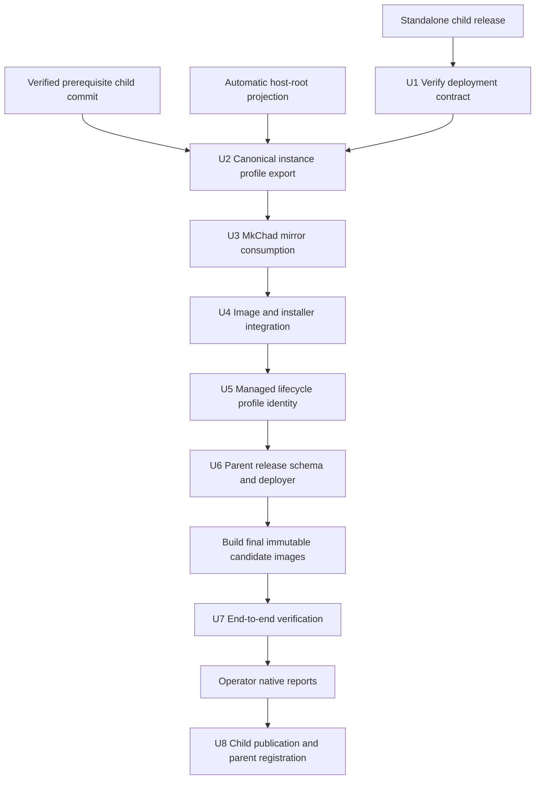

# MkChad Host Bridge Integration - Plan

## Goal Capsule

- **Objective:** Make released `host-bridge` binaries and the layered host-runtime-plus-caller-mount namespace available explicitly inside MkChad v1 x86_64 and AArch64 Neovim environments.
- **Product authority:** This plan consumes completed container-prerequisite and automatic host-root projection work plus the standalone host-bridge release; it does not redesign those products.
- **User outcome:** An agent or operator inside MkChad can explicitly run host Cargo tools, bounded Slurm clients, or file-level repair commands against an already-visible mounted root through the best compatible backend.
- **Open blockers:** The automatic host-root projection prerequisite must be implemented and verified, the prerequisite `msk_containers` commit must be verified, and the standalone child release commit, installer, archives, and checksums must be published before integration can land. This development environment has no container runtime, so native Docker/SIF claims additionally require operator-returned host reports from the supplied integration runner.
- **Stop conditions:** Stop if host paths must replace the image's normal `/usr`, a persistent instance can reuse the wrong bind profile, release deployment cannot verify the exact native host-bridge artifact, or unavailable full-root semantics are hidden by rewrite fallback.
- **Tail ownership:** Consume the immutable published host-bridge release, complete deterministic work in `container_tools`, `msk_containers`, and `mkchad`, provide exact host-run commands, validate returned native reports, and only then record the claimed child commits, artifacts, schemas, and gitlinks in one verified parent integration boundary.

---

## Product Contract

### Summary

MkChad consumes the generic writable `/host` mirror without changing the image's ordinary command environment. `container_tools` also binds the exact semantic caller-mount plan at `/.container-tools-mount-plan`. The installed standalone `host-bridge` binary uses `/host` as its lower host runtime root, replays eligible manifest-recorded caller workspace/home/explicit mounts over that root, and explicitly launches through Bubblewrap, PRoot, or caller-authorized rewrite behavior.

### Key Decisions

- **Integrate into MkChad v1.** (session-settled: user-directed - chosen over limiting host bridge to the MkChad v2 commander effort.)
- **Preserve explicit invocation.** (session-settled: user-directed - chosen over transparent PATH shims: image commands remain authoritative unless `host-bridge --` is used.)
- **Keep the core runtime-neutral.** (session-settled: user-directed - chosen over teaching host-bridge about Apptainer: MkChad owns only outer path projection and configuration location.)
- **Support x86_64 and AArch64 only.** (session-settled: user-directed - chosen over PPC64LE integration.)
- **Use light compatibility-oriented policy.** (session-settled: user-directed - chosen over command authorization and filesystem hardening: the feature assumes trusted callers and ordinary path behavior.)
- **Require explicit rewrite degradation.** (session-settled: user-directed - chosen over silent fallback when namespace and ptrace backends are unavailable.)
- **Provide one operator-runnable integration suite.** (session-settled: user-directed - runtime-dependent integration claims must be captured by a cumulative host test because the development environment has no container tools.)
- **Consume the exact bound semantic plan.** (session-settled: user-approved - chosen over searching launcher state or replacing caller mounts with a pure host root: the bridge layers the caller namespace recorded for this exact container.)

### Actors

- A1. **MkChad operator:** Installs an x86_64 or AArch64 release and supplies optional site-specific host-bridge configuration.
- A2. **MkChad launcher:** Selects the image, fixes the persistent bind profile, and consumes host paths from the generic mirror at dedicated visible destinations.
- A3. **In-container agent or shell:** Explicitly invokes `host-bridge` for a host/root command.
- A4. **Host bridge:** Reads the runtime-neutral config and selects Bubblewrap, PRoot, or explicitly permitted rewrite semantics.
- A5. **Release deployer:** Stages, verifies, installs, and records the exact architecture-specific host-bridge artifact.

### Requirements

**Packaging and availability**

- R1. MkChad release metadata must pin one published `host-bridge` child commit and checksum-addressed x86_64/AArch64 release artifacts.
- R2. Deployment must select the artifact matching the current supported host architecture and reject PPC64LE or unknown architectures for host-bridge installation.
- R3. Deployment must install the exact static binary in the child installer's immutable content-addressed store, atomically update the user-owned host-tool selector, and verify both through the child repository's check/apply/verify contract.
- R4. MkChad launchers must make the installed binary available at one fixed image path without adding the user's entire host binary directory to image PATH.
- R5. Bubblewrap and PRoot must come from the prerequisite image and remain capability-probed by host-bridge rather than inferred from release metadata.

**Host path projection**

- R6. Normal image `/usr`, `/bin`, `/sbin`, `/lib*`, `/etc`, and `/opt/msk` must remain unchanged outside a nested host-bridge launch.
- R7. Maintained launchers must consume the automatic `/host` projection and exact `/.container-tools-mount-plan` selector produced by `container_tools` rather than constructing their own fixed host-system bind list or searching mount-plan state.
- R8. The selected projection strategy, semantic mount-plan digest/path, protection masks, and exact bind set must be fixed before persistent instance creation and must participate in its canonical profile identity.
- R9. Slurm integration must support host configuration and runtime resources through `/host/etc/slurm` and `/host/run/munge` when present without reading credentials in launcher diagnostics.
- R10. Existing automatic workspace, home, and shared-filesystem binds remain visible at their current paths. Binds represented by eligible semantic manifest roles are replayed over the nested host root; native implicit HOME/CWD paths not represented as semantic entries remain outer-container behavior and are not promised as nested overlays. Profiles may add configured projections only when their targets do not collide.
- R11. Every explicit host-bridge bind, the effective automatic host mirror, and the exact semantic manifest bind must participate in the persistent-instance profile; no launcher or bridge invocation may try to discover, add, or replace an outer bind while executing an existing instance.
- R12. Persistent identity must be finalized only after all automatic, explicit user, bridge, bootstrap, cwd, and generated mirror binds are assembled. Changing the resolved immutable bridge executable, effective config path, explicit bridge/base bind identity, effective UID/GID/supplementary-group realization, generated projection strategy, or generated lexical-source/resolved-target/destination/access/recursion tuple selects a new identity; incidental generated inode, device, mount-ID, timestamp, or same-path network-remount changes do not.

**Configuration and UX**

- R13. MkChad must resolve the effective config home as `${XDG_CONFIG_HOME:-$HOME/.config}`, use its user-owned `mkchad/host-bridge/config.toml`, and pass the absolute path through `HOST_BRIDGE_CONFIG`; when the dedicated existing `host-bridge/` parent is outside an already visible home or mount, only that directory is bound read-only at the same path before instance creation. Deployment must not create, read, or overwrite the config file or expose unrelated external XDG configuration.
- R14. Documentation must provide x86_64/AArch64 examples for host Cargo tools, Slurm submit/inspect, mounted-root file repair, and capability diagnosis.
- R15. When no config exists, ordinary MkChad behavior must remain unchanged and `host-bridge` must report its normal missing-config diagnostic only when explicitly invoked.
- R16. `host-bridge doctor --json` must remain available to agents for stable capability inspection without parsing Bubblewrap, PRoot, kernel, or localized error text.
- R17. MkChad must not enable rewrite degradation globally; the user must opt in through each invocation according to the standalone contract.

**Slurm and Rust flows**

- R18. A documented profile must support Cargo/Rustup binaries installed on the host when the toolchain, project, linker, and output paths are visible.
- R19. A documented profile must support Slurm `sbatch`, `squeue`, `sinfo`, and read-oriented `scontrol` using the host site's libraries, configuration, network, and authentication socket.
- R20. Interactive `srun`, scheduler lifecycle management, automatic module loading, and site configuration discovery remain deferred.

**Deployment and compatibility**

- R21. The root release schema, deployer, release launcher, developer deployment path, result records, and tests must agree on the new component and artifact class.
- R22. Host-bridge configuration remains configuration-owned and outside release deployment; release state records only component/artifact identity and installation outcome.
- R23. Existing PPC64LE image and deployment behavior must remain supported without host-bridge and must not be removed from the release schema.
- R24. Failed bridge install, host projection, or capability setup must not modify live MkChad configuration or stop unrelated persistent instances.
- R25. The default automated suite must use fake roots, fake Slurm clients/sockets, and isolated temporary homes; real Slurm and live site configuration tests are explicit opt-in gates.
- R26. `mkchad_release.py` must require a caller-supplied `--host-bridge-archive PATH` for x86_64/AArch64 and forbid it for PPC64LE. `mkchad_develop.py` accepts the same optional argument: when supplied it must match the admitted local `host-bridge` checkout commit and is installed; when omitted, developer deployment preserves any installed bridge binary and reports bridge installation as not requested. Both paths copy and verify a supplied regular file in private staging before live mutation.
- R27. Release and developer terminal result schema 2 must represent `nvim-image` and `host-bridge-binary` separately under one closed `artifacts` object. Each entry is either null before admission/not applicable/not requested or records architecture plus expected/observed checksum; the bridge entry additionally records expected/observed source commit. Successful release x86_64/AArch64 results require both entries, successful PPC64LE results require a null bridge entry, developer omission uses a null bridge entry, and fallback/interrupted results use the same shape with unavailable observations null.
- R28. A managed OpenCode server lifecycle must record the canonical persistent-container profile identity. A start against an existing different, malformed, legacy, or future identity fails closed with explicit stop/start guidance instead of reusing or automatically stopping the old server; absent lifecycle state permits first-start creation.
- R29. Documentation and isolated tests must show unprivileged file-level repair of an already-visible, same-architecture mounted root within caller permissions; MkChad does not discover or add arbitrary repair-root binds.
- R30. The parent must ship one opt-in `tests/host_bridge_release_runtime_test.sh` that consumes an accepted projection report and tests the cumulative release/outer-projection/nested-backend flows. It emits bounded schema `mkchad.host-bridge-release-runtime/v1` with exact source, image, archive, case, and cleanup evidence; exit 77 grants no backend or architecture claim.
- R31. MkChad's shipped profile must set `root = "/host"` and `mount_plan = "/.container-tools-mount-plan"`; full-root execution requires a valid complete `ct-mount-plan-v1` record with direct or fallback generated-host-root evidence.
- R32. Host bridge must replay only `detected-automatic`, caller-data `explicit`, and `persistent-automatic-cwd` entries, never `bootstrap-internal` or generated projection entries. `container_tools` must omit bridge/config launcher-internal binds, protection masks, and the manifest bind itself from semantic entries while retaining them in outer argv and persistent identity.
- R33. Missing, malformed, future, truncated, digest-mismatched, semantically invalid, changed-during-read, partial, or `none` mount plans must make bridge full-root capability unavailable before nested backend probing or dispatch while ordinary MkChad remains usable.
- R34. Manifest-derived caller overlays and user-configured projections must be merged after the lower root into one stable parent-before-child target order. Between unrelated targets, manifest entries precede configured projections and each source retains declaration order. Exact target collisions are rejected; no source may be inferred from host state, mountinfo, backend argv, or a different digest record.
- R35. Automatic remote Docker/Podman launches that intentionally lack the local-only manifest selector remain ordinary remote launches and cannot claim MkChad host-bridge full-root integration. Maintained MkChad host-bridge launchers remain local Apptainer/Singularity paths and do not resolve or send bridge/config binds to remote Docker/Podman daemons.
- R36. `container_tools` must provide one launcher-internal read-only bind option for the bridge binary and external config directory. It emits backend-native read-only argv and participates in persistent identity but adds no semantic mount-plan entry, because those inputs are consumed before nested dispatch and must not become caller-data overlays.
- R37. The shipped profile and semantic consumer must reject replay target `/`, verify every generated entry by joining its target beneath configured root `/host`, and treat Bubblewrap as incompatible rather than creating a missing or type-mismatched destination in the host root.
- R38. Accepted host reports must identify the final local parent candidate commit and tree that contain the runner and complete integration diff. Any later source or image change invalidates the evidence before publication.
- R39. Nested backend tests must prove that every outer read-only mask protecting manifest backing state remains effective through lower-root, manifest-recorded HOME/workspace/explicit/cwd, and native implicit HOME/CWD aliases. Any failure blocks the affected backend/runtime release claim rather than introducing runtime state discovery into host-bridge.

### Key Flows


- F1. **Host Cargo tool:** The operator configures a profile using the automatic `/host` mirror and the already-mounted home/project; an agent invokes a Cargo-installed command explicitly and receives its native result.
- F2. **Slurm inspection:** The launcher projects host Slurm libraries/configuration/socket; an agent invokes `squeue`, `sinfo`, or read-oriented `scontrol` through host-bridge.
- F3. **Slurm submission:** An agent invokes `sbatch` with a workspace script; the projected cwd and host site stack submit it once and return the native client result.
- F4. **Backend diagnosis:** The agent requests JSON doctor output and sees installed plus operational Bubblewrap/PRoot status for the configured profile.
- F5. **Unsupported host:** Both full-root probes fail; host-bridge exits without launching until the caller explicitly requests rewrite degradation.
- F6. **Release deployment:** The deployer stages the native binary and image, verifies checksums and source commits, installs child and host tools serially, then reports exact observed state.
- F7. **Mounted-root repair:** An already-mounted same-architecture fixture is selected as the standalone profile root; a caller performs bounded file-level repair without MkChad adding a new bind or claiming elevated authority.
- F8. **External host verification:** After deterministic gates pass, the implementer supplies one command per available backend/architecture. The operator runs the cumulative host suite with an accepted matching projection report and returns its JSON result; the coordinator validates all digests, applicable cases, and cleanup before accepting the integration claim.
- F9. **Layered nested launch:** Host bridge reads the exact bound selector, uses `/host` as the lower root, overlays eligible caller data mounts in deterministic parent-before-child order, validates cwd, then probes and dispatches one nested backend.
- F10. **Managed lifecycle fencing:** A persistent launch finalizes the complete container profile, injects its full digest, and the managed OpenCode lifecycle compares that identity before reuse or process spawn; mismatch returns stop/start guidance without signaling or replacing state.

### Acceptance Examples

- AE1. Given an x86_64 or AArch64 release and a host Cargo-installed executable absent from the image, `host-bridge -- executable --version` runs the host-root tool while ordinary `executable` lookup still uses or misses according to the image PATH.
- AE2. Given a fake Slurm root and Unix authentication socket, `host-bridge -- squeue`, `sinfo`, `scontrol show config`, and `sbatch fixture.sh` receive exact argv/cwd/environment and never parse presentation output in MkChad launchers.
- AE3. Given a namespace-capable host, Bubblewrap doctor and execution pass inside the SIF using the projected paths.
- AE4. Given Bubblewrap is denied but ptrace is permitted, PRoot executes the same fixture through the current persistent instance.
- AE5. Given both full-root mechanisms are denied, the explicit command performs no work and reports both causes; ordinary MkChad remains usable.
- AE6. Given the host-bridge selector is atomically updated to a new verified immutable payload, an in-flight launcher remains bound to its resolved old payload and the next launcher selects a persistent profile bound to the new payload instead of reusing the old bind.
- AE7. Given no host-bridge config, MkChad and OpenCode start as before, while an explicit host-bridge invocation reports configuration guidance.
- AE8. Given a PPC64LE MkChad release, existing behavior remains valid and no host-bridge artifact or launcher bind is required.
- AE9. Given a release manifest with wrong architecture, checksum, child commit, artifact class, or incomplete action set, deployment fails before live mutation.
- AE10. Given an opt-in real HPC profile, bounded Slurm inspection and a user-supplied safe submission smoke pass without exposing site credentials in logs or release state.
- AE11. Given an already-visible mounted-root fixture, an unprivileged repair command changes only caller-writable fixture files, and a read-only profile refuses the same write.
- AE12. Given an active managed OpenCode server under one bridge profile identity, a start with a changed binary, effective config path, or bind-set identity fails with bounded stop/start guidance and neither reuses nor signals the existing server.
- AE13. Given an accepted projection report, local image, and exact host-bridge archive, one opt-in host command runs only isolated fake-Cargo/fake-Slurm/repair fixtures and emits a redacted exact-source report. Missing runtime, image, architecture, archive, or matching projection evidence exits 77 and remains unclaimed.
- AE14. Given host `/usr` beneath `/host`, a caller workspace mounted at `/workspace`, and a valid complete bound manifest, both nested backends execute host binaries and descendants while reading and writing the caller workspace at `/workspace`; the image's ordinary `/usr` remains unchanged outside host-bridge.
- AE15. Given an absent, malformed, future, truncated, digest-mismatched, semantically invalid, partial, `none`, or changed-during-read manifest, explicit host-bridge full-root invocation dispatches no nested backend and ordinary MkChad/OpenCode commands remain usable.
- AE16. Given an explicit remote Docker/Podman endpoint through generic `container_tools`, no local manifest selector is present and the ordinary remote payload remains usable without a MkChad host-bridge full-root claim; maintained MkChad bridge wrappers do not target that remote path.
- AE17. Given every supported outer alias to private manifest state, nested Bubblewrap and PRoot write, rename, and unlink attempts fail and the exact manifest bytes/digest remain unchanged before and after dispatch.

### Scope Boundaries

**In scope**

- Host-bridge child registration and release/deployment metadata.
- Static native binary installation and fixed in-image availability.
- Consumption of the automatic writable host mirror before persistent instance startup.
- User-owned runtime-neutral config and examples.
- Explicit Cargo tool and Slurm submit/inspect flows.
- File-level repair of already-visible same-architecture mounted roots.
- x86_64 and AArch64 Docker/SIF/release evidence.

**Deferred**

- Interactive `srun --pty`.
- Automatic environment-module capture or site topology discovery.
- MkChad v2 commander use of host-bridge.
- GUI/TUI for profiles or backend status.
- Dynamic arbitrary bind configuration in `container_tools`.
- Real HPC execution as a release gate; it remains optional site certification after deterministic fixture release gates pass.

**Out of scope**

- PPC64LE host-bridge support or removal of legacy PPC64LE MkChad.
- Replacing image tools globally with host tools.
- A resident host execution daemon or socket bridge.
- Deployment-owned site configuration or credentials.
- Security sandboxing, command authorization, or path hardening beyond current launcher contracts.
- Foreign-architecture/QEMU execution, privilege elevation, real ownership changes, service startup, block-device operations, or bootloader repair.

### Dependencies And Assumptions

- `docs/plans/2026-08-06-001-feat-automatic-host-root-projection-plan.md` has produced a verified generic `/host` capability plus an accepted exact-source host report for every backend/architecture claimed here.
- The container-prerequisites plan has produced a verified `msk_containers` commit containing Bubblewrap and PRoot for x86_64/AArch64; this plan owns building and publishing the final integrated images.
- The standalone plan has published checksum-addressed static host-bridge artifacts and an installer contract.
- Apptainer/Singularity permits the configured outer binds and fixes them for the life of a persistent instance.
- Host filesystems and site paths are trusted inputs under the user-confirmed compatibility-tool posture.
- Slurm application authentication and cluster policy remain the site's responsibility.

### Sources And Research

- `msk_containers/container_tools/ct_instance_exec.sh` defines immutable persistent-instance bind profiles and execution without late bind changes.
- `msk_containers/container_tools/ct_library.sh` defines current explicit bind and environment injection contracts.
- `docs/plans/2026-08-06-001-feat-automatic-host-root-projection-plan.md` defines the generic host mirror, backend parity, and best-effort failure contract consumed here.
- `msk_containers/nvim/bin/mkchad` and `mkchad-opencode-server` own current persistent launch integration.
- `msk_containers/bin/install_nvim.sh` owns installed MkChad host launchers.
- `mkchad/lua/configs/opencode.lua` owns managed OpenCode lifecycle state validation, healthy-state reuse, and start/stop fencing inside the image.
- `deploy/release.json`, `deploy/release-v2.schema.json`, `deploy/mkchad_deploy.py`, and `deploy/mkchad_release.py` define the closed schema-2 release/deployment contract.
- `docs/deployment/configuration-contract-v1.md` separates release-owned code from user-owned configuration.

---

## Planning Contract

**Product Contract preservation:** changed: the user-approved exact layered namespace revises R7-R12, adds R31-R39, F9-F10, and AE14-AE17, and narrows HOME/CWD claims to semantic entries actually present. Existing packaging, explicit invocation, deployment, portability, and scope decisions remain unchanged.

### Key Technical Decisions

- KTD1. **Consume a published root child.** Add `host-bridge/` as an independent parent submodule on branch `mkchad-v1` only after the exact released child commit is fetchable.
- KTD2. **Install one native static artifact on the host.** The public and developer launchers admit `--host-bridge-archive`, the release deployer selects x86_64 or AArch64, verifies checksum plus embedded source commit, and delegates check/apply/verify to the already-published `host-bridge/scripts/install-release.sh`.
- KTD3. **Bind only one immutable installed executable into a fixed image location.** The child installer maintains `$HOME/.local/bin/host-bridge` as an atomic selector into `${XDG_DATA_HOME:-$HOME/.local/share}/mkchad/tools/host-bridge/SHA256/host-bridge`. The launcher resolves the selector once, verifies the selected regular file against the digest-named immutable path, and projects that resolved path read-only to `/opt/msk/host-bridge/bin/host-bridge`; the bootstrap prepends only `/opt/msk/host-bridge/bin`, not the host's general binary directories. Ordinary deployment never overwrites or deletes old immutable payloads, so a concurrent selector update cannot change an already-resolved bind source.
- KTD4. **Compose the nested namespace from the exact outer plan.** Depend on the completed automatic host-root projection prerequisite for `/host` plus its exact bound `ct-mount-plan-v1` selector. Host bridge uses `/host` as the lower runtime root, replays eligible caller data mounts over it, and leaves image paths intact until Bubblewrap or PRoot constructs that nested namespace.
- KTD5. **Resolve site state from the host root and recorded caller data from the manifest.** Host `/etc`, libraries, and runtime state come from the selected `/host` root; workspaces, home/shared mounts, and explicit caller data overlays come from eligible entries in the exact manifest when recorded there. Launchers construct neither site-specific system binds nor a second mount inventory.
- KTD6. **Use one dedicated user-owned config directory.** Launchers set `HOST_BRIDGE_CONFIG=${XDG_CONFIG_HOME:-$HOME/.config}/mkchad/host-bridge/config.toml`; when the existing dedicated parent directory is not already visible, bind only that directory read-only at the same absolute path. The core config names only image-visible paths such as `/host/usr` and current workspace mounts.
- KTD7. **Add only bridge semantics absent from the canonical container profile.** When a verified bridge selector exists, the launcher computes a lowercase SHA-256 host-bridge key over a NUL-framed `host-bridge-profile-v1` record containing only the normalized absolute `HOST_BRIDGE_CONFIG` value and passes it through `ct_instance_exec.sh --ct-profile-key`. Existing explicit-bind identity already covers the immutable binary and external config bind; duplicating those tuples or checksums in the bridge key would create two canonicalizations of the same inputs. When no verified bridge selector exists, omit the bridge key and all bridge-specific binds.
- KTD8. **Extend the complete canonical persistent profile already exported by `container_tools`.** The prerequisite's profile v3 already includes the exact manifest path/bind plus finalized automatic/base, explicit, bootstrap, implicit cwd, generated mirror, protection-mask, effective identity, and semantic mount-plan inputs. Add optional persistent-only `--ct-profile-key 64-hex`, hash it alongside that existing profile without duplicating mount semantics, and inject the resulting full digest as reserved `MKCHAD_CONTAINER_PROFILE_ID` during instance start and exec.
- KTD9. **Expand release schema coherently.** Add one universally recorded deployed component, one architecture-specific artifact family, `staged_host_bridge`, exact action ordering, caller archive ingress, and result schema 2 across every closed validator and fallback producer.
- KTD10. **Preserve PPC64LE.** The ninth component metadata and inert checkout remain universal so the manifest shape stays closed; bridge artifact admission, installation actions, launcher binds, and observations apply only to x86_64/AArch64. PPC64LE supplies no bridge archive and retains existing runtime behavior.
- KTD11. **Compose one host evidence bundle.** U3-U5 define integration cases, while U7 creates one parent runner that first validates a matching accepted `container-tools.host-projection-runtime/v1` report and then exercises the cumulative release flow. Its fake-runtime/schema tests run locally; only the operator executes real Docker/SIF cases. Reports bind to the final local parent candidate commit/tree created before native execution, and publication must use that exact commit and image bytes.
- KTD12. **Make bridge/config binds read-only outer internals in `container_tools`.** One producer-owned `--ct-internal-bind-ro` option renders backend-native read-only binds and hashes them in persistent profiles without adding semantic manifest entries. Maintained bridge wrappers use only local Apptainer/Singularity, so they consume that option without endpoint parsing or remote-daemon bind semantics.

### Managed Lifecycle Identity Contract

- The host-bridge profile key exists only when the bridge selector resolves to a verified immutable payload. It contains the effective absolute config path only; finalized outer bind identity already covers the binary and external config bind. An absent selector preserves the prior container profile except for unrelated prerequisite mount-plan inputs.
- `ct_instance_exec.sh` emits `MKCHAD_CONTAINER_PROFILE_ID` as exactly 64 lowercase hex characters only after hashing the host-bridge key, all finalized effective bind inputs, the effective identity realization, and the complete semantic generated-mirror profile. The in-image lifecycle never recomputes host paths or accepts caller override through `--ct-env`.
- OpenCode lifecycle state schema 5 is schema 4 plus required `container_profile_id`; every other schema-4 field and validation rule remains unchanged. New starts write schema 5. Status and explicit stop continue to report/operate on valid legacy state under existing identity controls, but start never adopts or rewrites a schema 1-4, malformed, or future state as matching schema 5. An absent state permits ordinary first-start creation.
- Under the lifecycle fence, start compares the supplied digest before health-based reuse or process spawn. Existing-state mismatch returns typed `container_profile_mismatch` with stop/start guidance and performs no signal, unlink, state replacement, transport change, or backend contact.

### Outer Projection Layout

| Host source when present | Image-visible destination | Access | Purpose |
|---|---|---|---|
| Resolved `${XDG_DATA_HOME:-$HOME/.local/share}/mkchad/tools/host-bridge/SHA256/host-bridge` selected by `$HOME/.local/bin/host-bridge` | `/opt/msk/host-bridge/bin/host-bridge` | read-only | Immutable explicit launcher binary |
| Automatic host `/` strategy or generated top-level fallback | `/host` and matching `/host/*` destinations | host permissions | Generic host binaries, libraries, configuration, writable state, and non-kernel submounts |
| Exact content-addressed semantic plan selected by `container_tools` | `/.container-tools-mount-plan` | read-only, backing aliases masked | Caller-visible overlay roles and selected-root targets for this launch |

An existing external `${XDG_CONFIG_HOME}/mkchad/host-bridge/` is additionally bound read-only at the same path; no sibling XDG configuration is exposed. The default `$HOME/.config` needs no extra bind. Both bridge/config binds use the launcher-internal read-only producer option on maintained local Apptainer/Singularity launchers and are deliberately absent from semantic replay. Generic remote Docker/Podman behavior remains outside these wrappers and receives no local manifest selector. `container_tools` masks every writable alias of the private manifest backing directory and rejects conflicting destinations or state-descendant sources before dispatch. The automatic mirror warns and preserves ordinary MkChad launch when unavailable; explicit host-bridge capability diagnosis requires a complete direct/fallback manifest and reports partial, absent, or invalid plans without affecting ordinary MkChad.

### User Configuration Example

```toml
version = 1
default_profile = "mkchad-host"

[profiles.mkchad-host]
root = "/host"
root_access = "inherit"
semantics = "full-root"
mount_plan = "/.container-tools-mount-plan"
cwd_unmapped = "error"
path = ["/home/user/.cargo/bin", "/usr/local/bin", "/usr/bin", "/bin"]
```

The repository ships examples only; it never writes this live file.

The root supplies host binaries, libraries, `/etc`, and runtime paths. The exact bound manifest replays eligible recorded caller workspaces, home/shared mounts, explicit data binds, and persistent cwd over that root; it does not invent native implicit HOME/CWD entries or replay bootstrap and launcher-internal mounts. The example uses `inherit` because the automatic outer mirror preserves the invoking user's host permissions and writable access. Profiles that add explicit read-only projections continue to use `read-only` and exclude PRoot when it cannot enforce that restriction.

### Release And Deployment Model

- Add `host-bridge` as the universal ninth component with `disposition = deployed` and a checkout under the MkChad XDG data component root; it remains inert on PPC64LE.
- Add `host-bridge-binary` artifacts with x86_64 and AArch64 checksum entries, exact 40-hex `source_commit`, and a strict archive filename class; each source commit must equal the universal host-bridge component commit.
- Extend public and developer launchers with `--host-bridge-archive PATH` and action tokens with `staged_host_bridge`; the deployer admits, privately stages, and resolves it only for matching native x86_64/AArch64 releases. PPC64LE rejects a supplied bridge archive.
- Run host-bridge preflight before checkout or binary mutation, install after the child checkout is staged, and verify exact binary version/checksum before reporting success.
- Stage and install the new `msk_containers` host launchers and selected SIF only after host-bridge binary preflight succeeds.
- Replace singular result `artifact` with result-schema-2 `artifacts`, whose exact keys are `nvim-image` and `host-bridge-binary`. The image object has exactly `architecture`, `expected_sha256`, and nullable `observed_sha256`; the bridge object has those fields plus `expected_source_commit` and nullable `observed_source_commit`. Either value may be null only when not yet admitted, not applicable, or not requested under the R27 rules. Record configuration guidance separately; never record config contents or host path inventory.

#### Closed Manifest And Action Expansion

- `artifacts.host-bridge-binary` is an array of exactly one x86_64 and one AArch64 object. Each object has exactly `architecture`, `sha256`, `source_commit`, and `source_filename_class = "host-bridge-release-archive"`; `source_commit` equals the ninth component commit. PPC64LE has no bridge artifact entry.
- Add exact tokens `staged_host_bridge`, `host_bridge_sha256`, `host_bridge_target`, and `host_bridge_store`. They expand respectively to the privately staged admitted archive, selected release-manifest digest or admitted developer-archive digest, `$HOME/.local/bin/host-bridge`, and `${XDG_DATA_HOME:-$HOME/.local/share}/mkchad/tools/host-bridge`. `component_revision` supplies the expected release-component or admitted local-checkout source commit, and existing `recovery_dir` supplies private rollback storage. Tokens are never accepted from caller text or serialized into results.
- The ninth component owns exactly three actions in this order within each phase:

| ID | Phase | Path | Args |
|---|---|---|---|
| `host-bridge-install-preflight` | preflight | `scripts/install-release.sh` | `--check --archive {staged_host_bridge} --expected-sha256 {host_bridge_sha256} --expected-source-commit {component_revision} --target {host_bridge_target} --store-dir {host_bridge_store}` |
| `host-bridge-install` | apply | `scripts/install-release.sh` | `--apply --archive {staged_host_bridge} --expected-sha256 {host_bridge_sha256} --expected-source-commit {component_revision} --target {host_bridge_target} --store-dir {host_bridge_store} --recovery-dir {recovery_dir}` |
| `host-bridge-install-verify` | verify | `scripts/install-release.sh` | `--verify --archive {staged_host_bridge} --expected-sha256 {host_bridge_sha256} --expected-source-commit {component_revision} --target {host_bridge_target} --store-dir {host_bridge_store}` |

- On x86_64/AArch64, host-bridge preflight is the first action, bridge apply precedes `msk_containers` host-tool/image apply, and bridge verify precedes the remaining verify actions. On PPC64LE all three actions are admitted as architecture-inapplicable and recorded `skipped-not-applicable` without token resolution or execution.
- Developer deployment with a supplied bridge archive admits the same three actions and resolves tokens from the archive plus local child checkout. When the optional archive is omitted, it removes all three bridge actions before token resolution, preserves the selector/store untouched, records no synthetic skipped actions, and emits a null `host-bridge-binary` result.

#### Terminal Result Schema 2

- Both branches require exactly `schema = 2`, `mode`, `run_id`, timestamps, `outcome`, `phase`, `components`, `artifacts`, `actions`, nullable `failed_step`, bounded redacted `diagnostic`, and absolute `log_path`; unknown fields fail validation.
- The release branch has `mode = "release"`, `release`, and `configuration_handoff`. After manifest admission `components` has exactly nine result-v1-shaped entries; before admission it is empty. The developer branch has `mode = "developer"`, absolute `workspace`, and the existing closed `image` object with exactly `choice`, nullable `supplied_sha256`, nullable `active_sha256`, and `decision`; after source admission `components` has exactly `msk_containers`, `container_tools`, `mkchad`, and `host-bridge` requested/observed entries, and before admission it is empty.
- `artifacts` always has exactly `nvim-image` and `host-bridge-binary`. Non-null image values have exactly `architecture`, `expected_sha256`, and nullable `observed_sha256`. Non-null bridge values add `expected_source_commit` and nullable `observed_source_commit`. Success requires all applicable requested/observed fields to match; PPC64LE and developer omission require a null bridge value; pre-admission fallback may use null values for both keys.
- Action results retain exact `component`, `id`, `phase`, and `status`; component adds `host-bridge`, and status adds `skipped-not-applicable`. Release actions may contain all nine-component actions; developer actions contain only admitted deployed-child actions. Fallback and interrupted producers emit the same branch and shape, with empty pre-admission collections or null observations rather than a legacy schema.

### Implementation Constraints

- Preserve unrelated dirty child gitlinks and untracked parent files throughout implementation.
- Do not inspect or modify the live host-bridge config during default tests or deployment.
- Build shell argv with arrays; do not serialize binds or commands for later `eval`.
- Keep optional-path diagnostics free of directory contents, socket data, environment dumps, and credentials.
- Never add host directories to ordinary image `PATH` or global `LD_LIBRARY_PATH`.
- Use exact architecture and checksum evidence before installing a binary.
- Cross-repository implementation is serial: immutable host-bridge release, `container_tools`, `msk_containers`, `mkchad`, then parent deploy/release/submodule integration.
- Use `/tmp/mkchad-v1/host-bridge-integration` for disposable fixtures and release staging.
- Host-run evidence uses `/tmp/mkchad-v1/host-bridge-host`, isolated HOME/XDG roots, fake Cargo/Slurm/socket/repair fixtures, local images/archives only, and no live MkChad configuration, registry pulls, real scheduler calls, or arbitrary projected-path writes.

### Host-Run Evidence Contract

From the parent workspace, the operator runs one backend/architecture at a time:

```bash
MKCHAD_HOST_BRIDGE_RUNTIME_TEST=1 \
  bash tests/host_bridge_release_runtime_test.sh \
    --backend apptainer \
    --image "$MKCHAD_HOST_TEST_SIF" \
    --host-bridge-archive "$MKCHAD_HOST_TEST_BRIDGE_ARCHIVE" \
    --projection-report /tmp/mkchad-v1/host-root-projection-host/apptainer-RUN_ID/report.json \
    --work /tmp/mkchad-v1/host-bridge-host/apptainer-RUN_ID
```

Docker accepts an already-local image selector and resolves it once to the immutable image ID used by every launch. SingularityCE/Apptainer require an absolute regular SIF that is copied, using reflink when available, into the work directory and executed only from that staged copy. The bridge archive and projection report are likewise copied into private staging before validation. Before creating fixtures, the runner requires the prerequisite report to have the exact schema, overall `passed` outcome, no skipped applicable case, successful exact cleanup, matching backend/architecture/image digest, and matching reviewed `container_tools` source digest. Malformed, failed, unavailable, incomplete, or mismatched prerequisite evidence exits 77 with no integration claim.

`--work` must be a new directory beneath `/tmp/mkchad-v1/host-bridge-host`. Existing, relative, or out-of-root paths are invalid exit 2 before mutation and emit no report. Environmental failure to create an otherwise valid work directory emits one stdout-only unavailable JSON object with exit 77 and no file. After creation, every syntactically valid non-help run writes `$work/report.json` and emits the same single JSON object on stdout. Exit 0 means all applicable cases passed, 1 means failure, and 77 means disabled or unavailable/no claim; `--help` emits usage and exit 0 without a report.

Schema `mkchad.host-bridge-release-runtime/v1` has only these top-level keys: `schema`, `evidence_kind`, `source_manifest_digest`, `parent_commit`, `parent_tree`, `child_commits`, `image_id`, `image_digest`, `archive_digest`, `runtime`, `runtime_version`, `architecture`, `projection_report_digest`, `mount_plan_digest`, `cases`, `cleanup`, and `overall`. `schema` is the exact schema name; `evidence_kind` is `native` or `unavailable`; `overall` is `passed`, `failed`, or `unavailable`; `runtime` is `docker`, `singularity`, or `apptainer`; `architecture` is null, `x86_64`, or `aarch64`; commit/tree IDs are lowercase 40-hex. `source_manifest_digest`, `image_digest`, `archive_digest`, `projection_report_digest`, and `mount_plan_digest` are null or lowercase 64-hex; `image_id` is one immutable Docker ID or null; `runtime_version` is a bounded sanitized scalar or null. `child_commits` has exactly `host_bridge`, `container_tools`, `msk_containers`, and `mkchad`. Native passed/failed evidence requires non-null architecture, runtime version, source/image/archive/projection digests, plus a non-null mount-plan digest for every case that enters a container; Docker additionally requires non-null `image_id`, while SingularityCE/Apptainer require it to be null. Unavailable evidence requires `overall = unavailable`, permits unavailable inputs to remain null, and must not claim a case pass. The NUL-framed source manifest binds the final local parent candidate plus those child commits; all launches use the admitted immutable image, semantic plan, and staged archive bytes. Source manifests and staged inputs are hashed before dispatch and at completion; any change fails the run.

The exact ordered case IDs are `HB-HOST-001-admission-binds`, `HB-HOST-002-bubblewrap-layered`, `HB-HOST-003-proot-layered`, `HB-HOST-004-invalid-plan`, `HB-HOST-005-cargo`, `HB-HOST-006-slurm`, `HB-HOST-007-mounted-root`, `HB-HOST-008-profile-lifecycle`, `HB-HOST-009-interruption-cleanup`, and `HB-HOST-010-remote-no-claim`. Each case object has exactly `id`, `status`, `reason`, `duration_ms`, `operation_count`, and `fixture_digests`. Status is `pass`, `fail`, or `not-applicable`; reason is `ok`, `runtime-unavailable`, `input-unavailable`, `prerequisite-unavailable`, `backend-unavailable`, `policy-denied`, `architecture-not-applicable`, `precondition-failed`, `assertion-failed`, or `cleanup-failed`. Pass requires `ok`; fail permits only the final three failure reasons; not-applicable permits only the six unavailable/policy reasons, and a claimed nested backend cannot be not-applicable. An unavailable report contains all ten ordered cases as not-applicable with the most specific allowed unavailable reason and null fixture digests. Duration is an integer from 0 through 300000 and operation count is 0 through 128. `fixture_digests` has exactly `root_before`, `root_after`, `manifest_before`, `manifest_after`, and `result`, each null or lowercase 64-hex.

`cleanup` has exactly `status`, `reason`, `run_id`, `runtime_object_identity_digest`, `profile_id`, `creation_identity_digest`, `operation_count`, `remaining_processes`, `remaining_instances`, `remaining_containers`, and `remaining_paths`. Status is `pass` or `fail`; reason is `ok`, `identity-ambiguous`, `stop-failed`, `residue`, or `interrupted-before-capture`; pass requires `ok`. `run_id` is lowercase 32-hex; each identity field is null or lowercase 64-hex. Operation count is 0 through 64, and every remaining count is an integer from 0 through 64. Acceptance requires cleanup pass and all remaining counts zero. Cleanup never infers authority from a listing, display name, PID, or work path and signals nothing when identity is ambiguous. The report excludes config contents, environment dumps, host inventories, scheduler credentials, raw argv, payload output, and private nonce values; only a one-way creation-identity digest may appear. Returned reports are accepted only when the parent commit/tree and every digest match the reviewed candidate, all applicable closed cases pass, cleanup is exact, and no source changed.

Host-dependent coverage is cumulative rather than one harness per unit: U3 defines launcher/mirror/profile cases, U4 supplies packaged image/backend checks, U5 supplies managed-lifecycle mismatch cases, and U7 assembles and fake-tests the one operator runner. U1, U2, U3, U5, and U6 still require their deterministic suites locally; missing container tools excuse only the explicitly host-dependent execution, not fixture, schema, static-analysis, or report-validation tests.

### Sequencing



### Requirement Traceability

| Unit | Requirements | Flows | Acceptance examples |
|---|---|---|---|
| U1 | R1-R5, R21-R22 | F6 | AE9 |
| U2 | R8, R11-R12, R24, R28, R35-R36 | F10 | AE6, AE12, AE16 |
| U3 | R4, R6-R20, R24-R25, R29, R31-R37, R39 | F1-F5, F7, F9-F10 | AE1-AE7, AE11-AE12, AE14-AE17 |
| U4 | R4-R17, R23-R25, R29, R31-R37, R39 | F1-F5, F7, F9 | AE1-AE8, AE11, AE14-AE17 |
| U5 | R12-R13, R24, R28 | F10 | AE6-AE7, AE12 |
| U6 | R1-R5, R21-R24, R26-R27 | F6 | AE6, AE8-AE9, AE12 |
| U7 | R1-R39 | F1-F10 | AE1-AE17 |
| U8 | R1-R5, R21-R24, R26-R28, R30-R39 | F6, F8-F9 | AE6, AE8-AE9, AE12-AE17 |

### Risks And Mitigations

| Risk | Impact | Mitigation | Required proof |
|---|---|---|---|
| Host paths overlay image system paths globally | Image corruption or nondeterminism | Bind only beneath `/host/*`; nested backend applies mappings | Launcher argv and ordinary command tests |
| Automatic host mirror is partial or unavailable | Host tools observe incomplete roots | Preserve ordinary launch, expose bounded diagnostics, and let host-bridge capability checks refuse unsupported profiles | Direct, fallback, partial, and unavailable projection tests |
| Bind added after instance startup | Tool sees stale or absent paths | Fix all binds in profile before `instance start` | Persistent reuse/profile-change tests |
| Selector update races launcher resolution | New profile identity names old or mutable bytes | Resolve and verify immutable payload once; retain old payloads | Paused-launch selector update and next-launch tests |
| Munge/Slurm layout differs by site | Slurm commands fail | Document visible mirror paths and keep profile selection user-owned | Fake layouts and opt-in site evidence |
| Rewrite silently handles failed full-root setup | Incorrect Slurm/Cargo behavior | No global degradation consent | Both-backends-denied integration test |
| Release schema updated incompletely | Deployment admission or recovery breaks | Treat schema/deployer/release/tests as one unit | Invalid-manifest matrix and recovery tests |
| New component breaks PPC64LE | Existing users lose deployments | Architecture-conditional artifact requirement | PPC release fixture remains green |
| Default tests submit real jobs | Unintended scheduler effects | Fake clients by default; explicit opt-in live smoke | Network/credential-free suite audit |
| Active managed server outlives a semantic bind, effective-group, image, or bridge change | Commands route through stale mounts, access, or binary | Persist and compare the canonical profile digest; include effective identity realization, keep generated mirror identity semantic, and require explicit stop/start for accepted same-path remount staleness | Semantic generated-bind, group-change, explicit-source replacement, and active-server mismatch tests without signaling |
| Native result is unavailable or from mismatched source/image/archive | False integration or architecture claim | One exact-source host runner consumes the prerequisite report and emits closed digests; exit 77 remains unclaimed | Operator-returned report validated against reviewed commits and artifacts |
| Bridge reads a different plan or drops caller overlays | Wrong workspace/home inside host-root command | Consume only the bound selector, validate its digest/roles, and compose lower root plus caller overlays before probing | Exact-manifest, malformed, partial, collision, and layered namespace cases |
| Bridge/config bind is writable or replayed into the host root | Mutable input or false Bubblewrap incompatibility | Producer-owned launcher-internal read-only bind omitted from semantic entries | Apptainer/Singularity argv/access, manifest exclusion, and persistent identity cases |
| Bubblewrap creates an absent nested target in `/host` | Probe mutates host state | Standalone preflight requires existing type-compatible destinations and marks Bubblewrap incompatible otherwise | Missing parent/leaf/type and unchanged-root cases |
| Nested rebinding drops a manifest-state protection mask | Future plan corruption or cross-project routing | Require every alias to remain read-only through each nested backend | Write/rename/unlink refusal and unchanged digest cases |

---

## Implementation Units

### U1. Verify The Published Host-Bridge Installation Contract

- **Goal:** Prove the immutable standalone release already exposes every installation and verification input MkChad requires.
- **Files:** None changed; inspect the published `host-bridge/scripts/install-release.sh`, `host-bridge/docs/release.md`, exact archives, checksums, and release commit as read-only inputs.
- **Approach:** Verify the published installer's staged-archive, expected-checksum, expected-source-commit, architecture, target, check/apply/verify, and private-recovery contracts. If any contract is missing, stop this plan and revise/release the standalone child first; do not patch or republish it from integration.
- **Test scenarios:** First immutable install and selector update; compliant no-op; x86/AArch64 mismatch; checksum/source-commit mismatch; malformed/traversing archive; wrong embedded version; selector replacement with private recovery; old payload retention; check-only; interrupted stage; destination race; exact verify.
- **Verification:** Run the child installer test and release verification against both published archives.
- **Dependencies:** Completed standalone plan and explicit child release.

### U2. Extend The Canonical Local Launch Contract

- **Goal:** Give managed processes the canonical persistent identity and give maintained local launchers one backend-neutral read-only outer-internal bind that never becomes a nested caller overlay.
- **Files:** `msk_containers/container_tools/ct_library.sh`; `msk_containers/container_tools/ct_instance_exec.sh`; `msk_containers/container_tools/tests/host_projection_test.sh`; `msk_containers/container_tools/tests/instance_exec_test.sh`; `msk_containers/container_tools/README.md`.
- **Approach:** Start from the verified `ct-instance-profile-v3` and exact `ct-mount-plan-v1` prerequisite. Add optional exactly-once `--ct-profile-key 64-hex` handling to persistent instance execution only. When present, append one NUL-framed label/value to the existing profile-hash input; when absent, preserve the exact prior hash. Add `--ct-internal-bind-ro HOST_PATH:CONTAINER_PATH` to the shared launcher parser: validate and render it read-only for every backend and include its exact argv/source identity in persistent profiles, but deliberately add no semantic manifest entry. Maintained bridge wrappers pass it only to local Apptainer/Singularity. Do not duplicate or reinterpret manifest entries in wrappers. After computing the canonical digest, reject caller override of `MKCHAD_CONTAINER_PROFILE_ID` through direct, ambient, `SINGULARITYENV_`, or `APPTAINERENV_` channels and inject the digest into both instance start and every exec. Keep full 64-hex environment identity while retaining the existing 32-hex instance-name prefix. Commit and verify `container_tools` independently before its parent gitlink changes.
- **Test scenarios:** Existing caller/hash compatibility without a key; malformed/duplicate key; key changes profile; full environment value matches profile; start and reuse exec receive the same value; direct and runtime-prefixed override rejection; digest is absent until all binds, protection masks, and the exact manifest selector are finalized; launcher-internal read-only Docker/Podman/Singularity/Apptainer argv; missing/symlinked/wrong-type source; internal bind is absent from semantic entries but present exactly once in outer argv/profile identity; adding/changing an explicit user bind changes both mount plan and identity; auto/required/refresh may reuse when effective binds, manifest digest, and identity realization match; effective UID/primary GID/supplementary GIDs/group mode changes alter it; image/bootstrap/base-or-explicit bind path/inode/type changes alter it; generated strategy/lexical-source/resolved-target/destination/access/recursion changes alter it; generated inode/device/mount-ID/time/remount metadata does not; concurrent first use; no argument leaks to payload; existing timeout/non-signaling behavior.
- **Verification:** Run `tests/host_projection_test.sh`, `tests/instance_exec_test.sh`, and child shell/static-analysis gates from `msk_containers/container_tools`.
- **Dependencies:** Verified container-prerequisite child state and the completed automatic host-root projection prerequisite; U1 is an integration admission gate and does not block this independent producer work.

### U3. Consume The Host Mirror In MkChad Launchers

- **Goal:** Make the bridge binary and effective generic host mirror visible before persistent instance creation without changing ordinary image resolution.
- **Files:** `msk_containers/container_tools` gitlink; `msk_containers/nvim/bin/host_bridge_library.sh`; `msk_containers/nvim/bin/mkchad`; `msk_containers/nvim/bin/nvim_shell`; `msk_containers/nvim/bin/mkchad-opencode-server`; `msk_containers/nvim/bin/mkchad-container-bootstrap`; `msk_containers/tests/host_bridge_wrapper_test.sh`; `msk_containers/tests/opencode_server_wrapper_test.sh`.
- **Approach:** Record the verified U2 nested gitlink. Centralize immutable bridge selector resolution and config-path-only host-bridge key calculation in one sourced host library while consuming both the generic mirror and exact semantic selector selected by `container_tools`. Pass the resolved binary and optional dedicated external config directory through `--ct-internal-bind-ro`; do not manufacture backend argv or semantic entries. Set the fixed config environment and prepend only the fixed bridge binary directory. The maintained wrappers select local Apptainer/Singularity, while generic remote Docker/Podman behavior remains a `container_tools` no-claim path rather than an MkChad bridge launch. The shipped profile names `/host` and `/.container-tools-mount-plan`; wrappers never parse, copy, or search for the manifest. Persistent editor and managed OpenCode invocations pass the key through `--ct-profile-key` only when a verified bridge exists; nonpersistent `nvim_shell` shares the local mirror, exact selector, and config but does not pass an instance-only option or claim lifecycle identity. Status-only operations remain free of unnecessary bridge binds.
- **Test scenarios:** Config absent; default and dedicated external XDG roots; no external XDG sibling exposure; relative XDG root rejection; nonexistent dedicated root omitted with explicit missing-config behavior; bridge absent omits key and binds; maintained launchers remain local Apptainer/Singularity; valid direct/fallback exact manifests; partial/none/missing/malformed/future/digest-mismatched/truncated manifests leave ordinary MkChad usable but bridge full-root unavailable; manifest-recorded workspace/home/explicit/cwd overlays beat the lower host root; native implicit HOME/CWD is not overclaimed; `bootstrap-internal` is present but non-replayed, while bridge/config internal, protection-mask, and selector binds are absent from semantic entries; target `/` and exact-target collisions fail; missing Bubblewrap destination leaves the lower root unchanged; paths with spaces; host-permission writes beneath fixture `/var` and `/run`; image `/usr` unchanged; exact bridge PATH precedence; no host PATH/LD import; deterministic config-path-only key; persistent first start/reuse; selector update during paused launch still binds the resolved immutable payload; binary, mount-plan digest/path, projection strategy, complete semantic bind set, protection masks, effective group realization, explicit bridge-bind identity, and effective config-path changes select separate instances exactly once; generated network-remount metadata does not; nonpersistent shell omits the profile option; stale instance remains separate; ordinary MkChad/OpenCode behavior; no late bind or state-search attempt.
- **Verification:** Run focused launcher/wrapper tests and shellcheck changed scripts.
- **Dependencies:** U2 and the verified prerequisite `msk_containers` commit.

### U4. Package The Integration In Both Maintained Images And Installers

- **Goal:** Provide fixed image destinations, examples, and installed launcher files with x86_64/AArch64 parity.
- **Files:** `msk_containers/nvim/x86/nvim_container_x86.dockerfile`; `msk_containers/nvim/aarch64/nvim_container_aarch64.dockerfile`; `msk_containers/bin/install_nvim.sh`; `msk_containers/docs/adr/002-package-selections.md`; `msk_containers/tests/nvim_container_tooling_test.sh`; `msk_containers/tests/install_nvim_test.sh`; `msk_containers/tests/host_bridge_integration_test.sh`; `msk_containers/tests/host_bridge_backend_runtime_test.sh`; `msk_containers/docs/host-bridge.md`.
- **Approach:** Create `/opt/msk/host-bridge/bin`, install the launcher helper with existing host tools, document user-owned config and use cases, and retain architecture parity. Do not embed the host-bridge release binary in the SIF; the outer release deploys and binds the exact host binary. Keep `host_bridge_backend_runtime_test.sh` as the bounded in-image capability probe consumed by U7's parent host runner. Commit the deterministically verified `msk_containers` source independently before parent deployment work begins, but make no native image claim until U7/HOST tests the final immutable candidate bytes.
- **Test scenarios:** Missing destination; installer first install/no-op/recovery; source changes; x86/ARM parity; PPC exclusion; documentation/config examples parse; binary remains externally supplied; image backend tools present from the prerequisite commit.
- **Verification:** Run tooling, installer, parity, and backend-harness schema tests locally. Supply serial native image build/smoke commands to the operator when unavailable here; validate returned image/backend reports before claiming that architecture.
- **Dependencies:** U3.

### U5. Bind Managed OpenCode State To The Canonical Profile

- **Goal:** Prevent a healthy managed server from being adopted through a launcher profile different from the one that started it.
- **Files:** `mkchad/lua/configs/opencode.lua`; `mkchad/lua/mkchad/opencode/command.lua`; `mkchad/tests/opencode_lifecycle_spec.lua`; `mkchad/tests/opencode_state_validation_spec.lua`; `mkchad/tests/opencode_startup_race_spec.lua`; `mkchad/tests/opencode_command_adapter_spec.lua`.
- **Approach:** Admit `MKCHAD_CONTAINER_PROFILE_ID` only as a lowercase 64-hex digest from the trusted persistent launcher, add it as required `container_profile_id` in lifecycle schema 5, and compare it under the existing lifecycle fence before healthy-state reuse or spawn. Matching identities and absent first-start state preserve current behavior. Existing malformed, legacy, future, or mismatched identity blocks start with bounded explicit stop/start guidance and does not signal, remove, rewrite, or downgrade state. Map that refusal through the closed command adapter as exact `container_profile_mismatch`. Commit and verify the `mkchad` child independently before parent deployment work.
- **Test scenarios:** Matching first start/reuse; missing/malformed environment identity; matching state; changed binary/binds/effective config path; legacy state without identity; malformed/future state; mismatch under concurrent starts; status remains observational; stop remains explicitly user-directed; no signal, state unlink, or replacement on mismatch; unchanged direct/TLS transport, credentials, and database behavior.
- **Verification:** Run focused lifecycle, state-validation, and startup-race specs, then the child-required OpenCode lifecycle suite.
- **Dependencies:** U4 and U2's canonical environment contract.

### U6. Expand Parent Release And Deployment Contracts

- **Goal:** Add one independently versioned component and binary artifact without weakening the closed release schema.
- **Files:** `.gitmodules`; `AGENTS.md`; `deploy/release.json`; `deploy/release-v2.schema.json`; `deploy/result-v2.schema.json`; `deploy/mkchad_deploy.py`; `deploy/mkchad_release.py`; `deploy/mkchad_develop.py`; `docs/deployment/configuration-contract-v1.md`; `docs/deployment/README.md`; `tests/test_mkchad_deploy.py`; `tests/test_mkchad_develop.py`; `tests/test_mkchad_release.py`; `tests/run_deployment_tests.sh`; `host-bridge` gitlink.
- **Approach:** Add the universal ninth component and architecture-conditioned artifact family, extend public/developer caller arguments, closed enums/maps/order/tokens, and result schema 2, stage the native archive, delegate install actions, and keep site config configuration-owned. Register the submodule only after its remote and exact release commit are fetchable.
- **Test scenarios:** Missing/duplicate/ninth wrong component; x86/AArch64 exact artifact; missing required caller archive; PPC without and with rejected bridge archive; wrong checksum/filename/architecture/source commit; initial install; active compliant verify-only; partial existing state; installer failure/recovery; interrupted and pre-admission fallback results; result redaction; developer-tree staging; recursive fresh clone; unrelated gitlinks unchanged.
- **Verification:** Run focused deployment/release tests and schema validation before broad deployment test script.
- **Dependencies:** Published standalone child release verified by U1 plus independently committed and verified U2 `container_tools`, U4 `msk_containers`, and U5 `mkchad` changes.

### U7. Prove End-To-End Host Tool Flows

- **Goal:** Validate the complete release, exact outer semantic plan, layered nested backend, and explicit Cargo, Slurm, and mounted-root command experience.
- **Files:** `tests/test_host_bridge_release_integration.py`; new `tests/host_bridge_release_runtime_test.sh`; `docs/deployment/README.md`; no new `msk_containers` files after its U4 commit.
- **Approach:** Build isolated host-root fixtures with fake Cargo and Slurm process trees, manifest-recorded caller workspace/home, mounted-root repair tree, config, Unix socket, protected backing aliases, and submission records. Add one opt-in parent host runner that validates an accepted projection report, captures the exact selector digest from inside the container, and delegates through the deployed host bridge and exact candidate image under Bubblewrap and PRoot. Deterministic tests fake every runtime/archive/report/manifest boundary and validate the closed schema/case IDs, redaction, source binding, immutable input use, ownership-bearing cleanup capture, pre/post digest stability, exit 0/1/2/77, and no-signal ambiguity handling. After all U3-U7 deterministic files and child gitlinks are committed and verified, create the final local parent candidate commit, prohibit source changes, build the immutable candidate images from that commit once, and record their content digests before any native claim. Reports must name that parent commit/tree. Real HPC remains separate optional post-release certification, never an input to the default host runner.
- **Test scenarios:** AE1-AE17; exact parent commit/tree and child source commits; exact host binary checksum; ordinary image command isolation; exact selector path/digest; host runtime lower root plus manifest-recorded workspace/home/explicit/cwd overlays; native implicit HOME/CWD non-claim; bootstrap/internal exclusion; target `/` and collision refusal; missing Bubblewrap target leaves host root unchanged; malformed/future/truncated/mismatched/partial/none/changed plan refusal and doctor status; protection-mask write/rename/unlink refusal through every alias; Cargo child process and output path; fake Slurm query/submission argv and cwd; already-visible mounted-root read/write; backend denial matrix; explicit rewrite only; binary/config/bind/manifest update; managed-server identity mismatch; selective process interruption, PID reuse, identity ambiguity, and zero run-owned residue; no credentials or live paths; native x86/ARM; legacy PPC release; generic remote manifest omission/no-claim; missing/mismatched projection report, image, archive, source tree, architecture, and cleanup evidence.
- **Verification:** Run deterministic integration and host-runner schema/fake-boundary tests locally. Build each final candidate image once on an applicable builder, then supply one exact command per operator-available native x86_64/AArch64 Docker/SIF environment and accept only reports matching those candidate digests. If explicitly authorized on a real HPC site, separately certify `sinfo`, `squeue`, `scontrol show config`, and one user-approved safe `sbatch` fixture; report absence without blocking release.
- **Dependencies:** U6.

### U8. Publish Children And Complete Parent Integration

- **Goal:** Publish the remaining child histories and land one exact MkChad v1 release boundary after consuming the already-published standalone child.
- **Files:** `host-bridge` gitlink; `msk_containers` gitlink; `mkchad` gitlink; nested `msk_containers/container_tools` gitlink; parent release/deployment/docs files from U6.
- **Approach:** Verify the immutable published host-bridge commit/artifacts, publish the already-committed `container_tools`, `msk_containers`, and `mkchad` children serially in dependency order, publish the exact U7/HOST-tested image bytes without rebuilding, then publish the already-created final parent candidate commit that the reports identify. Do not amend or create a different parent integration commit after host evidence. Any image rebuild, commit/tree change, or source change invalidates the reports and returns to U7/HOST before publication. Preserve unrelated work; do not modify or republish host-bridge in this plan.
- **Test scenarios:** All four child commits fetch from declared remotes; host-bridge artifact and published image checksums exactly match the accepted host reports and recorded commits; rebuild detection invalidates evidence; recursive clone resolves including the nested child; deploy verify-only reports compliant state; parent diff has intended gitlinks and integration files only; no live config enters Git.
- **Verification:** Repeat child broad gates at pinned commits, parent deployment suite, `git submodule status --recursive`, `git diff --check`, and final staged-diff inspection.
- **Dependencies:** U7, accepted native reports for every backend/architecture claimed by the release, and explicit authorization for `container_tools`, `msk_containers`, `mkchad`, image, and parent publication plus final release actions.

---

## Verification Contract

### Focused Repository Gates

- `host-bridge`: read-only installer and release-contract conformance against both exact published native archives.
- `container_tools`: automatic host-root strategy, exact semantic manifest publication/bind, backing-alias protection, launcher-internal read-only bind argv/profile identity and manifest exclusion, backend translation, supplementary-group argv, persistent-instance profile-key, reserved environment rejection, resolved bind-identity, compatibility, concurrency, interruption/recovery, and timeout tests; shellcheck changed scripts.
- `msk_containers`: host-bridge wrapper, OpenCode wrapper, installer, container tooling, and backend-runtime-harness schema tests; shellcheck changed scripts.
- `mkchad`: lifecycle, state-schema, and startup-race tests for schema-5 profile identity and fail-closed mismatch.
- Parent: schema, deployer, developer-tree, release-launcher, host-bridge integration, and host-runner fake-boundary/report-validation tests.

### Operator Host Runtime Gates

- Native x86_64 Docker and SIF: automatic writable host mirror, exact selector and nested backing protection, layered manifest-recorded caller workspace/home, read-only bridge bind on maintained local SIF launchers, Bubblewrap no-target-creation fixture, PRoot fixture, Cargo-like flow, Slurm-like flow, malformed/partial plan refusal, generic remote no-claim, and mounted-root fixture.
- Native AArch64 Docker and SIF: the same suite; source parity alone is insufficient.
- Backend-denied runners: prove bounded unavailable diagnostics and no silent rewrite.
- Optional post-release HPC certification: run only user-approved read commands and one safe submission fixture, with no credential or private configuration capture; this is not a release completion gate.

Each claimed Docker/SIF and architecture combination requires both an accepted matching projection report and `mkchad.host-bridge-release-runtime/v1` report from the documented one-command runner. The development environment records these gates as unavailable rather than invoking missing tools. The operator executes suites serially and returns the exact JSON plus exit status; exit 77, a missing report, a digest mismatch, or a skipped applicable case makes no claim for that combination.

### Deployment Gates

- Validate release manifest schema 2 with exactly nine recognized components and terminal result schema 2 with both closed artifact keys after expansion.
- Validate architecture-conditioned host-bridge artifact requirements while preserving PPC64LE image behavior.
- Verify child commits, native artifact checksum, installed binary identity, published image checksum, accepted host-report image digest, and configuration guidance all agree.
- Exercise first install, compliant no-op, verify-only active service, partial state, failure recovery, and interruption.
- Confirm release/deployment output excludes config contents, host environment, host path inventory, scheduler credentials, and private session data.

### Broad Closeout

- Run one resource-intensive image or integration suite at a time.
- Repeat broad child verification only after all focused cross-repository changes settle.
- Do not mutate protected live MkChad paths during automated verification.
- Validate operator reports against the reviewed commits, image/archive digests, prerequisite report, and cleanup before closeout.
- Report real HPC, backend, and architecture gates not run, with the missing environment rather than substitute evidence.

---

## Definition of Done

- MkChad v1 records and deploys one exact published host-bridge child and native x86_64/AArch64 artifacts.
- The selector resolves to a checksum-addressed immutable static binary available inside maintained SIFs only through its fixed bridge path; ordinary host binaries never enter image PATH automatically.
- The selected automatic host mirror is visible beneath `/host` before persistent instance creation, preserves caller authority, and never replaces image roots globally.
- The exact bound plan layers only eligible recorded caller mounts over `/host`, rejects target `/` and collisions, preserves every manifest-state mask through nested backends, and never scans launcher state.
- User-owned runtime-neutral configuration remains outside deployment and is documented with Cargo, Slurm, doctor, and failure examples.
- Bubblewrap and PRoot full-root flows have accepted exact-source native x86_64 and AArch64 host reports; denied policies produce bounded no-dispatch outcomes.
- Rewrite degradation is never globally enabled or silently selected.
- Cargo-installed host tools, fake/default Slurm submit/inspect, and already-visible mounted-root repair flows pass deterministically; optional real HPC site certification is reported separately when authorized.
- Host-bridge binary, effective config path, explicit bind identity, effective group realization, or complete semantic generated mirror changes select compatible persistent-instance profiles; incidental generated mount metadata does not. Managed OpenCode starts fail closed on canonical identity mismatch rather than reusing or signaling a stale server.
- Release schema, deployer, release launcher, result schema 2, developer deployment, documentation, and tests agree on the ninth component and new artifact family.
- The cumulative host runner, prerequisite-report validation, fake-boundary tests, redacted result schema, and one-command operator instructions ship with the integration; unavailable exit 77 never becomes a support claim.
- Published native images and the parent candidate commit/tree are the exact U7/HOST-tested identities; any rebuild or source change invalidates prior runtime evidence.
- Legacy PPC64LE MkChad release behavior remains valid without host-bridge.
- Child repositories are committed before one separate local parent candidate commit; host evidence names that exact candidate, children publish first, and the unchanged parent candidate publishes last with unrelated work and live configuration preserved.
