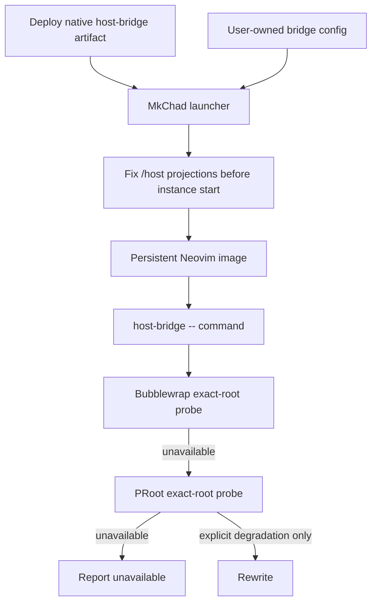
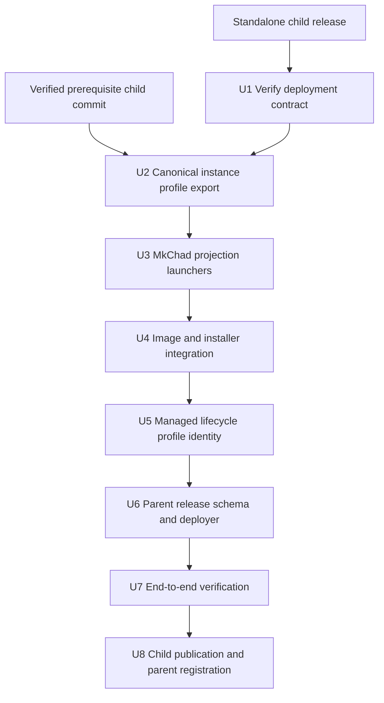

# MkChad Host Bridge Integration - Plan

## Goal Capsule

- **Objective:** Make released `host-bridge` binaries and configured host tool roots available explicitly inside MkChad v1 x86_64 and AArch64 Neovim environments.
- **Product authority:** This plan integrates completed container-prerequisite and standalone-host-bridge releases; it does not redesign either product.
- **User outcome:** An agent or operator inside MkChad can explicitly run host Cargo tools, bounded Slurm clients, or file-level repair commands against an already-visible mounted root through the best compatible backend.
- **Open blockers:** The prerequisite `msk_containers` commit must be verified, and the standalone child release commit, installer, archives, and checksums must be published before integration can land.
- **Stop conditions:** Stop if host paths must replace the image's normal `/usr`, a persistent instance can reuse the wrong bind profile, release deployment cannot verify the exact native host-bridge artifact, or unavailable full-root semantics are hidden by rewrite fallback.
- **Tail ownership:** Consume the immutable published host-bridge release, then complete and publish `container_tools`, `msk_containers`, and `mkchad` serially before recording exact child commits, artifacts, schemas, and gitlinks in one verified parent integration boundary.

---

## Product Contract

### Summary

MkChad projects selected host filesystem paths into dedicated `/host/*` locations without changing the image's ordinary command environment. The installed standalone `host-bridge` binary consumes a user-owned runtime-neutral config and explicitly launches host/root commands through Bubblewrap, PRoot, or caller-authorized rewrite behavior.

### Key Decisions

- **Integrate into MkChad v1.** (session-settled: user-directed - chosen over limiting host bridge to the MkChad v2 commander effort.)
- **Preserve explicit invocation.** (session-settled: user-directed - chosen over transparent PATH shims: image commands remain authoritative unless `host-bridge --` is used.)
- **Keep the core runtime-neutral.** (session-settled: user-directed - chosen over teaching host-bridge about Apptainer: MkChad owns only outer path projection and configuration location.)
- **Support x86_64 and AArch64 only.** (session-settled: user-directed - chosen over PPC64LE integration.)
- **Use light compatibility-oriented policy.** (session-settled: user-directed - chosen over command authorization and filesystem hardening: the feature assumes trusted callers and ordinary path behavior.)
- **Require explicit rewrite degradation.** (session-settled: user-directed - chosen over silent fallback when namespace and ptrace backends are unavailable.)

### Actors

- A1. **MkChad operator:** Installs an x86_64 or AArch64 release and supplies optional site-specific host-bridge configuration.
- A2. **MkChad launcher:** Selects the image, fixes the persistent bind profile, and projects host paths at dedicated visible destinations.
- A3. **In-container agent or shell:** Explicitly invokes `host-bridge` for a host/root command.
- A4. **Host bridge:** Reads the runtime-neutral config and selects Bubblewrap, PRoot, or explicitly permitted rewrite semantics.
- A5. **Release deployer:** Stages, verifies, installs, and records the exact architecture-specific host-bridge artifact.

### Requirements

**Packaging and availability**

- R1. MkChad release metadata must pin one published `host-bridge` child commit and checksum-addressed x86_64/AArch64 release artifacts.
- R2. Deployment must select the artifact matching the current supported host architecture and reject PPC64LE or unknown architectures for host-bridge installation.
- R3. Deployment must install the exact static binary in the child installer's immutable content-addressed store, atomically update the user-owned host-tool selector, and verify both through the child repository's check/apply/verify contract.
- R4. MkChad launchers must make the installed binary available at one fixed image path without adding the user's entire host binary directory to image PATH.
- R5. Bubblewrap and PRoot must come from the prerequisite image and remain capability-probed by host-bridge rather than inferred from release metadata.

**Host path projection**

- R6. Normal image `/usr`, `/bin`, `/sbin`, `/lib*`, `/etc`, and `/opt/msk` must remain unchanged outside a nested host-bridge launch.
- R7. Maintained launchers must bind available host system trees read-only beneath dedicated `/host/*` destinations before persistent instance creation.
- R8. The initial common projection set must cover host `/usr`, `/bin`, `/sbin`, `/lib`, `/lib64`, and `/opt` when each source exists, while preserving explicit absence rather than creating misleading empty roots.
- R9. Slurm integration must support optional host `/etc/slurm` and `/run/munge` or `/var/run/munge` projections without reading credentials in launcher diagnostics.
- R10. Existing automatic workspace, home, and shared-filesystem binds remain visible at their current paths and may be referenced by host-bridge projections without duplication.
- R11. Every explicit host-bridge bind must participate in the persistent-instance profile; no launcher may try to add a bind while executing an existing instance.
- R12. Changing the resolved immutable bridge executable, effective config path, explicit bind set, or resolved bind-source identity must select a new persistent-instance identity rather than reuse an incompatible instance.

**Configuration and UX**

- R13. MkChad must resolve the effective config home as `${XDG_CONFIG_HOME:-$HOME/.config}`, use its user-owned `mkchad/host-bridge/config.toml`, and pass the absolute path through `HOST_BRIDGE_CONFIG`; when the dedicated existing `host-bridge/` parent is outside an already visible home or mount, only that directory is bound read-only at the same path before instance creation. Deployment must not create, read, or overwrite the config file or expose unrelated external XDG configuration.
- R14. Documentation must provide x86_64/AArch64 examples for host Cargo tools, Slurm submit/inspect, mounted-root file repair, and capability diagnosis.
- R15. When no config exists, ordinary MkChad behavior must remain unchanged and `host-bridge` must report its normal missing-config diagnostic only when explicitly invoked.
- R16. `host-bridge doctor --json` must remain available to agents for stable capability inspection without parsing Bubblewrap, PRoot, kernel, or localized error text.
- R17. MkChad must not enable rewrite degradation globally; the user must opt in through each invocation according to the standalone contract.

**Slurm and Rust flows**

- R18. A documented profile must support Cargo/Rustup binaries installed on the host when the toolchain, project, linker, and output paths are visible.
- R19. A documented profile must support Slurm `sbatch`, `squeue`, `sinfo`, and read-oriented `scontrol` using the host site's libraries, configuration, network, and authentication socket.
- R20. Interactive `srun`, scheduler lifecycle management, automatic module loading, and site configuration discovery remain deferred.

**Deployment and compatibility**

- R21. The root release schema, deployer, release launcher, developer deployment path, result records, and tests must agree on the new component and artifact class.
- R22. Host-bridge configuration remains configuration-owned and outside release deployment; release state records only component/artifact identity and installation outcome.
- R23. Existing PPC64LE image and deployment behavior must remain supported without host-bridge and must not be removed from the release schema.
- R24. Failed bridge install, host projection, or capability setup must not modify live MkChad configuration or stop unrelated persistent instances.
- R25. The default automated suite must use fake roots, fake Slurm clients/sockets, and isolated temporary homes; real Slurm and live site configuration tests are explicit opt-in gates.
- R26. `mkchad_release.py` must require a caller-supplied `--host-bridge-archive PATH` for x86_64/AArch64 and forbid it for PPC64LE. `mkchad_develop.py` accepts the same optional argument: when supplied it must match the admitted local `host-bridge` checkout commit and is installed; when omitted, developer deployment preserves any installed bridge binary and reports bridge installation as not requested. Both paths copy and verify a supplied regular file in private staging before live mutation.
- R27. Release and developer terminal result schema 2 must represent `nvim-image` and `host-bridge-binary` separately under one closed `artifacts` object. Each entry is either null before admission/not applicable/not requested or records architecture plus expected/observed checksum; the bridge entry additionally records expected/observed source commit. Successful release x86_64/AArch64 results require both entries, successful PPC64LE results require a null bridge entry, developer omission uses a null bridge entry, and fallback/interrupted results use the same shape with unavailable observations null.
- R28. A managed OpenCode server lifecycle must record the canonical persistent-container profile identity. A start against an existing different, malformed, legacy, or future identity fails closed with explicit stop/start guidance instead of reusing or automatically stopping the old server; absent lifecycle state permits first-start creation.
- R29. Documentation and isolated tests must show unprivileged file-level repair of an already-visible, same-architecture mounted root within caller permissions; MkChad does not discover or add arbitrary repair-root binds.

### Key Flows



- F1. **Host Cargo tool:** The operator configures a profile using `/host` system paths and the already-mounted home/project; an agent invokes a Cargo-installed command explicitly and receives its native result.
- F2. **Slurm inspection:** The launcher projects host Slurm libraries/configuration/socket; an agent invokes `squeue`, `sinfo`, or read-oriented `scontrol` through host-bridge.
- F3. **Slurm submission:** An agent invokes `sbatch` with a workspace script; the projected cwd and host site stack submit it once and return the native client result.
- F4. **Backend diagnosis:** The agent requests JSON doctor output and sees installed plus operational Bubblewrap/PRoot status for the configured profile.
- F5. **Unsupported host:** Both full-root probes fail; host-bridge exits without launching until the caller explicitly requests rewrite degradation.
- F6. **Release deployment:** The deployer stages the native binary and image, verifies checksums and source commits, installs child and host tools serially, then reports exact observed state.
- F7. **Mounted-root repair:** An already-mounted same-architecture fixture is selected as the standalone profile root; a caller performs bounded file-level repair without MkChad adding a new bind or claiming elevated authority.

### Acceptance Examples

- AE1. Given an x86_64 or AArch64 release and a host Cargo-installed executable absent from the image, `host-bridge -- executable --version` runs the host-root tool while ordinary `executable` lookup still uses or misses according to the image PATH.
- AE2. Given a fake Slurm root and Unix authentication socket, `host-bridge -- squeue`, `sinfo`, `scontrol show config`, and `sbatch fixture.sh` receive exact argv/cwd/environment and never parse presentation output in MkChad launchers.
- AE3. Given a namespace-capable host, Bubblewrap doctor and execution pass inside the SIF using the projected paths.
- AE4. Given Bubblewrap is denied but ptrace is permitted, PRoot executes the same fixture through the current persistent instance.
- AE5. Given both full-root mechanisms are denied, the explicit command performs no work and reports both causes; ordinary MkChad remains usable.
- AE6. Given the host-bridge selector is atomically updated to a new verified immutable payload, an in-flight launcher remains bound to its resolved old payload and the next launcher selects a persistent profile bound to the new payload instead of reusing the old bind.
- AE7. Given no host-bridge config, MkChad and OpenCode start as before, while an explicit host-bridge invocation reports configuration guidance.
- AE8. Given a PPC64LE MkChad release, existing behavior remains valid and no host-bridge artifact or launcher bind is required.
- AE9. Given a release manifest with wrong architecture, checksum, child commit, artifact class, or incomplete action set, deployment fails before live mutation.
- AE10. Given an opt-in real HPC profile, bounded Slurm inspection and a user-supplied safe submission smoke pass without exposing site credentials in logs or release state.
- AE11. Given an already-visible mounted-root fixture, an unprivileged repair command changes only caller-writable fixture files, and a read-only profile refuses the same write.
- AE12. Given an active managed OpenCode server under one bridge profile identity, a start with a changed binary, effective config path, or bind-set identity fails with bounded stop/start guidance and neither reuses nor signals the existing server.

### Scope Boundaries

**In scope**

- Host-bridge child registration and release/deployment metadata.
- Static native binary installation and fixed in-image availability.
- Read-only projection of common host system paths to `/host/*` before persistent instance startup.
- User-owned runtime-neutral config and examples.
- Explicit Cargo tool and Slurm submit/inspect flows.
- File-level repair of already-visible same-architecture mounted roots.
- x86_64 and AArch64 Docker/SIF/release evidence.

**Deferred**

- Interactive `srun --pty`.
- Automatic environment-module capture or site topology discovery.
- MkChad v2 commander use of host-bridge.
- GUI/TUI for profiles or backend status.
- Dynamic arbitrary bind configuration in `container_tools`.
- Real HPC execution as a release gate; it remains optional site certification after deterministic fixture release gates pass.

**Out of scope**

- PPC64LE host-bridge support or removal of legacy PPC64LE MkChad.
- Replacing image tools globally with host tools.
- A resident host execution daemon or socket bridge.
- Deployment-owned site configuration or credentials.
- Security sandboxing, command authorization, or path hardening beyond current launcher contracts.
- Foreign-architecture/QEMU execution, privilege elevation, real ownership changes, service startup, block-device operations, or bootloader repair.

### Dependencies And Assumptions

- The container-prerequisites plan has produced a verified `msk_containers` commit containing Bubblewrap and PRoot for x86_64/AArch64; this plan owns building and publishing the final integrated images.
- The standalone plan has published checksum-addressed static host-bridge artifacts and an installer contract.
- Apptainer/Singularity permits the configured outer binds and fixes them for the life of a persistent instance.
- Host filesystems and site paths are trusted inputs under the user-confirmed compatibility-tool posture.
- Slurm application authentication and cluster policy remain the site's responsibility.

### Sources And Research

- `msk_containers/container_tools/ct_instance_exec.sh` defines immutable persistent-instance bind profiles and execution without late bind changes.
- `msk_containers/container_tools/ct_library.sh` defines current explicit bind and environment injection contracts.
- `msk_containers/nvim/bin/mkchad` and `mkchad-opencode-server` own current persistent launch integration.
- `msk_containers/bin/install_nvim.sh` owns installed MkChad host launchers.
- `mkchad/lua/configs/opencode.lua` owns managed OpenCode lifecycle state validation, healthy-state reuse, and start/stop fencing inside the image.
- `deploy/release.json`, `deploy/release-v2.schema.json`, `deploy/mkchad_deploy.py`, and `deploy/mkchad_release.py` define the closed schema-2 release/deployment contract.
- `docs/deployment/configuration-contract-v1.md` separates release-owned code from user-owned configuration.

---

## Planning Contract

**Product Contract preservation:** Product decisions from the confirmed brainstorm are captured unchanged; planning adds cross-repository ownership, fixed projection layout, deployment expansion, and verification sequence.

### Key Technical Decisions

- KTD1. **Consume a published root child.** Add `host-bridge/` as an independent parent submodule on branch `mkchad-v1` only after the exact released child commit is fetchable.
- KTD2. **Install one native static artifact on the host.** The public and developer launchers admit `--host-bridge-archive`, the release deployer selects x86_64 or AArch64, verifies checksum plus embedded source commit, and delegates check/apply/verify to the already-published `host-bridge/scripts/install-release.sh`.
- KTD3. **Bind only one immutable installed executable into a fixed image location.** The child installer maintains `$HOME/.local/bin/host-bridge` as an atomic selector into `${XDG_DATA_HOME:-$HOME/.local/share}/mkchad/tools/host-bridge/SHA256/host-bridge`. The launcher resolves the selector once, verifies the selected regular file against the digest-named immutable path, and projects that resolved path read-only to `/opt/msk/host-bridge/bin/host-bridge`; the bootstrap prepends only `/opt/msk/host-bridge/bin`, not the host's general binary directories. Ordinary deployment never overwrites or deletes old immutable payloads, so a concurrent selector update cannot change an already-resolved bind source.
- KTD4. **Project host system trees under `/host`.** Bind existing `/usr`, `/bin`, `/sbin`, `/lib`, `/lib64`, and `/opt` to matching `/host/*` paths read-only, leaving image paths intact until Bubblewrap/PRoot constructs a nested execution root.
- KTD5. **Keep site extras explicit and bounded.** Project existing Slurm configuration and Munge runtime directories to fixed `/host/etc/slurm` and `/host/run/munge` paths; other shared application mounts continue through existing mount detection and are referenced at their visible paths by user config.
- KTD6. **Use one dedicated user-owned config directory.** Launchers set `HOST_BRIDGE_CONFIG=${XDG_CONFIG_HOME:-$HOME/.config}/mkchad/host-bridge/config.toml`; when the existing dedicated parent directory is not already visible, bind only that directory read-only at the same absolute path. The core config names only image-visible paths such as `/host/usr` and current workspace mounts.
- KTD7. **Make binary, config-path, and bind changes canonical instance and managed-server changes.** The launcher computes a lowercase SHA-256 host-bridge key over a NUL-framed `host-bridge-profile-v1` record containing labeled fields for resolved immutable binary path and checksum, normalized absolute `HOST_BRIDGE_CONFIG`, and each ordered normalized functional source/destination/access bind tuple. It passes that digest through the new `ct_instance_exec.sh --ct-profile-key` contract.
- KTD8. **Export the canonical persistent profile from `container_tools`.** Extend only persistent instance execution with optional `--ct-profile-key 64-hex`. Include a supplied key in the existing canonical profile hash alongside image, bootstrap, mount argv, resolved bind paths, and bind `stat` identities; preserve the old hash when absent. Inject the resulting full 64-hex digest as reserved `MKCHAD_CONTAINER_PROFILE_ID` during both instance start and exec, rejecting caller override. The in-image lifecycle records that canonical digest, so source replacement or remount at the same path cannot reuse stale managed state.
- KTD9. **Expand release schema coherently.** Add one universally recorded deployed component, one architecture-specific artifact family, `staged_host_bridge`, exact action ordering, caller archive ingress, and result schema 2 across every closed validator and fallback producer.
- KTD10. **Preserve PPC64LE.** The ninth component metadata and inert checkout remain universal so the manifest shape stays closed; bridge artifact admission, installation actions, launcher binds, and observations apply only to x86_64/AArch64. PPC64LE supplies no bridge archive and retains existing runtime behavior.

### Managed Lifecycle Identity Contract

- The host-bridge profile key always exists, including when the bridge selector is absent. Its labeled binary fields contain either `present`, resolved immutable path, and SHA-256, or `absent` and empty path/checksum; the remaining fields always contain the effective absolute config path and normalized explicit bridge binds.
- `ct_instance_exec.sh` emits `MKCHAD_CONTAINER_PROFILE_ID` as exactly 64 lowercase hex characters after hashing the host-bridge key together with its complete existing instance inputs and resolved bind identities. The in-image lifecycle never recomputes host paths or accepts caller override through `--ct-env`.
- OpenCode lifecycle state schema 5 is schema 4 plus required `container_profile_id`; every other schema-4 field and validation rule remains unchanged. New starts write schema 5. Status and explicit stop continue to report/operate on valid legacy state under existing identity controls, but start never adopts or rewrites a schema 1-4, malformed, or future state as matching schema 5. An absent state permits ordinary first-start creation.
- Under the lifecycle fence, start compares the supplied digest before health-based reuse or process spawn. Existing-state mismatch returns typed `container_profile_mismatch` with stop/start guidance and performs no signal, unlink, state replacement, transport change, or backend contact.

### Outer Projection Layout

| Host source when present | Image-visible destination | Access | Purpose |
|---|---|---|---|
| Resolved `${XDG_DATA_HOME:-$HOME/.local/share}/mkchad/tools/host-bridge/SHA256/host-bridge` selected by `$HOME/.local/bin/host-bridge` | `/opt/msk/host-bridge/bin/host-bridge` | read-only | Immutable explicit launcher binary |
| `/usr` | `/host/usr` | read-only | Host executables, loaders, libraries, data |
| `/bin` | `/host/bin` | read-only | Legacy/merged-usr command path |
| `/sbin` | `/host/sbin` | read-only | Legacy administrative command path |
| `/lib` | `/host/lib` | read-only | Host loader/library path |
| `/lib64` | `/host/lib64` | read-only | 64-bit host loader/library path |
| `/opt` | `/host/opt` | read-only | Site software installed under `/opt` |
| `/etc/slurm` | `/host/etc/slurm` | read-only | Optional Slurm configuration |
| `/run/munge` or `/var/run/munge` | `/host/run/munge` | read-only bind | Optional authentication socket visibility |

An existing external `${XDG_CONFIG_HOME}/mkchad/host-bridge/` is additionally bound read-only at the same path; no sibling XDG configuration is exposed. The default `$HOME/.config` needs no extra bind. Absent optional sources are omitted with bounded diagnostics; required executable and common-root failures block bridge enablement but not ordinary MkChad launch.

### User Configuration Example

```toml
version = 1
default_profile = "mkchad-host"

[profiles.mkchad-host]
root = "/"
root_access = "inherit"
semantics = "full-root"
cwd_unmapped = "error"
path = ["/home/user/.cargo/bin", "/usr/local/bin", "/usr/bin", "/bin"]

[[profiles.mkchad-host.projections]]
visible = "/host/usr"
target = "/usr"
access = "inherit"
required = true

[[profiles.mkchad-host.projections]]
visible = "/host/lib64"
target = "/lib64"
access = "inherit"
required = false

[[profiles.mkchad-host.projections]]
visible = "/host/etc/slurm"
target = "/etc/slurm"
access = "inherit"
required = false

[[profiles.mkchad-host.projections]]
visible = "/host/run/munge"
target = "/run/munge"
access = "inherit"
required = false
```

The repository ships examples only; it never writes this live file.

The example uses `inherit` because MkChad's outer Apptainer/Singularity binds already enforce read-only access to the projected system and Slurm sources. This keeps PRoot eligible without weakening writes: integration tests must prove a write through PRoot is still refused at the outer bind. Standalone profiles that rely on host-bridge itself to enforce read-only access continue to use `read-only` and exclude PRoot.

### Release And Deployment Model

- Add `host-bridge` as the universal ninth component with `disposition = deployed` and a checkout under the MkChad XDG data component root; it remains inert on PPC64LE.
- Add `host-bridge-binary` artifacts with x86_64 and AArch64 checksum entries, exact 40-hex `source_commit`, and a strict archive filename class; each source commit must equal the universal host-bridge component commit.
- Extend public and developer launchers with `--host-bridge-archive PATH` and action tokens with `staged_host_bridge`; the deployer admits, privately stages, and resolves it only for matching native x86_64/AArch64 releases. PPC64LE rejects a supplied bridge archive.
- Run host-bridge preflight before checkout or binary mutation, install after the child checkout is staged, and verify exact binary version/checksum before reporting success.
- Stage and install the new `msk_containers` host launchers and selected SIF only after host-bridge binary preflight succeeds.
- Replace singular result `artifact` with result-schema-2 `artifacts`, whose exact keys are `nvim-image` and `host-bridge-binary`. The image object has exactly `architecture`, `expected_sha256`, and nullable `observed_sha256`; the bridge object has those fields plus `expected_source_commit` and nullable `observed_source_commit`. Either value may be null only when not yet admitted, not applicable, or not requested under the R27 rules. Record configuration guidance separately; never record config contents or host path inventory.

#### Closed Manifest And Action Expansion

- `artifacts.host-bridge-binary` is an array of exactly one x86_64 and one AArch64 object. Each object has exactly `architecture`, `sha256`, `source_commit`, and `source_filename_class = "host-bridge-release-archive"`; `source_commit` equals the ninth component commit. PPC64LE has no bridge artifact entry.
- Add exact tokens `staged_host_bridge`, `host_bridge_sha256`, `host_bridge_target`, and `host_bridge_store`. They expand respectively to the privately staged admitted archive, selected release-manifest digest or admitted developer-archive digest, `$HOME/.local/bin/host-bridge`, and `${XDG_DATA_HOME:-$HOME/.local/share}/mkchad/tools/host-bridge`. `component_revision` supplies the expected release-component or admitted local-checkout source commit, and existing `recovery_dir` supplies private rollback storage. Tokens are never accepted from caller text or serialized into results.
- The ninth component owns exactly three actions in this order within each phase:

| ID | Phase | Path | Args |
|---|---|---|---|
| `host-bridge-install-preflight` | preflight | `scripts/install-release.sh` | `--check --archive {staged_host_bridge} --expected-sha256 {host_bridge_sha256} --expected-source-commit {component_revision} --target {host_bridge_target} --store-dir {host_bridge_store}` |
| `host-bridge-install` | apply | `scripts/install-release.sh` | `--apply --archive {staged_host_bridge} --expected-sha256 {host_bridge_sha256} --expected-source-commit {component_revision} --target {host_bridge_target} --store-dir {host_bridge_store} --recovery-dir {recovery_dir}` |
| `host-bridge-install-verify` | verify | `scripts/install-release.sh` | `--verify --archive {staged_host_bridge} --expected-sha256 {host_bridge_sha256} --expected-source-commit {component_revision} --target {host_bridge_target} --store-dir {host_bridge_store}` |

- On x86_64/AArch64, host-bridge preflight is the first action, bridge apply precedes `msk_containers` host-tool/image apply, and bridge verify precedes the remaining verify actions. On PPC64LE all three actions are admitted as architecture-inapplicable and recorded `skipped-not-applicable` without token resolution or execution.
- Developer deployment with a supplied bridge archive admits the same three actions and resolves tokens from the archive plus local child checkout. When the optional archive is omitted, it removes all three bridge actions before token resolution, preserves the selector/store untouched, records no synthetic skipped actions, and emits a null `host-bridge-binary` result.

#### Terminal Result Schema 2

- Both branches require exactly `schema = 2`, `mode`, `run_id`, timestamps, `outcome`, `phase`, `components`, `artifacts`, `actions`, nullable `failed_step`, bounded redacted `diagnostic`, and absolute `log_path`; unknown fields fail validation.
- The release branch has `mode = "release"`, `release`, and `configuration_handoff`. After manifest admission `components` has exactly nine result-v1-shaped entries; before admission it is empty. The developer branch has `mode = "developer"`, absolute `workspace`, and the existing closed `image` object with exactly `choice`, nullable `supplied_sha256`, nullable `active_sha256`, and `decision`; after source admission `components` has exactly `msk_containers`, `container_tools`, `mkchad`, and `host-bridge` requested/observed entries, and before admission it is empty.
- `artifacts` always has exactly `nvim-image` and `host-bridge-binary`. Non-null image values have exactly `architecture`, `expected_sha256`, and nullable `observed_sha256`. Non-null bridge values add `expected_source_commit` and nullable `observed_source_commit`. Success requires all applicable requested/observed fields to match; PPC64LE and developer omission require a null bridge value; pre-admission fallback may use null values for both keys.
- Action results retain exact `component`, `id`, `phase`, and `status`; component adds `host-bridge`, and status adds `skipped-not-applicable`. Release actions may contain all nine-component actions; developer actions contain only admitted deployed-child actions. Fallback and interrupted producers emit the same branch and shape, with empty pre-admission collections or null observations rather than a legacy schema.

### Implementation Constraints

- Preserve unrelated dirty child gitlinks and untracked parent files throughout implementation.
- Do not inspect or modify the live host-bridge config during default tests or deployment.
- Build shell argv with arrays; do not serialize binds or commands for later `eval`.
- Keep optional-path diagnostics free of directory contents, socket data, environment dumps, and credentials.
- Never add host directories to ordinary image `PATH` or global `LD_LIBRARY_PATH`.
- Use exact architecture and checksum evidence before installing a binary.
- Cross-repository implementation is serial: immutable host-bridge release, `container_tools`, `msk_containers`, `mkchad`, then parent deploy/release/submodule integration.
- Use `/tmp/mkchad-v1/host-bridge-integration` for disposable fixtures and release staging.

### Sequencing



### Requirement Traceability

| Unit | Requirements | Flows | Acceptance examples |
|---|---|---|---|
| U1 | R1-R5, R21-R22 | F6 | AE9 |
| U2 | R11-R12, R24, R28 | F4 | AE6, AE12 |
| U3 | R4, R6-R20, R24-R25, R29 | F1-F5, F7 | AE1-AE7, AE11 |
| U4 | R4-R17, R23-R25, R29 | F1-F5, F7 | AE1-AE8, AE11 |
| U5 | R12-R13, R24, R28 | F4 | AE6-AE7, AE12 |
| U6 | R1-R5, R21-R24, R26-R27 | F6 | AE6, AE8-AE9, AE12 |
| U7 | R1-R29 | F1-F7 | AE1-AE12 |
| U8 | R1-R5, R21-R24, R26-R28 | F6 | AE6, AE8-AE9, AE12 |

### Risks And Mitigations

| Risk | Impact | Mitigation | Required proof |
|---|---|---|---|
| Host paths overlay image system paths globally | Image corruption or nondeterminism | Bind only beneath `/host/*`; nested backend applies mappings | Launcher argv and ordinary command tests |
| Bind added after instance startup | Tool sees stale or absent paths | Fix all binds in profile before `instance start` | Persistent reuse/profile-change tests |
| Selector update races launcher resolution | New profile identity names old or mutable bytes | Resolve and verify immutable payload once; retain old payloads | Paused-launch selector update and next-launch tests |
| Munge/Slurm layout differs by site | Slurm commands fail | Optional fixed common binds plus documented visible-path config | Fake layouts and opt-in site evidence |
| Rewrite silently handles failed full-root setup | Incorrect Slurm/Cargo behavior | No global degradation consent | Both-backends-denied integration test |
| Release schema updated incompletely | Deployment admission or recovery breaks | Treat schema/deployer/release/tests as one unit | Invalid-manifest matrix and recovery tests |
| New component breaks PPC64LE | Existing users lose deployments | Architecture-conditional artifact requirement | PPC release fixture remains green |
| Default tests submit real jobs | Unintended scheduler effects | Fake clients by default; explicit opt-in live smoke | Network/credential-free suite audit |
| Active managed server outlives path, inode, image, or bridge change | Commands route through stale mounts or binary | Persist and compare canonical `container_tools` profile digest; require explicit stop/start | Same-path source replacement and active-server mismatch tests without signaling |

---

## Implementation Units

### U1. Verify The Published Host-Bridge Installation Contract

- **Goal:** Prove the immutable standalone release already exposes every installation and verification input MkChad requires.
- **Files:** None changed; inspect the published `host-bridge/scripts/install-release.sh`, `host-bridge/docs/release.md`, exact archives, checksums, and release commit as read-only inputs.
- **Approach:** Verify the published installer's staged-archive, expected-checksum, expected-source-commit, architecture, target, check/apply/verify, and private-recovery contracts. If any contract is missing, stop this plan and revise/release the standalone child first; do not patch or republish it from integration.
- **Test scenarios:** First immutable install and selector update; compliant no-op; x86/AArch64 mismatch; checksum/source-commit mismatch; malformed/traversing archive; wrong embedded version; selector replacement with private recovery; old payload retention; check-only; interrupted stage; destination race; exact verify.
- **Verification:** Run the child installer test and release verification against both published archives.
- **Dependencies:** Completed standalone plan and explicit child release.

### U2. Export The Canonical Persistent Instance Profile

- **Goal:** Give managed in-container processes the same full profile identity that `container_tools` uses to select a persistent instance.
- **Files:** `msk_containers/container_tools/ct_instance_exec.sh`; `msk_containers/container_tools/tests/instance_exec_test.sh`; `msk_containers/container_tools/README.md`.
- **Approach:** Add optional exactly-once `--ct-profile-key 64-hex` handling to persistent instance execution only. When present, append a NUL-framed label/value to the existing profile-hash input; when absent, preserve the exact prior hash. After computing the canonical digest, reject any caller `--ct-env MKCHAD_CONTAINER_PROFILE_ID=...` override and inject the digest into both `instance start` and every `exec`. Keep full 64-hex environment identity while retaining the existing 32-hex instance-name prefix. Commit and verify `container_tools` independently before its parent gitlink changes.
- **Test scenarios:** Existing caller/hash compatibility without a key; malformed/duplicate key; key changes profile; full environment value matches profile; start and reuse exec receive the same value; caller override rejected; image/bootstrap/bind/path/inode/type changes alter the value; bind source replacement at the same path; concurrent first use; no argument leaks to payload; existing timeout/non-signaling behavior.
- **Verification:** Run `tests/instance_exec_test.sh` and the child shell/static-analysis gates from `msk_containers/container_tools`.
- **Dependencies:** U1 and the verified prerequisite child state.

### U3. Add Fixed Host Projections To MkChad Launchers

- **Goal:** Make the bridge binary and common host roots visible before persistent instance creation without changing ordinary image resolution.
- **Files:** `msk_containers/container_tools` gitlink; `msk_containers/nvim/bin/host_bridge_library.sh`; `msk_containers/nvim/bin/mkchad`; `msk_containers/nvim/bin/nvim_shell`; `msk_containers/nvim/bin/mkchad-opencode-server`; `msk_containers/nvim/bin/mkchad-container-bootstrap`; `msk_containers/tests/host_bridge_wrapper_test.sh`; `msk_containers/tests/opencode_server_wrapper_test.sh`.
- **Approach:** Record the verified U2 nested gitlink. Centralize array-based optional/required bind construction, immutable selector resolution, and host-bridge key calculation in one sourced host library. Add the resolved static binary and existing system/Slurm paths as explicit read-only outer binds, bind only an existing dedicated external host-bridge config directory at the same path, set the fixed config environment, and expose only the bridge binary directory inside PATH. Persistent editor and managed OpenCode invocations pass the key through `--ct-profile-key`; nonpersistent `nvim_shell` shares projections and config but does not pass an instance-only option or claim lifecycle identity. Status-only operations remain free of unnecessary bridge binds.
- **Test scenarios:** Config absent; default and dedicated external XDG roots; no external XDG sibling exposure; relative XDG root rejection; nonexistent dedicated root omitted with explicit missing-config behavior; bridge absent key; every optional path absent/present; paths with spaces; read-only bind argv; PRoot write refusal through inherited outer read-only access; image `/usr` unchanged; exact bridge PATH precedence; no host PATH/LD import; deterministic NUL-framed key; persistent first start/reuse; selector update during paused launch still binds the resolved immutable payload; binary, bind-set, bind-source identity, and in-home/external effective config-path changes select separate instances; nonpersistent shell omits the profile option; stale instance remains separate; ordinary MkChad/OpenCode behavior; no late bind attempt.
- **Verification:** Run focused launcher/wrapper tests and shellcheck changed scripts.
- **Dependencies:** U2 and the verified prerequisite `msk_containers` commit.

### U4. Package The Integration In Both Maintained Images And Installers

- **Goal:** Provide fixed image destinations, examples, and installed launcher files with x86_64/AArch64 parity.
- **Files:** `msk_containers/nvim/x86/nvim_container_x86.dockerfile`; `msk_containers/nvim/aarch64/nvim_container_aarch64.dockerfile`; `msk_containers/bin/install_nvim.sh`; `msk_containers/docs/adr/002-package-selections.md`; `msk_containers/tests/nvim_container_tooling_test.sh`; `msk_containers/tests/install_nvim_test.sh`; `msk_containers/tests/host_bridge_integration_test.sh`; `msk_containers/docs/host-bridge.md`.
- **Approach:** Create `/opt/msk/host-bridge/bin`, install the launcher helper with existing host tools, document user-owned config and use cases, and retain architecture parity. Do not embed the host-bridge release binary in the SIF; the outer release deploys and binds the exact host binary. After focused and native image verification, commit the `msk_containers` child independently before parent deployment work begins.
- **Test scenarios:** Missing destination; installer first install/no-op/recovery; source changes; x86/ARM parity; PPC exclusion; documentation/config examples parse; binary remains externally supplied; image backend tools present from the prerequisite commit.
- **Verification:** Run tooling and installer tests, build both images serially, and smoke the fixed binary bind in native Docker and SIF environments.
- **Dependencies:** U3.

### U5. Bind Managed OpenCode State To The Canonical Profile

- **Goal:** Prevent a healthy managed server from being adopted through a launcher profile different from the one that started it.
- **Files:** `mkchad/lua/configs/opencode.lua`; `mkchad/lua/mkchad/opencode/command.lua`; `mkchad/tests/opencode_lifecycle_spec.lua`; `mkchad/tests/opencode_state_validation_spec.lua`; `mkchad/tests/opencode_startup_race_spec.lua`; `mkchad/tests/opencode_command_adapter_spec.lua`.
- **Approach:** Admit `MKCHAD_CONTAINER_PROFILE_ID` only as a lowercase 64-hex digest from the trusted persistent launcher, add it as required `container_profile_id` in lifecycle schema 5, and compare it under the existing lifecycle fence before healthy-state reuse or spawn. Matching identities and absent first-start state preserve current behavior. Existing malformed, legacy, future, or mismatched identity blocks start with bounded explicit stop/start guidance and does not signal, remove, rewrite, or downgrade state. Map that refusal through the closed command adapter as exact `container_profile_mismatch`. Commit and verify the `mkchad` child independently before parent deployment work.
- **Test scenarios:** Matching first start/reuse; missing/malformed environment identity; matching state; changed binary/binds/effective config path; legacy state without identity; malformed/future state; mismatch under concurrent starts; status remains observational; stop remains explicitly user-directed; no signal, state unlink, or replacement on mismatch; unchanged direct/TLS transport, credentials, and database behavior.
- **Verification:** Run focused lifecycle, state-validation, and startup-race specs, then the child-required OpenCode lifecycle suite.
- **Dependencies:** U4 and U2's canonical environment contract.

### U6. Expand Parent Release And Deployment Contracts

- **Goal:** Add one independently versioned component and binary artifact without weakening the closed release schema.
- **Files:** `.gitmodules`; `AGENTS.md`; `deploy/release.json`; `deploy/release-v2.schema.json`; `deploy/result-v2.schema.json`; `deploy/mkchad_deploy.py`; `deploy/mkchad_release.py`; `deploy/mkchad_develop.py`; `docs/deployment/configuration-contract-v1.md`; `docs/deployment/README.md`; `tests/test_mkchad_deploy.py`; `tests/test_mkchad_develop.py`; `tests/test_mkchad_release.py`; `tests/run_deployment_tests.sh`; `host-bridge` gitlink.
- **Approach:** Add the universal ninth component and architecture-conditioned artifact family, extend public/developer caller arguments, closed enums/maps/order/tokens, and result schema 2, stage the native archive, delegate install actions, and keep site config configuration-owned. Register the submodule only after its remote and exact release commit are fetchable.
- **Test scenarios:** Missing/duplicate/ninth wrong component; x86/AArch64 exact artifact; missing required caller archive; PPC without and with rejected bridge archive; wrong checksum/filename/architecture/source commit; initial install; active compliant verify-only; partial existing state; installer failure/recovery; interrupted and pre-admission fallback results; result redaction; developer-tree staging; recursive fresh clone; unrelated gitlinks unchanged.
- **Verification:** Run focused deployment/release tests and schema validation before broad deployment test script.
- **Dependencies:** Published standalone child release verified by U1 plus independently committed and verified U2 `container_tools`, U4 `msk_containers`, and U5 `mkchad` changes.

### U7. Prove End-To-End Host Tool Flows

- **Goal:** Validate the complete release, outer projection, nested backend, and explicit Cargo, Slurm, and mounted-root command experience.
- **Files:** `tests/test_host_bridge_release_integration.py`; `docs/deployment/README.md`; no new `msk_containers` files after its U4 commit.
- **Approach:** Build isolated host-root fixtures with fake Cargo and Slurm process trees, mounted-root repair tree, config, Unix socket, and submission records. Run through deployed host bridge and SIF under Bubblewrap and PRoot. Real HPC is optional post-release site certification, separately authorized and bounded, not a substitute for or blocker to deterministic release gates.
- **Test scenarios:** AE1-AE12; exact host binary checksum/source commit; ordinary image command isolation; Cargo child process and output path; Slurm query/submission argv and cwd; already-visible mounted-root read/write; backend denial matrix; explicit rewrite only; binary/config/bind update; managed-server identity mismatch; selective process interruption; no credentials or live paths; native x86/ARM; legacy PPC release.
- **Verification:** Run isolated integration on native x86_64 and AArch64. If explicitly authorized on a real HPC site, separately certify `sinfo`, `squeue`, `scontrol show config`, and one user-approved safe `sbatch` fixture; report absence without blocking release.
- **Dependencies:** U6.

### U8. Publish Children And Complete Parent Integration

- **Goal:** Publish the remaining child histories and land one exact MkChad v1 release boundary after consuming the already-published standalone child.
- **Files:** `host-bridge` gitlink; `msk_containers` gitlink; `mkchad` gitlink; nested `msk_containers/container_tools` gitlink; parent release/deployment/docs files from U6.
- **Approach:** Verify the immutable published host-bridge commit/artifacts, publish the already-committed `container_tools`, `msk_containers`, and `mkchad` children serially in dependency order, build and publish final integrated images, then commit parent submodules plus release/deployment integration. Stage only intended files and preserve unrelated work; do not modify or republish host-bridge in this plan.
- **Test scenarios:** All four child commits fetch from declared remotes; host-bridge artifact and image checksums match their recorded commits; recursive clone resolves including the nested child; deploy verify-only reports compliant state; parent diff has intended gitlinks and integration files only; no live config enters Git.
- **Verification:** Repeat child broad gates at pinned commits, parent deployment suite, `git submodule status --recursive`, `git diff --check`, and final staged-diff inspection.
- **Dependencies:** U7 and explicit authorization for `container_tools`, `msk_containers`, `mkchad`, image, and parent publication plus final release actions.

---

## Verification Contract

### Focused Repository Gates

- `host-bridge`: read-only installer and release-contract conformance against both exact published native archives.
- `container_tools`: persistent-instance profile-key, resolved bind-identity, environment-injection, compatibility, concurrency, and timeout tests; shellcheck changed scripts.
- `msk_containers`: host-bridge wrapper, OpenCode wrapper, installer, and container tooling tests; shellcheck changed scripts.
- `mkchad`: lifecycle, state-schema, and startup-race tests for schema-5 profile identity and fail-closed mismatch.
- Parent: schema, deployer, developer-tree, release-launcher, and host-bridge integration tests.

### Real Runtime Gates

- Native x86_64 Docker and SIF: bridge binary bind, Bubblewrap fixture, PRoot fixture, Cargo-like flow, Slurm-like flow, and mounted-root fixture.
- Native AArch64 Docker and SIF: the same suite; source parity alone is insufficient.
- Backend-denied runners: prove bounded unavailable diagnostics and no silent rewrite.
- Optional post-release HPC certification: run only user-approved read commands and one safe submission fixture, with no credential or private configuration capture; this is not a release completion gate.

### Deployment Gates

- Validate release manifest schema 2 with exactly nine recognized components and terminal result schema 2 with both closed artifact keys after expansion.
- Validate architecture-conditioned host-bridge artifact requirements while preserving PPC64LE image behavior.
- Verify child commits, native artifact checksum, installed binary identity, image checksum, and configuration guidance.
- Exercise first install, compliant no-op, verify-only active service, partial state, failure recovery, and interruption.
- Confirm release/deployment output excludes config contents, host environment, host path inventory, scheduler credentials, and private session data.

### Broad Closeout

- Run one resource-intensive image or integration suite at a time.
- Repeat broad child verification only after all focused cross-repository changes settle.
- Do not mutate protected live MkChad paths during automated verification.
- Report real HPC and architecture gates not run, with the missing environment rather than substitute evidence.

---

## Definition of Done

- MkChad v1 records and deploys one exact published host-bridge child and native x86_64/AArch64 artifacts.
- The selector resolves to a checksum-addressed immutable static binary available inside maintained SIFs only through its fixed bridge path; ordinary host binaries never enter image PATH automatically.
- Common host system and optional Slurm paths are visible beneath `/host/*` before persistent instance creation and never replace image roots globally.
- User-owned runtime-neutral configuration remains outside deployment and is documented with Cargo, Slurm, doctor, and failure examples.
- Bubblewrap and PRoot full-root flows pass native x86_64 and AArch64 integration tests; denied policies produce bounded no-dispatch outcomes.
- Rewrite degradation is never globally enabled or silently selected.
- Cargo-installed host tools, fake/default Slurm submit/inspect, and already-visible mounted-root repair flows pass deterministically; optional real HPC site certification is reported separately when authorized.
- Host-bridge binary, effective config-path, bind-set, or resolved bind-source identity changes select compatible persistent-instance profiles, and managed OpenCode starts fail closed on canonical identity mismatch rather than reusing or signaling a stale server.
- Release schema, deployer, release launcher, result schema 2, developer deployment, documentation, and tests agree on the ninth component and new artifact family.
- Legacy PPC64LE MkChad release behavior remains valid without host-bridge.
- Child repositories are committed and published before one separate parent integration commit, with unrelated work and live configuration preserved.
