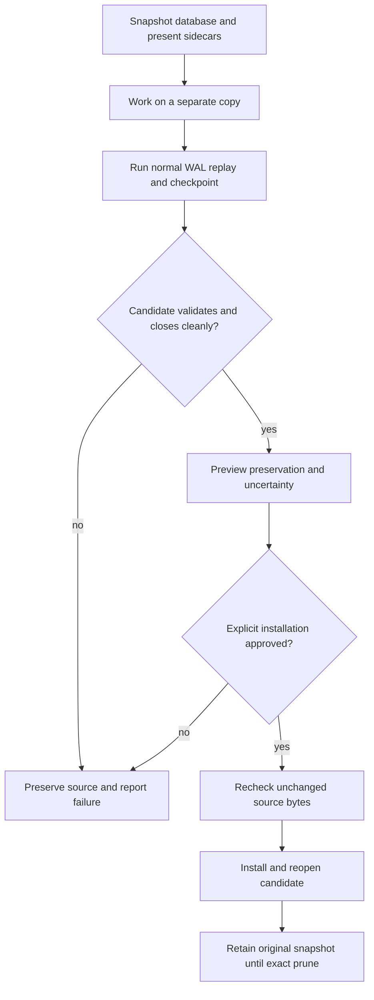
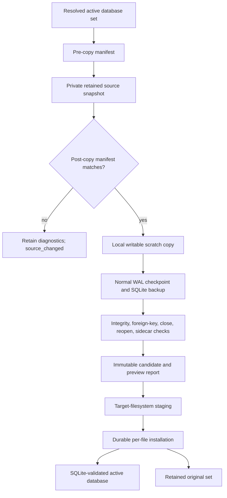
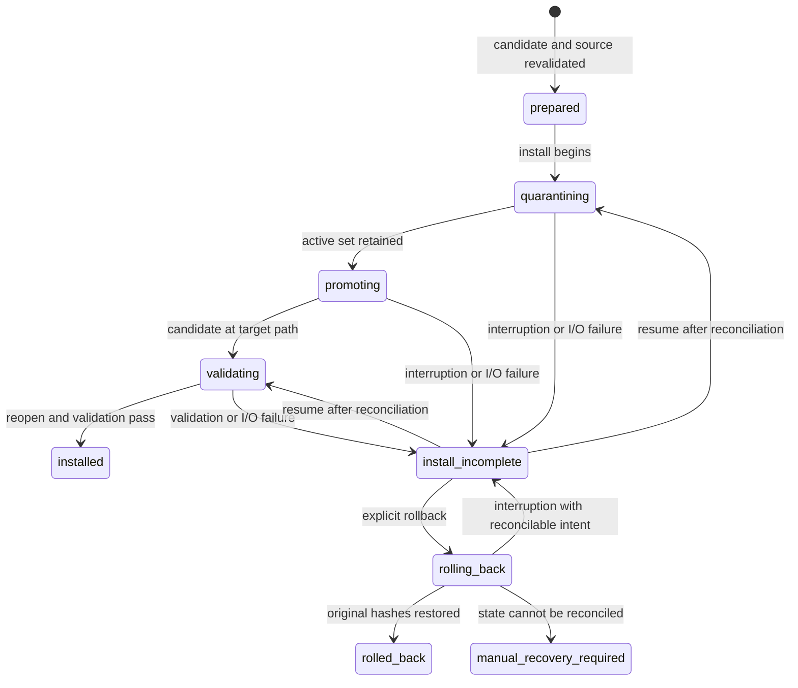

# OpenCode Database Cleanup Tool - Plan

## Goal Capsule

- **Objective:** Provide a standalone operator tool that cleans up an existing OpenCode SQLite database after the observed `SQLITE_PROTOCOL: locking protocol` failure without changing how OpenCode normally opens or manages its database.
- **Product authority:** A new independent repository owns the cleanup CLI, recovery artifacts, validation, installation, and explicit pruning. OpenCode and MkChad receive only the prerequisite inverse changes needed to restore their pre-policy baseline; they and the container repositories receive no new cleanup integration or runtime behavior.
- **Stop conditions:** Stop when the source changes during capture or before installation, when normal WAL replay cannot produce a valid candidate, or when an uncertain-loss installation lacks explicit approval.
- **Execution profile:** Deep, data-safety-sensitive implementation across one new repository plus prerequisite restoration in the existing OpenCode and MkChad repositories.
- **Target repository:** `opencode-db` is an independent child repository at `opencode-db/` in the MkChad coordination repository, recorded as a submodule/gitlink alongside the existing children.
- **Tail ownership:** The implementation run owns focused tests, package validation, wheel smoke testing, review, coherent local commits in each affected child repository, the new `opencode-db` gitlink and workspace registration, and parent gitlink updates for restored children. Remote creation, pushes, and publication remain separately authorized actions.
- **Open blockers:** None. Planning resolves repository naming, packaging, explicit target selection, command syntax, and recovery-state behavior below.

---

## Product Contract

### Summary

Build an independently installable cleanup tool that snapshots an OpenCode database and its SQLite sidecars, produces a WAL-cleaned candidate on a copy, validates and previews the result, and installs it only after an explicit operator action.

### Problem Frame

OpenCode normally works on the affected nodes, but using the same SQLite state from multiple nodes has produced `SQLITE_PROTOCOL: locking protocol` failures.
No other corruption symptom has been observed.
The desired intervention is an operator-run repair, not a replacement database policy or a new runtime ownership system. Calling the command is sufficient evidence that the operator has handled OpenCode shutdown outside this tool.

### Key Decisions

- **Leave OpenCode behavior unchanged.** (session-settled: user-directed — chosen over an NFS-specific journal and ownership policy: the observed problem calls for repair tooling, not a new runtime database architecture.) The tool does not alter OpenCode startup, journal selection, database paths, wrappers, lifecycle, or multi-node behavior.
- **Ship as a standalone child repository.** (session-settled: user-directed — chosen over MkChad-integrated recovery: the cleanup utility must have independent history and installation while remaining a child of the coordination repository.)
- **Preview before installation.** (session-settled: user-directed — chosen over automatic replacement or copy-only output: the operator should see a lightweight, recognizable summary of the candidate and invoke installation separately.)
- **Trust the operator's repair context.** (session-settled: user-directed — chosen over confirmation prompts, process inspection, or concurrent-user coordination: invoking the repair command means the operator has already stopped OpenCode as needed.)
- **Limit cleanup to normal WAL recovery.** (session-settled: user-directed — chosen over general SQLite salvage: only the observed locking-protocol case is in scope until another concrete failure is encountered.)
- **Gate uncertain loss.** (session-settled: user-directed — chosen over refusing every uncertain candidate or installing best effort automatically: a readable candidate with unprovable completeness may install only after the operator reviews the uncertainty and explicitly approves it.)
- **Prune only by explicit snapshot ID.** (session-settled: user-directed — chosen over automatic retention or unmanaged deletion: original snapshots remain until the operator selects one exact retained snapshot for deletion.)

<!-- ce-section: work-relationships -->
### How This Work Fits Together

This plan owns one standalone cleanup product and supersedes the earlier runtime NFS database-policy direction.

- **Independent child repository:** `opencode-db/` owns capture, cleanup, validation, preview, installation, and retained-snapshot pruning through its own Git history and parent gitlink.
- **OpenCode:** Receives only the inverse commit that restores its pre-policy behavior, then requires no cleanup patch or integration.
- **MkChad and container tooling:** MkChad receives only the inverse commits that restore its pre-policy behavior; neither it nor container tooling receives lifecycle, wrapper, packaging, or deployment integration for this product.
- **Prior plan:** `docs/plans/2026-08-04-001-fix-nfs-opencode-database-policy-plan.md` remains historical context but is not an implementation source.

### Actors

- A1. **Operator:** Supplies the database path, reviews cleanup results, authorizes uncertain installation when acceptable, and explicitly prunes retained snapshots. Service state is the operator's responsibility outside the tool.
- A2. **Cleanup tool:** Preserves the source set, creates and validates candidates, installs only an authorized candidate, and reports bounded diagnostics.
- A3. **OpenCode:** Reopens an installed database using its unchanged normal database behavior.

### Requirements

**Standalone boundary**

- R1. The cleanup tool must live in its own repository and be installable without modifying OpenCode, MkChad, or container repositories.
- R2. The tool must operate only when invoked by an operator and must never run automatically during OpenCode startup or shutdown.
- R3. The tool must identify and display the exact target database before capture, installation, or pruning.

**Operator trust boundary**

- R4. Capture and installation must begin from the explicit target without a stopped-service confirmation prompt or flag.
- R5. The tool must not inspect processes, coordinate database users, or report process-absence evidence; service shutdown and restart are outside this repository's responsibility.
- R6. The tool must fail if the source database set changes during capture or before installation.

**Copy-first cleanup**

- R7. Cleanup must preserve the database and every present standard `-wal`, `-shm`, and `-journal` sidecar as one private, timestamped source snapshot before attempting recovery.
- R8. Cleanup must operate on a separate copy and must not edit, delete, detach, or checkpoint the active source files in place.
- R9. Cleanup must use normal SQLite WAL replay, checkpoint, and clean-close behavior to produce a candidate without WAL, shared-memory, or rollback-journal sidecars.
- R10. Cleanup must fail without offering installation when normal WAL handling cannot produce a structurally valid candidate.

**Validation and preview**

- R11. A candidate must pass SQLite open, integrity, foreign-key, checkpoint, and clean-close validation before installation is offered.
- R12. Preview must distinguish a candidate whose recoverable contents are proven preserved from one whose completeness remains uncertain.
- R13. Preview must report the source snapshot ID, candidate ID, validation outcome, bounded loss or uncertainty summary, recognizable project records, the four most recently updated sessions, and bounded SQLite issue counts without exposing message bodies, credentials, or arbitrary row contents.
- R14. Failure to prove completeness must not prevent preview, but it must prevent installation until the operator explicitly authorizes that exact candidate and report.

**Explicit installation**

- R15. Installation must be a separate explicit operation that selects one exact validated candidate.
- R16. Installation must repeat the source-stability check before replacing the active database set and must not add process or concurrent-user checks.
- R17. Installation must retain the complete pre-cleanup source snapshot as rollback evidence and must not claim success until the installed database reopens and validates cleanly.
- R18. After installation, OpenCode must remain responsible for selecting and managing its normal database journal behavior.

**Retention and pruning**

- R19. Source snapshots, candidates, and reports must remain private and persist without age- or count-based deletion.
- R20. Pruning must select one exact retained snapshot ID and must not accept paths, prefixes, or glob patterns.
- R21. Pruning must refuse a snapshot required by an incomplete installation and otherwise delete only the exact selected retained snapshot ID.

**Failure behavior**

- R22. Interruption or I/O failure must leave the active database or a retained source snapshot reconstructible and must support a bounded retry or explicit abort.
- R23. Human and machine-readable results must distinguish successful preview, uncertain candidate, validation failure, installed candidate, retained rollback, changed source, and completed prune.
- R24. The tool must never silently fall back to an empty, in-memory, or newly initialized database.

### Cleanup Flow



### Key Flows

- F1. **Preview cleanup candidate**
  - **Trigger:** A1 encounters `SQLITE_PROTOCOL: locking protocol` and invokes repair for the explicit database path.
  - **Actors:** A1, A2.
  - **Steps:** A1 selects the database; A2 immediately captures the source set, cleans a copy through normal WAL handling, validates it, and reports a lightweight project/session/issue summary plus preservation or uncertainty.
  - **Outcome:** A validated candidate is available for review, or cleanup fails with the source snapshot preserved.
  - **Covers:** R2-R14, R22-R24.
- F2. **Install reviewed candidate**
  - **Trigger:** A1 accepts a complete candidate or explicitly authorizes the exact uncertain candidate and report.
  - **Actors:** A1, A2, A3.
  - **Steps:** A2 repeats the source-stability check, installs the selected candidate, reopens and validates it, and retains the original snapshot; A3 later uses the database normally.
  - **Outcome:** OpenCode can reopen the cleaned database without any runtime-policy change.
  - **Covers:** R4-R6, R14-R18, R22-R24.
- F3. **Prune retained snapshot**
  - **Trigger:** A1 decides an exact retained source snapshot is no longer needed.
  - **Actors:** A1, A2.
  - **Steps:** A1 selects the exact snapshot ID; A2 verifies it is not active or required for rollback, deletes only that snapshot's artifacts, and reports the result.
  - **Outcome:** Selected evidence is removed without retention automation or broad path deletion.
  - **Covers:** R19-R23.

### Acceptance Examples

- AE1. **Covers R1-R3, R18.** Given the standalone tool is installed, when OpenCode runs normally without cleanup, then its database path, startup, WAL behavior, wrappers, and lifecycle remain unchanged.
- AE2. **Covers R4-R10.** Given an explicit OpenCode database with WAL state that previously produced `locking protocol`, when preview runs, then it starts without a shutdown confirmation, retains the source set, and performs cleanup only on a separate copy.
- AE3. **Covers R9-R13.** Given normal SQLite WAL replay and checkpoint succeed, when the candidate closes, then it has no sidecars, passes validation, and previews project IDs with recognizable worktree/remote context, the four most recently updated sessions, and bounded issue counts.
- AE4. **Covers R10, R22, R24.** Given normal WAL handling cannot produce a valid candidate, when preview finishes, then installation is unavailable and no empty or newly initialized database replaces the source.
- AE5. **Covers R12-R16.** Given candidate completeness cannot be proven, when installation is requested without authorization bound to that candidate and report, then installation is refused; exact explicit approval permits it.
- AE6. **Covers R15-R18, R22.** Given a reviewed candidate and an unchanged source, when installation succeeds, then the candidate reopens cleanly and the complete original source snapshot remains available.
- AE7. **Covers R4-R6, R16.** Given the source changes after preview, when installation runs, then it refuses before replacement; no process state is inspected.
- AE8. **Covers R19-R21.** Given several retained snapshots, when prune receives one exact eligible ID, then it removes only that snapshot; paths, globs, active state, and required rollback evidence are refused.

### Success Criteria

- A fixture reproducing the observed `SQLITE_PROTOCOL: locking protocol` condition yields either a validated WAL-cleaned candidate or a preserved, actionable failure without source mutation.
- Explicitly installed candidates reopen successfully under unchanged OpenCode behavior.
- Every successful installation retains its original database and sidecars until exact-ID prune.
- No supported workflow requires a change in the OpenCode, MkChad, or container repositories.

### Scope Boundaries

- General SQLite salvage, `.recover`-style reconstruction, and arbitrary corruption repair are outside scope.
- Changing OpenCode's journal mode, synchronization settings, database path, startup, or schema is outside scope.
- Service shutdown, cross-node ownership, leases, process inspection, concurrent-user coordination, automatic takeover, and continuous synchronization are outside scope.
- Automatic cleanup, installation, rollback, or retention expiry is outside scope.
- Failure modes other than the observed `locking protocol` error remain deferred until they are encountered and characterized.

### Dependencies and Assumptions

- The operator invokes cleanup only after arranging any required OpenCode shutdown; the tool neither asks for nor verifies that condition.
- SQLite's normal WAL replay can recover the target failure; candidates that require salvage are rejected.
- The source filesystem can store private snapshots and support explicit replacement during installation.
- The standalone repository may consume SQLite tooling but does not depend on MkChad runtime code.

### Outstanding Questions

**Deferred to Planning**

- Choose the standalone repository name and distribution method.
- Define target-database discovery and explicit path-selection ergonomics.
- Define the exact completeness comparison and bounded machine-result schema consistent with these requirements.

### Sources

- `docs/plans/2026-08-04-001-fix-nfs-opencode-database-policy-plan.md` documents the superseded runtime-policy direction and the original locking-protocol context.
- SQLite WAL behavior: <https://www.sqlite.org/wal.html>.

---

## Planning Contract

**Product Contract preservation:** changed: R4-R5 remove shutdown confirmation and process/concurrency responsibility; R7 names the supported standard sidecars; R13 defines the lightweight domain-aware preview; R16 retains only source-stability rechecks; R21 simplifies prune eligibility; and the repository relationship makes `opencode-db` a new child gitlink. F1-F3 and AE1-AE8 are updated to match those user-directed boundaries.

### Key Technical Decisions

- KTD1. **Restore the existing products before building the standalone tool.** Reverse the known superseded OpenCode and MkChad changes through reviewable inverse commits rather than rewriting history, and remove only the identified uncommitted follow-on changes. Stop if those patch boundaries contain unrelated user work. This preserves R1 and the Product Contract decision that OpenCode, MkChad, and container behavior remain unchanged.
- KTD2. **Build `opencode-db` as an independent Python child repository.** (session-settled: user-directed — chosen over MkChad-integrated code, a peer checkout, and Bun or native implementations: the cleanup utility needs independent history and installation within the coordination repository's child layout.) Use Python 3.11+, the standard library at runtime, a `src/` package layout, and a console-script entry point. Register child path `opencode-db`, URL `git@github.com:krafczyk/opencode-db.git`, and branch `mkchad-v1` in the parent `.gitmodules` and `AGENTS.md`, then record its child commit through the parent gitlink. Build a wheel and source distribution; remote creation and pushes remain separately authorized prerequisites, and PyPI publication is deferred.
- KTD3. **Support Linux only in the first release.** (session-settled: user-directed — chosen over portability-first behavior: Linux supplies the mount and replacement semantics needed to admit local scratch and stage installation.) Service shutdown, process inspection, and concurrent database use are outside the tool's contract; commands begin immediately from the explicit path.
- KTD4. **Require an explicit target path.** Every command requires an exact absolute `--database` path and never invokes OpenCode to discover it. Preview requires the canonical target to exist as a regular file; status, abort, resume, rollback, and prune may resolve a recorded target while its active main file is absent. Reject relative, in-memory, and unknown targets without guessing or creating a database. Every artifact command selects the exact target before a target-scoped ID.
- KTD5. **Separate persistent evidence from admitted writable SQLite scratch.** Store private retained artifacts in a target-derived control directory adjacent to the database so later operator invocations can find them. Use Linux mount information to admit `tmpfs`, `ramfs`, `ext2`, `ext3`, `ext4`, `xfs`, `btrfs`, or `zfs` for SQLite scratch; `$TMPDIR` is a candidate, not proof of locality, and remote or unclassified filesystems fail closed. Retained candidates are hash-checked in place but SQLite-revalidated on a fresh admitted scratch copy. Post-promotion validation at the active target is the only non-scratch SQLite-open exception. Establish `0700` directories, `0600` files, and a `077` process umask before sensitive writes. Refuse capture when locality, privacy, or required space cannot be established.
- KTD6. **Identify every supported source set and decision by content and target.** Capture the main database and every present standard `-wal`, `-shm`, and `-journal` sidecar with pre-copy and post-copy manifests containing target identity, presence, byte length, and SHA-256. Any rollback-journal presence is preserved as standard evidence but rejected as unsupported and non-installable without parsing or following super-journal references. A source snapshot ID binds its target and manifest, a candidate ID binds candidate bytes and target, and a report digest binds the preview decision. Any changed target, presence, size, or digest makes the capture or installation ineligible.
- KTD7. **Use only SQLite's normal recovery path on the copied set.** (session-settled: user-directed — chosen over `.recover`, frame surgery, row salvage, or migration: only the observed WAL cleanup case is supported.) Preserve captured SHM as evidence but let SQLite rebuild the WAL index in scratch. Reject hot rollback-journal and simultaneous WAL/journal states as unsupported. Open with `mode=rw` so a missing main database cannot be created, run bounded WAL checkpoints while checking returned rows, and use Python's SQLite backup API to materialize a clean candidate from the recovered view.
- KTD8. **Classify completeness from file evidence plus SQLite outcomes.** `complete` means the candidate preserves everything SQLite can recover from the exact captured source set; it never claims that no WAL file or committed history disappeared before capture. Reports carry this scope explicitly and never make an unqualified zero-loss claim. A candidate is `complete` when the captured set has no contradictory sidecar evidence, its WAL layout is structurally whole when present, SQLite reports a non-busy complete checkpoint, backup succeeds, and the candidate validates. A candidate is `uncertain` when normal SQLite handling still produces a valid candidate but captured evidence indicates potentially omitted WAL state, such as missing WAL with residual SHM or a non-frame-aligned trailing WAL fragment. Header/checkpoint failure, unsupported journal evidence, integrity failure, or foreign-key failure is `invalid` and cannot install. The tool never repairs or extracts frames itself.
- KTD9. **Bind approval to immutable target-scoped evidence.** Installation selects one target-scoped candidate ID and rechecks target identity, source manifest digest, candidate SHA-256, report schema version, and report SHA-256. An uncertain candidate additionally requires the operator to supply the exact report digest. Cross-target replay, regeneration, or any byte change invalidates prior approval.
- KTD10. **Install through a durable per-file intent log.** A database set cannot be swapped atomically. Before each same-filesystem move, persist the exact source path, destination path, expected before/after presence and hashes, sequence number, and intended next mutation; mark completion only after the move and required sync. The immutable accepted source snapshot is rollback authority, while quarantined originals are usable only when their hashes match it. Filesystem contents are observations reconciled against the log, never phase authority by themselves. Reopen and validate with SQLite only; never start OpenCode. An interruption after active mutation exposes `status`, `resume`, or explicit `rollback`, never an automatic choice.
- KTD11. **Make every operation bounded and stdout-pure in machine mode.** Chunked copy, hashing, SQLite backup, and validation honor finite deadlines. `--json` emits exactly one newline-terminated, versioned, bounded JSON object on stdout; diagnostics use stderr; credentials, message bodies, and fields outside the approved lightweight preview never appear; and stable statuses plus exit classes distinguish completion, decision-required preview, precondition refusal, operational failure, and manual recovery.
- KTD12. **Keep prune minimal and exact.** Prune accepts one complete target-scoped snapshot ID, resolves it through the control store rather than a user path, refuses only a group required by an incomplete installation, and deletes only files bound to that group. If interrupted, the operator may retry the same exact ID to remove any remaining files; the tool does not maintain prune journals, tombstones, retention categories, or broad cleanup scans.
- KTD13. **Keep retained protocols readable and fail closed across versions.** Every target catalog, manifest, result, report, and install log records its schema and creating tool version. Unknown future schemas are read-only failures with no mutation. Released readers retain support for prior persisted schemas, and incomplete installation state is never migrated in place.
- KTD14. **Keep preview lightweight and recognizable.** When the candidate is readable, query only a small stable subset regardless of whether all validation gates pass: `project.id`, `project.name`, and `project.worktree`; an optional credential-redacted `origin` remote discovered read-only from an available worktree; and the four most recently updated sessions using `session.id`, `session.title`, `session.project_id`, and `session.time_updated`. If those tables or columns are absent, mark that summary unavailable without changing generic SQLite cleanup classification. Group structured `foreign_key_check` rows by table. If global integrity validation fails, run bounded table-scoped `integrity_check(TABLE)` calls and count their non-`ok` rows per table instead of parsing integrity message text; retain unattributed global failures as a database-level count. An unreadable candidate reports validation failure without domain rows. Never show message bodies, prompts, tokens, permissions, model metadata, or arbitrary rows.

### High-Level Technical Design

The control store is persistent evidence and coordination state, not a place where SQLite opens the retained database. The scratch workspace is local and disposable; only a closed, validated candidate returns to persistent storage.



The target catalog remains outside operation groups and maps exact target-scoped IDs to retained state even while the active main path is absent. Installation intent is authoritative whenever active files may have moved. `status` is a read-only recovery aid, not a concurrency-control surface.



| Evidence | Authority | Recovery rule |
|---|---|---|
| Target catalog | Maps canonical target identity to exact operation IDs, protocol versions, and nonterminal references | Must remain readable even when the active main file or an operation group is absent |
| Immutable source manifest and snapshot | Defines accepted pre-install bytes and rollback authority | Never mutate in place; restore only bytes matching the manifest |
| Per-file install intent log | Defines the next authorized move, expected locations, and before/after hashes | Persist intent before mutation; a fresh process accepts only the recorded before or after state |
| Candidate and report digests | Define reviewed installation input and approval scope | Any target, schema, or byte mismatch invalidates selection |
| Filesystem contents | Supply observations for reconciliation | Never infer authority from a path's presence alone; an unrecognized combination requires manual recovery |

### Command Contract

| Command | Selection | Tool precondition | Allowed outcome |
|---|---|---|---|
| `cleanup preview` | Exact absolute target from `--database` | Existing regular database path | `complete`, `uncertain`, `source_changed`, `invalid`, or precondition refusal |
| `cleanup install` | Exact target and candidate ID; exact report digest for uncertainty | Source remains unchanged | `installed`, `install_incomplete`, or refusal |
| `cleanup status` | Exact target and optional snapshot or installation ID | None; read-only | Current phase, validated next actions, retained IDs, and host-local scratch evidence |
| `cleanup abort` | Exact target and nonterminal capture/preview ID | No database precondition; exact operation only | `aborted`, `scratch_cleanup_required`, or refusal |
| `cleanup resume` | Exact target and incomplete installation ID | Recorded state is reconcilable | `installed`, `install_incomplete`, or `manual_recovery_required` |
| `cleanup rollback` | Exact target and incomplete installation ID | Retained source is reconstructible | `rolled_back`, `install_incomplete`, or `manual_recovery_required` |
| `cleanup prune` | Exact target and snapshot ID | No active-database precondition | `pruned` or refusal |

The human renderer may explain next actions, but it consumes the same result object as `--json`. Machine-mode usage errors also use the result schema rather than argparse's default prose.

Normative command synopses:

```text
opencode-db cleanup preview --database ABSOLUTE_PATH [--scratch-dir ABSOLUTE_PATH] [--deadline-seconds N] [--json]
opencode-db cleanup install --database ABSOLUTE_PATH --candidate ID [--approve-uncertain-report SHA256] [--scratch-dir ABSOLUTE_PATH] [--deadline-seconds N] [--json]
opencode-db cleanup status --database ABSOLUTE_PATH [--operation ID] [--json]
opencode-db cleanup abort --database ABSOLUTE_PATH --operation ID [--json]
opencode-db cleanup resume --database ABSOLUTE_PATH --operation ID [--deadline-seconds N] [--json]
opencode-db cleanup rollback --database ABSOLUTE_PATH --operation ID [--deadline-seconds N] [--json]
opencode-db cleanup prune --database ABSOLUTE_PATH --snapshot ID [--json]
```

### Artifact Layout and Identity

- The default retained root is `<database-parent>/.opencode-db/<target-id>/`; `target-id` is derived from the canonical absolute target path without exposing that path in filenames. A private target catalog outside operation groups owns identity lookup, schema compatibility, and incomplete-installation references.
- Each accepted preview has one source snapshot directory containing the immutable raw source set, source manifest, candidate, validation report, and operation evidence. Installation rollback files remain in that same bound group.
- Local scratch defaults beneath `$TMPDIR/opencode-db/<operation-id>/` only when `/proc/self/mountinfo` classifies that path as a documented local filesystem. Record operation ID, host identity, and scratch path in the target catalog before sensitive scratch creation. Terminal preview removes its exact scratch; `abort` can remove only same-host operation-bound scratch, while another host reports `scratch_cleanup_required` without pretending cleanup occurred.
- IDs combine a sortable UTC timestamp with cryptographically random bytes. IDs are never accepted as paths or prefixes.
- Canonical JSON uses UTF-8, sorted keys, no NaN values, and explicit schema and tool versions. State updates use write-fsync-replace-directory-fsync where the filesystem supports the required primitives; failure before active mutation aborts, while failure afterward reconciles the last durable per-file intent into `install_incomplete`.
- Reports include exact target identity, `completeness_scope: captured_source_set`, `historical_completeness: not_proven`, file metadata, SQLite/library versions, checkpoint counts, validation summaries, digests, statuses, and next actions. They exclude row values, SQL text from user tables, credentials, environment dumps, and unbounded exception strings.

### Result and Exit Semantics

Schema version 1 emits one closed object with every top-level field present: `schema_version` (integer `1`), `command` (command string), `ok` (boolean), `status` (closed status string), `exit_code` (integer), `target` (absolute string or null), `snapshot_id`, `candidate_id`, `operation_id`, and `report_sha256` (bounded string or null), `completeness` (`complete`, `uncertain`, `invalid`, or null), `validation` (closed object), `preview` (closed object or null), `next_actions` (bounded list of command strings), and `diagnostics` (bounded list of closed `{code, message}` objects). The validation object always contains `integrity`, `foreign_keys`, `checkpoint`, `clean_reopen`, and `sidecars_absent`, each using `pass`, `fail`, or `not_run`. Preview contains bounded `projects`, `recent_sessions`, `table_issue_counts`, and `database_issue_count`; project/session entries expose only the KTD14 fields. Version-1 producers emit no unknown fields. Persisted version-1 readers reject unknown fields and unknown enum values without mutation; external consumers must branch on `schema_version` before interpreting a future schema.

- Exit `0`: requested action reached a terminal successful state, including a complete preview, install, rollback, prune, or status read.
- Exit `2`: invalid command syntax or input shape.
- Exit `3`: a valid uncertain preview requires a human decision before install.
- Exit `4`: a safety precondition refused the action, including changed source, unsupported source state, invalid target, or mismatched retained evidence.
- Exit `5`: bounded operational or validation failure before manual recovery is required.
- Exit `6`: active-set reconciliation requires operator-guided manual recovery.
- JSON output is capped at 64 KiB. Diagnostics exceeding the cap are summarized by stable code and count, with full credential-free detail retained in the private report when safe.

### Operator and Time Bounds

- Commands begin from the explicit database path without stopped-service flags, prompts, process inspection, or concurrent-user coordination. The operator owns service state outside this repository.
- The default overall operation deadline is 30 minutes and is configurable within documented finite bounds. SQLite busy waits are finite. Preflight checks reported free bytes and inodes for retained storage, scratch, staging, and rollback before sensitive copying or active mutation.

### Sequencing

1. Restore the existing child repositories and parent gitlinks so the standalone boundary is real before new production work begins.
2. Before creating the production package, use a private copy of the observed database state to prove that normal checkpoint/backup cleanup changes the unchanged-OpenCode reopen outcome. Stop and revisit the Product Contract if the original symptom cannot be distinguished from the cleaned result.
3. Bootstrap `opencode-db` and freeze its CLI, result, artifact, and privacy contracts.
4. Implement explicit target validation, manifests, capture, and local scratch staging.
5. Implement normal SQLite cleanup, completeness classification, validation, and preview reporting.
6. Implement the durable install/recovery state machine, then minimal exact-ID prune.
7. Complete operator documentation, wheel/install smoke testing, private acceptance support, and final review.

### Assumptions and Implementation-Time Discovery

- Python's linked SQLite version supports URI `mode=rw`, WAL checkpoint pragmas, and the connection backup API; record the exact version in reports and fail capability checks before capture if unavailable.
- The target filesystem supports individual same-filesystem replacement for installation. Preview remains usable when installation primitives are unsupported, but install refuses before active mutation.
- The first release admits documented local scratch filesystem types from Linux mount information and fails closed on remote or unclassified mounts; expanding that admission list requires tests rather than an operator bypass.
- Directory fsync support varies on HPC filesystems. Treat an unsupported durability primitive as an installation precondition failure rather than claiming a stronger guarantee.
- The exact internal function and dataclass names may change during implementation, but the module boundaries, artifact schema, command behavior, and state transitions in this plan remain authoritative.

### Risks and Mitigations

- **Service state is outside the tool.** Do not prompt for, inspect, verify, or coordinate OpenCode process state; document that invoking the repair command is sufficient operator intent.
- **Multi-file replacement can interrupt between paths.** Persist phase and hashes before each move, refuse unrelated commands while incomplete, and provide deterministic resume or rollback.
- **NFS free-space and durability evidence can become stale.** Preflight conservatively, check every write, retain source evidence, and never convert an I/O error into success.
- **A readable database can still have unknowable missing WAL history.** Separate `uncertain` from `complete`, bind approval to exact report bytes, and never summarize uncertainty as zero loss.
- **Database size multiplies copy and hash cost.** Stream in chunks, report bounded progress only to stderr in human mode, enforce deadlines, and document retained-space requirements.
- **Python SQLite and OpenCode may use different SQLite builds.** Avoid schema assumptions and migrations, use stable SQLite file/WAL behavior only, record versions, and verify the installed file through non-migrating SQLite before OpenCode is started separately.

### Deferred to Follow-Up Work

- PyPI publication, signed releases, package-manager integration, and a hosted repository are deferred until the local package contract is verified and the user separately authorizes remote actions.
- macOS and Windows support are deferred.
- A generalized corruption classifier, `.recover`, row salvage, WAL-frame extraction, and rollback-journal recovery remain outside the product's identity unless a new observed failure changes the Product Contract.
- Automatic OpenCode integration, startup hooks, cross-node leases, and fleet coordination remain outside the product's identity.

---

## Output Structure

Primary target repository: child repository `opencode-db/` within the coordination repository. Paths in this tree are relative to that child. Its `AGENTS.md` must declare development root `opencode-db-v1`, protected data, actors, shared-filesystem assumptions, in-scope failures, and exclusions under the parent workspace threat model. The coordination repository also updates `.gitmodules`, root `AGENTS.md`, and the `opencode-db` gitlink.

```text
AGENTS.md
README.md
pyproject.toml
docs/
  protocol.md
src/
  opencode_db/
    __init__.py
    __main__.py
    artifacts.py
    cleanup.py
    cli.py
    install.py
    model.py
    target.py
tests/
  sqlite_fixtures.py
  test_artifacts.py
  test_cleanup.py
  test_cli.py
  test_install.py
  test_target.py
```

`model.py` owns versioned result, manifest, report, and state types; `artifacts.py` owns the target catalog, private storage, minimal prune, and content identity; `target.py` owns explicit path and scratch admission; `cleanup.py` owns copied-set SQLite processing; `install.py` owns installation, resume, and rollback; `cli.py` composes commands and renderers.

---

## Implementation Units

### U1. Restore the standalone product boundary

- **Goal:** Remove only the known superseded runtime-policy implementation so OpenCode and MkChad return to their prior behavior before `opencode-db` is introduced.
- **Requirements:** R1, R18, AE1, KTD1.
- **Dependencies:** None.
- **Repositories and files:**
  - `opencode`: inverse commit `bb7004b631`; affected paths are `packages/core/src/database/database.ts`, `packages/core/src/flag/flag.ts`, `packages/core/test/database-policy.test.ts`, `packages/core/test/fixture/database-policy-node.ts`, `packages/opencode/package.json`, `packages/opencode/script/package-mkchad-release.ts`, `packages/opencode/src/cli/cmd/db.ts`, `packages/opencode/src/cli/cmd/run.ts`, `packages/opencode/src/cli/effect-cmd.ts`, `packages/opencode/test/cli/run/run-process.test.ts`, `packages/opencode/test/lib/cli-process.ts`, and `packages/opencode/test/script/package-mkchad-release.test.ts`.
  - `mkchad`: remove the identified uncommitted U4-only changes in `lua/mkchad/opencode/database.lua`, `lua/mkchad/opencode/database_command.lua`, `lua/mkchad/opencode/database_install.lua`, `lua/mkchad/opencode/database_recovery.lua`, `tests/opencode_database_authority_spec.lua`, `tests/opencode_database_command_spec.lua`, `tests/opencode_database_fence_spec.py`, `tests/opencode_database_fence_worker.lua`, `tests/opencode_database_install_spec.py`, and `tests/opencode_database_recovery_spec.py`; then inverse commits `65f5256` and `0050789` without rewriting history.
  - Coordination repository: update only the `opencode` and `mkchad` gitlinks after child commits are complete.
- **Approach:** Inspect each current diff against the known superseded commits and U4 patch boundary. Preserve unrelated user changes, stop on overlapping hunks, create child inverse commits first, and update parent gitlinks separately. Do not transfer production authority, fencing, policy, or install code into the new repository.
- **Patterns to follow:** Child-repository independence and commit ordering in `AGENTS.md`; OpenCode's `dev` default branch and package-scoped test rule in `opencode/AGENTS.md`.
- **Test scenarios:** Test expectation: none -- this unit restores the pre-feature baseline rather than adding behavior. Verify the resulting trees against the commits immediately preceding the superseded changes and run existing package/configuration smoke tests for the restored database path and normal startup behavior.
- **Verification:** The only child diffs are reviewable inverse changes; the uncommitted U4 files no longer contain superseded work; OpenCode's normal WAL/path behavior matches its prior baseline; MkChad has no cleanup authority, recovery, or install surface; parent gitlinks reference the restoration commits.

### U2. Bootstrap the package and freeze the CLI contract

- **Goal:** Create and register an independently installable Python child repository with stable command, result, identity, and development contracts.
- **Requirements:** R1-R3, R13, R23-R24, AE1, KTD2-KTD4, KTD11, KTD13-KTD14.
- **Dependencies:** U1.
- **Repositories and files:** Child `opencode-db`: `AGENTS.md`, `pyproject.toml`, `src/opencode_db/__init__.py`, `src/opencode_db/__main__.py`, `src/opencode_db/cli.py`, `src/opencode_db/model.py`, `tests/test_cli.py`. Coordination repository: `.gitmodules`, `AGENTS.md`, and the `opencode-db` gitlink.
- **Approach:** After U1, run the private observed-case feasibility gate before creating production package code; stop planning execution if cleanup does not improve the unchanged-OpenCode reopen outcome. Create `opencode-db` as an independent child repository, register its URL/branch and ownership in the parent, then declare Python 3.11+, no runtime dependencies, a console entry point named `opencode-db`, and the child development short name, build root, and threat model in its `AGENTS.md`. Implement the normative target-scoped command synopses and closed schema-version-1 result object consumed by both human and JSON renderers. Keep statuses, schema/tool versions, compatibility policy, IDs, digests, allowed next actions, bounded diagnostics, and exit classes closed and documented.
- **Execution note:** Begin with command-contract tests because every later unit depends on stable parsing and result semantics.
- **Patterns to follow:** The minimal `src/` packaging shape in `opencode_sprint_loop/pyproject.toml` is historical reference only. Follow sorted ASCII-safe JSON and `allow_nan=False` behavior from `opencode_sprint_loop/src/opencode_sprint_loop/jsonio.py` without taking a runtime dependency.
- **Test scenarios:**
  - Before package bootstrap, reproduce the observed failure against a private copied source and verify that a minimal normal SQLite checkpoint/backup candidate changes the unchanged-OpenCode reopen outcome; stop if it does not.
  - Invoke each `cleanup` subcommand with `--help` and verify the normative grammar and no database mutation.
  - Invoke `--json` with valid and invalid arguments and verify exactly one bounded newline-terminated JSON document, no ANSI or human chatter on stdout, stable schema/status fields, and matching exit class.
  - Invoke preview, install, resume, and rollback with detached stdin and verify they begin without a shutdown confirmation prompt or flag.
  - Pass unknown commands, path-shaped IDs, prefixes, NaN-like numeric inputs, overlong values, and unknown future artifact schemas; verify usage or read-only compatibility rejection without traceback, migration, or database creation.
  - Inject exceptions containing credential-like values and long text; verify stdout/stderr and retained safe diagnostics remain bounded and redacted.
- **Verification:** A wheel exposes `opencode-db`; direct module and console-script invocations return equivalent results; public modules and public APIs have responsibility, parameter, return, failure, and side-effect documentation.

### U3. Resolve targets and capture immutable source sets

- **Goal:** Validate the operator-supplied target, then retain one private, stable snapshot of the exact supported SQLite file set.
- **Requirements:** R3-R8, R19, R22-R24, F1, AE2, AE7, KTD3-KTD6, KTD11, KTD13.
- **Dependencies:** U2.
- **Files:** `src/opencode_db/target.py`, `src/opencode_db/artifacts.py`, `src/opencode_db/model.py`, `src/opencode_db/cli.py`, `tests/test_target.py`, `tests/test_artifacts.py`.
- **Approach:** Require and canonicalize one explicit absolute existing regular-file target, then immediately preflight private retained storage, admitted local scratch, space, and inodes. Manifest the main DB and all standard sidecars before copying; preserve but reject any rollback-journal state without parsing super-journal evidence; stream-copy into a newly identified retained snapshot; fsync and hash the copies; then require an exact post-copy source manifest match. Partial or unstable captures remain diagnostic-only and never become candidates.
- **Execution note:** Build a deterministic source-mutation fixture before implementing acceptance of a snapshot; do not add process or concurrent-user fixtures.
- **Patterns to follow:** Target behavior in `opencode/packages/core/src/database/database.ts`, `opencode/packages/core/src/global.ts`, and `opencode/packages/opencode/src/cli/cmd/db.ts`; destructive-boundary guidance in `compound-engineering/docs/solutions/best-practices/preserve-user-content-across-all-destructive-paths.md`.
- **Test scenarios:**
  - Covers F1 / AE2. Resolve an explicit existing database, capture each combination of absent/present WAL and SHM, and verify exact private bytes plus manifests while the active set remains byte-identical.
  - Omit `--database`, supply `:memory:`, a relative path, missing database, directory, or dangling path; verify `target_invalid` without fallback, OpenCode invocation, or database creation.
  - Mutate bytes, add/remove a sidecar, or change size during capture and verify `source_changed`, a new ID is required for retry, and no installable candidate exists.
  - Provide rollback-journal and super-journal evidence; verify the standard main and sidecars are preserved, no super-journal reference is parsed or followed, and the source is unsupported and non-installable.
  - Select known remote and unclassified scratch mounts, deny private permissions, exhaust reported bytes/inodes, interrupt chunked copy, or exceed the deadline; verify no accepted snapshot and no mutation of active files.
- **Verification:** Accepted snapshots contain every captured byte with `0700`/`0600` privacy, exact manifests, stable IDs, bounded reports, and no writable SQLite open against the active or retained source.

### U4. Produce and classify a clean SQLite candidate

- **Goal:** Convert an accepted source snapshot into a sidecar-free candidate through normal SQLite behavior and classify it as complete, uncertain, or invalid.
- **Requirements:** R8-R14, R22-R24, F1, AE2-AE5, KTD5-KTD8, KTD11, KTD13.
- **Dependencies:** U3.
- **Files:** `src/opencode_db/cleanup.py`, `src/opencode_db/artifacts.py`, `src/opencode_db/model.py`, `src/opencode_db/cli.py`, `tests/sqlite_fixtures.py`, `tests/test_cleanup.py`, `tests/test_cli.py`.
- **Approach:** Copy the accepted main and WAL into admitted local scratch; retain captured SHM but never place it at the scratch filename SQLite opens, so SQLite must rebuild the WAL index. Refuse rollback-journal states before opening. Inspect WAL layout read-only for bounded structural evidence without extracting frames. Open the scratch main with URI `mode=rw`, record a passive checkpoint result, require a successful non-busy truncate checkpoint, materialize a fresh candidate through `Connection.backup`, close all connections, and validate the candidate by full integrity check, foreign-key check, clean close/reopen, and absent sidecars. Persist candidate and immutable target-scoped report only after digest verification.
- **Execution note:** Generate WAL fixtures with real SQLite processes first; manipulate copies only to create deterministic missing/trailing/malformed evidence cases.
- **Patterns to follow:** SQLite WAL and checkpoint contracts at <https://www.sqlite.org/wal.html> and <https://www.sqlite.org/pragma.html#pragma_wal_checkpoint>; Python backup API at <https://docs.python.org/3/library/sqlite3.html#sqlite3.Connection.backup>.
- **Test scenarios:**
  - Covers AE3. Capture committed WAL frames left by an abruptly terminated writer; preview replays them, checkpoint results show no busy/incomplete work, backup includes committed rows, and the closed candidate has no sidecars.
  - Leave uncommitted transaction state before process death; verify normal SQLite recovery excludes uncommitted rows without the tool reading or manipulating frames.
  - Capture a clean main DB with no sidecars and verify a valid complete no-op candidate rather than an empty/new database.
  - Capture missing WAL with residual SHM or a non-frame-aligned trailing WAL fragment that normal SQLite accepts; verify a valid `uncertain` report with bounded evidence and no loss claim.
  - Remove a whole WAL or a checksum-valid frame-aligned suffix from a fixture and verify the report limits `complete` to the captured recoverable view and never claims historical completeness or zero loss.
  - Provide stale and internally inconsistent SHM with a valid main/WAL set; verify SHM is not copied into SQLite's scratch namespace and candidate bytes/classification derive from main/WAL evidence.
  - Supply malformed WAL that SQLite cannot checkpoint, hot rollback journal, simultaneous WAL/journal evidence, malformed main header, integrity failure, and foreign-key violations; verify `invalid` or unsupported status and no installable candidate.
  - Force busy/incomplete checkpoint result rows, backup interruption, deadline expiration, local scratch exhaustion, candidate sidecar residue, or reopen failure; verify source retention and installation refusal.
  - Use table values containing tokens, binary blobs, long text, unusual Unicode, and NaN-like floats; verify candidate values survive while reports expose only the approved lightweight project/session fields and never expose credentials or message bodies.
- **Verification:** Every installable candidate is a direct SQLite backup of the normally recovered view, passes every required validation, has no sidecars after close, carries immutable digests, and has a reproducible completeness class.

### U5. Orchestrate preview and immutable approval evidence

- **Goal:** Join capture and cleanup into a reviewable preview whose exact evidence can authorize only one candidate.
- **Requirements:** R2-R3, R11-R15, R19, R22-R24, F1-F2, AE3-AE5, KTD6, KTD8-KTD9, KTD11, KTD13-KTD14.
- **Dependencies:** U3, U4.
- **Files:** `src/opencode_db/cli.py`, `src/opencode_db/model.py`, `src/opencode_db/artifacts.py`, `tests/test_cli.py`, `tests/test_artifacts.py`.
- **Approach:** Persist a full immutable validation report for installation evidence, but render a lightweight preview. From any readable candidate, list each project ID with name/worktree and an optional credential-redacted `origin` remote discovered read-only from the available worktree; list the four non-archived sessions with greatest `time_updated`, falling back to the four most recently updated sessions when the archived column is absent; group foreign-key issues by table; and, only after a failed global integrity check, use table-scoped integrity checks to count issue rows per table while retaining unattributed global failures as database-level. Missing OpenCode tables or columns make only that summary unavailable, not the generic cleanup classification; an unreadable candidate reports validation failure without a project/session summary. Bind approval to the retained report bytes. Human and JSON renderers consume the bounded preview/result object. Mark complete candidates installable by exact target-scoped ID, uncertain candidates decision-required, and invalid candidates non-installable. Rehash candidate and report whenever selected; never refresh a candidate or approval in place.
- **Patterns to follow:** `opencode/packages/core/src/project/sql.ts` for the available project identity fields; `opencode/packages/core/src/session/sql.ts` for the bounded recent-session fields; `compound-engineering/docs/solutions/agent-friendly-cli-principles.md` for stdout purity, stable status vocabulary, and actionable machine results. The project table does not store a remote URL, so remote lookup remains optional and read-only against the recorded worktree.
- **Test scenarios:**
  - Covers AE3. Preview a complete candidate and verify exact target, IDs, concise validation status, project IDs/names/worktrees, credential-redacted remotes when discoverable, four recent session IDs/titles/project IDs/timestamps, table issue counts, database-level issue count, and install action appear in human and JSON forms.
  - Remove or rename the expected project/session columns and verify the affected summary is `unavailable` while generic validation and candidate eligibility remain unchanged.
  - Store remotes with embedded user information or credential-like values and verify preview strips credentials; make Git or the worktree unavailable and verify remote is `unknown` without failing preview.
  - Covers AE5. Preview an uncertain candidate and verify exit `3`, explicit uncertainty, and an install command requirement bound to the report digest.
  - Mutate candidate bytes, report bytes, schema version, snapshot reference, or digest after preview; verify selection returns `candidate_changed` or `report_changed` and no approval remains valid.
  - Create two byte-identical databases at different targets and verify cross-target candidate, report, approval, status, abort, and install selection are refused.
  - Preview an invalid candidate and verify no install action is offered while source evidence and bounded diagnostics remain available.
  - Abruptly terminate preview once after scratch registration; verify `status` reports the exact host/path and `abort` removes only same-host operation-bound scratch before recording `aborted`.
  - Generate reports near and beyond diagnostic limits; verify deterministic 64 KiB machine output and retained full safe detail without credential leakage.
- **Verification:** An operator can recognize the projects and recent sessions in the candidate without understanding the full schema or seeing message content, and every later installation can prove it is acting on the exact reviewed bytes.

### U6. Install, resume, and roll back through durable phases

- **Goal:** Replace the unchanged active source set with one reviewed candidate while retaining deterministic recovery after representative interruption points.
- **Requirements:** R4-R6, R14-R19, R21-R24, F2, AE5-AE7, KTD3, KTD6, KTD9-KTD11, KTD13.
- **Dependencies:** U5.
- **Files:** `src/opencode_db/install.py`, `src/opencode_db/artifacts.py`, `src/opencode_db/model.py`, `src/opencode_db/target.py`, `src/opencode_db/cli.py`, `tests/test_install.py`, `tests/test_cli.py`.
- **Approach:** Compare the active set and target identity to the accepted source manifest; rehash candidate/report in retained storage, then copy and SQLite-revalidate the candidate in fresh admitted scratch; enforce exact uncertain approval; preflight same-filesystem staging and rollback capacity. Persist each per-file intent before mutation, retain the active main and sidecars under the operation group, promote the staged candidate, then reopen with non-migrating SQLite validation at the target. `status` reads the target catalog and intent log even when the main path is absent and derives allowable next actions. `resume` continues only an unambiguous recorded mutation; `rollback` explicitly restores the immutable accepted source set or hash-identical quarantined originals. Unreconcilable bytes produce `manual_recovery_required` without deleting evidence or guessing.
- **Execution note:** Implement the state machine against injected interruption points before adding the uninterrupted success path.
- **Patterns to follow:** Individual atomic publication and directory sync pattern in `deploy/mkchad_deploy.py`; never claim set-wide atomicity. Preserve destructive-path eligibility through one centralized state check.
- **Test scenarios:**
  - Covers AE6. Install a complete candidate against an unchanged source; verify the active path reopens and validates, no old sidecars remain active, and the exact original set remains retained.
  - Covers AE5. Attempt uncertain install without approval, with the wrong report digest, and with exact approval; verify only the exact candidate/report pair proceeds.
  - Covers AE7. Change DB bytes or add/remove/change any sidecar after preview; verify refusal before active mutation. Verify no process checks or confirmation flags run on the unchanged path.
  - Abruptly terminate a subprocess at three representative critical boundaries: after an original file is retained, after candidate promotion, and during rollback. Start a fresh process with no inherited descriptors or memory; verify exact active/retained presence and hashes, no unexpected sidecar, one safe disposition, and idempotent `resume` or `rollback`.
  - Mutate staged, active, rollback, state, candidate, or report bytes during an incomplete install; verify reconciliation refuses or reaches `manual_recovery_required` without deleting any unmatched artifact.
  - Fail post-promotion integrity, foreign-key, close/reopen, fsync, free-space, and deadline checks; verify no success claim and explicit recovery state.
  - Verify the tool never invokes OpenCode for candidate, installed, resume, or rollback validation; a later operator-started OpenCode remains free to select WAL and run its normal migrations.
  - Use byte-identical source sets at two targets and verify cross-target resume and rollback are refused before mutation.
- **Verification:** Every injected interruption leaves either the original active set, the validated candidate, or exact retained bytes plus an actionable durable state; success is reported only after non-migrating SQLite validation at the target path.

### U7. Prune one eligible snapshot safely

- **Goal:** Remove one exact retained snapshot group without broad path deletion or loss of required rollback evidence.
- **Requirements:** R3, R19-R23, F3, AE8, KTD3, KTD6, KTD12-KTD13.
- **Dependencies:** U6.
- **Files:** `src/opencode_db/artifacts.py`, `src/opencode_db/install.py`, `src/opencode_db/cli.py`, `tests/test_artifacts.py`, `tests/test_install.py`, `tests/test_cli.py`.
- **Approach:** Resolve only a syntactically complete ID through the exact target catalog, refuse a group referenced by an incomplete installation, and unlink only files enumerated by that group. An interrupted prune can retry the same exact ID against remaining files; there is no prune journal, tombstone, retention automation, or broad scan.
- **Execution note:** Write negative destructive-path tests before implementing deletion.
- **Patterns to follow:** `compound-engineering/docs/solutions/best-practices/preserve-user-content-across-all-destructive-paths.md` requires tests to prove that the intended deletion path ran and that sibling paths cannot reach protected content.
- **Test scenarios:**
  - Covers AE8. Prune one eligible exact ID among several groups and prove every unselected byte remains.
  - Reject paths, prefixes, glob characters, unknown IDs, candidate IDs, wrong-target IDs, and groups referenced by an incomplete installation; permit exact prune of other snapshot groups.
  - Interrupt deletion once, retry the same ID, and verify only remaining files in that exact group are removed.
  - Replace a manifest-listed file with changed bytes or add an unexpected file; verify refusal rather than deleting mismatched or unlisted content.
  - Keep OpenCode running only against the untouched active set and verify prune of an eligible retained group does not inspect or mutate it.
- **Verification:** Prune can delete only the one manifest-bound eligible group, is restartable without broad scans, and cannot remove active or required recovery evidence.

### U8. Document, package, and prove operator use

- **Goal:** Make the standalone tool installable and operable without knowledge of its implementation or changes to neighboring products.
- **Requirements:** R1-R5, R13, R18-R24, F1-F3, AE1-AE8, KTD2-KTD4, KTD10-KTD14.
- **Dependencies:** U2-U7.
- **Files:** `README.md`, `docs/protocol.md`, `pyproject.toml`, `tests/sqlite_fixtures.py`, `tests/test_cli.py`, `tests/test_cleanup.py`, `tests/test_install.py`, `tests/test_target.py`.
- **Approach:** Document child-repository ownership, explicit target paths, immediate execution without shutdown confirmation or process coordination, lightweight preview fields and limitations, preview/install separation, uncertainty approval, status/abort/resume/rollback, retained protocol compatibility, minimal exact prune, JSON/exit contracts, deadlines, privacy, disk amplification, and the boundary that OpenCode starts separately. Add focused generated WAL fixtures to default tests and a private acceptance entry point that consumes a user-supplied copied `SQLITE_PROTOCOL` fixture without committing or printing it. Build and install a wheel in an isolated environment and smoke the console entry point.
- **Execution note:** Prefer install/runtime smoke proof for packaging, then run the deterministic suite; keep real network-filesystem acceptance explicitly opt-in and private.
- **Patterns to follow:** README command clarity from `opencode_sprint_loop/README.md` as historical packaging reference; workspace protected-path and credential rules from `AGENTS.md`.
- **Test scenarios:**
  - Build a wheel, install it into a clean Python 3.11+ environment, and run help, complete preview, uncertain preview, install refusal, status, and exact prune through the installed console script.
  - Follow README instructions from a clean shell with an explicit absolute target; verify documented commands and output fields match behavior and no OpenCode discovery command runs.
  - Run the private observed-case gate against a copied input with a predefined expected classification/data oracle and source-byte-identity check; verify the original reproduces the motivating reopen failure, the cleaned disposable candidate reopens successfully under unchanged OpenCode, and the source remains unchanged. Accept a documented supported refusal only when the feasibility gate already established that refusal as the expected outcome.
  - Verify docs state that commands do not ask about shutdown or inspect concurrent users, no automatic cleanup occurs, OpenCode is never started by the tool, snapshots persist until exact prune, preview is intentionally lightweight, and general salvage is unsupported.
- **Verification:** Source and wheel artifacts build reproducibly enough for local installation, the installed CLI passes smoke flows, default tests remain deterministic and credential-free, and docs match every public command/status and safety boundary.

---

## Verification Contract

Primary commands run from the `opencode-db` repository unless a row names another repository.

| Gate | Command | Proves | Applies to |
|---|---|---|---|
| Standard-library tests | `python -m unittest discover -s tests -v` | CLI, source capture, WAL cleanup, install recovery, and prune behavior | U2-U8 |
| Bytecode validation | `python -m compileall -q src` | Import and syntax integrity under the selected interpreter | U2-U8 |
| Lint | `ruff check .` | Static defects and repository style | U2-U8 |
| Format | `ruff format --check .` | Stable Python formatting | U2-U8 |
| Type check | `mypy src tests` | Typed state/result boundaries and test integration | U2-U8 |
| Package build | `python -m build` | Wheel and source distribution metadata and contents | U2, U8 |
| Wheel smoke | Install the built wheel into an isolated environment beneath `/tmp/opencode-db-v1` and invoke `opencode-db --help` plus fixture-backed preview | Console entry point and runtime dependency independence | U2, U8 |
| Parent child registration | From the coordination repository, verify `.gitmodules`, root `AGENTS.md`, and `git submodule status -- opencode-db` agree on the new child path, branch, ownership, and gitlink | `opencode-db` is a normal coordination child rather than an external peer checkout | U2, U8 |
| OpenCode restoration | Run focused database-path and CLI smoke tests from `opencode/packages/core` and `opencode/packages/opencode` with the provisioned Bun executable | U1 restores prior OpenCode behavior without policy residue | U1 |
| MkChad restoration | Run the repository's existing Lua/Python OpenCode command and startup smoke tests that remain after the inverse commits | U1 removes recovery authority without regressing prior startup behavior | U1 |
| Private observed-case acceptance | Copied fixture and supported network filesystem; private and outside default CI, but required before package implementation and release completion | The original reproduces the motivating failure, normal cleanup changes the disposable unchanged-OpenCode reopen outcome as expected, and source bytes remain identical | U2-U6, U8 |

The default suite must generate focused WAL states through Python subprocesses rather than checking in user databases. It covers committed and uncommitted frames, missing and malformed standard sidecars, stale SHM, rollback-journal refusal, source mutation, cross-target replay, candidate/report mutation, lightweight project/session preview, credential-redacted optional remotes, table/database issue counts, representative fresh-process install recovery, one interrupted prune retry, schema incompatibility, timeout, no-space, scratch locality, privacy, and JSON redaction. It does not add process, stopped-service, or concurrent-user tests. Run only one resource-intensive suite at a time.

---

## Definition of Done

- U1 is complete when the known superseded OpenCode and MkChad work has been reversed through coherent child commits, unrelated work is preserved, and parent gitlinks record only those child updates.
- U2 is complete when `opencode-db/` is registered as a normal child repository, a Python 3.11+ wheel installs its console command, all commands share one versioned bounded result contract, and public APIs are documented.
- U3 is complete when invalid explicit targets, source mutation, remote/unclassified scratch, privacy failure, and storage insufficiency all fail before an accepted snapshot while valid captures retain exact private bytes and target identity.
- U4 is complete when normal SQLite WAL handling produces only validated sidecar-free candidates, completeness classifications are reproducible, and unsupported/salvage states cannot install.
- U5 is complete when preview shows bounded recognizable project records, four recent sessions, and table/database issue counts without requiring schema expertise or exposing message content, and any changed candidate/report byte invalidates installation authority.
- U6 is complete when representative fresh-process abrupt-death tests at original retention, candidate promotion, and rollback prove deterministic status, resume, rollback, or manual recovery without a false success or lost source set.
- U7 is complete when target-scoped exact-ID prune removes only one eligible manifest-bound group, refuses incomplete-install dependencies, and can retry the same ID after one representative interruption.
- U8 is complete when docs, wheel smoke, deterministic fixtures, and the private observed-case acceptance gate match the shipped behavior.
- All Verification Contract gates applicable to the final diff pass. If the private observed-case fixture or expected oracle is unavailable, implementation may be reported code-complete but the product and release Definition of Done remain unmet.
- No OpenCode, MkChad, or container runtime-policy behavior remains changed by this effort, and `opencode-db` is recorded as a normal child submodule/gitlink of the coordination repository.
- No credentials, message bodies, prompts, arbitrary database rows, private database fixtures, live MkChad state, generated sensitive reports, or disposable build artifacts are staged or committed.
- Experimental or dead-end implementation code, stale fixtures, abandoned state formats, and superseded runtime-policy remnants are removed before completion.
