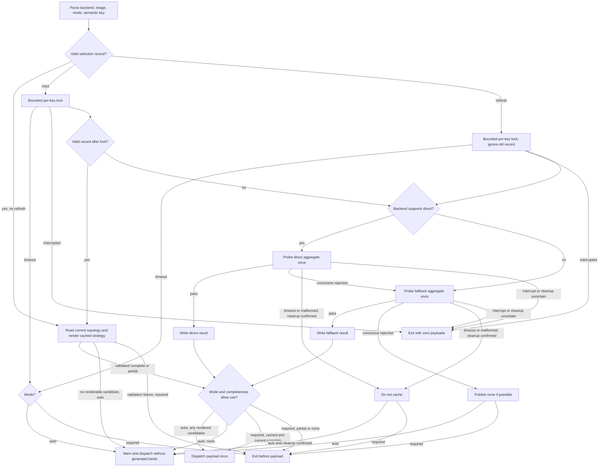
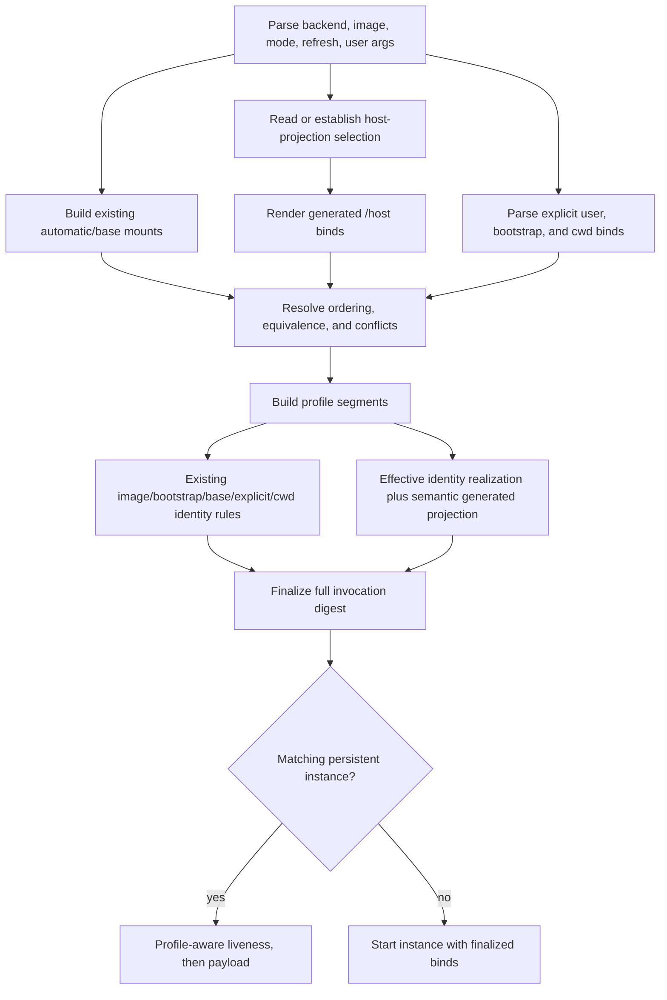
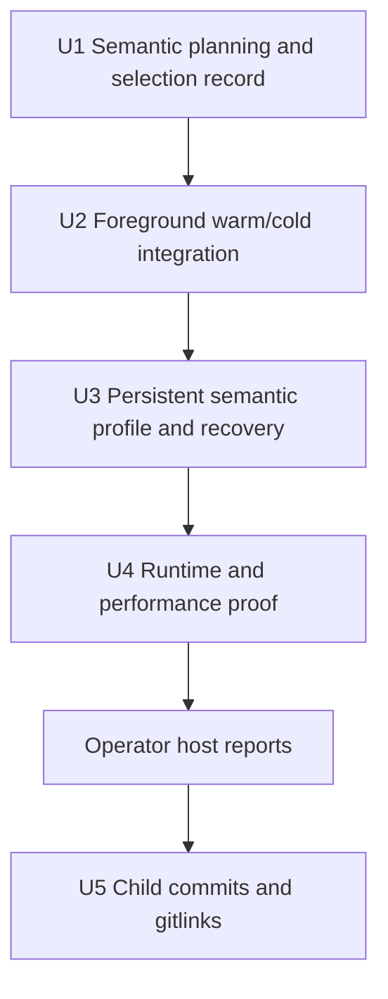

# Automatic Host Root Projection - Plan

## Goal Capsule

- **Objective:** Give every supported container backend a best-effort writable view of the invoking host filesystem beneath `/host` without changing the image root or existing same-path mounts.
- **Product authority:** This plan owns generic host-root discovery, capability selection, bind translation, and launch behavior in `container_tools`; host-bridge consumes the result as separate work.
- **User outcome:** Docker, Podman, SingularityCE, and Apptainer callers use one `/host` convention while normal image paths retain their current meaning and warm launches remain close to today's simple path.
- **Open blockers:** None for deterministic implementation. This development environment has no container runtime, so real backend and supplementary-group claims remain unavailable until the implementation supplies the host-run evidence bundle and the operator returns applicable reports.
- **Stop conditions:** Stop if a warm launch creates a probe container, generated projection identity depends on volatile filesystem presentation, a payload can run more than once, or host kernel API mounts appear beneath `/host`.
- **Tail ownership:** Complete deterministic verification, provide the exact host-run commands, validate returned reports before making backend claims, then record the `container_tools`, `msk_containers`, and workspace gitlinks. Remote publication still requires explicit authorization.

---

## Product Contract

### Summary

`container_tools` exposes a writable host filesystem view beneath `/host` across all four supported backends. A cold or explicitly refreshed launch proves one backend/image capability and memoizes the selected strategy plus its fallback path plan when applicable. Warm launches use that selection without creating probe containers. Full persistent identity is finalized only after every automatic, explicit, bootstrap, cwd, and generated bind is assembled.

### Problem Frame

Container images replace the host root, so host `/usr`, `/etc`, `/var`, `/run`, `/opt`, and similar paths resolve to image content. Existing mount detection exposes workspaces and separately mounted storage at the same paths, but intentionally excludes `/` and therefore cannot expose root-backed host paths. Host tools need a coherent nested host view without replacing image paths globally.

### Key Decisions

- **Make host-root projection a generic prerequisite.** (session-settled: user-directed - chosen over embedding fixed host binds in MkChad host-bridge integration.)
- **Provide backend parity.** (session-settled: user-directed - chosen over SingularityCE/Apptainer-only behavior.)
- **Prefer direct root with a generated fallback.** (session-settled: user-directed - chosen over a fixed FHS list.)
- **Keep the mirror writable under caller authority.** (session-settled: user-directed - chosen over read-only binds.)
- **Include `/run` and ordinary submounts.** (session-settled: user-approved - chosen over treating runtime state as a kernel API filesystem.)
- **Exclude host kernel API filesystems.** (session-settled: user-approved - container-provided `/proc`, `/sys`, `/dev`, and cgroups remain authoritative.)
- **Preserve ordinary launches when projection is safely unavailable.** (session-settled: user-directed - chosen over making compatibility support a universal launch requirement.)
- **Retain the current trusted-path posture.** (session-settled: user-directed - no new ownership, ancestor, inode, anti-symlink, ACL, permission-repair, or path-authority regime.)
- **Support supplementary groups without overstating evidence.** (session-settled: user-approved - source-level construction is required; backend claims require runtime evidence.)
- **Keep projection logic in the shared library.** (session-settled: user-confirmed - chosen over changing detector output or installing another helper.)
- **Use automatic and required modes.** (session-settled: user-confirmed - best effort is default; callers may require completeness.)
- **Preserve fallback path usability, not symlink inode identity.** (session-settled: user-confirmed - `/host/bin` may be a bind of the host referent rather than a symlink object.)
- **Memoize selection, including fallback paths.** (session-settled: user-directed after Proof review - warm launches must not repeat runtime probes or fallback discovery.)
- **Use semantic projection identity.** (session-settled: user-directed after Proof review - generated profiles must not churn on inode, device, mount-ID, timestamp, or network-remount details.)
- **Ship host-executable evidence tests.** (session-settled: user-directed - the current development environment has no container tools, so runtime-dependent units must contribute to one cumulative host runner that the operator can execute and report.)

<!-- ce-section: work-relationships -->
### How This Work Fits Together

- **Enables:** `docs/plans/2026-08-04-004-feat-mkchad-host-bridge-integration-plan.md` consumes the selected mirror.
- **Shares:** Existing same-path mount discovery and backend argv assembly remain common infrastructure.
- **Can proceed independently of:** Host-bridge packaging, release deployment, and managed OpenCode lifecycle work.
- **Does not absorb:** Host command semantics, release schemas, or a general mount-detector rewrite.

### Actors

- A1. **Container caller:** Invokes a foreground, shell, or persistent launcher and may require `/host`.
- A2. **Container tools:** Reads current topology, consumes or establishes a capability result, constructs binds, and dispatches once.
- A3. **Container runtime:** Applies backend bind and identity behavior.
- A4. **Container payload:** Runs at most once with the selected mirror or, when allowed, without an automatic mirror.
- A5. **Host test operator:** Runs the supplied opt-in suite against locally available runtimes/images and returns its machine-readable reports without needing to interpret internal assertions.

### Requirements

**Projection semantics**

- R1. Docker, Podman, SingularityCE, and Apptainer must expose the same `/host` contract when supported.
- R2. `/host` must not replace image `/usr`, `/etc`, `/var`, `/run`, or other root paths.
- R3. Generated binds request writable access while host permissions, ACLs, mount restrictions, and security policy remain authoritative.
- R4. Existing automatic, explicit, workspace, home, and shared-filesystem mounts retain current destinations, access, and relative ordering.
- R5. Host `/run` and other non-kernel submounts are eligible at matching `/host/*` destinations.
- R6. Host `/proc`, `/sys`, `/dev`, cgroups, and equivalent kernel API filesystems must not be imported beneath `/host`.
- R7. Discovery and bind construction retain the existing trusted-path posture without adding new filesystem-hardening policy.

**Capability selection and performance**

- R8. Before payload dispatch, container tools must either consume a valid memoized capability result for the current semantic key or perform a bounded cold proof against the actual backend and image.
- R9. A valid selection record memoizes `direct`, `fallback`, or conclusively `none`, proven `complete|partial`, and effective group mode. Clean conclusive `none` is written whenever cache publication succeeds and records the deterministic conservative group mode if no successful proof established a broader one. A fallback record may additionally store the exact discovered lexical source and resolved symlink-target strings that were proven; direct records continue to derive eligible mounted descendants from current `mountinfo`, and warm validation recomputes current effective completeness.
- R10. Cold selection prefers a non-recursive host `/` projection plus eligible explicit descendants when the backend documents a non-recursive control, then attempts one generated top-level fallback aggregate. SingularityCE and Apptainer begin with fallback because they expose no documented per-bind non-recursive root control.
- R11. Fallback planning is mode-independent: deterministically invalid or unrepresentable candidates are omitted before one retained aggregate probe and mark the result partial. Auto may dispatch the proven partial result with warnings by opaque candidate ID; required performs the same selection proof, caches the result when possible, then refuses before payload. Runtime-level aggregate rejection makes fallback unavailable; it does not start candidate-by-candidate or retained-set probe loops.
- R12. A final payload is never retried after launch, regardless of projection, runtime, or payload result.
- R13. Auto mode warns and dispatches once with the currently renderable selected candidates, or without an automatic projection when none remain, while preserving pre-existing `/host` binds. Required mode refuses before payload on any incompleteness.
- R14. `--ct-host-root-refresh` bypasses a valid record for one invocation and is orthogonal to `--ct-host-root auto|required`.

**Identity and compatibility**

- R15. Generated projection identity consists of strategy and each ordered lexical source, resolved symlink target string, destination, access, and recursion policy. It excludes stat identity, inode, device, major:minor, mount ID, timestamps, filesystem type, and mount-option presentation.
- R16. Full persistent invocation identity is finalized only after existing automatic/base mounts, explicit user binds, bootstrap, implicit cwd, and generated `/host` binds are assembled and conflicts are resolved. It includes the effective UID, primary GID, sorted supplementary GIDs, and selected group mode. Existing identity behavior remains unchanged for image, bootstrap, base, explicit, and cwd inputs; the new semantic rule applies only to generated `/host` binds.
- R17. A persistent instance keeps its selected strategy, binds, and effective identity realization for its lifetime. Generated `/host` identity does not select a new instance for same-path network remounts or incidental filesystem metadata; a changed effective group realization does. Unchanged existing base-bind identity behavior remains governed by R16.
- R18. A strategy may change only after first use, cache eviction/corruption, explicit refresh, or a semantic key change such as backend, host, endpoint selector, image selector, projection-affecting options, group set, or protocol version.
- R19. Backend translation preserves path boundaries, spaces, writable intent, and deterministic order through argv arrays. Unrepresentable paths become typed candidate failures rather than split text.
- R20. Docker and Podman preserve supported supplementary groups without inventing memberships; unsupported or inconclusive behavior uses deterministic primary-only mode with a diagnostic and never consumes partial probe output. SingularityCE and Apptainer use their native inherited caller groups. The effective realization is applied and hashed even when auto dispatches without generated projection.
- R21. Projection policy and selection memoization stay outside `ct_runtime.conf` and `ct_mount.conf`.

**Verification and observability**

- R22. Warm foreground launches make zero pre-payload runtime calls of any class; warm persistent reuse adds no runtime operation beyond the existing liveness call upgraded to a profile check.
- R23. Docker/Podman cold direct success uses one aggregate probe and cold fallback uses one direct plus one fallback probe. SingularityCE/Apptainer cold fallback uses one fallback probe. No group-only or retained-fallback probe exists.
- R24. The cold path has an eight-second aggregate deadline plus at most two seconds for exact cleanup. Parent interruption or unconfirmed cleanup is terminal with zero payloads.
- R25. Tests cover direct, fallback, deterministic partial fallback, none, required refusal, cache hit/miss/refresh/corruption/concurrency, exact-once dispatch, workstation/HPC layouts, `/run`, NFS, Lustre, GPFS, and paths with spaces.
- R26. Diagnostics and selection records contain no unselected directory contents, credentials, private configuration, rendered bind argv, or raw probe output. A fallback record may contain only its selected path strings and resolved symlink-target strings.
- R27. The repository must ship one cumulative opt-in host runner for runtime-dependent behavior. U2 introduces foreground cases, U3 adds persistent cases, and U4 finalizes the matrix; units do not create incompatible per-unit harnesses.
- R28. Each syntactically valid non-help host invocation emits a bounded `container-tools.host-projection-runtime/v1` JSON report tied to exact source and image digests when available. Exit 0 means every applicable selected case passed, 1 means at least one failed, 2 means invalid invocation and emits no report, and 77 means the runner is disabled or the requested runtime/image/prerequisite was unavailable and grants no support claim. `--help` emits usage and exits 0 without a report.

### Key Flows

- F1. **Warm foreground:** Read a valid selection result, validate/render its strategy, finalize all invocation binds, and dispatch once with no probe runtime. Warm fallback checks its stored lexical/resolved pairs rather than enumerating `/` again; auto omits invalid stored candidates, while required refuses on any loss.
- F2. **Cold selection:** Under one per-key lock, prove direct once and fallback once only if needed, publish the complete, partial, or conclusive-none result when possible, then gate dispatch according to auto/required mode. Candidate filtering and proof do not depend on which mode arrived first.
- F3. **Warm unavailable:** Consume conclusive `none`; auto warns and dispatches without generated binds, while required refuses.
- F4. **Explicit refresh:** Ignore the old result for this invocation, run cold selection, and replace it only after conclusive proof and confirmed cleanup.
- F5. **Persistent reuse:** Build the complete effective bind list, finalize the full invocation profile, perform the existing one liveness call as a profile check, and dispatch into the fixed instance without capability probing.
- F6. **Persistent creation recovery:** Journal only pending instance creation with a mode-0600 nonce record so interruption can be reconciled without signaling an unrelated instance.
- F7. **External host verification:** The implementer runs deterministic tests for the harness, supplies one command per requested backend, and records real execution as unavailable locally. The operator runs each command serially and returns the JSON report; the coordinator validates schema, source digest, image digest, case results, operation counts, and cleanup before accepting that backend claim.

### Acceptance Examples

- AE1. **Covers R1-R6, R8-R10, R22.** After one direct proof, the next foreground launch creates no probe object, exposes host `/usr` beneath `/host/usr`, leaves image `/usr` unchanged, and excludes host kernel API mounts.
- AE2. **Covers R8-R14, R23-R24.** A cold direct rejection starts one fallback probe at most; an auto success dispatches once, and required failure dispatches zero payloads.
- AE3. **Covers R11-R13, R25.** A required-first fallback with a statically unrepresentable candidate probes and caches the exact partial aggregate once, refuses before payload, and lets a later auto invocation consume that record without probing; runtime aggregate rejection does not trigger subset search.
- AE4. **Covers R15-R18.** Same semantic paths after NFS remount, inode/device changes, or mount-ID changes produce the same generated profile and strategy.
- AE5. **Covers R15-R18.** A changed direct lexical bind set, backend/image selector, group set, effective group mode, or explicit refresh may produce a new profile or strategy. Any changed effective identity realization selects a new persistent profile. A fallback symlink retarget is adopted only when refresh rebuilds its stored path plan.
- AE6. **Covers R16-R17, R22.** Persistent reuse performs one profile-aware instance check and one payload exec, with no selection probe or late bind.
- AE7. **Covers R3, R20, R25.** Readable, writable, nonwritable, and supplementary-group fixtures preserve backend-supported caller authority without broader access; an inconclusive auto launch uses primary-only Docker/Podman or native inherited SingularityCE/Apptainer realization and ignores partial probe output.
- AE8. **Covers R9, R13-R14, R21, R26.** A warm fallback reuses and revalidates the selected path plan without root enumeration, auto omits a missing or retargeted stored candidate, required refuses that loss, a malformed cache is a miss, a failed refresh preserves the previous record without using it for that invocation, and no unselected directory contents or raw mount inventory enters cache or diagnostics.
- AE9. **Covers R4, R21.** Existing detector output and same-path mounts remain unchanged; no runtime-storage or mount config entry is required.
- AE10. **Covers R22-R28.** A host with one local backend and image runs a single opt-in command in a fresh work directory and receives one redacted report containing stable case IDs, exact source/image evidence, PASS/FAIL/SKIP results, operation counts, timings, and cleanup status. A missing backend exits 77 and cannot be reported as passing.

### Scope Boundaries

- Host-bridge implementation, packaging, and release deployment.
- Replacing image roots or adding host paths to global `PATH` or `LD_LIBRARY_PATH`.
- A filesystem authorization model, command allowlist, sandbox, credential scanner, or stricter path-hardening regime.
- Ownership/ancestor/inode/symlink/ACL/permission-repair checks beyond existing behavior. These are intentional non-requirements, not deferred audit findings.
- Preserving fallback symlink inode identity.
- Raw Docker/Podman subcommand passthrough.
- Automatic detection of in-place runtime/image replacement under the same semantic selector; callers use explicit refresh.
- TTLs, an eviction service, a cache daemon, raw `mountinfo` snapshots, or cached direct-strategy descendant inventories. Only the selected fallback path plan is stored.
- Replacing `ct_mount_detector.sh` with `mountinfo` in this feature. Any future migration requires separate output-equivalence and latency evidence.
- Pulling/building images, contacting registries, inspecting live MkChad state, or exercising real scheduler/site credentials from the host evidence runner.

### Dependencies And Assumptions

- Supported hosts are Linux and expose `/proc/self/mountinfo`.
- Supported images provide `/bin/sh` for cold proof.
- Default/native Docker/Podman endpoints are trusted local runtime choices; explicit remote, Podman machine, TCP, and SSH selectors make projection unavailable.
- Existing container-tools mount validation and persistent base-bind identity are the compatibility baseline.
- Selection files are optimization data, not authority or secrets. Malformed or unavailable cache state becomes a miss, not a hard launch failure.
- Host runtime evidence uses operator-supplied local image selectors or absolute SIF paths. Missing runtimes/images are reported with exit 77 rather than downloaded, substituted, or represented by fixture evidence.

### Sources And Research

- [`ct_mount_detector.sh`](../../msk_containers/container_tools/ct_mount_detector.sh) defines current same-path discovery and remains unchanged.
- [`ct_library.sh`](../../msk_containers/container_tools/ct_library.sh) defines validation, backend translation, and launch assembly.
- [`ct_instance_exec.sh`](../../msk_containers/container_tools/ct_instance_exec.sh) defines persistent profile identity and reuse.
- [Linux `proc_pid_mountinfo(5)`](https://man7.org/linux/man-pages/man5/proc_pid_mountinfo.5.html) defines projection topology fields.
- [Docker bind mounts](https://docs.docker.com/engine/storage/bind-mounts/) documents writable defaults, daemon-host resolution, and `bind-recursive=disabled`.
- [Podman run](https://docs.podman.io/en/latest/markdown/podman-run.1.html) documents `bind-nonrecursive` and `--group-add keep-groups`.
- [Apptainer bind paths](https://apptainer.org/docs/user/latest/bind_paths_and_mounts.html) and [SingularityCE bind paths](https://docs.sylabs.io/guides/latest/user-guide/bind_paths_and_mounts.html) document writable user binds and CSV-aware `--mount`.

---

## Planning Contract

**Product Contract preservation:** The writable, backend-parity mirror remains unchanged. Planning replaces per-launch proof and volatile profile identity with cold selection memoization and semantic generated-bind identity.

### Key Technical Decisions

- KTD1. **Keep ordinary detection stable.** Add private projection functions to `ct_library.sh`; leave `ct_mount_detector.sh`, `ct_args.sh`, detector output, and existing base mount ordering unchanged.
- KTD2. **Use `mountinfo` only for generated projection planning.** Parse one fresh snapshot into arrays, exclude kernel API subtrees, and build current direct/fallback binds. Mount IDs and filesystem presentation are parser inputs only.
- KTD3. **Memoize selection, not raw topology.** Store schema, semantic key digest, strategy, completeness, group mode, and a closed reason. Fallback records additionally store the exact proven lexical source/resolved-symlink strings as a NUL-framed path plan. Never store raw mount records, rendered argv, unselected directory contents, or probe output.
- KTD4. **Make warm paths probe-free and metadata-bounded.** A cache hit validates and renders its selected strategy, then dispatches. Warm direct reads `mountinfo` once. Warm fallback reads `mountinfo` once and verifies each stored lexical path still resolves to its stored target under one positive `CT_HOST_PROJECTION_PLAN_TIMEOUT`, default one second; it does not enumerate `/` or multiply per-candidate timeouts. Timeout follows cached-strategy render failure without probing or cache mutation.
- KTD5. **Use the minimum mode-independent cold probes.** Fold mount and group reporting into backend aggregate proof. Docker/Podman use direct and, only after conclusive direct rejection, fallback. SingularityCE/Apptainer use fallback only. Build and prove the same retained aggregate regardless of auto/required, then apply mode policy. If no proof conclusively establishes group support, discard any partial output and use primary-only Docker/Podman or native inherited SingularityCE/Apptainer realization. Remove standalone group, retained-fallback, and per-candidate runtime probes.
- KTD6. **Finalize identity after bind assembly.** First build existing automatic/base mounts, resolve the selected projection, add explicit user/bootstrap/cwd binds, and resolve `/host` conflicts. Then hash the full invocation profile. Generated fields use strategy plus ordered lexical source/resolved-symlink/destination/access/recursion values and exclude volatile metadata. Effective UID, primary GID, sorted supplementary GIDs, and selected group mode are canonical profile inputs so a persistent instance cannot retain stale access.
- KTD7. **Preserve existing identity behavior elsewhere.** Image, bootstrap, base/explicit mounts, and implicit cwd retain their current profile inputs. Downstream bridge-specific binds may retain their own resolved-path/stat identity.
- KTD8. **Keep strategy and fallback plan stable.** Cache hits never reconsider direct versus fallback or discover newly appearing fallback paths. A missing, ineligible, or retargeted stored fallback candidate is omitted with a diagnostic in auto; if none remain, auto runs without generated projection. Required refuses on any such loss. Neither mode silently switches strategy or mutates the record; explicit refresh recomputes the plan.
- KTD9. **Keep endpoint handling simple.** Include hostname, resolved tool path string, and the endpoint selector derived from environment/local client configuration without invoking the runtime in the key. Reject explicit remote/machine/TCP/SSH selectors. Perform nonce locality proof only during cold Docker/Podman probing, not warm launch.
- KTD10. **Keep persistent reuse on its existing call shape.** Rebuild current topology, effective identity realization, and semantic generated profile locally, then replace `/bin/true` liveness with a comparison against the reserved digest stored at instance start. Do not run capability or runtime aggregate probes during reuse.
- KTD11. **Journal creation only.** Keep a mode-0600 pending name/profile/nonce record around `instance start` for bounded process-death recovery. Do not add foreground journals or durable probe state.
- KTD12. **Do not treat selection cache as private authority.** Cache file mode is neither prescribed nor validated because records contain no secrets or authority. Every cached lexical/resolved pair is revalidated and every destination is derived strictly beneath `/host`. Only the separate persistent-creation nonce record remains mode 0600 because it authorizes interrupted-instance reconciliation. Do not add ownership, ancestor, inode, descriptor, ACL, permission-repair, or filesystem-specific checks.
- KTD13. **Build one cumulative host runner.** Introduce `tests/host_projection_runtime_test.sh` with U2 foreground behavior, extend the same runner with U3 persistent behavior, and finalize its backend matrix/reporting in U4. Deterministic fake-runtime tests must prove the runner's CLI, no-pull behavior, operation classification, report schema, redaction, exit codes, and exact cleanup before asking the operator to execute it.

### Selection Record

Default location:

```text
${XDG_RUNTIME_DIR}/container-tools/host-projection-v1/KEY
```

If `XDG_RUNTIME_DIR` is unavailable, use `/tmp/container-tools-${UID}/host-projection-v1/KEY`. Use the caller's normal umask; file or directory mode is not a validity condition. A record is capped at 1,048,576 bytes and 4,096 fallback pairs. An unavailable, malformed, truncated, over-limit, or future-schema record is ignored as a miss before unbounded parsing. A proven current plan that exceeds the publication limits may still serve that invocation, but cache publication fails and the next invocation remains cold.

`KEY` is a NUL-framed SHA-256 over:

- Cache/probe/render policy version.
- Backend family, hostname, resolved executable path string, and effective local endpoint selector.
- Semantic image selector string and projection-affecting runtime option strings.
- UID, primary GID, sorted supplementary GIDs, and requested group form.
- Host boot ID, which scopes node-local capability across reboot but never enters persistent projection identity.

The key excludes per-invocation automatic/explicit/generated bind paths, inode/device numbers, mount IDs, timestamps, filesystem types/options, socket identity, payload argv, and payload environment. Adding an unrelated user bind therefore does not force a cold capability proof.

The record value contains closed scalar fields for strategy, completeness, group mode, and reason. Group mode is a backend-compatible closed value: `numeric-supplementary`, `keep-groups`, `primary-only`, or `native-inherited`. A fallback record then carries NUL-framed lexical source/resolved-symlink pairs for the exact proven fallback plan. On read, every source must still be absolute and eligible, each lexical path must resolve to its recorded target, excluded subtrees are filtered again, and the destination is derived as `/host${lexical_source}` rather than trusted from cache text. Missing, ineligible, or retargeted entries reduce current completeness without invalidating the key; newly appearing paths wait for refresh.

Warm reads are lock-free. On a miss, take one bounded per-key `flock`, reread, and probe only if still absent. Write a temporary record and atomically rename only after conclusive proof and confirmed cleanup. Cold callers never probe concurrently for one key; a successfully published result permits at most one selection across a concurrent wave, while transient or publication failures may cause bounded serialized retries. Lock timeout follows ordinary auto-without-projection or required-refusal policy; parent interruption is terminal with zero payloads. Cache write failure does not invalidate the already-proven current launch; it only leaves the next invocation cold.

- Positive `direct` and `fallback` results are memoized.
- Conclusive `none` after clean direct/fallback rejection is memoized whenever publication succeeds, providing fast auto/required behavior.
- Timeout, interruption, malformed output, metadata failure, or cleanup uncertainty is never memoized.
- `--ct-host-root-refresh` ignores the old record for one invocation. Failed refresh neither consumes nor replaces it.
- No TTL or automatic mtime-based invalidation exists. In-place image/runtime replacement under the same selector requires refresh.

### Strategy And Failure Model



Docker/Podman direct strategy is non-recursive `/ -> /host` plus every eligible separately mounted descendant. SingularityCE/Apptainer do not claim direct support and begin with fallback. Fallback is current top-level directories/directory symlinks plus eligible descendants. For recursively binding backends, a candidate containing an excluded descendant is filtered before proof and marks the result partial, as does any deterministic invalid or unrepresentable candidate. The retained aggregate is identical for auto and required: auto may dispatch a proven partial result, while required refuses after selection because it permits no omission. If the aggregate reports a mount mismatch or runtime setup rejects it before reporting, fallback is unavailable; there is no subset search.

Legitimate direct-to-fallback change is limited to first/cold use, record eviction/corruption, explicit refresh, or semantic key change. Same-path NFS remount, device/inode changes, mount ID, timestamps, and option presentation never change strategy or generated profile identity. A changed direct descendant set can change the generated tuple while retaining direct strategy. Fallback validates only its stored plan: auto omits missing, ineligible, or retargeted entries and required refuses; newly appearing paths and replacement targets wait for refresh.

### Full Invocation Identity

Capability selection and persistent invocation identity are separate layers:



- The selection key answers whether the backend/image can provide a strategy. Per-call bind paths do not belong in that key.
- The fallback path plan is a selection-record value because it avoids repeating warm discovery; it is not key material.
- The full invocation digest is computed only after all final binds are known. An additional explicit user bind therefore selects a different persistent instance even though it reuses the same capability result.
- Existing automatic/base/explicit/bootstrap/cwd inputs retain current identity rules. Generated `/host` inputs use only the semantic tuple from R15. Effective UID, primary GID, sorted supplementary GIDs actually applied or inherited, and selected group mode are separate canonical inputs. Without a conclusive selection result, final assembly substitutes the backend's deterministic conservative mode before hashing.
- `auto` versus `required` may reuse the same instance when both resolve to the same complete effective bind set and identity realization. `refresh` changes identity only if it changes the resolved strategy, final bind set, or effective identity realization. Any input that changes those outcomes changes identity.
- Cold capability probes exercise generated projection and identity behavior, not unrelated per-call binds. Explicit binds targeting `/host` are handled deterministically during final conflict resolution; unrelated explicit binds affect only the full invocation profile.

### Backend Translation

| Backend | Generated projection form | Identity behavior |
|---|---|---|
| Docker | Repeated `--mount type=bind,src=...,dst=...,bind-recursive=disabled` | Numeric `--user`; proven sorted numeric `--group-add`, otherwise primary-only |
| Podman | Repeated `--mount type=bind,src=...,dst=...,bind-nonrecursive` | `--userns=keep-id`, numeric user; proven `keep-groups`, otherwise primary-only |
| SingularityCE | Fallback-only repeated writable `--mount type=bind,src=...,dst=...` with documented CSV quoting | Ordinary caller identity/groups; no fakeroot |
| Apptainer | Same fallback-only contract as SingularityCE | Ordinary caller identity/groups; no fakeroot |

Generated arguments precede existing mount arguments, whose relative order remains unchanged. Equivalent existing `/host` binds satisfy the candidate. Conflicting binds remain authoritative: auto omits/fails the generated candidate, and required refuses when completeness is lost.

### Performance Contract

- **Warm foreground:** Zero pre-payload runtime calls in every class. Direct performs one `mountinfo` parse. Fallback performs one `mountinfo` parse and validates its stored path plan under the single default one-second generated-planning deadline; it does not enumerate `/` again.
- **Warm persistent reuse:** Exactly one profile-aware instance liveness exec and one payload exec. No selection probe, image inspection, instance start/stop, or capability lock.
- **Cold direct:** Docker/Podman use one aggregate probe; no group-only probe.
- **Cold fallback:** Docker/Podman use one direct and one fallback aggregate. SingularityCE/Apptainer use one fallback aggregate. No retained-set or per-candidate probes exist.
- **Cold deadline:** Eight seconds total for lock, bounded record parsing, discovery, cold endpoint/image inspection, both probes, parsing, and normal cleanup. Exact cleanup may use at most two additional seconds.
- **Measurement:** Runtime operation classes and counts are hard gates. Real-runtime cold/warm median, p95, and max are reported over at least 20 seeded warm launches but are evidence rather than cross-host millisecond pass/fail thresholds.

Existing `build_mount_args` validation, detector parsing, and persistent base-bind stats remain baseline costs and are not duplicated for generated projection records. The plan intentionally does not modernize those paths in this change.

### Host-Run Evidence Contract

Run one backend at a time from `msk_containers/container_tools` after deterministic tests pass:

```bash
CT_HOST_PROJECTION_RUNTIME_TEST=1 \
  bash tests/host_projection_runtime_test.sh \
    --backend docker \
    --image LOCAL_IMAGE_SELECTOR \
    --work /tmp/mkchad-v1/host-root-projection-host/docker-RUN_ID
```

`--backend` accepts exactly `docker`, `podman`, `singularity`, or `apptainer`. Docker/Podman selectors must already exist in the local runtime; inspect-only admission resolves one immutable local image ID and every test launch uses that ID, never the mutable selector. SingularityCE/Apptainer images must be existing absolute regular SIF paths and are copied, using reflink when available, into the private work directory; every launch uses that staged copy. The runner hashes admitted image bytes/identity before and after execution and fails on change. `--work` must be a new directory beneath `/tmp/mkchad-v1/host-root-projection-host`; an existing, relative, or out-of-root path is invalid exit 2 before mutation, while environmental failure to create an otherwise valid path emits one stdout-only unavailable report with exit 77 and no report file. Each invocation owns only its unique runtime objects, labels, cache root, sentinels, staged image, and logs.

Every syntactically valid non-help invocation that can create its work directory writes `$work/report.json` and emits the same single JSON object on stdout, including disabled or unavailable outcomes. Invalid invocation emits concise usage only on stderr and no JSON; `--help` emits usage only on stdout. Schema `container-tools.host-projection-runtime/v1` contains only bounded scalar evidence:

- Overall `passed|failed|unavailable`, backend/version, architecture, source commit, a closed NUL-framed SHA-256 manifest over the exact launcher/library/test files, and the immutable image ID/content digest actually executed. The source manifest is rechecked before dispatch and at completion; any change fails the run rather than issuing evidence for mixed bytes.
- Stable cases `HP-HOST-001` image-root isolation and selected strategy, `HP-HOST-002` `/run`/ordinary descendants/kernel exclusions, `HP-HOST-003` test-owned writes and effective groups, `HP-HOST-004` cold/warm/refresh operation counts and timings, `HP-HOST-005` auto/required/exact-once/cleanup behavior, and `HP-HOST-006` persistent profile/reuse for SingularityCE/Apptainer. A backend-inapplicable case is `skip`; a missing requested prerequisite makes the whole run `unavailable` with exit 77.
- Per-case `pass|fail|skip`, a closed reason, bounded elapsed milliseconds, normalized operation counts, and exact test-owned cleanup status. Raw argv, environment, directory listings, mount inventory, credentials, private configuration, payload output, and host paths outside the work root are excluded.

The runner creates writable sentinels only beneath its work directory and, when available, one test-owned child of the caller's runtime directory for `/run` evidence. It never writes arbitrary projected host paths, signals unaccounted processes, contacts a registry/network service, or cleans an object without its exact run label/name. It wraps only the launcher-under-test phase when measuring runtime calls; harness admission/metadata calls are recorded separately and cannot satisfy or contaminate warm operation-count assertions.

The operator returns each complete `report.json` (or its exact stdout object) and command exit status. The coordinator accepts a backend claim only after matching the report's source digest to the reviewed tree, validating image/runtime identity, confirming every applicable case passed, and confirming exact cleanup. Narrative summaries and fixture-only results are not substitutes. A returned unavailable report records the missing gate honestly and leaves that backend claim open.

### Implementation Constraints

- Use Bash arrays and quoted argv expansion; no `eval`, word-split command substitution, or line-serialized records.
- Keep unselected directory contents, raw mount inventory, and paths outside the selected fallback plan out of diagnostics and selection files.
- Cache and pending-record failures degrade to cache miss or bounded recovery; they do not introduce new filesystem policy.
- Clear inherited SingularityCE/Apptainer bind variables as existing launch policy requires. Cold probes receive no payload environment or bootstrap.
- Use `/tmp/mkchad-v1/host-root-projection` for development fixtures; do not touch protected live MkChad paths.
- Run one real backend suite at a time and do not download substitute runtimes or images.
- Keep host-run fixtures under `/tmp/mkchad-v1/host-root-projection-host`; deterministic harness tests must use fake runtimes and must not require the operator's container environment.
- Future audits must evaluate against the explicit trusted-path and performance contracts. Rejected hardening controls in Scope Boundaries are not findings without a new reachable requirement or threat-model change.

### Sequencing



### Requirement Traceability

| Unit | Requirements | Flows | Acceptance examples |
|---|---|---|---|
| U1 | R4-R11, R14-R21, R25-R26 | F1-F4 | AE1-AE5, AE8-AE9 |
| U2 | R1-R14, R19-R28 | F1-F4, F7 | AE1-AE3, AE7-AE10 |
| U3 | R12, R15-R18, R22-R28 | F5-F7 | AE4-AE6, AE8, AE10 |
| U4 | R1-R28 | F1-F7 | AE1-AE10 |
| U5 | R1-R28 | F1-F7 | AE1-AE10 |

### Risks And Mitigations

| Risk | Impact | Mitigation | Required proof |
|---|---|---|---|
| Warm path repeats cold work | Launch regression | Node-local selection record with stored fallback plan and hard zero-pre-payload-runtime-call warm counts | Fake-runtime counts and real warm report |
| Volatile network metadata changes profile | Duplicate/stale persistent instances | Semantic generated tuple only; preserve volatile data as parser/probe evidence, not identity | NFS/remount identity fixtures |
| Stale capability after in-place image/runtime replacement | Cached strategy may no longer work | Explicit refresh; no payload retry or ambiguous cache mutation | Refresh and final-status tests |
| Cached strategy cannot fully represent current topology | Incomplete mirror | Auto retains only validated selected candidates or runs none; required refuses; no silent strategy switch | Changed-topology cache-hit tests |
| Cached fallback path text is malformed or altered | Wrong source or destination could be rendered | Validate every source, reapply exclusions, and derive destinations strictly beneath `/host`; otherwise treat record as miss/render failure | Malformed and tampered-record tests |
| Effective supplementary groups change after instance creation | Stale or broadened persistent access | Hash effective UID/GID/group set and selected group mode into the full profile | Group-change profile and reuse tests |
| Recursive bind imports kernel APIs | Contract violation | Non-recursive flags where documented; cold aggregate proof and runtime gates | Exclusion fixtures and backend gates |
| Probe interruption leaves runtime artifact | Stray process with host binds | Cold create-before-start/exact cleanup; uncertainty is terminal | Timeout/interruption cleanup tests |
| Conclusive none becomes stale | Projection remains unavailable until refresh/key change | Document refresh; never TTL-reprobe warm launches | Negative-record and refresh tests |
| Host report comes from different source/image or leaks machine data | False support claim or private-data exposure | Exact source/image digests, closed redacted schema, deterministic schema/redaction tests, and coordinator validation | Returned report validation against reviewed tree |
| Runtime is unavailable in the development environment | Backend behavior remains unverified | Ship one operator-runnable suite; exit 77 records no claim and cannot be converted into fixture success | Operator-returned report per claimed backend |
| Future review expands rejected hardening | Portability and scope regression | Explicit non-requirements and threat-model calibration | Review checklist and unchanged detector |

---

## Implementation Units

### U1. Add Semantic Planning And Selection Memoization

- **Goal:** Build current projection binds and memoize backend/image selection, including the proven fallback path plan without caching raw topology.
- **Files:** `msk_containers/container_tools/ct_library.sh`; new `msk_containers/container_tools/tests/host_projection_test.sh`.
- **Approach:** Add projection-only `mountinfo` parsing, exclusions, direct/fallback semantic records, deterministic ordering, node-local selection key/read/write/refresh, NUL-framed fallback plan values, bounded cold locking, and backend rendering. Revalidate cached sources and derive every destination beneath `/host`. Keep detector and base mount code unchanged.
- **Test scenarios:** Escaped spaces/tabs/backslashes; root and separate `/usr`, `/var`, `/run`; NFS/Lustre/GPFS; kernel exclusions; top-level symlinks; direct/fallback ordering; fallback path-plan round trip and warm reuse without root enumeration; one aggregate generated-planning deadline with a hanging cached symlink resolution and no per-candidate multiplication; cache hit/miss/corrupt/future/tampered with file mode ignored; exact 1,048,576-byte/4,096-pair boundaries and boundary-plus-one rejection; semantic key changes; inode/device/time/mount-ID changes do not change key/profile; missing/ineligible/retargeted stored candidates are omitted in auto and refused in required until refresh; concurrent successful publication performs one selection, transient/publication failures serialize bounded retries without overlap; held-lock timeout/interruption; failed refresh preserves old record.
- **Verification:** Run the new fixture suite, `bash -n`, ShellCheck, and `git diff --check`.
- **Dependencies:** None.

### U2. Integrate Warm And Cold Foreground Launches

- **Goal:** Add automatic/required/refresh behavior while keeping warm exec and shell probe-free.
- **Files:** `msk_containers/container_tools/ct_library.sh`; `ct_exec.sh`; `ct_shell.sh`; `tests/bootstrap_test.sh`; `tests/host_projection_test.sh`; new cumulative `tests/host_projection_runtime_test.sh`; `README.md`.
- **Approach:** Normalize image-first Docker/Podman payload commands, consume valid records, perform at most direct/fallback cold probes under the shared deadline, prepend generated binds, and dispatch once. Fold group reporting into aggregate proof and preserve exact payload argv/status. Introduce the opt-in host runner with frontend admission/reporting plus `HP-HOST-001` through `HP-HOST-005`; test the runner itself with fake runtimes so no real runtime is needed in this unit.
- **Test scenarios:** Exec/shell and bootstrap/non-bootstrap matrix; cold direct/fallback/none; warm direct/fallback/none; clean conclusive-none publication with conservative group mode when needed; auto/required/refresh; required-first partial proof followed by probe-free auto reuse; aggregate rejection without subset probe; remote selector; lock/probe timeout, interruption, and cleanup; inconclusive auto ignores partial group output and applies/hashes primary-only Docker/Podman or native inherited SingularityCE/Apptainer realization; payload zero/one counts; existing `/host` equivalence/conflict; clean probe environment; host-runner invalid/disabled/unavailable paths, safe work-creation failure, no-pull admission, immutable image-ID use, staged SIF use, source/image pre/post changes, report redaction, exact labels, and exit 0/1/2/77.
- **Verification:** Run bootstrap and projection suites, host-runner fake-runtime/schema tests, `--help`, and disabled/unavailable paths, then shell static analysis. Record real execution as pending operator handoff rather than invoking an absent runtime.
- **Dependencies:** U1.

### U3. Use Semantic Identity For Persistent Instances

- **Goal:** Reuse persistent instances without capability reprobes or volatile generated-bind identity.
- **Files:** `msk_containers/container_tools/ct_instance_exec.sh`; `tests/instance_exec_test.sh`; `tests/host_projection_test.sh`; `tests/host_projection_runtime_test.sh`; `README.md`.
- **Approach:** Append `ct-host-projection-profile-v1` semantic fields and the effective UID/GID/supplementary-group realization to the existing profile hash, store its digest in reserved instance environment, upgrade the existing liveness call to compare it, and retain a minimal mode-0600 creation-pending nonce record for process-death recovery. Existing base-bind identities remain unchanged. Extend the same host runner with `HP-HOST-006`; do not create a second persistent-runtime harness.
- **Test scenarios:** Warm reuse has exactly liveness plus payload; identity is finalized only after automatic, generated, explicit user, bootstrap, and cwd binds plus effective UID/GID/supplementary-group realization; adding/changing an explicit bind changes full identity without changing the selection key; auto/required/refresh reuse when the effective strategy, binds, and identity realization match; same generated tuple across network remount metadata reuses; generated strategy or lexical-source/resolved-target/destination/access/recursion change selects a new profile; any effective UID, primary GID, supplementary-group set, or selected group-mode change selects a new profile; no late bind; mismatch is terminal without stopping pre-existing instance; interrupted creation adopts or cleans only matching pending nonce; dry run has no state mutation; host-run persistent case is an explicit skip for Docker/Podman and pass/fail, never fixture success, for SingularityCE/Apptainer.
- **Verification:** Run instance, projection, and host-runner fake-runtime/schema suites, then shell static analysis. Record real persistent execution as pending operator handoff.
- **Dependencies:** U2.

### U4. Prove Runtime Behavior And Performance

- **Goal:** Finalize the operator-runnable backend evidence bundle and validate returned reports without turning unavailable runtimes into fake parity.
- **Files:** `msk_containers/container_tools/tests/host_projection_runtime_test.sh`; `tests/host_projection_test.sh`; `README.md`.
- **Approach:** Finalize opt-in local-image gates for all four backends, stable case IDs, exact source/image binding, normalized operation tracing, report schema, cleanup, and operator commands. Each real run seeds one cold result, executes at least 20 warm samples, and reports operation counts plus cold/warm elapsed distributions using isolated caller-permission and group fixtures. Run no backend here when the development environment lacks it; hand commands to the operator and validate returned JSON instead.
- **Test scenarios:** `HP-HOST-001` through `HP-HOST-006`; image root unchanged; backend-supported `/host` direct/fallback; `/run`; kernel exclusions; readable/writable/nonwritable/group-only fixtures; cold cleanup; warm zero-pre-payload-runtime-call count; semantic identity across remount-style fixture metadata; explicit refresh; immutable image and closed-source manifest remain stable; malformed/foreign-source reports rejected by the coordinator.
- **Verification:** Run deterministic harness gates always. Provide one exact command per operator-available backend, then validate returned exit status and `report.json` against the reviewed source digest. Report exit 77/unreturned architectures honestly and make no claim for them.
- **Dependencies:** U3.

### U5. Commit Children And Record Gitlinks

- **Goal:** Produce one coherent verified prerequisite boundary.
- **Files:** U1-U4 child files; nested `msk_containers/container_tools` gitlink; workspace `msk_containers` gitlink.
- **Approach:** Commit verified `container_tools`, then the nested `msk_containers` gitlink, then the workspace gitlink. Stage no unrelated plans, databases, ideation, or scripts. Do not push without explicit authorization.
- **Verification:** Inspect status/diff/history and staged diff at each boundary; rerun focused tests at committed revisions; run recursive submodule status and workspace `git diff --check`.
- **Dependencies:** U4 plus accepted host reports for every backend/architecture claimed by this changeset; unavailable gates remain explicitly unclaimed.

---

## Verification Contract

### Deterministic Gates

Run from `msk_containers/container_tools` with fresh task directories:

```bash
bash tests/runtime_config_test.sh /tmp/mkchad-v1/host-root-projection/runtime-config "$PWD"
bash tests/bootstrap_test.sh /tmp/mkchad-v1/host-root-projection/bootstrap "$PWD"
bash tests/host_projection_test.sh /tmp/mkchad-v1/host-root-projection/projection "$PWD"
bash tests/instance_exec_test.sh /tmp/mkchad-v1/host-root-projection/instance "$PWD/ct_instance_exec.sh"
bash tests/host_projection_runtime_test.sh --help
bash -n ct_*.sh tests/*.sh
shellcheck ct_*.sh tests/*.sh
```

Fake runtimes classify operations as `inspect`, `probe-create`, `probe-start`, `probe-cleanup`, `instance-liveness`, `instance-start`, and `payload`; each probe sequence is tagged `direct` or `fallback`. The planner fixture separately records `root-enumeration`, `mountinfo-parse`, and lexical/resolved-pair validation events. These test-only events are not production diagnostics. Hard assertions are:

- Docker/Podman cold direct: one direct probe, no fallback/group/retained probe, one payload.
- Docker/Podman cold fallback: one direct and one fallback probe, no other probe, one payload.
- SingularityCE/Apptainer cold fallback: one fallback probe, no direct/group/retained probe, one payload.
- Warm foreground: one payload and zero operations in every other runtime class, including `inspect`.
- Warm fallback: zero root-enumeration calls; validate the stored lexical/resolved pairs and render only retained entries.
- Warm persistent: one instance-liveness and one payload operation only.
- Auto without conclusive selection: no partial probe output affects group argv or profile; backend-conservative group realization is applied and hashed.
- Concurrent miss with successful publication: at most one cold selection per key; no-publish outcomes never overlap probes and retries remain serialized and bounded.
- Held lock: timeout follows auto/required policy, interruption is terminal, and neither path dispatches a probe.
- Parent interruption, unconfirmed cleanup, required refusal, and persistent profile mismatch: zero payloads.

Use reduced fake deadlines to prove the shared eight-second plus cleanup model without flaky wall-clock microbenchmarks. `host_projection_test.sh` also drives the host runner through fake runtime adapters to prove disabled/unavailable behavior, safe work-root admission/creation failure, local-image-only admission, immutable image-ID/staged-SIF execution, source/image pre/post digest binding, report schema/redaction, normalized count separation, exact cleanup, and exits 0/1/2/77 without a real container tool.

### Operator Host Runtime Gates

- Docker: local/default endpoint, non-recursive direct/fallback, cold cleanup, numeric groups, warm zero pre-payload runtime calls.
- Podman: native local mode, `bind-nonrecursive`, rootless `keep-groups` where supported, warm zero pre-payload runtime calls.
- SingularityCE: local SIF, fallback-only projection, site bind policy, ordinary groups, persistent semantic profile reuse, and warm zero pre-payload runtime calls.
- Apptainer: the same fallback-only SIF and persistent matrix.

The operator runs only available backends, serially, with an already-local image:

```bash
CT_HOST_PROJECTION_RUNTIME_TEST=1 bash tests/host_projection_runtime_test.sh \
  --backend docker --image "$CT_HOST_TEST_DOCKER_IMAGE" \
  --work /tmp/mkchad-v1/host-root-projection-host/docker-RUN_ID

CT_HOST_PROJECTION_RUNTIME_TEST=1 bash tests/host_projection_runtime_test.sh \
  --backend podman --image "$CT_HOST_TEST_PODMAN_IMAGE" \
  --work /tmp/mkchad-v1/host-root-projection-host/podman-RUN_ID

CT_HOST_PROJECTION_RUNTIME_TEST=1 bash tests/host_projection_runtime_test.sh \
  --backend singularity --image "$CT_HOST_TEST_SINGULARITY_SIF" \
  --work /tmp/mkchad-v1/host-root-projection-host/singularity-RUN_ID

CT_HOST_PROJECTION_RUNTIME_TEST=1 bash tests/host_projection_runtime_test.sh \
  --backend apptainer --image "$CT_HOST_TEST_APPTAINER_SIF" \
  --work /tmp/mkchad-v1/host-root-projection-host/apptainer-RUN_ID
```

For Docker/Podman fallback evidence, the test-owned tracing adapter may force a conclusive direct-probe rejection and then delegate the fallback probe and payload unchanged to the real runtime; the report labels this condition and never represents it as natural runtime rejection. For each available backend, return command status and `report.json`, including backend version, image digest, architecture, cache filesystem class, selected/forced strategy condition, cold direct/fallback elapsed time, warm median/p95/max over at least 20 seeded runs, structural operation counts, and cleanup status. Structural counts are gates; cross-host millisecond values are reported evidence.

### Compatibility And Closeout

- `ct_mount_detector.sh` and `ct_args.sh` remain unchanged.
- Existing same-path, explicit, bootstrap, environment, cwd, and payload behavior remains covered.
- Existing persistent base-bind identity tests remain green; new network-metadata stability applies only to generated projection binds.
- Documentation explains the three identity layers, refresh, cold versus warm behavior, cached fallback paths, writable authority, narrowed groups, and accepted same-selector staleness.
- Run one operator host backend suite at a time, validate every returned report against the reviewed source, inspect all repository diffs, and report every unavailable gate.

---

## Definition Of Done

- Every supported launcher defaults to best-effort `/host` and accepts required plus explicit refresh controls.
- Warm foreground launches create no probe runtime; warm persistent reuse adds no operation beyond the existing profile-aware liveness call.
- Cold direct/fallback selection uses at most two probes under the bounded deadline and never retries a payload.
- Clean conclusive `none` and proven partial results are published when possible, so a required-first result can be consumed probe-free by later auto/required launches.
- Selection records contain no raw host topology or unselected directory contents; fallback records may contain the selected path plan. Cached lexical/resolved pairs are revalidated without root enumeration. Cache mode is not prescribed or validated, while the separate creation nonce remains mode 0600.
- Full persistent identity is finalized after all automatic, explicit user, bootstrap, cwd, and generated binds; an additional user bind changes that identity without forcing a new capability proof.
- Effective UID, primary GID, sorted supplementary GIDs, and selected group mode participate in persistent identity, so changed access never reuses an old instance.
- Generated persistent identity is stable across inode, device, mount-ID, timestamp, and same-path network-remount changes.
- Strategy changes only for documented cold/refresh/semantic-key causes, never incidental filesystem presentation.
- Existing detector behavior and existing base/explicit bind identity remain unchanged.
- Direct/fallback mirrors include eligible `/run` and data submounts while excluding host kernel API filesystems.
- The cumulative host runner and its fake-runtime/schema tests are committed with the implementation, and the operator can invoke any available backend with one documented command.
- Deterministic suites pass without credentials/network access; each real backend/architecture claim is backed by an accepted exact-source host report, while exit 77 or an unreturned report remains explicitly unclaimed.
- Child commits and parent gitlinks are coherent and contain no unrelated or protected live data.
