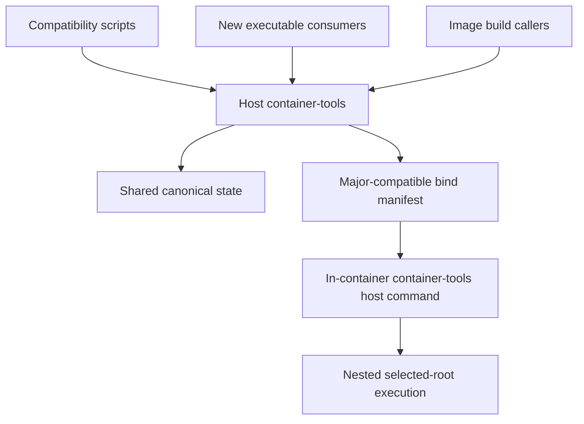
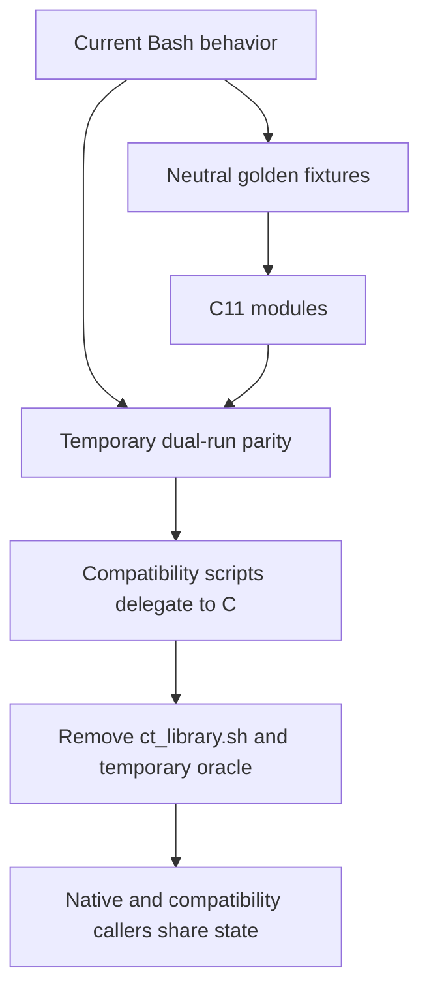
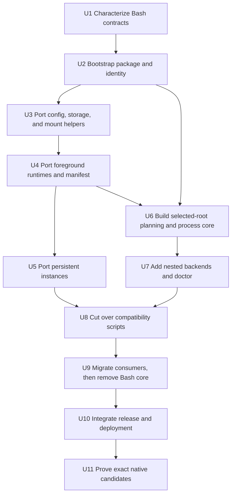

# Container Tools C11 Consolidation - Plan

## Goal Capsule

- **Objective:** Turn `container_tools` into an install-prefix-aware C11 product that owns current container behavior and host-root command execution while preserving existing script callers during migration.
- **Product authority:** This plan owns the `container_tools` product boundary, C11 transition, compatibility surface, package behavior, and absorption of host-bridge. It normatively inherits the approved standalone host-execution Product Contract while superseding only its separate repository, executable name, installation, artifact, release ownership, product-level architecture policy, and installed-file trampoline transport.
- **Execution profile:** Characterization-first, serial cross-repository migration through `container_tools`, `msk_containers`, and the workspace deployment boundary; one resource-intensive build or runtime suite at a time.
- **Stop conditions:** Stop before a cutover that changes established shell-visible behavior, writes an unrecognized state schema, weakens selected-root semantics, or lacks exact-source native evidence for a claimed backend or architecture.
- **Tail ownership:** Implementation owns coherent child commits and parent gitlinks. Pushes, releases, image publication, and deployment remain explicit operator actions.

---

## Product Contract

### Summary

`container_tools` becomes one regular C11 software package with a new statically linked `container-tools` executable, private build libraries, and configurable installation prefix. The host installation launches the original container and publishes the semantic bind manifest; an independently selected in-container installation uses that manifest to run a command inside a nested recreation of the selected program root without launching another image. Existing public `ct_*.sh` commands remain as C11-backed compatibility entry points until their consumers migrate.

### Problem Frame

The current Bash product already owns outer runtime selection, automatic mounts, host-root projection, semantic manifest publication, persistent-instance identity, runtime storage, and recovery. A separate C11 host-bridge would consume a protocol defined by `container_tools` while duplicating parsing, installation, release, architecture, and compatibility machinery.

The semantic manifest reveals the natural product boundary: one product should own both production and consumption of its cross-namespace contract. Replatforming that product in C11 also provides a stable executable interface for consumers, but existing deployments cannot require every wrapper to migrate at once.

### Key Decisions

- **One C11 product owns outer launch and host execution.** (session-settled: user-directed - chosen over a separate host-bridge repository and release: manifest production and consumption belong to one versioned product.)
- **Install as a regular prefix-based package.** (session-settled: user-directed - chosen over a product-managed version store: operators select host and in-container versions through `PATH` or direct executable/script paths.)
- **Expose one executable with a new interface.** (session-settled: user-approved - chosen over multiple executables or public library frontends: one CLI keeps versioning, installation, and behavior coherent.)
- **Keep package libraries private initially.** (session-settled: user-approved - chosen over a supported public C ABI: no current C consumer justifies permanent ABI carrying cost.)
- **Move all product behavior into C11.** (session-settled: user-approved - chosen over porting launch paths only or requiring a later core migration: sourced build, cache, state, mount, and lifecycle behavior need one authority.)
- **Preserve five compatibility scripts.** (session-settled: user-directed - chosen over migrating every wrapper in this plan: existing consumers continue calling `ct_exec.sh`, `ct_shell.sh`, `ct_instance_exec.sh`, `ct_mount_detector.sh`, and `ct_args.sh` after those commands delegate to C11.)
- **Remove the sourced implementation boundary.** (session-settled: user-directed - chosen over retaining `ct_library.sh`: direct sourcers migrate to executable subcommands and the C11 core becomes the only implementation.)
- **Migrate consumers explicitly and individually.** (session-settled: user-approved - chosen over a global switch or automatic fallback: each consumer adopts the new interface under its own tests.)
- **Treat existing behavior as the parity baseline.** (session-settled: user-approved - chosen over redesigning behavior during the language migration: intentional behavior changes remain separate product decisions.)
- **Share canonical state during migration.** (session-settled: user-approved - chosen over preview or split state: compatibility scripts and direct C11 consumers must safely reuse the same caches, manifests, locks, profiles, and persistent instances.)
- **Freeze the bind-manifest grammar for each product major.** (session-settled: user-approved - chosen over exact-version matching or runtime schema negotiation: independently selected host and in-container releases within one major must interoperate.)
- **Expose generic profile identity.** (session-settled: user-approved - chosen over a MkChad-specific core environment contract: lifecycle consumers may use the product identity without owning its hash semantics.)



### Actors

- A1. **Operator:** Installs and selects independent host and in-container package versions.
- A2. **Compatibility caller:** Uses an existing `ct_*.sh` command without migrating its invocation yet.
- A3. **Native CLI consumer:** Calls the new `container-tools` interface directly.
- A4. **Host installation:** Selects an outer runtime, prepares mounts and state, launches the container, and publishes the bind manifest.
- A5. **In-container installation:** Consumes the bound manifest and runs explicit commands inside a nested recreation of the selected program root within the original container.
- A6. **Lifecycle consumer:** Uses the generic persistent profile identity to reject incompatible reuse.

### Requirements

**Product and package identity**

- R1. `container_tools` must remain an independently versioned repository and become the source of one C11 software package.
- R2. The package must install beneath a caller-selected prefix and support selection through `PATH` or direct executable/script paths while resolving each invocation to one coherent package version.
- R3. The package must expose one new `container-tools` executable interface for outer launch, shell, persistent instances, mount inspection, configuration and storage helpers, diagnostics, and nested selected-root execution.
- R4. Package libraries must remain private implementation details in the first C11 product generation; installed headers and a supported public C ABI are not required.
- R5. The C11 implementation must own all behavior currently implemented by the `container_tools` shell family and `ct_library.sh`.
- R6. The package must absorb host-bridge behavior without creating a separate repository, release, installed artifact family, or product version.
- R7. Existing Docker, Podman, SingularityCE, and Apptainer outer-runtime support must remain in scope.
- R8. The C11 package must remain architecture-neutral across every architecture on which it and its external dependencies can be built and run; unavailable external backends are capability outcomes rather than product architecture exclusions.

**Independent host and in-container installations**

- R9. Host and in-container environments must be able to install different `container-tools` releases from the same product major.
- R10. The host installation must produce and bind the same semantic manifest contract for every eligible local non-dry SingularityCE, Apptainer, Docker, and Podman launch; dry runs produce none, and explicit remote Docker/Podman endpoints cannot claim a local host projection or manifest.
- R11. The in-container installation must consume the exact bound manifest to reconstruct eligible caller-visible overlays inside the nested command environment without searching host state, binding the host executable inward, or launching another image.
- R12. Host execution must use a profile-selected program root already visible inside the original container, defaulting to `/host` while allowing another mounted Linux root, and must apply eligible manifest overlays over that selected root.
- R13. A manifest produced by any release in one product major must be accepted by every other release in that major.
- R14. The manifest grammar must remain closed and unchanged within a product major; a grammar change requires a new product major.
- R15. A major mismatch or invalid manifest must fail before nested backend probing or command dispatch while ordinary container behavior remains usable.

**Behavioral and state parity**

- R16. C11 behavior must preserve the supported Bash baseline for runtime argv, environment, mounts, current directory, exit status, signals, diagnostics, dry runs, and failure boundaries.
- R17. C11 must preserve the canonical mount-plan bytes, digest rules, path semantics, role semantics, and stable selector behavior for the current product major.
- R18. C11 and compatibility-script callers must share the same state roots, locks, cache records, mount-plan records, persistent profile identities, pending creation records, and managed runtime instances during migration.
- R19. Mixed compatibility-script, direct C11, and co-installed host-version use must preserve concurrency, timeout, interruption, stale-state recovery, and unrelated-process safety; an unrecognized or incompatible state schema fails without reuse or mutation.
- R20. C11 must expose one generic complete persistent profile identity after all effective inputs are finalized.
- R21. Lifecycle consumers must be able to compare that identity without recomputing container-tools state or accepting a weaker partial identity.

**Compatibility shell surface**

- R22. `ct_exec.sh`, `ct_shell.sh`, `ct_instance_exec.sh`, `ct_mount_detector.sh`, and `ct_args.sh` must remain installed and independently invocable at the end of this plan.
- R23. Each retained script must preserve its supported command name, arguments, environment, exit behavior, and diagnostics while delegating implementation to the selected C11 package.
- R24. Retained scripts must not contain a legacy behavior fallback after C11 cutover.
- R25. Existing wrappers such as `nvim_shell`, `mkchad`, and the managed OpenCode launcher must continue working without migration to the new executable interface in this plan.
- R26. Consumers that adopt the new interface must switch explicitly; neither executable discovery nor runtime failure may silently select between Bash and C11 interfaces.
- R27. Compatibility scripts may be retired in later work only after every supported consumer has migrated and parity plus native runtime evidence passes.

**Removal of `ct_library.sh`**

- R28. Every direct source consumer of `ct_library.sh` must migrate to the new executable interface before the library script is removed.
- R29. Architecture/backend image-build scripts must retain their runtime storage and build-cache behavior after migrating from sourced functions to executable subcommands.
- R30. Tests that currently source `ct_library.sh` must move to public executable behavior or private C unit boundaries rather than preserving a shell API solely for tests.
- R31. `ct_library.sh` must be absent from the installed and repository product surface at the end of this plan.

**Release and integration**

- R32. Each package release must identify its executable, private build-library composition, compatibility scripts, protocols, documentation, and source commit as one coherent version; cross-prefix executable, script, or metadata mixing must fail explicitly.
- R33. Host deployment and image construction must select and verify the host and in-container package versions and provenance independently, including an allowed same-major version difference.
- R34. MkChad release/deployment metadata must retain one `container_tools` product component, separately record the host-installed and in-container package identities, and add no standalone host-bridge component or artifact family.
- R35. Existing container and host installers must preserve check, apply, verify, interruption, and recovery behavior while installing the prefix-based package and compatibility scripts.
- R36. Documentation and plans must stop presenting host-bridge as a separate product and must identify the new executable as the manifest producer and consumer.

**Inherited host execution authority**

- R37. The standalone host-bridge Product Contract is inherited as normative behavior except where this plan explicitly changes product ownership, executable naming, installation, artifact, release, product-level architecture, and internal trampoline transport boundaries. The inherited pre-existing trampoline-file destination is replaced by KTD12's verified descriptor plus required existing `/proc` directory contract.
- R38. Inherited behavior includes strict profiles and configuration discovery, visible-root and projection semantics, mount-plan validation, cwd and environment handling, Bubblewrap/PRoot/rewrite eligibility, bounded probes and cleanup, executable compatibility, doctor output, exact-once dispatch, explicit degradation consent, and Cargo/Slurm/repair outcomes.
- R39. The selected program root and manifest-derived overlays must be independent inputs: `/host` supplies the default invoking-host root, while another already-visible root can supply repair or test semantics without losing caller workspace and other eligible manifest projections.

### Key Flows

- F1. **Unmigrated wrapper launch:** A wrapper calls its existing `ct_*.sh` command, the compatibility entry point invokes the selected C11 package, and the payload observes parity behavior.
- F2. **Migrated consumer launch:** A consumer calls the new executable interface directly and uses the same runtime, state, and profile contracts as compatibility callers.
- F3. **Cross-install selected-root execution:** The selected host package launches the original container and binds its manifest; the independently selected in-container package validates that manifest and runs the command inside a nested recreation of the configured program root.
- F4. **Mixed persistent reuse:** Compatibility and direct C11 callers contend under the same locks and reuse only a persistent instance with the exact matching canonical profile.
- F5. **Prefix-selected installation:** An operator installs host and in-container packages under different prefixes and selects each through its environment or an exact path without changing protocol behavior.
- F6. **Build caller migration:** An image-build script replaces sourced `ct_library.sh` calls with executable operations while retaining architecture-specific cache and runtime storage behavior.
- F7. **Later compatibility retirement:** A later change proves zero supported script callers and accepted parity evidence before removing compatibility entry points.

### Acceptance Examples

- AE1. Given existing `nvim_shell`, `mkchad`, and managed OpenCode wrappers, installing the C11 package and compatibility scripts preserves their current invocations and payload results without wrapper edits.
- AE2. Given representative Docker, Podman, SingularityCE, and Apptainer inputs, Bash-baseline fixtures and C11-backed compatibility commands produce the same effective runtime argv, state records, statuses, and bounded failure classes; eligible non-dry local launches also produce the same manifest bytes, while dry and explicit-remote automatic launches produce none.
- AE3. Given a host `1.x` package and a different in-container `1.y` package, a complete valid major-1 manifest supports selected-root execution without binding the host package inward or launching another image.
- AE4. Given host and in-container packages from different majors, selected-root execution refuses the manifest before backend probing while the ordinary original-container command remains usable.
- AE5. Given packages installed under two different prefixes, changing `PATH` or the exact invoked path selects one complete intended package without rewriting files; an executable, script, or package-metadata mismatch across prefixes fails explicitly.
- AE6. Given compatibility and direct C11 callers start the same persistent profile concurrently, one instance is created or reused under the shared lock and neither caller signals or adopts unrelated state.
- AE7. Given a profile input, mount plan, runtime selection, or effective identity changes, both compatibility and direct callers select the same new profile identity and leave the old instance untouched.
- AE8. Given each current image-build script, replacing `ct_library.sh` sourcing with executable operations preserves configured cache/tmp paths, Buildx cache rotation, architecture separation, and failure behavior.
- AE9. Given a retained public script, removing or breaking the C11 executable fails explicitly and never executes a legacy fallback implementation.
- AE10. Given the C11 cutover is complete, the repository and installed package contain the five compatibility scripts but no `ct_library.sh`, and no non-test source attempts to source it.
- AE11. Given release/deployment metadata for the consolidated product, one `container_tools` product component separately identifies and verifies the selected host and in-container package versions, source provenance, and same-major compatibility without a standalone host-bridge gitlink or artifact.
- AE12. Given the default `/host` program root or another already-visible mounted Linux root, the in-container executable preserves the approved manifest overlays, argv, cwd, environment, descriptor, signal, backend ordering, degradation-consent, and no-double-dispatch behavior within the original container.
- AE13. Given another supported architecture with a working C11 toolchain, the package core builds and runs while each unavailable external nested backend is reported as a capability result rather than an architecture-wide product exclusion.

### Scope Boundaries

**In scope**

- C11 ownership of all current container-tools behavior.
- Host-bridge absorption as an executable capability.
- Prefix-based package installation with private libraries.
- Shared state and behavior parity between compatibility and direct callers.
- Migration of every direct `ct_library.sh` source consumer.
- Five retained C11-backed compatibility command scripts.
- Release, deployment, image, documentation, and plan reconciliation required by the new product boundary.

**Deferred for later**

- Migrating wrappers that can continue through retained compatibility scripts.
- Removing the five compatibility scripts after all supported consumers migrate.
- A supported public C library ABI and installed development headers.
- Distribution-specific packaging beyond the configurable prefix installation contract.

**Outside this product's identity**

- A separate host-bridge repository, release, installer, or version.
- Product-managed version stores or selectors that replace ordinary prefix and environment selection.
- Automatic fallback from the new executable interface to the legacy Bash implementation.
- Exact host/in-container release matching within one product major.
- A security sandbox, privilege boundary, or container runtime replacement.

### Dependencies And Assumptions

- The current automatic host-root projection and `ct-mount-plan-v1` implementation are the behavioral baseline rather than work to rediscover.
- Bubblewrap, PRoot, outer container runtimes, and architecture toolchains remain external dependencies with existing capability gates.
- Current shell tests, runtime evidence contracts, and persisted records are available as parity fixtures for planning and implementation.
- Same-major compatibility applies to the cross-install bind manifest. Shared host state uses explicit schemas and permits only recognized safe reuse; future or incompatible state fails closed rather than gaining an all-state same-major compatibility promise.
- Existing live MkChad configuration and runtime state remain protected and are not migration fixtures.

<!-- ce-section: work-relationships -->
### How This Work Fits Together

This plan owns the consolidated `container_tools` product and replaces the current separate-product direction. The relationships below orient planning; they are not a committed implementation sequence.

- **Provides the baseline:** `docs/plans/2026-08-06-001-feat-automatic-host-root-projection-plan.md` defines the implemented projection, manifest, profile, and evidence behavior that C11 must preserve.
- **Remains a capability prerequisite:** `docs/plans/2026-08-04-002-feat-host-bridge-container-prerequisites-plan.md` continues to supply Bubblewrap, PRoot, and toolchains for maintained images, but its separate executable and product-level architecture exclusions must be reconciled.
- **Is superseded only for product ownership, architecture policy, and trampoline transport:** `docs/plans/2026-08-04-003-feat-standalone-host-bridge-plan.md` remains the normative host-execution behavior contract, but host-bridge no longer becomes an independent repository, executable product, installation, artifact, or release, its product-level architecture exclusions do not carry forward, and its pre-existing installed trampoline-file destination is replaced by KTD12's descriptor transport.
- **Must be reframed:** `docs/plans/2026-08-04-004-feat-mkchad-host-bridge-integration-plan.md` must consume the in-container package, remove the host binary bind and standalone artifact, and retain its lifecycle and native evidence goals.
- **Enables later work:** Consumer-by-consumer migration to the direct executable interface and final compatibility-script retirement occur after this plan.

### Sources And Research

- Current product contract and manifest protocol: `msk_containers/container_tools/README.md`.
- Current shell implementation: `msk_containers/container_tools/ct_library.sh`, `msk_containers/container_tools/ct_exec.sh`, `msk_containers/container_tools/ct_shell.sh`, `msk_containers/container_tools/ct_instance_exec.sh`, `msk_containers/container_tools/ct_mount_detector.sh`, and `msk_containers/container_tools/ct_args.sh`.
- Current callers: `msk_containers/nvim/bin/`, architecture/backend image-build scripts under `msk_containers/nvim/`, and `msk_containers/bin/install_tools.sh`.
- Current release/deployment ownership: `deploy/release.json`, `deploy/release-v2.schema.json`, and `deploy/mkchad_deploy.py`.
- Host execution semantics to retain: `docs/plans/2026-08-04-003-feat-standalone-host-bridge-plan.md`.
- MkChad integration outcomes to retain: `docs/plans/2026-08-04-004-feat-mkchad-host-bridge-integration-plan.md`.

### Outstanding Questions

No launch-blocking questions remain. Exact dependency commits, package versions, and release checksums are implementation outputs that must be pinned and recorded before their corresponding changes are committed.

---

## Planning Contract

**Product Contract preservation:** changed: R2, R32, AE5, the package Summary, and the matching prefix-install Key Decision remove `LD_LIBRARY_PATH` as a package-version selector and make private libraries build-time-only. R37 also replaces the inherited installed trampoline-file destination with the verified executable-descriptor transport required by the selected static package. The user selected a statically linked executable after review proved that dynamic cross-prefix selection contradicted exact package coherence and selected-root execution.

### Key Technical Decisions

- KTD1. **Build one static C11 executable with CMake and CTest.** (session-settled: user-directed - chosen over a dynamic package plus separate trampoline or library-authoritative LD selection: one relocatable executable preserves exact package coherence and can enter any selected root that satisfies the inherited compatibility requirements without installing package files there.) The child repository organizes implementation as private static build libraries, links project and vendored code into `container-tools`, adds deterministic C tests and install rules, and exports no library API or runtime library artifact.
- KTD2. **Use two pinned parsers and a project-owned digest implementation.** Retain the previously selected `tomlc17` tag `R260618` at commit `7813bdd218b2b5f54940a9759ec0ffb3b60c1d1f` for strict TOML profiles, vendor one reviewed `yyjson` release for bounded JSON input/output, and keep SHA-256 in project-owned C so protocol identity does not depend on an external command or crypto runtime. Each vendored tree records its exact commit, upstream URL, license, and unmodified-file digest.
- KTD3. **Dual-license project-owned C under Apache-2.0 OR MIT.** (session-settled: user-directed - chosen over a single permissive license: package consumers may use either license while vendored dependencies retain their upstream notices.) Add `LICENSE-APACHE` and `LICENSE-MIT`, SPDX-identify project-owned source, and include all notices in installed and release packages.
- KTD4. **Use a noun-oriented subcommand hierarchy.** Public native entry points are `exec`, `shell`, `instance exec`, `instance identity`, `mount detect`, `mount args`, `runtime exec`, `buildx exec`, `host exec`, `host doctor`, and `package verify`. Global `--version` and `--version --json` identify the package before any state or backend access.
- KTD5. **Preserve compatibility through package-relative trampolines.** Each retained `ct_*.sh` file performs only strict package resolution and `exec`s its matching native operation through an internal `compat` dispatch. It contains no product logic, parsing fallback, state access, backend detection, or shell reconstruction.
- KTD6. **Make exact package coherence self-verifying.** Install the executable and compatibility scripts in `bin/` and metadata in `share/container-tools/`. The statically linked executable embeds exact package version, source commit, package epoch, and build identity. Compatibility scripts carry the same generated identity and invoke the sibling executable, so cross-prefix script, executable, or metadata mixing fails before command parsing or state access.
- KTD7. **Characterize Bash before replacing it.** Capture checked-in golden inputs and outputs for argv, environment, diagnostics, exit phases, mount plans, state files, and profile digests while `ct_library.sh` is still authoritative. Also retain closed, redacted, exact-source native Bash baseline reports and the immutable local parity-image identity for every outer-runtime and architecture combination later claimed by C. During the port, run Bash and C against the same isolated fixtures; after parity is established, remove the executable Bash oracle but retain neutral golden vectors, accepted native baseline reports, parity-image identities, and public integration tests.
- KTD8. **Preserve current state bytes unless a schema change is required.** C readers and writers first implement the existing selection records, mount-plan records, pending records, and persistent profile contracts byte-for-byte. Any unavoidable schema change is additive, versioned, recognized by both migration paths before a writer emits it, and tested for old/current/future handling; otherwise no schema number changes during the language migration.
- KTD9. **Keep `ct-mount-plan-v1` the product-major-1 wire contract.** The C producer and consumer share one bounded parser/serializer and one golden corpus, but interoperability tests still treat them as independent installations. Product major 1 never adds fields, roles, optional extensions, alternate discovery, or negotiation to this grammar; a future grammar maps to a future product major.
- KTD10. **Run children directly, never through reconstructed shell text.** Runtime, build-cache, persistent-instance, nested-backend, and payload execution use argv/environment arrays plus `execve` or `posix_spawn`-appropriate process supervision. `runtime exec` applies selected runtime storage to one child command, while `buildx exec` holds the cache generation lock across the child and commits or discards the generation from the child outcome.
- KTD11. **Expose canonical profile identity through the instance interface.** `instance identity` accepts the same profile-affecting inputs as `instance exec`, performs the same bounded preparation needed to finalize effective runtime, mount, identity, and selected-root inputs, and prints exactly one lowercase 64-hex digest by default. Preparation may acquire canonical locks, run cold capability probes, publish recognized cache or mount-plan records, and recover owned temporary state, but it never creates, contacts, or signals a persistent instance and never dispatches a payload. Failure before finalization emits no digest. `--json` emits a closed versioned object for tooling. `instance exec` injects the same digest through the reserved environment contract after rejecting caller overrides.
- KTD12. **Absorb the approved host-execution design as internal modules.** Strict TOML profiles, exact manifest consumption, path/environment planning, process supervision, Bubblewrap, PRoot, rewrite, doctor JSON, and exact-once dispatch follow `docs/plans/2026-08-04-003-feat-standalone-host-bridge-plan.md`. The parent opens and verifies the current static executable, preserves that descriptor across the probe or launch, projects the caller's existing `/proc` at target `/proc`, and invokes the internal trampoline through `/proc/self/fd/N`; the child compares its embedded build identity with a bounded internal control record and requires no prefix metadata or file destination inside the selected root. A root without a usable type-compatible `/proc` target is incompatible without mutation. Names, install layout, release ownership, supported architecture policy, and the default manifest-enabled `/host` profile follow this plan instead.
- KTD13. **Package source and static native archives without an architecture allowlist.** CMake source installs remain the portability baseline. Maintained x86_64 and AArch64 archives use the already-provisioned native musl toolchain; PPC64LE uses native GCC plus Fedora `glibc-static`, which U9 adds and records in the package-selection ADR. The C core avoids static-glibc facilities that require runtime-loaded NSS or locale modules, and archive metadata records libc family and toolchain identity. Other architectures may use any verified C11 static toolchain rather than being rejected by a hard-coded product list.
- KTD14. **Keep one release component with two independently verified roles.** The `container_tools` release component records closed host-package and in-container-package identity objects, each containing version, product major, architecture, source commit, and archive or installed-tree digest. Their versions may differ when majors match. Host package installation and image package verification remain separate actions under that one component.
- KTD15. **Make `CT_ROOT` a complete package-bin override.** (session-settled: user-directed - chosen over a second development-executable variable or in-tree build output: a C package cannot preserve an unbuilt source checkout as an executable package.) `CT_ROOT` names an absolute directory containing the static executable and all five matching compatibility scripts. Development builds install to an isolated prefix and point `CT_ROOT` at that prefix's `bin/`; raw source checkouts fail with the existing unusable-root class before launch.

### Public CLI Contract

| Interface | Responsibility | Compatibility owner |
|---|---|---|
| `container-tools exec ...` | Non-interactive outer runtime launch and exact payload status | `ct_exec.sh` |
| `container-tools shell ...` | Interactive outer runtime shell launch | `ct_shell.sh` |
| `container-tools instance exec ...` | Create, reuse, and execute in one canonical persistent instance | `ct_instance_exec.sh` |
| `container-tools instance identity ...` | Emit the finalized persistent profile identity without creating or contacting an instance | Native interface |
| `container-tools mount detect ...` | Emit the current mount-detector contract | `ct_mount_detector.sh` |
| `container-tools mount args ...` | Convert mount configuration to detector arguments without shell evaluation | `ct_args.sh` |
| `container-tools runtime exec --backend NAME -- COMMAND...` | Apply validated runtime storage/configuration to one runtime or build child | Migrated image-build scripts |
| `container-tools buildx exec --architecture ARCH -- COMMAND...` | Hold, rotate, commit, or discard the architecture cache generation around one Buildx child | Migrated Docker build scripts |
| `container-tools host exec [PROFILE OPTIONS] -- COMMAND...` | Run one command in the nested selected-root environment inside the original container | Consolidated host execution |
| `container-tools host doctor [PROFILE OPTIONS] [--json]` | Report bounded selected-root and backend capability without payload dispatch | Consolidated diagnostics |
| `container-tools package verify [--json]` | Verify executable/package-metadata coherence and report immutable identity | Installers and deployment |

Compatibility mode preserves each script's current option grammar and diagnostics. Native subcommands may organize help text differently, but they use the same option names for shared launch behavior and require `--` wherever command-boundary ambiguity exists. Unknown options, duplicate singleton options, malformed values, and package mismatches fail before backend or state access.

`buildx exec` requires its child argv to begin with `docker buildx build`, rejects caller-supplied `--cache-from` and `--cache-to` transaction flags, and inserts the generated architecture-specific cache arguments before the caller's build arguments. It holds the generation lock through that exact child and commits or discards the generation from the child's exact outcome.

### Package And Protocol Layout

```text
PREFIX/
  bin/container-tools
  bin/ct_exec.sh
  bin/ct_shell.sh
  bin/ct_instance_exec.sh
  bin/ct_mount_detector.sh
  bin/ct_args.sh
  share/container-tools/release.json
  share/container-tools/examples/
  share/container-tools/licenses/
  share/container-tools/protocols/
```

- CMake uses GNU installation directories and computes relative install paths; no compiled default contains the build checkout or one operator's prefix.
- Private static build libraries have no install rules, installed headers, linker names intended for third parties, `pkg-config` files, or CMake package exports.
- `release.json` and `--version --json` share a closed schema containing product version, product major, package epoch, architecture, source commit, build identity, manifest grammar, and component digests.
- A native archive contains one top-level versioned directory with the relative prefix tree, README, both project licenses, vendored notices, release metadata, and an external checksum. Links, devices, duplicate names, traversal, absolute paths, unknown files, and identity mismatches are invalid.
- Source installs and archives use the same `package verify` checks. `LD_LIBRARY_PATH` does not select package versions and does not affect the statically linked package; same-major protocol compatibility never permits an exact package-internal mismatch.
- `CT_ROOT` uses the same package boundary as `PATH` and exact invocation: it must resolve to the `bin/` directory of one complete verified prefix. It is not a source-tree discovery mechanism or build-output selector.

### Package Delivery Contract

- `scripts/build-package.sh` configures, builds, tests, installs, and archives one exact source commit for one native architecture. Required inputs are an absolute disposable build root, semantic product version, exact 40-hex source commit, and output directory. It refuses a dirty or mismatched source identity and emits the archive plus checksum without changing an existing output.
- `scripts/verify-package.sh` accepts an archive, expected SHA-256, expected version, expected source commit, and expected architecture. It bounds and validates the archive layout, rejects links, devices, traversal, duplicates, and extras, extracts privately, compares `release.json` with `container-tools --version --json` and `package verify --json`, verifies static linkage and machine identity, and leaves no selected installation.
- `scripts/install-package.sh` accepts exactly one of `--check`, `--apply`, or `--verify` plus the same archive identity, an absolute prefix, and a private recovery directory for apply. Check and verify are mutation-free. Apply takes the prefix installer lock, stages and revalidates all files, records replaced files and transaction state privately, exposes only fail-closed identity mixes, and completes or restores an interrupted transaction without deleting unrelated prefix contents.
- A release manifest keeps one `container_tools` component and adds a `container-tools-package` artifact array. Each closed entry has `role` (`host` or `container`), architecture, version, product major, source commit, SHA-256, libc family, and source filename class. Host and container entries may name different same-major versions and commits.
- Release and developer deployment accept one explicit host-package archive, privately stage it, and resolve only schema-defined package tokens. The `container_tools` component owns ordered `container-tools-package-preflight`, `container-tools-package-install`, and `container-tools-package-verify` actions that invoke its installer; package preflight precedes host-tool and image mutation, apply precedes host-tool installation, and verify precedes terminal success.
- The independently built in-container archive is staged into the image build context and its identity is recorded in image metadata. Image preflight and final verification compare that metadata and an isolated in-image `package verify` result with the release's `container` artifact entry. Terminal results report expected and observed host/container package identities without package contents, environment, or prefix inventory.
- MkChad release and developer deployment expand `container_tools_host_prefix` to `${HOME}/.local`, preserving the current host command location. Maintained images install their selected package beneath `/opt/msk/container-tools` and prepend `/opt/msk/container-tools/bin` to image `PATH`; other source/package consumers remain free to choose another prefix explicitly.

The closed deployment tokens are `staged_container_tools_host_package`, `container_tools_host_sha256`, `container_tools_host_version`, `container_tools_host_source_commit`, `container_tools_host_prefix`, `native_architecture`, and the existing `recovery_dir`. Callers supply package archives, never token values. The three component actions are:

| ID | Phase | Child path | Required arguments |
|---|---|---|---|
| `container-tools-package-preflight` | preflight | `scripts/install-package.sh` | `--check`, staged archive, expected digest/version/commit/architecture, target prefix |
| `container-tools-package-install` | apply | `scripts/install-package.sh` | `--apply`, the same identity and prefix, private recovery directory |
| `container-tools-package-verify` | verify | `scripts/install-package.sh` | `--verify`, the same identity and prefix |

### State And Migration Contract



- Golden fixtures distinguish semantic values from presentation. Byte contracts such as NUL framing, digests, manifest records, cache/state files, JSON schemas, and exact argv remain byte-exact; human diagnostics compare typed code, phase, and bounded stable text where paths or tool output vary.
- Fixture generation uses isolated paths below `/tmp/mkchad-v1/container-tools-c11`; no fixture reads or writes protected MkChad live state.
- C takes authority one feature slice at a time behind test-only selection. A public compatibility script switches only after its entire supported matrix passes against C and shared-state concurrency tests include mixed old-script and direct-C callers.
- Final source and installed-package scans reject `ct_library.sh`, shell sourcing of it, legacy implementation fallback, and tests whose only purpose is preserving a private shell API.
- Rollback within product major 1 is data-compatible because final C writers preserve current recognized bytes. An older implementation encountering a deliberately future schema must fail without reuse or mutation rather than being made permissive for rollback.

### Selected-Root Execution Contract

- `host exec` defaults to profile discovery under the `container-tools` namespace and an installed example profile whose program root is `/host` and whose exact manifest selector is `/.container-tools-mount-plan`.
- The profile grammar and backend behavior remain those specified by the inherited host-execution Product Contract: strict unknown-field rejection, bounded reads, no path canonicalization requirement, Bubblewrap then PRoot capability probing, explicit rewrite consent, and one final dispatch.
- The manifest parser accepts only the current product-major grammar and exact bound selector supplied by the outer launch. It never searches host state, imports a host executable or library, or launches Docker, Podman, SingularityCE, or Apptainer from inside the container.
- Root mappings, eligible semantic manifest overlays, and configured projections are merged into one deterministic parent-before-child plan. Exact-target conflicts fail; Bubblewrap cannot create missing destinations in the lower root; read-only requirements capability-filter PRoot and rewrite.
- `host doctor --json` retains the inherited closed capability and reason model under a `container-tools.host-doctor/v1` schema. Human output may improve independently, but automation consumes only JSON and exit status.

### Implementation Constraints

- Compile as C11 with GCC and Clang under `-Wall -Wextra -Wpedantic -Werror` plus selected conversion, shadow, format, and missing-prototype diagnostics.
- Bound every external file, record count, diagnostic, subprocess, lock wait, and cleanup interval. Malformed external data returns typed errors; it never reaches `abort()` or unchecked allocation arithmetic.
- Keep module headers private under `src/`; document every affected public CLI, schema, config field, exit behavior, and side effect in `README.md` or `docs/`.
- Preserve argv as byte strings on Linux. Do not use `system`, `popen`, `eval`, shell-quoted command strings, presentation-oriented runtime listings, or unbounded command substitution as machine interfaces.
- Keep selected-root probes non-mutating, run-owned cleanup identity-bound, and fallback impossible after the dispatch boundary. Signal only owned process groups and persistent instances whose canonical creation identity matches.
- Keep default tests deterministic, credential-free, network-free, cluster-free, and independent of real container runtimes. Real runtime and architecture claims come only from opt-in exact-source reports.
- Perform child implementation and commits serially: `container_tools`, then its `msk_containers` gitlink and consumers, then workspace release/deployment integration and parent gitlink.
- Use task-specific directories beneath `/tmp/mkchad-v1/container-tools-c11`; run no more than one resource-intensive build, image, or native runtime suite at a time.

### Sequencing



### Requirement Traceability

| Unit | Requirements | Flows | Acceptance examples |
|---|---|---|---|
| U1 | R16-R19, R23, R28-R30 | F1-F2, F4, F6 | AE1-AE2, AE6-AE10 |
| U2 | R1-R4, R8, R32 | F5 | AE5, AE13 |
| U3 | R3, R5, R16, R28-R30 | F1-F2, F6 | AE2, AE8, AE10 |
| U4 | R5, R7, R10, R14-R19 | F1-F4 | AE1-AE4, AE6-AE7 |
| U5 | R18-R21 | F4 | AE6-AE7 |
| U6 | R6, R11-R17, R37-R39 | F3 | AE3-AE4, AE12-AE13 |
| U7 | R6, R8, R11-R17, R37-R39 | F3 | AE3-AE4, AE12-AE13 |
| U8 | R5, R18, R22-R27, R30 | F1-F2, F4, F7 | AE1-AE2, AE6-AE9 |
| U9 | R25, R28-R31, R33, R35 | F1, F5-F6 | AE1, AE5, AE8, AE10 |
| U10 | R32-R36 | F5 | AE5, AE11 |
| U11 | R7-R19, R27, R32-R35, R37-R39 | F1-F6 | AE1-AE13 |

### Risks And Mitigations

| Risk | Impact | Mitigation | Required proof |
|---|---|---|---|
| Bash behavior is inferred rather than captured | Silent launch or diagnostic regressions | Freeze neutral golden vectors before moving authority | Dual-run parity over every public script and state format |
| Script, executable, and metadata come from different prefixes | Wrong behavior or provenance interpretation | Sibling resolution and exact startup identity handshake | Mixed-prefix PATH/direct-path matrix fails before state access |
| C emits a subtly different canonical record | Split caches, profiles, or persistent instances | Shared byte fixtures and no schema bump without necessity | Cross-reader/writer and digest tests in both directions |
| A same-major consumer accepts a grammar extension differently | Wrong nested overlays or cross-project routing | Freeze `ct-mount-plan-v1` and test every prior/current producer-consumer pair | Golden corpus plus cross-version package matrix |
| Ported process supervision retries after dispatch or signals unrelated work | Duplicate side effects or user-work loss | Explicit dispatch boundary, owned process groups, canonical creation identity | Injected failures, PID reuse, interruption, and unrelated-process tests |
| Build cache helper exits before the build and loses lock/transaction semantics | Corrupt or cross-architecture Buildx cache | `buildx exec` owns the child and transaction lifecycle | Success, failure, signal, stale generation, and concurrent architecture tests |
| A static package archive does not run on an older supported host | Deployment unavailable | Record libc/toolchain baseline, retain source install, and run exact archives natively | Native package verification on every claimed release environment |
| Selected-root backend appears available but mutates or incompletely overlays the root | Wrong host-tool behavior | Exact-profile probes, pre-existing Bubblewrap targets, closed manifest merge | Unchanged-root and layered Cargo/Slurm/repair fixtures |
| Release schema records one package while image contains another | Unreproducible host/container interoperability | Separate host and in-container identity objects under one component | Manifest admission and installed/image `package verify` comparison |
| Native runtime evidence comes from different source or image bytes | False support claim | Closed reports bind source, package, image, runtime, and cleanup digests | Coordinator validation against final commits and immutable artifacts |

---

## Implementation Units

### Unit Index

| Unit | Title | Primary files | Depends on |
|---|---|---|---|
| U1 | Characterize the Bash baseline | `msk_containers/container_tools/tests/fixtures/`; existing shell tests | None |
| U2 | Bootstrap the C11 package | `msk_containers/container_tools/CMakeLists.txt`; `src/`; `vendor/` | U1 |
| U3 | Port config, storage, and mount helpers | `src/config.c`; `src/storage.c`; `src/mount.c` | U2 |
| U4 | Port outer runtime launch and manifests | `src/runtime.c`; `src/mount_plan.c`; foreground tests | U3 |
| U5 | Port persistent instances and identity | `src/instance.c`; `src/profile.c`; instance tests | U4 |
| U6 | Build selected-root planning and process core | `src/host_config.c`; `src/supervisor.c`; `src/path_map.c` | U2; completion gated by U4 |
| U7 | Add nested backends and doctor | `src/backend_*.c`; `src/doctor.c`; backend tests | U6 |
| U8 | Cut over compatibility scripts | five `ct_*.sh` files; integration tests | U5, U7 |
| U9 | Migrate consumers, remove Bash core, and integrate packages | `ct_library.sh`; `msk_containers/bin/`; `msk_containers/nvim/`; `msk_containers/tests/` | U8 |
| U10 | Integrate release and deployment | `deploy/`; deployment tests; superseded plans | U9 |
| U11 | Prove exact native candidates | runtime evidence runners and release docs | U10 |

### U1. Characterize The Bash Baseline

- **Goal:** Freeze implementation-neutral parity evidence before replacing any shell authority.
- **Requirements:** R16-R19, R23, R28-R30; F1-F2, F4, F6; AE1-AE2, AE6-AE10.
- **Files:** `msk_containers/container_tools/tests/bootstrap_test.sh`; `msk_containers/container_tools/tests/instance_exec_test.sh`; `msk_containers/container_tools/tests/host_projection_test.sh`; `msk_containers/container_tools/tests/runtime_config_test.sh`; `msk_containers/container_tools/tests/host_projection_runtime_test.sh`; new `msk_containers/container_tools/tests/fixtures/bash-baseline/`; new `msk_containers/container_tools/tests/fixtures/native-bash-baseline/`; new `msk_containers/container_tools/tests/parity_test.sh`.
- **Approach:** Refactor fixtures so one driver can invoke the current Bash implementation and a later installed C package under isolated HOME, XDG, runtime, and fake-backend roots. Record exact machine contracts and typed human outcomes without copying `ct_library.sh` into the permanent fixture tree. Extend the existing native runner's closed schema with a Bash-baseline evidence kind bound to exact source, runtime, architecture, one retained immutable local parity image, semantic results, operation classes, and cleanup; accepted redacted reports and parity-image identities remain durable evidence after the oracle is removed.
- **Test scenarios:** All four outer runtimes; exec/shell/bootstrap; mount arguments with spaces and delimiters; dry and remote no-manifest paths; direct/fallback/none projection; runtime config; Buildx cache success/failure; persistent create/reuse/mismatch/concurrency/interruption; every current recognized state schema; malformed/future records; argv/status/signal/diagnostic phase; source mutation during launch; native baseline report schema, source/image binding, redaction, unavailable outcome, and exact cleanup.
- **Verification:** Run all five existing deterministic suites against Bash, regenerate neutral fixtures twice and prove byte-identical output, then run native Bash baseline commands for every runtime/architecture combination intended for a later parity claim. Resolve and retain each local Docker image ID or staged SIF digest as the immutable parity image through U11. Validate and retain accepted reports; an unavailable or unretained combination remains unclaimed. Run `bash -n`, ShellCheck, and `git diff --check`.
- **Dependencies:** None.

### U2. Bootstrap The C11 Package And Coherent Identity

- **Goal:** Establish the prefix-installable static package, dependency boundary, public CLI parser, and fail-closed package identity before implementing behavior.
- **Requirements:** R1-R4, R8, R32; F5; AE5, AE13.
- **Files:** new `msk_containers/container_tools/CMakeLists.txt`; new `msk_containers/container_tools/cmake/ContainerToolsWarnings.cmake`; new `msk_containers/container_tools/src/main.c`; new `msk_containers/container_tools/src/cli.c`; new `msk_containers/container_tools/src/package.c`; private headers under `msk_containers/container_tools/src/`; new `msk_containers/container_tools/vendor/tomlc17/`; new `msk_containers/container_tools/vendor/yyjson/`; new `msk_containers/container_tools/LICENSE-APACHE`; new `msk_containers/container_tools/LICENSE-MIT`; new `msk_containers/container_tools/tests/test_cli.c`; new `msk_containers/container_tools/tests/test_package.c`.
- **Approach:** Create private static build libraries and link one static executable, generate immutable release/build identity into the executable and scripts, and install the fixed layout. Implement global help/version plus closed subcommand parsing and `package verify`; all behavior subcommands may return a typed not-implemented result only within this unit and cannot be released in that state.
- **Test scenarios:** Every subcommand and separator shape; unknown/duplicate options; empty and non-UTF-8 argv; paths with spaces; source and two-prefix installs; PATH selection; exact executable path; static ELF identity; script or metadata mismatch fixture; moved complete prefix; incomplete prefix; version JSON schema; x86_64/AArch64/PPC64LE detection without an allowlist; vendored revision/license drift.
- **Verification:** Configure, build, install twice under separate `/tmp/mkchad-v1/container-tools-c11` prefixes, run focused CTest targets with GCC and Clang, and verify each complete and intentionally mixed prefix.
- **Dependencies:** U1.

### U3. Port Configuration, Storage, And Mount Helpers

- **Goal:** Replace sourced configuration, storage, mount detection, and Buildx cache functions with direct C operations.
- **Requirements:** R3, R5, R16, R28-R30; F1-F2, F6; AE2, AE8, AE10.
- **Files:** new `msk_containers/container_tools/src/config.c`; new `msk_containers/container_tools/src/storage.c`; new `msk_containers/container_tools/src/mount.c`; new `msk_containers/container_tools/src/buildx.c`; new `msk_containers/container_tools/src/process.c`; new `msk_containers/container_tools/tests/test_config.c`; new `msk_containers/container_tools/tests/test_storage.c`; new `msk_containers/container_tools/tests/test_mount.c`; new `msk_containers/container_tools/tests/test_buildx.c`; `msk_containers/container_tools/tests/runtime_config_test.sh`; baseline fixture files from U1.
- **Approach:** Implement the current `ct_runtime.conf` grammar and path safety, exact runtime environment selection, mount detector/argument output, and architecture-keyed Buildx generation transaction. `runtime exec` and `buildx exec` supervise one argv-preserved child so environment and locks remain in scope until commit, discard, signal cleanup, or timeout.
- **Test scenarios:** Missing/default/explicit config; comments, spaces, malformed and unknown keys; unsafe or unavailable storage roots; SingularityCE/Apptainer/Docker/Podman environment; mount config parity and malformed entries; Buildx cold/warm generations, architecture separation, held lock, stale pending generation, child 0/nonzero/signal outcome, interruption, failed commit, concurrent callers, and unrelated files untouched.
- **Verification:** Run focused CTest targets, the Bash/C parity driver for helper vectors, runtime config integration tests through the installed executable, sanitizers, and static analysis.
- **Dependencies:** U2.

### U4. Port Foreground Runtime Launch And Semantic Manifests

- **Goal:** Make C authoritative for nonpersistent exec/shell launch, host projection, mount-plan publication, and all four outer backends.
- **Requirements:** R5, R7, R10, R14-R19; F1-F4; AE1-AE4, AE6-AE7.
- **Files:** new `msk_containers/container_tools/src/runtime.c`; new `msk_containers/container_tools/src/backend_outer.c`; new `msk_containers/container_tools/src/host_projection.c`; new `msk_containers/container_tools/src/mount_plan.c`; new `msk_containers/container_tools/src/sha256.c`; new `msk_containers/container_tools/tests/test_runtime.c`; new `msk_containers/container_tools/tests/test_host_projection.c`; new `msk_containers/container_tools/tests/test_mount_plan.c`; `msk_containers/container_tools/tests/bootstrap_test.sh`; `msk_containers/container_tools/tests/host_projection_test.sh`; `msk_containers/container_tools/tests/host_projection_runtime_test.sh`; `msk_containers/container_tools/README.md`.
- **Approach:** Port parser, mount ordering, endpoint classification, cold selection, warm records, generated projection, alias protection, semantic profile fields, and content-addressed `ct-mount-plan-v1` publication without changing bytes or state roots. Render backend argv directly and cross the dispatch boundary once.
- **Test scenarios:** AE2-AE4; local versus explicit remote Docker/Podman; all host-root modes; direct/fallback/none and cache hit/miss/refresh; mountinfo escapes and network filesystems; reserved selector conflicts; all manifest roles and tuple bounds; final NUL/count/digest/version failures; alias write/rename/unlink protection; dry run; payload statuses and signals; timeout/interruption cleanup; source change; no second payload; golden manifest corpus for every prior major-1 release.
- **Verification:** Run focused CTest targets, installed-package bootstrap/projection suites, parity against every U1 foreground fixture, shell/static-analysis gates for harnesses, and deterministic fake-runtime report validation.
- **Dependencies:** U3.

### U5. Port Persistent Instances And Canonical Identity

- **Goal:** Make C authoritative for profile finalization, concurrent create/reuse, bounded recovery, and the generic identity interface.
- **Requirements:** R18-R21; F4; AE6-AE7.
- **Files:** new `msk_containers/container_tools/src/profile.c`; new `msk_containers/container_tools/src/instance.c`; new `msk_containers/container_tools/src/state.c`; new `msk_containers/container_tools/tests/test_profile.c`; new `msk_containers/container_tools/tests/test_instance.c`; `msk_containers/container_tools/tests/instance_exec_test.sh`; `msk_containers/container_tools/tests/host_projection_test.sh`; `msk_containers/container_tools/tests/host_projection_runtime_test.sh`; `msk_containers/container_tools/README.md`.
- **Approach:** Preserve profile v3 and pending-record bytes, finalize identity after all effective mounts and identities, expose it through `instance identity`, and use the same digest for name, liveness, and reserved environment comparison. Keep lock, timeout, process-death recovery, and no-signal ambiguity behavior unchanged.
- **Test scenarios:** Identity parity for every existing field; one changed field selects a new digest; volatile mount metadata does not; warm `instance identity` performs no mutation; cold identity performs only bounded canonical selection/manifest preparation; preparation failure emits no digest; every emitted digest equals the next `instance exec`; no instance contact, creation, signal, or payload dispatch during identity; caller override rejection; concurrent first use; matching reuse; mismatched/legacy/malformed/future state; interrupted start at every state boundary; PID reuse; held lock; liveness timeout; exact cleanup; unrelated instance/process untouched; dry run writes nothing.
- **Verification:** Run focused profile/state CTest targets under sanitizers, installed-package instance/projection suites, mixed Bash/C shared-state fixtures, and fake persistent-runtime evidence validation.
- **Dependencies:** U4.

### U6. Build Selected-Root Planning And Process Semantics

- **Goal:** Internalize strict profiles, exact manifest consumption, path/environment planning, executable inspection, and safe subprocess ownership for `host exec`.
- **Requirements:** R6, R11-R17, R37-R39; F3; AE3-AE4, AE12-AE13.
- **Files:** new `msk_containers/container_tools/src/host_config.c`; new `msk_containers/container_tools/src/path_map.c`; new `msk_containers/container_tools/src/executable.c`; new `msk_containers/container_tools/src/elf.c`; new `msk_containers/container_tools/src/shebang.c`; new `msk_containers/container_tools/src/supervisor.c`; new `msk_containers/container_tools/tests/test_host_config.c`; new `msk_containers/container_tools/tests/test_path_map.c`; new `msk_containers/container_tools/tests/test_executable.c`; new `msk_containers/container_tools/tests/test_supervisor.c`; new `msk_containers/container_tools/examples/host.toml`; new `msk_containers/container_tools/docs/host-execution.md`.
- **Approach:** Adapt the inherited host-execution modules to the consolidated namespace and shared manifest parser. Merge selected root, eligible manifest overlays, and configured projections deterministically; resolve command/cwd/environment; open and identity-check the static executable plus bounded internal control record for descriptor-based trampoline admission; and own bounded probe groups before any backend is allowed to dispatch.
- **Test scenarios:** Strict TOML discovery and bounds; default `/host` and alternate visible root; absent/valid/malformed/future/changed manifest; every role and target conflict; parent-before-child overlays; required/optional projections; cwd longest-prefix/unmapped behavior; environment set/remove/PATH; static/dynamic ELF; shebang chains; architecture mismatch; valid/wrong/changed trampoline descriptor and embedded identity; PTY/descriptors/jobserver; timeout, leader-exits-first, PID reuse, complete reap, caller interruption, and unrelated process safety.
- **Verification:** Run focused config, mount-plan, path, executable, and supervisor CTest targets with sanitizers and bounded malformed-input corpora.
- **Dependencies:** U2 and U4's shared manifest parser contract; implementation may start from U2 using U1 golden manifest vectors but cannot complete before U4.

### U7. Add Nested Backends, Doctor, And Selected-Root Use Cases

- **Goal:** Complete exact-once selected-root execution inside the original container with Bubblewrap, PRoot, and explicit rewrite behavior.
- **Requirements:** R6, R8, R11-R17, R37-R39; F3; AE3-AE4, AE12-AE13.
- **Files:** new `msk_containers/container_tools/src/backend_nested.c`; new `msk_containers/container_tools/src/backend_bubblewrap.c`; new `msk_containers/container_tools/src/backend_proot.c`; new `msk_containers/container_tools/src/backend_rewrite.c`; new `msk_containers/container_tools/src/trampoline.c`; new `msk_containers/container_tools/src/doctor.c`; new `msk_containers/container_tools/tests/test_backend_nested.c`; new `msk_containers/container_tools/tests/test_bubblewrap.c`; new `msk_containers/container_tools/tests/test_proot.c`; new `msk_containers/container_tools/tests/test_rewrite.c`; new `msk_containers/container_tools/tests/test_doctor.c`; new `msk_containers/container_tools/tests/test_host_use_cases.c`; `msk_containers/container_tools/docs/host-execution.md`; `msk_containers/container_tools/README.md`.
- **Approach:** Preserve inherited capability filters and fixed backend order, preserve the verified executable descriptor into Bubblewrap or PRoot, project the caller's existing `/proc` onto a pre-existing target directory, invoke `/proc/self/fd/N` with the internal control record, emit the closed host-doctor schema, and prove Cargo-like, Slurm-like, and mounted-root repair flows over the exact semantic manifest. No nested operation invokes an outer container runtime.
- **Test scenarios:** Backend absent/denied/wedged; forced backend; Bubblewrap ordinary target absence/type mismatch leaves lower root unchanged; missing/wrong-type `/proc` target is incompatible without mutation; exact read-only `/proc` mapping; descriptor preservation; wrong embedded/control identity; absent prefix metadata inside nested root; read-only root/projection; PRoot minimal argv and ptrace denial; rewrite consent and ELF/shebang limits; malformed probe output; exact doctor fields/reasons; host package version different from in-container same-major package; cross-major refusal before probing; layered workspace/home; Cargo descendants; fake Slurm socket/config/submission; repair read/write; status/signal/descriptor parity; one dispatch after probe success or launch failure.
- **Verification:** Run all nested-backend CTest targets and synthetic use cases; run real Bubblewrap/PRoot only where local probes allow and record unavailable gates without substituting fixture success.
- **Dependencies:** U6.

### U8. Cut Over Compatibility Scripts

- **Goal:** Move every public compatibility command to C while temporarily retaining `ct_library.sh` only for direct source consumers migrated in U9.
- **Requirements:** R5, R18, R22-R27, R30; F1-F2, F4, F7; AE1-AE2, AE6-AE9.
- **Files:** `msk_containers/container_tools/ct_exec.sh`; `msk_containers/container_tools/ct_shell.sh`; `msk_containers/container_tools/ct_instance_exec.sh`; `msk_containers/container_tools/ct_mount_detector.sh`; `msk_containers/container_tools/ct_args.sh`; all `msk_containers/container_tools/tests/`; `msk_containers/container_tools/CMakeLists.txt`; `msk_containers/container_tools/README.md`.
- **Approach:** Replace each public script with the package-relative identity-bearing trampoline only after its full C parity slice passes. Convert public behavior tests from sourced functions to native CLI or private C units, retain accepted U1 native Bash reports for every runtime/architecture parity claim, delete the temporary executable Bash oracle, and make CTest install a temporary prefix before exercising compatibility scripts. Mark `ct_library.sh` as migration-only and prevent public scripts from sourcing it; U8 is not a removal boundary.
- **Test scenarios:** Every legacy invocation and diagnostic class; script from each of two prefixes; script copied without package; executable absent/non-executable/wrong identity; hostile PATH; symlinked invocation policy; all wrappers' expected exit propagation; no public shell fallback after C failure; only enumerated U9 direct source consumers still reference `ct_library.sh`.
- **Verification:** Run full child CTest with GCC and Clang, all five installed compatibility entry points, sanitizers/static analysis, `bash -n` and ShellCheck on retained scripts, an exact direct-sourcer inventory, accepted native Bash baseline validation for each intended parity claim, and `git diff --check`.
- **Dependencies:** U5 and U7.

### U9. Migrate Consumers, Remove The Bash Core, And Integrate Packages

- **Goal:** Migrate every direct source consumer before deleting `ct_library.sh`, then install and consume coherent host and in-container packages without migrating wrappers that remain supported by compatibility scripts.
- **Requirements:** R25, R28-R31, R33, R35; F1, F5-F6; AE1, AE5, AE8, AE10.
- **Files:** delete `msk_containers/container_tools/ct_library.sh`; new `msk_containers/container_tools/scripts/build-package.sh`; new `msk_containers/container_tools/scripts/verify-package.sh`; new `msk_containers/container_tools/scripts/install-package.sh`; new `msk_containers/container_tools/tests/package_archive_test.sh`; new `msk_containers/container_tools/tests/package_install_test.sh`; final `msk_containers/container_tools` tests and documentation; `msk_containers/container_tools` gitlink; `msk_containers/bin/install_tools.sh`; `msk_containers/bin/install_nvim.sh`; all architecture/backend build scripts under `msk_containers/nvim/x86/`, `msk_containers/nvim/aarch64/`, and `msk_containers/nvim/ppc64le/`; maintained image definitions under those directories; `msk_containers/nvim/bin/ct_launcher.sh`; `msk_containers/tests/install_nvim_test.sh`; `msk_containers/tests/nvim_shell_wrapper_test.sh`; `msk_containers/tests/opencode_server_wrapper_test.sh`; `msk_containers/tests/nvim_container_tooling_test.sh`; `msk_containers/tests/install_nvim_container_test.sh`; `msk_containers/docs/adr/002-package-selections.md`.
- **Approach:** First replace every `ct_library.sh` source in `msk_containers` build scripts with `runtime exec` or `buildx exec` and verify those working-tree consumers against the U8 package. Add the package tooling, delete `ct_library.sh` and obsolete shell-only tests once no direct consumer remains, run source-level gates, and commit the final child. Build and verify exact package archives from a clean detached checkout of that commit under `/tmp/mkchad-v1/container-tools-c11`, stage those bytes into each Docker/SIF build context, and have image definitions install them beneath `/opt/msk/container-tools` instead of reaching outside their context. Update the shared launcher helper so `CT_ROOT` resolves only a complete package `bin/`, leaving wrapper call sites on their existing compatibility script names. Record the final child gitlink with the already-migrated consumers and verify `msk_containers` before committing it. Host installers target `${HOME}/.local` through one lock-held transaction that stages and verifies every target, exposes only identity-consistent intermediate states, records private recovery, and can restore or complete after interruption; it does not claim an impossible multi-directory atomic rename.
- **Test scenarios:** Archive build from exact clean source and dirty/mismatched refusal; layout/traversal/link/duplicate/extra/static-machine/version/commit/checksum validation; first install, compliant no-op, upgrade, launch during upgrade, two prefixes, interruption at every install boundary, restore/complete recovery, incomplete package, cross-file mismatch, `CT_ROOT` complete-package selection, raw-checkout and partial-package rejection, ordinary `nvim_shell`, `mkchad`, and managed OpenCode calls unchanged; Docker cache argument injection and rotation for all architectures; SingularityCE/Apptainer storage; verified archive staging and source change; build child failure/signal; musl x86/AArch64 and static-glibc PPC64LE builds; static NSS/locale dependency rejection; image package identity mismatch; repository/install/archive scans contain no `ct_library.sh` or source directive.
- **Verification:** Run final child CTest and absence scans, commit the final child, build and verify archives from a clean detached checkout of that exact commit, then run focused installer/wrapper/tooling tests and ShellCheck against its exact gitlink before committing `msk_containers`. Build or validate one maintained image at a time; do not update the workspace gitlink until the child repositories are verified.
- **Dependencies:** U8.

### U10. Integrate Release, Deployment, And Documentation

- **Goal:** Represent one product with independently verified host and in-container package identities across release, developer deployment, recovery, and documentation.
- **Requirements:** R32-R36; F5; AE5, AE11.
- **Files:** `deploy/release.json`; `deploy/release-v2.schema.json`; `deploy/result-v2.schema.json`; `deploy/mkchad_deploy.py`; `deploy/mkchad_release.py`; `deploy/mkchad_develop.py`; `tests/test_mkchad_deploy.py`; `tests/test_mkchad_release.py`; `tests/test_mkchad_develop.py`; `tests/run_deployment_tests.sh`; `docs/deployment/README.md`; `docs/deployment/configuration-contract-v1.md`; `docs/plans/2026-08-04-002-feat-host-bridge-container-prerequisites-plan.md`; `docs/plans/2026-08-04-003-feat-standalone-host-bridge-plan.md`; `docs/plans/2026-08-04-004-feat-mkchad-host-bridge-integration-plan.md`; `msk_containers` gitlink.
- **Approach:** Keep exactly one `container_tools` component; add the closed role-keyed package artifacts, release/developer archive ingress, private staging token, exact installer actions/order, image metadata verification, and terminal expected/observed identities from the Package Delivery Contract. Admit independently selected host/container packages only when product majors match. Reframe prior host-bridge plans as superseded for implementation and release ownership while preserving their normative behavior references.
- **Test scenarios:** Missing/duplicate package role; malformed version/major/architecture/commit/digest/libc/filename class; missing or duplicate host archive ingress; unresolved or caller-forged token; wrong action order; same exact package; differing same-major packages; cross-major rejection before mutation; wrong host archive or image package; first install/no-op/upgrade/recovery/interruption; developer-tree deployment; image metadata versus isolated verification mismatch; result-schema fallbacks and redaction; PPC64LE static-glibc package identity; no host-bridge component/artifact/token/action; recursive child checkout and intended gitlink only.
- **Verification:** Run focused schema/deployer/release tests, then `tests/run_deployment_tests.sh`, recursive submodule status, `git diff --check`, and staged-diff inspection. Commit parent integration only after child commits are final.
- **Dependencies:** U9.

### U11. Prove Exact Native Packages And End-To-End Flows

- **Goal:** Bind release claims to final source, package, image, runtime, selected-root behavior, and exact cleanup evidence.
- **Requirements:** R7-R19, R27, R32-R35, R37-R39; F1-F6; AE1-AE13.
- **Files:** `msk_containers/container_tools/tests/host_projection_runtime_test.sh`; new `msk_containers/container_tools/tests/container_tools_runtime_test.sh`; `msk_containers/tests/host_bridge_backend_runtime_test.sh` renamed and reframed as a container-tools selected-root harness; new `tests/container_tools_release_runtime_test.sh`; `msk_containers/container_tools/docs/release.md`; `docs/deployment/README.md`.
- **Approach:** Extend the existing exact-source report model rather than creating per-unit harnesses. Native parity mode reuses the retained U1 immutable Docker ID or staged SIF bytes, binds or stages the final C package without changing those image bytes, and compares closed C semantic outcomes and operation classes with the matching accepted Bash baseline. Final-image mode separately admits the post-U9 immutable release image, records host and in-container package identities, exercises outer and nested integration, and claims operability rather than historical Bash parity. Both modes emit closed redacted reports with exact run-owned cleanup. Build final package/image candidates once after deterministic integration settles; any source, commit, package, or final image change invalidates its corresponding report.
- **Test scenarios:** All AE1-AE13; matching/missing/malformed/mismatched native Bash baseline and parity image; unchanged parity image with externally selected final C package; distinct final-image operability evidence; native package startup and coherence; host version 1.x with different in-container 1.y; cross-major refusal; all eligible local outer runtimes; remote Docker/Podman no-claim; direct/fallback/none projection; manifest protection; persistent create/reuse/profile change; Bubblewrap/PRoot/explicit rewrite; Cargo-like process tree; fake Slurm; alternate mounted root repair; timeout/interruption/PID reuse; no double dispatch; source/package/image mutation; report schema/redaction; exact zero-residue cleanup.
- **Verification:** Run deterministic report, fake-runtime, and malformed-input gates locally. Run one native backend/architecture suite at a time only where exact candidate runtimes and images exist; accept a claim only when the returned report matches final commits and digests and every applicable case plus cleanup passes. Report unavailable combinations explicitly.
- **Dependencies:** U10 and final immutable package/image candidates.

---

## Verification Contract

### Container Tools Deterministic Gates

```bash
cmake -S msk_containers/container_tools \
  -B /tmp/mkchad-v1/container-tools-c11/debug \
  -DCMAKE_BUILD_TYPE=Debug \
  -DCONTAINER_TOOLS_SANITIZERS=ON
cmake --build /tmp/mkchad-v1/container-tools-c11/debug
ctest --test-dir /tmp/mkchad-v1/container-tools-c11/debug --output-on-failure
cmake --install /tmp/mkchad-v1/container-tools-c11/debug \
  --prefix /tmp/mkchad-v1/container-tools-c11/prefix
```

- Repeat the dynamically linked test-only compile and CTest suite with GCC and Clang. Use AddressSanitizer and UndefinedBehaviorSanitizer where supported; sanitizer builds need not be statically linked. Separately verify that each release build is fully static with its architecture-specific release toolchain.
- Register all C unit tests, golden protocol/state vectors, installed-prefix tests, and retained shell integration tests in CTest so one command covers the deterministic child gate.
- Run bounded malformed-input corpora for TOML, JSON, ELF, shebang, state, and `ct-mount-plan-v1`; indefinite fuzzing remains opt-in.
- Run `bash -n` and ShellCheck on retained compatibility and runtime-evidence scripts, then verify the source, install tree, and archive contain no `ct_library.sh` or shell source references.

### Cross-Prefix And Cross-Version Gates

- Install two exact package builds under separate prefixes. Exercise PATH-only and exact-path selection, compatibility-script sibling resolution, moved complete prefix, static executable identity, and partial/corrupt prefix behavior.
- Compare Bash baseline and C results before U8 for every neutral fixture; after U8, run only checked-in golden vectors and installed public interfaces.
- Maintain immutable compatibility artifacts for every prior release in the active product major and run each candidate as producer and consumer against all of them. Valid `ct-mount-plan-v1` bytes must succeed identically; malformed bytes and a future-major grammar must fail before nested probing.
- Run mixed compatibility/direct callers against one isolated state root for concurrency, timeout, interruption, stale-state recovery, profile identity, and unrelated-process safety.

### Cross-Repository Gates

- In `msk_containers`, run installer, wrapper, container tooling, image installer, runtime-storage, and architecture-parity tests after recording the final `container_tools` child commit.
- In the workspace, run focused deployment schema, deployer, release, and developer-tree tests before `tests/run_deployment_tests.sh`.
- Validate source-controlled package selections in `msk_containers/docs/adr/002-package-selections.md`, recursive gitlinks, release component identities, and exact host/in-container package verification.
- Run one resource-intensive image build or integration suite at a time and never mutate protected live MkChad paths.

### Native Runtime And Release Gates

- Deterministic fake-runtime/report tests are mandatory and cannot establish a native backend claim.
- A C parity claim requires a retained accepted native Bash baseline report and the same unchanged immutable parity image for the runtime family and architecture. The final C package is supplied without rebuilding that image. Missing, unavailable, malformed, changed, or mismatched baseline/image evidence permits an operability result but no Bash-parity claim.
- Each claimed Docker, Podman, SingularityCE, or Apptainer path requires an exact-source report over the final package and image bytes. Explicit remote Docker/Podman evidence must report no local manifest or selected-root claim.
- Each claimed architecture requires native package startup, `package verify`, outer launch, manifest production, same-major independent consumer execution, nested backend cases applicable to that host, and exact cleanup. Parity evidence uses the retained U1 image; final release-image evidence separately proves the post-U9 integration. Source parity alone is insufficient.
- Release admission compares product version, major, architecture, source commit, build identity, package digest, image digest, manifest digest, runtime identity, and final source tree. A mismatch, skipped applicable case, exit 77, or incomplete cleanup leaves that claim open.
- Real HPC scheduler interaction remains optional and separately authorized. Default and release gates use fake Slurm/Cargo/socket/repair fixtures and expose no credentials, config contents, raw environment, host inventory, or private state.

---

## Definition of Done

- The Product Contract changes only where its dynamic package selector contradicted exact coherence and selected-root execution, and every R1-R39 requirement traces to at least one verified implementation unit.
- `container_tools` builds as C11 with CMake, installs beneath an arbitrary prefix, and exposes one statically linked `container-tools` executable plus the five retained compatibility scripts; private build libraries remain uninstalled implementation details.
- Project-owned code is available under Apache-2.0 OR MIT, and every package/archive carries both licenses plus vendored dependency notices and exact provenance.
- Package-relative execution works after moving a complete prefix, while mixed script/executable/metadata identities fail before parsing state or contacting a backend.
- `CT_ROOT` selects only a complete installed package `bin/`; development prefixes work, and raw or partial source checkouts fail before launch without changing wrapper call sites.
- C owns runtime config, storage, Buildx cache lifecycle, mount detection, outer launches, automatic host projection, semantic manifest publication, persistent instances, selected-root execution, and diagnostics without shell command reconstruction.
- Every claimed native outer-runtime parity result compares against a retained exact-source Bash baseline on the same unchanged immutable parity image; the final post-U9 image has separate exact-package operability evidence, and combinations without baseline evidence remain explicitly unclaimed for parity.
- Current canonical state, profile, and mount-plan bytes remain interoperable across compatibility and direct callers; malformed or future schemas fail without reuse or mutation.
- `ct-mount-plan-v1` remains frozen for product major 1 and each release candidate passes producer-consumer matrices in both directions against every prior major-1 release artifact.
- `instance identity` may perform only bounded canonical preparation, never creates or contacts an instance or dispatches a payload, emits no digest on incomplete preparation, and guarantees that every emitted digest equals the next `instance exec` profile for the same effective inputs.
- `host exec` consumes only the exact bound manifest, runs within the original container, defaults to `/host`, supports another visible mounted Linux root, preserves eligible overlays, and never launches another image.
- Bubblewrap, PRoot, and rewrite preserve their declared semantics, bounded cleanup, degradation consent, and exact-once dispatch contracts.
- `ct_exec.sh`, `ct_shell.sh`, `ct_instance_exec.sh`, `ct_mount_detector.sh`, and `ct_args.sh` preserve their supported interfaces as package-relative C trampolines with no fallback implementation.
- `ct_library.sh`, every source directive for it, temporary Bash oracle code, and tests preserving a private shell API are absent from source, install trees, and release archives.
- Existing `nvim_shell`, `mkchad`, and managed OpenCode callers pass unchanged through compatibility scripts; every image-build script uses native runtime/build subcommands and preserves storage/cache behavior.
- Release and deployment metadata contain one `container_tools` component with independently verified host and in-container package identities and no standalone host-bridge component or artifact family.
- Deterministic suites pass with GCC and Clang, sanitizer/static-analysis gates pass where supported, and every native backend/architecture claim has a matching exact-source report with zero run-owned residue.
- Every changed child is committed and verified before its parent gitlink changes; unrelated work and protected live state remain untouched; abandoned experimental code and superseded implementation scaffolding are removed.
