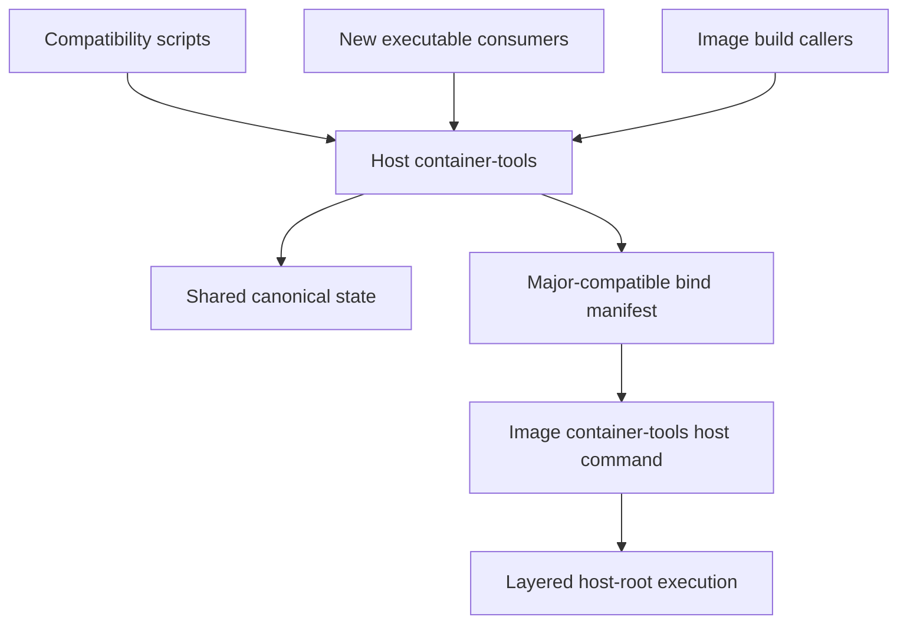

# Container Tools C11 Consolidation - Plan

## Goal Capsule

- **Objective:** Turn `container_tools` into an install-prefix-aware C11 product that owns current container behavior and host-root command execution while preserving existing script callers during migration.
- **Product authority:** This plan owns the `container_tools` product boundary, C11 transition, compatibility surface, package behavior, and absorption of host-bridge. It normatively inherits the approved standalone host-execution Product Contract while superseding only its separate repository, executable name, installation, artifact, and release ownership.
- **Open blockers:** None before technical planning. Planning must reconcile the superseded host-bridge plans, exact state compatibility, and release/deployment changes before implementation starts.

---

## Product Contract

### Summary

`container_tools` becomes one regular C11 software package with a new `container-tools` executable, private runtime libraries, and configurable installation prefix. The host installation launches containers and publishes the semantic bind manifest; an independently selected image installation consumes that manifest and provides host-root command execution. Existing public `ct_*.sh` commands remain as C11-backed compatibility entry points until their consumers migrate.

### Problem Frame

The current Bash product already owns outer runtime selection, automatic mounts, host-root projection, semantic manifest publication, persistent-instance identity, runtime storage, and recovery. A separate C11 host-bridge would consume a protocol defined by `container_tools` while duplicating parsing, installation, release, architecture, and compatibility machinery.

The semantic manifest reveals the natural product boundary: one product should own both production and consumption of its cross-namespace contract. Replatforming that product in C11 also provides a stable executable interface for consumers, but existing deployments cannot require every wrapper to migrate at once.

### Key Decisions

- **One C11 product owns outer launch and host execution.** (session-settled: user-directed - chosen over a separate host-bridge repository and release: manifest production and consumption belong to one versioned product.)
- **Install as a regular prefix-based package.** (session-settled: user-directed - chosen over a product-managed version store: operators select host and image versions through `PATH`, `LD_LIBRARY_PATH`, or direct executable/script paths.)
- **Expose one executable with a new interface.** (session-settled: user-approved - chosen over multiple executables or public library frontends: one CLI keeps versioning, installation, and behavior coherent.)
- **Keep package libraries private initially.** (session-settled: user-approved - chosen over a supported public C ABI: no current C consumer justifies permanent ABI carrying cost.)
- **Move all product behavior into C11.** (session-settled: user-approved - chosen over porting launch paths only or requiring a later core migration: sourced build, cache, state, mount, and lifecycle behavior need one authority.)
- **Preserve five compatibility scripts.** (session-settled: user-directed - chosen over migrating every wrapper in this plan: existing consumers continue calling `ct_exec.sh`, `ct_shell.sh`, `ct_instance_exec.sh`, `ct_mount_detector.sh`, and `ct_args.sh` after those commands delegate to C11.)
- **Remove the sourced implementation boundary.** (session-settled: user-directed - chosen over retaining `ct_library.sh`: direct sourcers migrate to executable subcommands and the C11 core becomes the only implementation.)
- **Migrate consumers explicitly and individually.** (session-settled: user-approved - chosen over a global switch or automatic fallback: each consumer adopts the new interface under its own tests.)
- **Treat existing behavior as the parity baseline.** (session-settled: user-approved - chosen over redesigning behavior during the language migration: intentional behavior changes remain separate product decisions.)
- **Share canonical state during migration.** (session-settled: user-approved - chosen over preview or split state: compatibility scripts and direct C11 consumers must safely reuse the same caches, manifests, locks, profiles, and persistent instances.)
- **Freeze the bind-manifest grammar for each product major.** (session-settled: user-approved - chosen over exact-version matching or runtime schema negotiation: independently selected host and image releases within one major must interoperate.)
- **Expose generic profile identity.** (session-settled: user-approved - chosen over a MkChad-specific core environment contract: lifecycle consumers may use the product identity without owning its hash semantics.)

### Actors

- A1. **Operator:** Installs and selects independent host and image package versions.
- A2. **Compatibility caller:** Uses an existing `ct_*.sh` command without migrating its invocation yet.
- A3. **Native CLI consumer:** Calls the new `container-tools` interface directly.
- A4. **Host installation:** Selects an outer runtime, prepares mounts and state, launches the container, and publishes the bind manifest.
- A5. **Image installation:** Consumes the bound manifest and executes explicit host-root commands through the supported nested backend.
- A6. **Lifecycle consumer:** Uses the generic persistent profile identity to reject incompatible reuse.

### Requirements

**Product and package identity**

- R1. `container_tools` must remain an independently versioned repository and become the source of one C11 software package.
- R2. The package must install beneath a caller-selected prefix and support selection through `PATH`, `LD_LIBRARY_PATH`, or direct paths while resolving each invocation to one coherent package version.
- R3. The package must expose one new `container-tools` executable interface for outer launch, shell, persistent instances, mount inspection, configuration and storage helpers, diagnostics, and host-root execution.
- R4. Package libraries must remain private implementation details in the first C11 product generation; installed headers and a supported public C ABI are not required.
- R5. The C11 implementation must own all behavior currently implemented by the `container_tools` shell family and `ct_library.sh`.
- R6. The package must absorb host-bridge behavior without creating a separate repository, release, installed artifact family, or product version.
- R7. Existing Docker, Podman, SingularityCE, and Apptainer outer-runtime support must remain in scope.
- R8. Existing PPC64LE container-tools behavior must remain supported, while host-root command execution retains its approved x86_64 and AArch64 scope until separately expanded.

**Independent host and image installations**

- R9. Host and image environments must be able to install different `container-tools` releases from the same product major.
- R10. The host installation must produce and bind the exact semantic manifest for each eligible local non-dry launch it constructs; dry runs and automatic launches through explicit remote Docker/Podman endpoints preserve their current no-manifest behavior.
- R11. The image installation must consume the exact bound manifest for explicit host-root execution without searching host state or requiring the host executable to be bound into the container; an absent selector cannot claim host-root capability.
- R12. The image-installed executable must provide host-root execution through the approved Bubblewrap, PRoot, and explicit rewrite semantics.
- R13. A manifest produced by any release in one product major must be accepted by every other release in that major.
- R14. The manifest grammar must remain closed and unchanged within a product major; a grammar change requires a new product major.
- R15. A major mismatch or invalid manifest must fail before nested backend probing or command dispatch while ordinary container behavior remains usable.

**Behavioral and state parity**

- R16. C11 behavior must preserve the supported Bash baseline for runtime argv, environment, mounts, current directory, exit status, signals, diagnostics, dry runs, and failure boundaries.
- R17. C11 must preserve the canonical mount-plan bytes, digest rules, path semantics, role semantics, and stable selector behavior for the current product major.
- R18. C11 and compatibility-script callers must share the same state roots, locks, cache records, mount-plan records, persistent profile identities, pending creation records, and managed runtime instances during migration.
- R19. Mixed compatibility-script, direct C11, and co-installed host-version use must preserve concurrency, timeout, interruption, stale-state recovery, and unrelated-process safety; an unrecognized or incompatible state schema fails without reuse or mutation.
- R20. C11 must expose one generic complete persistent profile identity after all effective inputs are finalized.
- R21. Lifecycle consumers must be able to compare that identity without recomputing container-tools state or accepting a weaker partial identity.

**Compatibility shell surface**

- R22. `ct_exec.sh`, `ct_shell.sh`, `ct_instance_exec.sh`, `ct_mount_detector.sh`, and `ct_args.sh` must remain installed and independently invocable at the end of this plan.
- R23. Each retained script must preserve its supported command name, arguments, environment, exit behavior, and diagnostics while delegating implementation to the selected C11 package.
- R24. Retained scripts must not contain a legacy behavior fallback after C11 cutover.
- R25. Existing wrappers such as `nvim_shell`, `mkchad`, and the managed OpenCode launcher must continue working without migration to the new executable interface in this plan.
- R26. Consumers that adopt the new interface must switch explicitly; neither executable discovery nor runtime failure may silently select between Bash and C11 interfaces.
- R27. Compatibility scripts may be retired in later work only after every supported consumer has migrated and parity plus native runtime evidence passes.

**Removal of `ct_library.sh`**

- R28. Every direct source consumer of `ct_library.sh` must migrate to the new executable interface before the library script is removed.
- R29. Architecture/backend image-build scripts must retain their runtime storage and build-cache behavior after migrating from sourced functions to executable subcommands.
- R30. Tests that currently source `ct_library.sh` must move to public executable behavior or private C unit boundaries rather than preserving a shell API solely for tests.
- R31. `ct_library.sh` must be absent from the installed and repository product surface at the end of this plan.

**Release and integration**

- R32. Each package release must identify its executable, private libraries, compatibility scripts, protocols, documentation, and source commit as one coherent version; cross-prefix binary, library, or script mixing must fail explicitly.
- R33. Host deployment and image construction must select and verify their package versions and provenance independently, including an allowed same-major version difference.
- R34. MkChad release/deployment metadata must retain one `container_tools` product component, separately record the host-installed and image-embedded package identities, and add no standalone host-bridge component or artifact family.
- R35. Existing container and host installers must preserve check, apply, verify, interruption, and recovery behavior while installing the prefix-based package and compatibility scripts.
- R36. Documentation and plans must stop presenting host-bridge as a separate product and must identify the new executable as the manifest producer and consumer.

**Inherited host execution authority**

- R37. The standalone host-bridge Product Contract is inherited as normative behavior except where this plan explicitly changes product ownership, executable naming, installation, artifact, and release boundaries.
- R38. Inherited behavior includes strict profiles and configuration discovery, visible-root and projection semantics, mount-plan validation, cwd and environment handling, Bubblewrap/PRoot/rewrite eligibility, bounded probes and cleanup, executable compatibility, doctor output, exact-once dispatch, explicit degradation consent, and Cargo/Slurm/repair outcomes.

### Key Flows

- F1. **Unmigrated wrapper launch:** A wrapper calls its existing `ct_*.sh` command, the compatibility entry point invokes the selected C11 package, and the payload observes parity behavior.
- F2. **Migrated consumer launch:** A consumer calls the new executable interface directly and uses the same runtime, state, and profile contracts as compatibility callers.
- F3. **Cross-install host execution:** The selected host package launches the outer container and binds its manifest; the independently selected image package validates that manifest and explicitly executes a host-root command.
- F4. **Mixed persistent reuse:** Compatibility and direct C11 callers contend under the same locks and reuse only a persistent instance with the exact matching canonical profile.
- F5. **Prefix-selected installation:** An operator installs host and image packages under different prefixes and selects each through its environment or an exact path without changing protocol behavior.
- F6. **Build caller migration:** An image-build script replaces sourced `ct_library.sh` calls with executable operations while retaining architecture-specific cache and runtime storage behavior.
- F7. **Later compatibility retirement:** A later change proves zero supported script callers and accepted parity evidence before removing compatibility entry points.

### Acceptance Examples

- AE1. Given existing `nvim_shell`, `mkchad`, and managed OpenCode wrappers, installing the C11 package and compatibility scripts preserves their current invocations and payload results without wrapper edits.
- AE2. Given representative Docker, Podman, SingularityCE, and Apptainer inputs, Bash-baseline fixtures and C11-backed compatibility commands produce the same effective runtime argv, state records, statuses, and bounded failure classes; eligible non-dry local launches also produce the same manifest bytes, while dry and explicit-remote automatic launches produce none.
- AE3. Given a host `1.x` package and a different image `1.y` package, a complete valid major-1 manifest supports host-root execution without binding the host package inward.
- AE4. Given a host and image package from different majors, host-root execution refuses the manifest before backend probing while the ordinary outer container command remains usable.
- AE5. Given packages installed under two different prefixes, changing `PATH`, `LD_LIBRARY_PATH`, or the exact invoked path selects one complete intended package without rewriting files; a binary, script, or private-library mismatch across prefixes fails explicitly.
- AE6. Given compatibility and direct C11 callers start the same persistent profile concurrently, one instance is created or reused under the shared lock and neither caller signals or adopts unrelated state.
- AE7. Given a profile input, mount plan, runtime selection, or effective identity changes, both compatibility and direct callers select the same new profile identity and leave the old instance untouched.
- AE8. Given each current image-build script, replacing `ct_library.sh` sourcing with executable operations preserves configured cache/tmp paths, Buildx cache rotation, architecture separation, and failure behavior.
- AE9. Given a retained public script, removing or breaking the C11 executable fails explicitly and never executes a legacy fallback implementation.
- AE10. Given the C11 cutover is complete, the repository and installed package contain the five compatibility scripts but no `ct_library.sh`, and no non-test source attempts to source it.
- AE11. Given release/deployment metadata for the consolidated product, one `container_tools` product component separately identifies and verifies the selected host and image package versions, source provenance, and same-major compatibility without a standalone host-bridge gitlink or artifact.
- AE12. Given a supported host-root command, the image executable preserves the approved argv, cwd, environment, descriptor, signal, backend ordering, degradation-consent, and no-double-dispatch behavior.

### Scope Boundaries

**In scope**

- C11 ownership of all current container-tools behavior.
- Host-bridge absorption as an executable capability.
- Prefix-based package installation with private libraries.
- Shared state and behavior parity between compatibility and direct callers.
- Migration of every direct `ct_library.sh` source consumer.
- Five retained C11-backed compatibility command scripts.
- Release, deployment, image, documentation, and plan reconciliation required by the new product boundary.

**Deferred for later**

- Migrating wrappers that can continue through retained compatibility scripts.
- Removing the five compatibility scripts after all supported consumers migrate.
- A supported public C library ABI and installed development headers.
- Expanding host-root execution beyond x86_64 and AArch64.
- Distribution-specific packaging beyond the configurable prefix installation contract.

**Outside this product's identity**

- A separate host-bridge repository, release, installer, or version.
- Product-managed version stores or selectors that replace ordinary prefix and environment selection.
- Automatic fallback from the new executable interface to the legacy Bash implementation.
- Exact host/image release matching within one product major.
- A security sandbox, privilege boundary, or container runtime replacement.

### Dependencies And Assumptions

- The current automatic host-root projection and `ct-mount-plan-v1` implementation are the behavioral baseline rather than work to rediscover.
- Bubblewrap, PRoot, outer container runtimes, and architecture toolchains remain external dependencies with existing capability gates.
- Current shell tests, runtime evidence contracts, and persisted records are available as parity fixtures for planning and implementation.
- Same-major compatibility applies to the cross-install bind manifest. Shared host state uses explicit schemas and permits only recognized safe reuse; future or incompatible state fails closed rather than gaining an all-state same-major compatibility promise.
- Existing live MkChad configuration and runtime state remain protected and are not migration fixtures.

<!-- ce-section: work-relationships -->
### How This Work Fits Together

This plan owns the consolidated `container_tools` product and replaces the current separate-product direction. The relationships below orient planning; they are not a committed implementation sequence.

- **Provides the baseline:** `docs/plans/2026-08-06-001-feat-automatic-host-root-projection-plan.md` defines the implemented projection, manifest, profile, and evidence behavior that C11 must preserve.
- **Remains a prerequisite:** `docs/plans/2026-08-04-002-feat-host-bridge-container-prerequisites-plan.md` continues to supply Bubblewrap, PRoot, and architecture toolchains, but its separate future executable wording must be reconciled.
- **Is superseded only for product ownership:** `docs/plans/2026-08-04-003-feat-standalone-host-bridge-plan.md` remains the normative host-execution behavior contract, but host-bridge no longer becomes an independent repository, executable product, installation, artifact, or release.
- **Must be reframed:** `docs/plans/2026-08-04-004-feat-mkchad-host-bridge-integration-plan.md` must consume the image-installed package, remove the host binary bind and standalone artifact, and retain its lifecycle and native evidence goals.
- **Enables later work:** Consumer-by-consumer migration to the direct executable interface and final compatibility-script retirement occur after this plan.

### Sources And Research

- Current product contract and manifest protocol: `msk_containers/container_tools/README.md`.
- Current shell implementation: `msk_containers/container_tools/ct_library.sh`, `msk_containers/container_tools/ct_exec.sh`, `msk_containers/container_tools/ct_shell.sh`, `msk_containers/container_tools/ct_instance_exec.sh`, `msk_containers/container_tools/ct_mount_detector.sh`, and `msk_containers/container_tools/ct_args.sh`.
- Current callers: `msk_containers/nvim/bin/`, architecture/backend image-build scripts under `msk_containers/nvim/`, and `msk_containers/bin/install_tools.sh`.
- Current release/deployment ownership: `deploy/release.json`, `deploy/release-v2.schema.json`, and `deploy/mkchad_deploy.py`.
- Host execution semantics to retain: `docs/plans/2026-08-04-003-feat-standalone-host-bridge-plan.md`.
- MkChad integration outcomes to retain: `docs/plans/2026-08-04-004-feat-mkchad-host-bridge-integration-plan.md`.

### Outstanding Questions

**Deferred to Planning**

- What exact subcommand hierarchy and option syntax should the new executable expose while keeping compatibility scripts mechanically faithful?
- Which private libraries should be installed, and how should runtime lookup behave for direct paths outside an activated prefix environment?
- How should parity tests invoke the preserved Bash baseline during implementation before `ct_library.sh` is removed?
- What implementation sequence proves shared-state safety before each compatibility script delegates to C11?
- Which generic environment, command output, or state interface should expose the complete persistent profile identity?
