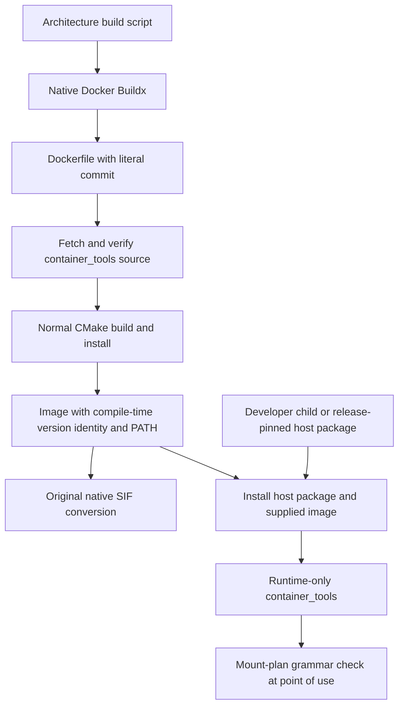
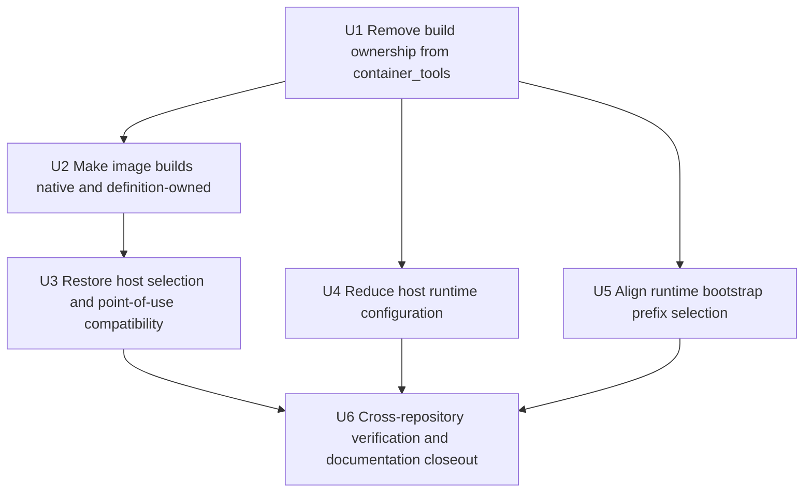

# Container Tools Runtime Boundary Restoration - Plan

## Goal Capsule

- **Objective:** Restore `container_tools` to a runtime-only product and make every maintained Neovim image build directly through Docker Buildx or SingularityCE/Apptainer without consulting or invoking host `container-tools` at all.
- **Product authority:** This plan supersedes the build-orchestration, build-cache, build-storage, image-package-ingress, and whole-prefix package-verification portions of `docs/plans/2026-08-07-001-refactor-container-tools-c11-consolidation-plan.md`. That plan remains authoritative for container launch behavior, launch identity and state, compatibility-entrypoint identity, and selected-root host execution.
- **Execution profile:** Characterization-first, serial cross-repository correction through `container_tools`, `msk_containers`, `config_files`, and the workspace deployment boundary. Run no more than one resource-intensive image build at a time.
- **Stop conditions:** Stop if an implementation consults a host `container-tools` executable or `CT_ROOT` while constructing an image, infers the in-image revision from a gitlink or host package, changes pre-build-storage script behavior beyond removing the wrappers, weakens normal runtime behavior, or adds deploy-time host/container package compatibility admission.
- **Tail ownership:** Implementation owns coherent child commits and parent gitlinks. Image publication, release publication, and live deployment remain explicit operator actions. Cache pruning is not part of this plan or its build procedure.

---

## Product Contract

### Summary

`container_tools` assists container execution. It launches supported runtimes with a view close to the caller's userspace, computes and persists launch identity at the product's supported strictness, and consumes that identity inside the running container to reconstruct a host-runtime view. It does not orchestrate Docker or SingularityCE/Apptainer image builds, rotate builder caches, select build scratch space, mutate image contents, or provide a generic wrapper for build subprocesses.

Neovim image builders call their native tools directly. Each maintained Dockerfile contains a reviewed, literal `container_tools` source revision, checks it out, and uses normal CMake build/install commands. Before a stable 1.0 release, the revision is a full commit; no script infers it from the nested gitlink and no caller overrides it through an ordinary build argument. The Dockerfile places `/opt/msk/container-tools/bin` near the front of image `PATH`. Singularity definitions perform the original Docker-archive conversion without another package installation, identity file, or verification stage.

Developer deployment derives and builds the host package directly from the admitted workspace's `msk_containers/container_tools` child, with no caller-selected source or archive. Release deployment installs the host package pinned by release authority. Neither path compares that host package with the independently pinned image package. Compatibility is enforced when the in-container consumer reads the host-produced mount plan: an incompatible grammar refuses that operation with expected-versus-actual diagnostics and never signals or stops the containing runtime instance.

### Problem Frame

The C11 consolidation treated a recently added Bash Buildx/storage helper as established `container_tools` behavior and ported it under a broad parity requirement. That changed `msk_containers` image construction from direct native builder calls into a workflow that resolves or bootstraps a host `container-tools`, stages a separately built package, injects cache arguments, and supervises the builder through the runtime product.

This ownership does not match the product. Build cache rotation, image-build scratch policy, source injection, and image mutation are concerns of the image repository and native build tools. Keeping them in `container_tools` increases its public interface and operational blast radius while making image construction depend on the product it is trying to install.

### Key Decisions

- **Keep `container_tools` runtime-only.** (session-settled: user-directed - chosen over preserving C11 build wrappers: the product owns launch semantics, launch identity, and selected-root host reconstruction, not image construction.)
- **Pin the in-image source in container definitions.** (session-settled: user-directed - chosen over nested-gitlink inference or host-package injection: the definition must visibly state what source it builds.)
- **Use full commits before a stable 1.0 release.** (session-settled: user-directed - chosen over pre-1.0 tags: the current development version does not yet provide a stable release tag contract.)
- **Restore the established host package selection.** Developer deployment builds the host package from the admitted `msk_containers/container_tools` child; release deployment installs the package pinned by the selected release.
- **Enforce compatibility at the mount-plan boundary.** Deployment does not compare host and image package identities. The in-container consumer accepts its supported mount-plan grammar or fails only the requested operation with an informative expected-versus-actual diagnostic.
- **Retain runtime bootstrap setup without double-selecting npm prefixes.** `--ct-bootstrap` remains a generic runtime hook. Shell and standalone-server launchers use it to derive one Node platform/architecture/major child before their payload, while the main MkChad launch lets Lua derive that same child once and publish it as `MSK_NPM_GLOBAL_ROOT`.

### Actors

- A1. **Image maintainer:** Reviews and updates the literal `container_tools` revision in maintained Dockerfiles.
- A2. **Image builder:** Runs the architecture build script with native Docker Buildx or SingularityCE/Apptainer tooling.
- A3. **Runtime operator:** Uses installed host `container_tools` commands to launch containers and reconstruct host views.
- A4. **Release operator:** Pins the release host package and selects an image whose Dockerfile pin is expected to be compatible.

### Requirements

**Product boundary**

- R1. `container_tools` must own outer container launch behavior, launch identity/state, persistent instance behavior, semantic mount-plan publication, and selected-root host execution. The host publishes `${XDG_STATE_HOME:-$HOME/.local/state}/container-tools/mount-plans/v1/<64-hex-digest>.manifest` and binds that exact record read-only inside the launched container at `/.container-tools-mount-plan`.
- R2. `container_tools` must not expose the current generic `runtime exec` storage/subprocess wrapper, `buildx exec`, Buildx cache transactions, Docker build temporary-directory selection, or any other image-build orchestration interface. Runtime-scoped `exec`, `shell`, `instance exec`, and `instance identity` remain because they construct the userspace mirror and launch the requested container.
- R3. Removing build functionality must not change supported `exec`, `shell`, `instance exec`, `instance identity`, mount, host execution, or compatibility-script behavior. Each installed compatibility script must continue authenticating its own compiled sibling executable before dispatch, but the public whole-prefix `package verify` command and unconditional sibling/metadata preflight are removed with the archive installer that used them.
- R4. Runtime configuration used by ordinary SingularityCE/Apptainer launches may remain, but `CT_DOCKER_BUILD_CACHE_DIR`, `CT_DOCKER_BUILD_TMP_DIR`, and `CT_DOCKER_BUILD_LOCK_TIMEOUT` must not exist in final active source, configuration grammar, documentation, help, or tests. Historical plans may retain those names as archival context while receiving the planned successor reference.

**Native image construction**

- R5. Every Docker build script must invoke `docker buildx build` directly and must never resolve, inspect, bootstrap, stage, or execute host `container-tools` or `CT_ROOT`, even when either is available.
- R6. Every SingularityCE/Apptainer build script must select the available native builder and invoke its `build` command directly without consulting or invoking `container-tools runtime exec`, host `container-tools`, or `CT_ROOT`.
- R7. Build scripts must restore native builder cache behavior from before `15f918e`: do not inject `--cache-from`, `--cache-to`, `TMPDIR`, SingularityCE/Apptainer cache variables, or repository-specific build-storage policy, and do not prune or rotate caches. Docker Buildx, SingularityCE, and Apptainer may reuse any cache available through their native defaults or caller configuration.
- R8. Native build scripts must restore the exact pre-`15f918e` command lines and working-directory behavior. This plan must not normalize path handling, output locations, messages, or orchestration beyond removing the intervening `container-tools` build wrappers.
- R9. `nvim/bin/resolve_container_tools.sh`, `nvim/bin/stage_container_tools_package.sh`, their bootstrap cache, and tests whose sole purpose is host-side image-build preparation must be removed.

**Definition-owned source build**

- R10. Each maintained Dockerfile must contain the public repository URL `https://github.com/krafczyk/container_tools.git` and one literal source revision used to fetch, detach, and verify the source before building.
- R11. Until a stable 1.0 release is established, every maintained Dockerfile revision must be a full 40-hex commit and must not be caller-overridable through a normal build argument.
- R12. All maintained architectures must pin the same `container_tools` commit unless a later reviewed plan explicitly establishes an architecture-specific exception.
- R13. The Dockerfile must check out the literal revision, configure and build the native static executable with normal CMake commands, and install it beneath `/opt/msk/container-tools` with `cmake --install`. X86_64 and AArch64 select `musl-gcc` with the existing musl static prerequisites; PPC64LE selects GCC with the existing `glibc-static` prerequisite.
- R14. The Dockerfile must set image `PATH` with `/opt/msk/container-tools/bin` near the front so ordinary interactive command lookup and inherited SIF environments select the image-installed executable. This image default is independent of host projection, which remains namespaced beneath `/host` and owns any selected-root host-command resolution without rewriting the image's ordinary `PATH`.
- R15. `container-tools --version` must report product version, source commit, architecture, and supported mount-plan grammar in human-readable form; `container-tools --version --json` must emit the same machine-readable identity from compile-time constants. Neither form may read installed package metadata; `/etc/mkchad/container-tools-package.json` and `share/container-tools/release.json` must not exist.
- R16. The Dockerfile must remove temporary source and build data after installation. Singularity definitions must restore the original Docker-archive conversion behavior and contain no package `%files`, source pin, build, install, identity-file, or package-verification step.

**Host selection and runtime compatibility**

- R17. Developer deployment must derive, build, and install host `container_tools` directly from the admitted workspace's `msk_containers/container_tools` child without a caller source/archive selector. Release deployment must check out the `container_tools` source commit pinned by the selected release and install it through the same normal CMake path, without a caller package archive.
- R18. Developer and release deployment must not derive, compare, admit, or record a container-package role from the supplied image; the Dockerfile pin is independent image-maintainer authority.
- R19. Deployment must not require host and in-image `container_tools` versions, commits, libc families, archive digests, or product majors to match. Release maintainers are responsible for selecting compatible pins.
- R20. When an in-container `host exec` or `host doctor` encounters an unsupported mount-plan grammar, it must fail closed before nested backend probing or payload dispatch, report the expected grammar and actual observed grammar discriminator, and leave the containing container or persistent runtime instance running. The user decides when to stop that container and restart it with a compatible host `container_tools`.

**Configuration and documentation**

- R21. The tracked Schumann runtime configuration must delete its existing `CT_DOCKER_BUILD_CACHE_DIR` and `CT_DOCKER_BUILD_TMP_DIR` assignments before the final runtime-only parser is deployed; retained SingularityCE/Apptainer path assignments do not change, and all Docker-build variable definitions and references are removed from active repository surfaces.
- R22. Existing native-builder caches and scratch directories must remain untouched. The restored build procedure performs no cleanup, pruning, rotation, generation management, or optional-cleanup guidance and allows native builders to reuse cache through their ordinary behavior.
- R23. Current product, package-selection, host-installation, deployment, and historical-plan relationship documentation must describe the restored ownership boundary and stop instructing image builders to use host `container-tools` wrappers or supplied container archives.

**Runtime bootstrap consistency**

- R24. `--ct-bootstrap HOST_PATH` must remain available to runtime `exec`, `shell`, `instance exec`, and `instance identity`. Every MkChad entry point must select exactly one Node platform/architecture/major child beneath the architecture-neutral mounted npm parent: `nvim_shell` and host-launched standalone OpenCode use `mkchad-container-bootstrap`; the main `mkchad` launcher passes `MSK_NPM_GLOBAL_BASE` without the bootstrap, and MkChad Lua derives the child once, sets `MSK_NPM_GLOBAL_ROOT` to that selected child, and aligns `NPM_CONFIG_PREFIX` and `PATH`. Editor, shell, inherited in-container server, and host-launched standalone server sessions must resolve the same child without a repeated key segment.

### Key Flows

- F1. **Docker image build:** The architecture script invokes Docker Buildx directly; the Dockerfile fetches its written commit, uses normal CMake build/install commands, prepends the installed bin directory to image `PATH`, checks compile-time `--version --json`, and cleans temporary source/build data.
- F2. **SIF conversion:** From the established architecture working directory, the script selects SingularityCE first or Apptainer second and runs the original `build --force --fakeroot` command against the Docker archive-backed definition; the definition adds no package-specific work.
- F3. **Runtime launch:** Host `container_tools` launches an image, memoizes launch identity, publishes the content-addressed semantic mount plan under the host state root, and binds it read-only at `/.container-tools-mount-plan`. The in-container consumer either executes selected-root work with a supported grammar or refuses only that operation with expected-versus-actual incompatibility diagnostics.
- F4. **Developer deployment:** The developer command derives, builds, and installs host `container_tools` from the admitted workspace's `msk_containers/container_tools` child and installs the supplied image without a caller package/source selector or image-package comparison.
- F5. **Release deployment:** Release metadata pins and verifies the host package; the supplied image remains independently pinned by its Dockerfile and is not subjected to a host/container package compatibility check.
- F6. **Writable npm prefix selection:** A launcher mounts the architecture-neutral host npm parent at `/opt/msk/npm-global`. Shell and host-launched standalone-server flows run `mkchad-container-bootstrap` after runtime environment injection; the main editor flow passes the parent to MkChad Lua instead. Each path derives the same key once, exposes the selected child as `MSK_NPM_GLOBAL_ROOT`, sets `NPM_CONFIG_PREFIX` to it, and prepends its `bin` directory to `PATH`.

### Acceptance Examples

- AE1. Given a trap `container-tools` executable on host `PATH` and a populated `CT_ROOT`, every image-build script reaches its native builder without reading, executing, or otherwise consulting either input.
- AE2. Given the pre-build-storage working directory, each SIF script prefers `singularity` over `apptainer` and runs `<builder> build --force --fakeroot nvim_container_ARCH.sif nvim_container_ARCH.def` with the original relative paths, messages, outputs, and caller-native cache/temporary behavior.
- AE3. Given a Dockerfile whose literal revision is changed, in-image `container-tools --version` and `container-tools --version --json` report that exact commit and supported mount-plan grammar from compile-time constants; a fetch or checkout mismatch fails the build and no installed package identity file exists.
- AE4. Given a caller tries to override the pre-1.0 revision through build arguments, the build still uses the Dockerfile's reviewed literal commit.
- AE5. Given the Docker archive already contains `/opt/msk/container-tools` and its `PATH`, SIF conversion performs only the original conversion and creates no second installation, identity file, or verification action.
- AE6. Given developer deployment, the installed host package is built from the exact admitted `msk_containers/container_tools` child commit without a `--container-tools-source` or host-archive argument; no image package identity participates in admission.
- AE7. Given release deployment, the installed host package matches the release pin and the supplied image is accepted without a host/container package comparison.
- AE8. Given the reduced Schumann configuration, the current pre-unwind runtime and the runtime-only package both accept it for ordinary launches; removed Docker build keys are not silently ignored by the final package.
- AE9. Given existing native-builder caches, image construction may reuse them through native defaults or caller configuration and performs no pruning, rotation, deletion, or cleanup guidance.
- AE10. Given an in-container consumer expecting `ct-mount-plan-v1` and a mounted record beginning with `ct-mount-plan-v2`, `host exec` exits before probing or payload dispatch with a diagnostic naming expected `ct-mount-plan-v1` and actual `ct-mount-plan-v2`; it does not signal or stop the containing runtime instance.
- AE11. Given Node reports `linux-x64-node24` and the mounted parent is `/opt/msk/npm-global`, main editor, shell, inherited in-container server, and host-launched standalone-server sessions all expose `MSK_NPM_GLOBAL_ROOT=/opt/msk/npm-global/linux-x64-node24`, use that exact value as `NPM_CONFIG_PREFIX`, and contain no repeated `/linux-x64-node24/linux-x64-node24` segment.

### Scope Boundaries

**In scope**

- Removal of public and internal image-build orchestration from `container_tools`.
- Direct native Docker and SingularityCE/Apptainer image-build scripts.
- Explicit restoration of the parent-of-`15f918e` native builder commands, working-directory behavior, cache behavior, messages, and outputs.
- Definition-owned, commit-pinned CMake builds of the in-image executable with the image bin directory near the front of `PATH`.
- Removal of host image-build resolvers, bootstraps, package staging, and associated tests.
- Restoration of developer-child and release-pin host package selection, with compatibility refusal at the in-container mount-plan boundary rather than deployment admission.
- Runtime configuration, documentation, and historical-plan relationship updates required by the boundary correction.
- Consistent single-key writable npm prefix selection across MkChad editor, shell, and OpenCode server entry points while retaining the generic runtime bootstrap hook.

**Deferred for later**

- Stable 1.0 release tags and switching Dockerfiles from full commits to reviewed release tags.
- Any future image-build product, reusable build-cache manager, or standardized builder-storage policy.
- Image publication and release candidate production.

**Outside this product's identity**

- Docker Buildx cache lifecycle and daemon storage.
- SingularityCE/Apptainer image-build cache and scratch policy.
- Image mutation, package injection, or container-definition generation.
- Any cleanup, pruning, rotation, or generation management of builder caches or temporary roots.

### Dependencies And Assumptions

- Maintained Docker builds already require network access for Fedora packages and pinned source dependencies; fetching the written `container_tools` commit does not introduce the first network dependency.
- CMake is the package's build/install interface for image, developer, and release installation. The C11 archive build, verification, and installer scripts are not retained as an external interface.
- Current Dockerfiles already select the native static toolchains required for x86_64, AArch64, and PPC64LE.
- Singularity definitions continue bootstrapping from architecture-matched Docker archives.
- MkChad Lua remains responsible for deriving the Node-specific child during main editor initialization; non-editor entry points need the runtime bootstrap because they do not execute that Lua initialization before resolving tools.
- The tracked `config_files` checkout is applied independently of release deployment. It is touched only because it currently contains the two Docker build assignments that the final runtime-only parser rejects.

<!-- ce-section: work-relationships -->
### How This Work Fits Together

- **Supersedes build and package-verification ownership:** `docs/plans/2026-08-07-001-refactor-container-tools-c11-consolidation-plan.md` remains the implemented runtime baseline but no longer governs `runtime exec`, `buildx exec`, image-build cache/storage behavior, prebuilt container-role package ingress, or public whole-prefix package verification.
- **Preserves runtime authority:** `docs/plans/2026-08-06-001-feat-automatic-host-root-projection-plan.md` remains authoritative for launch identity, host projection, mount-plan publication, and persistent runtime behavior.
- **Restores deployment selection:** `docs/deployment/README.md` and schema-2 deployment retain developer-child and release-pin host selection while removing deploy-time container-package admission.

### Sources And Research

- Pre-build-storage script baseline: `msk_containers` parent of commit `15f918e`.
- Build-storage integration: `msk_containers` commit `15f918e` and `container_tools` commit `e3ad4fd`.
- C11 build cutover: `msk_containers` commit `ed24f4b`.
- Current build command ownership: `msk_containers/nvim/x86/nvim_container_x86_build_docker.sh`, `msk_containers/nvim/x86/nvim_container_x86_build_singularity.sh`, and architecture peers.
- Current package delivery contract: `msk_containers/docs/adr/002-package-selections.md`.
- Current runtime and build command implementation: `msk_containers/container_tools/src/main.c`, `msk_containers/container_tools/src/cli.c`, `msk_containers/container_tools/src/buildx.c`, and `msk_containers/container_tools/src/config.c`.
- Current release identity handling: `deploy/mkchad_deploy.py`, `deploy/mkchad_develop.py`, `deploy/release-v2.schema.json`, and `deploy/result-v2.schema.json`.

---

## Planning Contract

**Product Contract preservation:** created from the user's corrected product boundary and revised from Proof feedback. Runtime launch, identity, host-view, per-compatibility-entrypoint identity, original native-build script behavior, established host package selection, generic runtime bootstrap setup, and non-destructive mount-plan incompatibility refusal are preserved; build orchestration, whole-prefix package verification, and deploy-time host/container admission are intentionally removed.

### Key Technical Decisions

- KTD1. **Delete unused orchestration and package-verification commands instead of deprecating them.** (session-settled: user-directed - chosen over preserving build and verification wrappers: no supported consumer remains once image scripts and host installation return to native CMake paths.) Remove command parsing, dispatch, documentation, fixtures, installed release metadata, and package digest inputs for `runtime exec`, `buildx exec`, and public `package verify`. Keep the exact compatibility-script-to-sibling-executable identity handshake, but do not make unrelated direct executable commands depend on every alias being present.
- KTD2. **Retain only runtime storage configuration.** Keep the configuration and storage modules needed by ordinary SingularityCE/Apptainer instance launch, remove Docker build fields and Buildx-only timeout/architecture helpers, and reject removed keys after the tracked Schumann configuration is reduced.
- KTD3. **Put a literal commit in each maintained Dockerfile.** (session-settled: user-directed - chosen over gitlink inference, caller build arguments, or pre-1.0 tags: the reviewed definition visibly owns the in-image source revision.) Use `https://github.com/krafczyk/container_tools.git` and a non-overridable full commit in the fetch/checkout command. Tests require the same literal across architectures.
- KTD4. **Use ordinary source checkout and CMake installation.** The Dockerfile and both host deployment modes fetch or select their authoritative checkout, verify the exact commit, select the architecture's declared static compiler, run CMake configure/build/install, and inspect compile-time `--version --json`. X86_64/AArch64 use `musl-gcc`; PPC64LE uses GCC plus `glibc-static`. They do not create, stage, verify, or install a package archive.
- KTD5. **Let SIF conversion inherit Docker-installed bytes without extra work.** The `.def` files restore the pre-C11 Docker-archive conversion shape and add no package `%files`, `%post` verification, identity file, source pin, build, or installation.
- KTD6. **Restore host selection and trust the image pin.** (session-settled: user-directed - chosen over deploy-time host/container identity admission: developer deployment derives the admitted `msk_containers/container_tools` child without a caller selector, release deployment uses the release-pinned host package, and the release maintainer selects a compatible Dockerfile pin.) Remove container-package role comparison from deployment and make mount-plan incompatibility a non-destructive point-of-use refusal.
- KTD7. **Use rollout ordering instead of a no-op config shim.** Update and apply the tracked runtime configuration before installing a parser that rejects removed Docker build keys. Do not accept ignored keys that imply build functionality still exists.
- KTD8. **Restore native cache behavior without cleanup.** Direct builders use and may benefit from native defaults and caller-standard environment/configuration. This plan adds no cache injection, pruning, rotation, deletion, or cleanup instructions.
- KTD9. **Keep bootstrap setup but select the npm child once.** `--ct-bootstrap` remains generic runtime functionality. Non-editor entry points use `mkchad-container-bootstrap`; main MkChad startup does not, because its Lua initialization derives the same key and sets the selected-root environment consumed by inventory and child processes.
- KTD10. **Keep image `PATH` and host projection orthogonal.** The Dockerfile makes its installed executable the ordinary image default. Host projection remains under `/host`; selected-root commands intentionally use their host-view profile, and no Dockerfile `PATH` rule is used as a projection defense.

### High-Level Technical Design



The source checkout exists only inside the Docker build. Build scripts restore the exact pre-`15f918e` architecture-specific commands and working-directory behavior. They do not read a gitlink, generate package metadata, create a private copied context, or own package compilation.

The Dockerfile installs directly from its pinned checkout. Version, source commit, architecture, and mount-plan grammar are compiled into the executable and exposed by `--version`/`--version --json`; no installed package identity file or package archive is created. The SIF conversion inherits both the installation and Docker-defined `PATH` without package-specific actions. Separately, runtime host projection stays beneath `/host` and does not determine ordinary image command lookup.

### Migration And Rollout Contract

1. Remove build commands from `container_tools` and commit the verified child independently.
2. After U1 fixes the runtime-only grammar, U2 and U4 may proceed independently: reduce and verify `config_files/.config/ct_runtime.conf`, and update the nested gitlink plus all image definitions, native build scripts, tests, and documentation in one coherent `msk_containers` child commit. An intermediate `msk_containers` commit must not point at a child that lacks commands its build scripts still call.
3. Restore developer-child and release-pin host package selection, remove deploy-time container-package admission, and add point-of-use mount-plan incompatibility diagnostics.
4. Correct the MkChad main-launch environment contract and non-editor bootstrap tests so every entry point selects one identical Node-specific child.
5. Apply the reduced tracked host configuration before installing the runtime-only host package, then record final child gitlinks. Live deployment and image publication remain separate operator actions.

Rollback does not require state migration. The corrected runtime preserves existing launch-state schemas and mount-plan bytes. An older package accepts the reduced runtime configuration because all removed keys were optional. Old Buildx cache generations remain inert, operator-owned files.

### Implementation Constraints

- Use repo-relative source and test paths throughout implementation and documentation.
- Do not edit protected live MkChad state or delete `/data1` cache/tmp directories during implementation or verification.
- Keep version identity source-owned and compile it from the verified checkout; do not add a separate image identity file.
- Do not introduce a Dockerfile revision argument whose ordinary override can bypass the reviewed pin.
- Keep all default tests deterministic and credential-free. Network fetch and native image builds remain explicit integration gates.
- Commit child repositories before parent gitlinks and stage no unrelated workspace files.

### Sequencing



### Requirement Traceability

| Unit | Requirements | Flows | Acceptance examples |
|---|---|---|---|
| U1 | R1-R4, R20 | F3 | AE8, AE10 |
| U2 | R5-R16 | F1-F2 | AE1-AE5 |
| U3 | R17-R19 | F4-F5 | AE6-AE7 |
| U4 | R4, R21-R22 | F3 | AE8-AE9 |
| U5 | R3, R24 | F3, F6 | AE11 |
| U6 | R3, R12-R24 | F1-F6 | AE1-AE11 |

### Risks And Mitigations

| Risk | Impact | Mitigation | Required proof |
|---|---|---|---|
| A Dockerfile pin drifts across architectures | Images ship different runtime products unintentionally | Require one literal full commit and static equality checks across maintained Dockerfiles | Tooling test extracts and compares all pins |
| A caller overrides the intended source | Image provenance no longer matches reviewed source | Use a literal fetch/checkout commit, not a normal build argument | Override attempts cannot change observed package commit |
| Host and image pins produce incompatible mount-plan grammars | Selected-root commands cannot safely interpret host publication | Fail only the requested in-container operation before probing or dispatch, name expected and actual grammar, and leave the runtime instance running | Future-grammar fixture, no backend call, exact diagnostic, no stop or signal |
| The installed image prefix is absent from ordinary image `PATH` | Interactive users and inherited SIF sessions do not select the Docker-built executable by default | Put `/opt/msk/container-tools/bin` near the front of Docker image `PATH`; keep `/host` projection and selected-root lookup as separate runtime behavior | Ordinary image PATH resolution and `--version --json` select the Docker-built executable without relying on projection |
| SIF conversion adds package-specific mutation | Docker and SIF behavior diverges from the original conversion | Restore the original `.def` shape with no package `%files`, verification, identity, build, or install step | Definition scan plus inherited PATH/runtime smoke |
| Runtime config rollout happens in the wrong order | New package rejects old Docker build keys | Reduce tracked config first and document deployment ordering | Old and new package accept reduced config; new package rejects removed keys |
| Cache restoration is mistaken for cache disablement | Builds become unnecessarily cold | Preserve native builder defaults and caller configuration while removing only repository-managed injection and cleanup | Warm native build evidence where available; no prune/rotation/delete commands |
| Literal commit is unreachable | Network image build fails | Pin only pushed commits and verify detached checkout before build | Opt-in native build fetches the final pin |
| Main MkChad startup and non-editor bootstrap both append the Node key | Editor-installed tools land in a different directory from shell and standalone-server tools | Main launch passes only the neutral parent to Lua; bootstrap remains limited to entry points that do not run Lua initialization | All entry points report one identical selected child and reject repeated-key fixtures |

---

## Implementation Units

### U1. Remove Image-Build Ownership From Container Tools

- **Goal:** Delete the public and internal build orchestration and archive-package surfaces while preserving runtime launch and userspace-mirror behavior.
- **Requirements:** R1-R4, R20; F3; AE8, AE10.
- **Files:** `msk_containers/container_tools/src/cli.c`; `msk_containers/container_tools/src/cli.h`; `msk_containers/container_tools/src/main.c`; `msk_containers/container_tools/src/package.c`; `msk_containers/container_tools/src/package.h`; delete `msk_containers/container_tools/src/buildx.c`; delete `msk_containers/container_tools/src/buildx.h`; `msk_containers/container_tools/src/config.c`; `msk_containers/container_tools/src/config.h`; `msk_containers/container_tools/src/storage.c`; `msk_containers/container_tools/src/storage.h`; `msk_containers/container_tools/src/mount_plan.c`; `msk_containers/container_tools/src/mount_plan.h`; delete `msk_containers/container_tools/scripts/build-package.sh`; delete `msk_containers/container_tools/scripts/verify-package.sh`; delete `msk_containers/container_tools/scripts/install-package.sh`; delete `msk_containers/container_tools/scripts/package-files.txt`; `msk_containers/container_tools/CMakeLists.txt`; delete `msk_containers/container_tools/tests/test_buildx.c`; delete `msk_containers/container_tools/tests/test_buildx_child.c`; delete `msk_containers/container_tools/tests/test_storage_timeout_child.c`; delete `msk_containers/container_tools/tests/package_archive_test.sh`; delete `msk_containers/container_tools/tests/package_install_test.sh`; delete `msk_containers/container_tools/tests/installer_lock_test.sh`; `msk_containers/container_tools/tests/test_cli.c`; `msk_containers/container_tools/tests/test_config.c`; `msk_containers/container_tools/tests/test_storage.c`; `msk_containers/container_tools/tests/test_mount_plan.c`; `msk_containers/container_tools/tests/test_package.c`; `msk_containers/container_tools/tests/test_runtime_config.cmake.in`; `msk_containers/container_tools/tests/test_install.cmake.in`; `msk_containers/container_tools/tests/native_runtime_config_test.sh`; `msk_containers/container_tools/tests/parity_test.sh`; `msk_containers/container_tools/tests/fixtures/bash-baseline/contracts.tsv`; `msk_containers/container_tools/README.md`.
- **Approach:** Remove command enums, parsing, dispatch, usage text, Buildx transaction code, Docker build fields, Buildx-only helpers, public whole-prefix package verification, the installed release metadata and its template, archive build/verify/install scripts, and their fixtures. Keep runtime configuration, process supervision, compile-time version identity, and each compatibility script's exact sibling-executable identity handshake. Make human and JSON version output self-contained from compile-time constants, without installed package metadata. Preserve typed mount-plan read outcomes and make `host exec`/`host doctor` report expected and actual grammar discriminators before refusing an incompatible plan, without signaling or stopping the containing runtime instance.
- **Test scenarios:** Generic `runtime exec`, `buildx exec`, and `package verify` are rejected while `exec`, `shell`, `instance exec`, and `instance identity` preserve userspace-mirror behavior; each compatibility alias accepts only its matching sibling executable, while direct executable commands do not require unrelated aliases or release metadata; all Docker build variables are absent repository-wide; runtime-only config accepts missing/default/explicit SingularityCE/Apptainer paths; `--version` and `--version --json` report compiled version/commit/architecture/grammar without installed identity input; a future mount-plan grammar names expected `ct-mount-plan-v1` and actual `ct-mount-plan-v2`, performs no nested probe or payload dispatch, and issues no runtime stop/signal; archive package scripts and tests are absent.
- **Verification:** Build and test dynamic binaries with GCC and Clang under `/tmp/mkchad-v1/container-tools-runtime-boundary`, run full CTest, run the reduced runtime-config integration and parity fixture checks, run sanitizers where supported, run ShellCheck, and inspect public help/version output plus the installed layout.
- **Dependencies:** None.

### U2. Restore Native Image Builders And Definition-Owned CMake Builds

- **Goal:** Build all maintained images without a host `container-tools` while installing an explicitly pinned source checkout through normal CMake commands inside each Docker image.
- **Requirements:** R5-R16; F1-F2; AE1-AE5.
- **Files:** delete `msk_containers/nvim/bin/resolve_container_tools.sh`; delete `msk_containers/nvim/bin/stage_container_tools_package.sh`; delete `msk_containers/tests/container_tools_build_bootstrap_test.sh`; all `msk_containers/nvim/{x86,aarch64,ppc64le}/nvim_container_*_build_docker.sh`; all `msk_containers/nvim/{x86,aarch64,ppc64le}/nvim_container_*_build_singularity.sh`; all `msk_containers/nvim/{x86,aarch64,ppc64le}/nvim_container_*.dockerfile`; all `msk_containers/nvim/{x86,aarch64,ppc64le}/nvim_container_*.def`; `msk_containers/tests/nvim_container_tooling_test.sh`; `msk_containers/docs/adr/002-package-selections.md`; `msk_containers/docs/host-installation.md`; `msk_containers/container_tools` gitlink.
- **Approach:** Restore direct native builder calls exactly from the parent of `15f918e`, including each architecture's original relative-versus-script-derived paths, output locations, Singularity-first/Apptainer-second detection, user messages, `build --force --fakeroot` argv, and native cache behavior. Do not opportunistically normalize the aggregate build or archive-export scripts. Dockerfiles install prerequisite toolchains, clone the literal revision from the `container_tools` repository, verify detached HEAD, select `musl-gcc` on x86_64/AArch64 or GCC with `glibc-static` on PPC64LE, run normal CMake configure/build/install into `/opt/msk/container-tools`, put that prefix's `bin` near the front of image `PATH`, inspect compiled version output, and remove temporary source/build data. SIF definitions return to their original conversion-only shape. Remove private copied contexts, host resolver/bootstrap logic, cache injection/cleanup, runtime wrappers, caller-supplied package arguments, and image identity files.
- **Test scenarios:** Trap host `container-tools` on `PATH` and populate `CT_ROOT`; prove neither is read or invoked; invalid/missing native builder; exact pre-`15f918e` direct argv, messages, detection order, relative paths, outputs, and cache behavior per architecture from the expected working directory; all Dockerfiles use `https://github.com/krafczyk/container_tools.git` and one shared 40-hex literal; no revision build argument; wrong fetched HEAD fails; normal static CMake install; ordinary image `PATH` resolves `/opt/msk/container-tools/bin/container-tools` without relying on `/host` projection; human/JSON version output names commit and mount-plan grammar; installed package identity files are absent; SIF definitions contain no package-specific `%files` or `%post` work; source/build cleanup; no resolver, stager, bootstrap cache, generic `runtime exec`, `buildx exec`, `--cache-from`, `--cache-to`, or prune/delete references in image-build sources.
- **Verification:** Run `tests/nvim_container_tooling_test.sh`, installer/wrapper tests affected by package-path expectations, Bash syntax, ShellCheck, recursive gitlink checks, and one x86_64 Docker build with the final reachable commit. Validate SIF conversion separately where a native runtime and matching Docker archive are available.
- **Dependencies:** U1 final child commit.

### U3. Restore Host Selection And Remove Deployment Compatibility Admission

- **Goal:** Restore developer-child and release-pin host installation while leaving image compatibility to release-maintainer selection and point-of-use mount-plan refusal.
- **Requirements:** R17-R19; F4-F5; AE6-AE7.
- **Files:** `deploy/mkchad_deploy.py`; `deploy/mkchad_develop.py`; `deploy/mkchad_release.py`; `deploy/release.json`; `deploy/release-v2.schema.json`; `deploy/result-v2.schema.json`; `tests/test_mkchad_deploy.py`; `tests/test_mkchad_develop.py`; `tests/test_mkchad_release.py`; `tests/run_deployment_tests.sh`; `tests/container_tools_release_runtime_test.sh`; `tests/container_tools_real_builder_gate.sh`; `docs/deployment/README.md`; `docs/deployment/configuration-contract-v1.md`; `msk_containers` gitlink.
- **Approach:** Make developer deployment derive its source from `<admitted-workspace>/msk_containers/container_tools`, verify that checkout against the admitted nested gitlink, and remove `--container-tools-source`. Make release deployment select the release-pinned `container_tools` component checkout and remove `--container-tools-host-package` plus package-artifact schema. Both modes use a private CMake build followed by normal CMake installation and verify the compiled `--version --json` commit. Remove the schema, result, and runtime logic that creates or compares a container-package role; deployment continues validating the image artifact itself but trusts the release maintainer's Dockerfile pin for compatibility.
- **Test scenarios:** Developer source path and commit are derived from the admitted nested child and that exact CMake install is selected; developer CLI rejects removed source/archive selectors; release source checkout matches the manifest component pin and that exact CMake install is selected; release CLI rejects the removed host-package argument; supplied image installation remains digest-checked; no package archive, image identity file, container-package role, or host/image compatibility check exists; differing and cross-major image executables do not change deployment outcome.
- **Verification:** Run focused Python unit tests, `tests/container_tools_real_builder_gate.sh`, `tests/container_tools_release_runtime_test.sh`, then `tests/run_deployment_tests.sh` in a fresh task directory beneath `/tmp/mkchad-v1/container-tools-runtime-boundary`.
- **Dependencies:** U1 point-of-use compatibility contract and U2 final image contract.

### U4. Reduce Schumann Configuration And Document Rollout

- **Goal:** Remove build-only keys without disrupting current runtime launch configuration or deleting operator data.
- **Requirements:** R4, R21-R22; F3; AE8-AE9.
- **Files:** `config_files/.config/ct_runtime.conf`; `AGENTS.md`.
- **Approach:** Delete only the two existing Docker build cache/tmp assignments and retitle the opening comment; they are present solely for the removed C11 build wrapper and would become unknown keys that block ordinary runtime configuration parsing. Retain the existing SingularityCE/Apptainer paths unchanged. Remove every Docker-build variable definition/reference from code, tests, configuration, and active documentation. State that caches remain native-builder-owned and untouched, without cleanup guidance. Narrow the workspace storage exception so it no longer implies that `container_tools` owns image-build storage.
- **Test scenarios:** Current pre-unwind package accepts reduced config; corrected package accepts reduced config; repository-wide scans find no Docker-build variable definitions/references outside historical plans; tracked config contains no Docker build settings; no test or deployment prunes, rotates, or removes cache/tmp directories; warm native cache remains usable where the builder provides it; ordinary runtime launch selects retained SingularityCE/Apptainer paths.
- **Verification:** Run isolated config materialization verification where applicable, focused runtime-config tests against both package revisions, shell/static checks, and inspect the independent `config_files` commit before the workspace gitlink changes.
- **Dependencies:** U1's final runtime-only grammar. The tracked config must be applied before live installation of U1.

### U5. Align Runtime Bootstrap Prefix Selection

- **Goal:** Retain generic runtime bootstrap support while making every MkChad entry point select the same Node-specific writable npm child exactly once.
- **Requirements:** R3, R24; F3, F6; AE11.
- **Files:** `mkchad/lua/mkinit.lua`; add `mkchad/tests/mkinit_npm_prefix_spec.lua`; `msk_containers/nvim/bin/mkchad`; `msk_containers/nvim/bin/mkchad-container-bootstrap`; `msk_containers/nvim/bin/nvim_shell`; `msk_containers/nvim/bin/mkchad-opencode-server`; `msk_containers/tests/nvim_shell_wrapper_test.sh`; `msk_containers/tests/opencode_server_wrapper_test.sh`; `msk_containers/docs/adr/002-package-selections.md`; final `mkchad` gitlink.
- **Approach:** Keep `--ct-bootstrap` and the bootstrap script unchanged for shell and host-launched standalone OpenCode flows. Remove bootstrap use only from the main `mkchad` launcher and pass the architecture-neutral mounted parent as `MSK_NPM_GLOBAL_BASE`. Update MkChad initialization to derive the key from that parent, append it once, create the child, set `MSK_NPM_GLOBAL_ROOT` and `NPM_CONFIG_PREFIX` to the selected child, and prepend that child's `bin`. In-container server children inherit the editor-selected environment; direct host-launched server and status flows continue using the bootstrap because they bypass editor initialization.
- **Test scenarios:** Main launcher passes the neutral base and no bootstrap; Lua with a valid Node key sets root, prefix, and PATH to one selected child; absent Node preserves current no-prefix behavior; shell and host-launched standalone server still request the bootstrap; in-container server bypass inherits the selected child; editor, shell, status, and server fixtures all report the same root; a preselected child cannot produce a repeated key segment.
- **Verification:** Run the focused isolated headless-Neovim initialization test, `msk_containers/tests/nvim_shell_wrapper_test.sh`, `msk_containers/tests/opencode_server_wrapper_test.sh`, Bash syntax, ShellCheck, and source assertions that only non-editor entry points request `mkchad-container-bootstrap`.
- **Dependencies:** None. Commit and verify `mkchad` independently before recording its workspace gitlink; coordinate the `msk_containers` launcher change in the same final workspace integration.

### U6. Close Cross-Repository Contracts And Native Evidence

- **Goal:** Prove the restored boundary end to end and leave durable documentation that prevents build ownership from drifting back.
- **Requirements:** R3, R12-R24; F1-F6; AE1-AE11.
- **Files:** `docs/plans/2026-08-07-001-refactor-container-tools-c11-consolidation-plan.md`; `docs/plans/2026-08-09-001-refactor-container-tools-runtime-boundary-plan.md`; `docs/deployment/README.md`; `msk_containers/docs/adr/002-package-selections.md`; final `mkchad`, `msk_containers`, and `config_files` gitlinks.
- **Approach:** Add a concise successor reference to the earlier C11 plan rather than rewriting its historical implementation record. Validate developer/release source selection and compiled version output with deterministic fixtures without producing or refreshing a release candidate. Run deterministic gates first, then one resource-intensive native build at a time. Record unavailable architectures/runtimes honestly and do not substitute fixture success for native claims.
- **Test scenarios:** Source scans across all changed repositories; exact Dockerfile pin equality; developer-child and release-pin source selection; direct Docker build that cannot consult a trapped host package; original direct SIF conversion where available; ordinary in-image PATH selects the Docker-built executable independently of host projection; no installed package identity, public package verification, or archive tooling; one-key npm prefix consistency; incompatible mount-plan refusal without runtime termination; no run-owned residue or cache cleanup; recursive gitlinks match committed children; documentation contains no active instruction to use removed commands or build helpers.
- **Verification:** Run the complete deterministic child and root suites, ShellCheck and Python compilation, `git diff --check` in each repository, recursive submodule status, one final x86_64 image build, and exact in-image PATH plus compiled version inspection. Run additional native architecture/runtime evidence only where the required host is available.
- **Dependencies:** U1-U5.

---

## Verification Contract

### Container Tools Deterministic Gate

```bash
cmake -S msk_containers/container_tools \
  -B /tmp/mkchad-v1/container-tools-runtime-boundary/debug \
  -DCMAKE_BUILD_TYPE=Debug \
  -DCONTAINER_TOOLS_STATIC=OFF \
  -DCONTAINER_TOOLS_SANITIZERS=ON
cmake --build /tmp/mkchad-v1/container-tools-runtime-boundary/debug
ctest --test-dir /tmp/mkchad-v1/container-tools-runtime-boundary/debug --output-on-failure
bash msk_containers/container_tools/tests/parity_test.sh --verify-fixtures
```

- Repeat the dynamic compile and CTest suite with GCC and Clang where both are available.
- Build one production static executable from the final child commit with CMake, install it to an isolated prefix with `cmake --install`, and verify human/JSON version identity plus compatibility entry points.
- Scan active source, configuration, tests, installed help, and documentation for generic `runtime exec`, `buildx exec`, public `package verify`, installed release metadata, `CT_DOCKER_BUILD_CACHE_DIR`, `CT_DOCKER_BUILD_TMP_DIR`, `CT_DOCKER_BUILD_LOCK_TIMEOUT`, and the deleted archive package scripts; historical plans are exempt archival records.
- Exercise unsupported mount-plan grammar through both `host exec` and `host doctor`; require an expected `ct-mount-plan-v1` versus actual discriminator diagnostic, no backend probe or payload dispatch, and no runtime stop/signal operation.

### msk_containers Deterministic Gate

```bash
bash msk_containers/tests/nvim_container_tooling_test.sh
bash msk_containers/tests/install_nvim_test.sh
bash msk_containers/tests/nvim_shell_wrapper_test.sh
bash msk_containers/tests/opencode_server_wrapper_test.sh
bash msk_containers/tests/install_nvim_container_test.sh
```

- Run Bash syntax and ShellCheck on all retained build, installer, and wrapper scripts.
- Assert all maintained Dockerfiles contain one identical full commit and no caller-overridable revision argument.
- Assert image-build sources contain no host resolver, build bootstrap, package stager, runtime/build wrapper, image identity file, repository-managed cache arguments, or cache cleanup command.
- Compare each native build script's command, builder preference, messages, relative paths, outputs, and cache behavior with the parent-of-`15f918e` baseline; run from the baseline working directory rather than adding cross-CWD behavior.
- Assert ordinary Docker image `PATH` selects `/opt/msk/container-tools/bin/container-tools` independently of `/host` projection, both version formats expose compiled commit/architecture/grammar, and SIF definitions contain no package-specific work.
- Assert the main MkChad launcher does not request a bootstrap, while shell and host-launched standalone-server paths do; all paths resolve the same single-key npm child and expose it as `MSK_NPM_GLOBAL_ROOT` and `NPM_CONFIG_PREFIX`.

### Deployment Gate

```bash
python3 -m py_compile deploy/mkchad_release.py deploy/mkchad_develop.py deploy/mkchad_deploy.py
python3 -m unittest -v tests.test_mkchad_release tests.test_mkchad_develop tests.test_mkchad_deploy
bash tests/container_tools_real_builder_gate.sh
bash tests/container_tools_release_runtime_test.sh
bash tests/run_deployment_tests.sh /tmp/mkchad-v1/container-tools-runtime-boundary/deployment
```

- The deployment task directory must not exist before the final command.
- Fixtures must prove developer host source selection from the admitted nested child and release host source selection from the release component pin, followed by normal CMake installation.
- Deployment must accept no package archive argument, require no in-image package identity, perform no host/container package comparison, and report installed host commit plus image artifact evidence without a container-package role.

### Native Image Gate

- Build the final x86_64 Docker image through its architecture script with a trap `container-tools` on host `PATH` and a populated `CT_ROOT`; fail the gate if either is inspected or invoked.
- Verify the in-image static executable, ordinary front-of-PATH selection, compiled source commit, product version/major, architecture, supported mount-plan grammar, and selected-root prerequisites; installed package identity files must be absent.
- Convert the matching Docker archive to SIF through the direct native script where SingularityCE or Apptainer is available; verify ordinary runtime startup and inherited PATH without adding package-specific conversion steps.
- Build additional architectures only on appropriate hosts, one at a time. An unavailable native gate remains unclaimed rather than blocking deterministic completion unless release scope requires that architecture.

### Cross-Repository Closeout

- Inspect status and staged diffs independently in `mkchad`, `msk_containers/container_tools`, `msk_containers`, `config_files`, and the workspace.
- Commit `mkchad` and `container_tools` independently before `msk_containers`, then record final workspace gitlinks only after root integration passes.
- Apply the reduced tracked runtime config before live installation of the runtime-only executable.
- Do not prune, rotate, delete, or document cleanup of live or historical Docker/Buildx/SingularityCE cache roots as part of closeout.

---

## Definition of Done

- `container_tools` exposes no image-build command, Buildx cache transaction, Docker build storage field, or documentation claiming image-build ownership.
- Supported runtime launch, launch identity/state, mount-plan, persistent instance, compatibility entry point, and selected-root host execution tests remain green; public whole-prefix package verification is absent, and unsupported mount-plan grammar refuses only the requested operation with expected-versus-actual diagnostics and no runtime stop/signal.
- Every maintained Docker and SIF build script invokes the native builder directly, cannot consult host `container-tools` or `CT_ROOT`, and matches the pre-`15f918e` command and working-directory behavior; the final x86_64 Docker path succeeds natively, while SIF and additional-architecture native success is claimed only where the required runtime or host is available.
- Every maintained Dockerfile visibly pins the same reviewed full `container_tools` commit, verifies fetched HEAD, uses ordinary CMake build/install under `/opt/msk/container-tools`, places its bin directory near the front of ordinary image `PATH` independently of host projection, verifies compiled version output, creates no installed package identity file, and removes temporary source/build data.
- No pre-1.0 Dockerfile pin can be changed through a normal build argument; moving to release tags remains deferred until a stable 1.0 contract exists.
- Singularity definitions restore the original conversion-only behavior and contain no package `%files`, verification, identity, build, or install step.
- Developer deployment derives and CMake-installs host `container_tools` from the admitted workspace's `msk_containers/container_tools` child with no caller selector; release deployment checks out and CMake-installs the release-pinned component source; neither accepts a package archive.
- Deployment performs no host/container package identity or major comparison and records no container-package result role; incompatible image/host combinations fail safely only when the in-container consumer reads the host mount plan.
- Docker build variables do not exist in final active source/config/tests/docs; the tracked Schumann runtime config retains only its SingularityCE/Apptainer paths; native cache use remains available and all cache/tmp roots remain untouched.
- Active documentation names `msk_containers` and native builders as image-build owners, and the earlier C11 plan points readers to this successor for the corrected boundary.
- `--ct-bootstrap` remains supported; MkChad editor, shell, status, inherited server, and host-launched standalone-server paths all select the same one-key writable npm child, with the main editor deriving it in Lua and non-editor host launches deriving it in the bootstrap.
- Deterministic suites, ShellCheck, Python compilation, diff checks, and recursive gitlink checks pass; native image/runtime claims are backed by exact final commits and artifacts.
- Every changed child is committed and verified before its parent gitlink changes, unrelated work remains untouched, and abandoned build-resolver/build-bootstrap/package-staging code is removed.

---

## APIs

This plan adds no network API or public language-level API. Its external interface is the following command-line surface and the machine-readable output selected by those commands.

### Runtime Product CLI

The runtime-only package retains these public commands and options:

- `container-tools --help` and `container-tools help`.
- `container-tools --version [--json]`; human output includes product version, source commit, architecture, and supported mount-plan grammar, while `--json` emits the same closed identity from compile-time constants without reading installed package metadata.
- `container-tools exec BACKEND [OPTIONS] [--] IMAGE COMMAND...`.
- `container-tools shell BACKEND [OPTIONS] [--] IMAGE`.
- `exec` and `shell` accept one backend selector: `--docker`, `--podman`, `--singularity`, or `--apptainer`.
- `exec` and `shell` retain `--ct-bind HOST_PATH:CONTAINER_PATH`, `--ct-env NAME=VALUE`, `--ct-bootstrap HOST_PATH`, `--ct-container-shell CONTAINER_PATH`, `--ct-host-root auto|required|disabled`, and `--ct-host-root-refresh`.
- `--ct-bootstrap HOST_PATH` is runtime setup, not image-build bootstrapping: shell and host-launched standalone-server entry points use it to mount and execute `mkchad-container-bootstrap` after runtime-provided environment is available so mounted user tools and npm prefixes are selected before the payload. Main MkChad startup deliberately omits it because editor Lua performs the same selection once.
- `container-tools instance exec BACKEND --ct-instance-root ROOT [INSTANCE_OPTIONS] -- IMAGE COMMAND...`.
- `container-tools instance identity BACKEND --ct-instance-root ROOT [INSTANCE_OPTIONS] -- IMAGE COMMAND... [--json]`; final `--json` emits `container-tools.instance-identity/v1` instead of the plain digest.
- `instance exec` and `instance identity` accept `--singularity` or `--apptainer` as `BACKEND`.
- `instance exec` and `instance identity` retain `--ct-bind HOST_PATH:CONTAINER_PATH`, `--ct-env NAME=VALUE`, `--ct-bootstrap HOST_PATH`, `--ct-container-shell CONTAINER_PATH`, `--ct-host-root auto|required`, and `--ct-host-root-refresh`.
- `--ct-instance-root ROOT` selects the private host directory for persistent-instance locks, pending journals, and reusable profile state; it does not select which `container-tools` executable runs.
- `container-tools mount detect [--exclude-fs FS...] [--exclude-path PATH...] [--add-path PATH...]`.
- `container-tools mount args FILE [ARGUMENT...]` reads the legacy whitespace-tokenized mount-argument file, merges file and caller tokens into first-seen long-option groups, and prints the grouped argument string. It does not contact, mutate, signal, or stop a running instance.
- `container-tools host exec [--config PATH] [--profile NAME] [--backend bubblewrap|proot|rewrite] [--allow-degraded=rewrite] [--verbose] -- COMMAND...`.
- `container-tools host doctor [--config PATH] [--profile NAME] [--verbose] [--json]` validates the selected host-view profile and mounted plan, probes Bubblewrap and PRoot, reports built-in rewrite eligibility, and explains why each backend is usable or unavailable without dispatching a payload or mutating a running instance. `--json` emits `container-tools.host-doctor/v1`; omission retains human-readable output.
- `host exec` and `host doctor` reject an unsupported mounted grammar before probing or dispatch. Their diagnostic names the expected grammar and actual observed discriminator; they do not stop or signal the containing runtime instance.
- The mount-plan data contract is `ct-mount-plan-v1`: the host publishes `${XDG_STATE_HOME:-$HOME/.local/state}/container-tools/mount-plans/v1/<64-hex-digest>.manifest` and every eligible launch binds that exact file read-only inside the container at `/.container-tools-mount-plan`.

The installed compatibility commands remain public aliases with the corresponding option grammar:

- `ct_exec.sh` delegates to `container-tools exec`.
- `ct_shell.sh` delegates to `container-tools shell`.
- `ct_instance_exec.sh` delegates to `container-tools instance exec`.
- `ct_mount_detector.sh` delegates to `container-tools mount detect`.
- `ct_args.sh` delegates to `container-tools mount args`.

### Source Build And Install CLI

Docker, developer, and release installations use the ordinary CMake interface from an exact checkout:

- `cmake -S SOURCE -B BUILD -DCMAKE_BUILD_TYPE=Release -DCONTAINER_TOOLS_STATIC=ON -DCMAKE_C_COMPILER=STATIC_CC`, where `STATIC_CC=musl-gcc` for x86_64/AArch64 and GCC for PPC64LE with `glibc-static` installed.
- `cmake --build BUILD`.
- `cmake --install BUILD --prefix PREFIX`.
- `PREFIX/bin/container-tools --version --json` verifies that the selected checkout identity was compiled into the installed executable; installation creates no separate release-identity file.

### Image Build CLI

The maintained architecture entry points remain shell commands with no new `container-tools` options:

- `nvim/{x86,aarch64,ppc64le}/nvim_container_*_build.sh` runs that architecture's Docker build, archive export, and SIF conversion sequence.
- `nvim/{x86,aarch64,ppc64le}/nvim_container_*_build_docker.sh` invokes `docker buildx build` directly.
- `nvim/{x86,aarch64,ppc64le}/nvim_container_*_export_docker.sh` retains its original caller-working-directory-relative archive output.
- `nvim/{x86,aarch64,ppc64le}/nvim_container_*_build_singularity.sh` invokes the available `singularity build` or `apptainer build` directly.

These scripts expose no host package, source revision, cache-generation, repository-specific scratch, or cleanup options. Native Docker, SingularityCE, and Apptainer environment/configuration and cache reuse remain caller-owned. Their command lines, runtime preference, messages, relative paths, and output locations match the pre-`15f918e` baseline.

### Deployment CLI

The deployment command syntax remains stable while established host package selection is restored:

- `python3 deploy/mkchad_develop.py --image IMAGE [--replace-partial]` derives the admitted workspace's `msk_containers/container_tools` child and builds/installs that exact host package without inspecting the image package.
- `mkchad-release --release TAG --image IMAGE [--replace-partial]` checks out and CMake-installs the release-pinned `container_tools` component while trusting the release maintainer's image pin.
- `python3 deploy/mkchad_deploy.py deploy --release TAG --image IMAGE [--replace-partial] --log-path PATH --result-path PATH --run-id ID` remains the release launcher's internal handoff command and performs no host/container package comparison.

Developer deployment accepts no caller-selected `container_tools` source or package. Release deployment accepts no caller package archive. No deployment command reads `/etc/mkchad/container-tools-package.json` or creates a container-package result role; that redundant file is removed entirely.

### Removed External Commands And Inputs

The final runtime-only package rejects or no longer ships these interfaces:

- `container-tools runtime exec --backend NAME -- COMMAND...`, the generic storage-environment subprocess wrapper; this does not remove runtime-scoped `exec`, `shell`, or persistent-instance commands.
- `container-tools buildx exec --architecture ARCH -- docker buildx build ...`.
- `container-tools package verify [--json]` and unconditional whole-prefix sibling/metadata validation; each compatibility alias retains its exact sibling-executable identity handshake.
- Repository-injected build-wrapper arguments for `--cache-from`, `--cache-to`, `TMPDIR`, or SingularityCE/Apptainer cache and temporary roots. Native cache use through builder defaults or caller configuration remains supported.
- Runtime configuration keys `CT_DOCKER_BUILD_CACHE_DIR` and `CT_DOCKER_BUILD_TMP_DIR`, plus the Buildx-only `CT_DOCKER_BUILD_LOCK_TIMEOUT` environment override.
- `nvim/bin/resolve_container_tools.sh`, `nvim/bin/stage_container_tools_package.sh`, and their host bootstrap/staging command surface.
- `scripts/build-package.sh`, `scripts/verify-package.sh`, `scripts/install-package.sh`, package archive arguments/artifacts, `/etc/mkchad/container-tools-package.json`, and `share/container-tools/release.json`.
