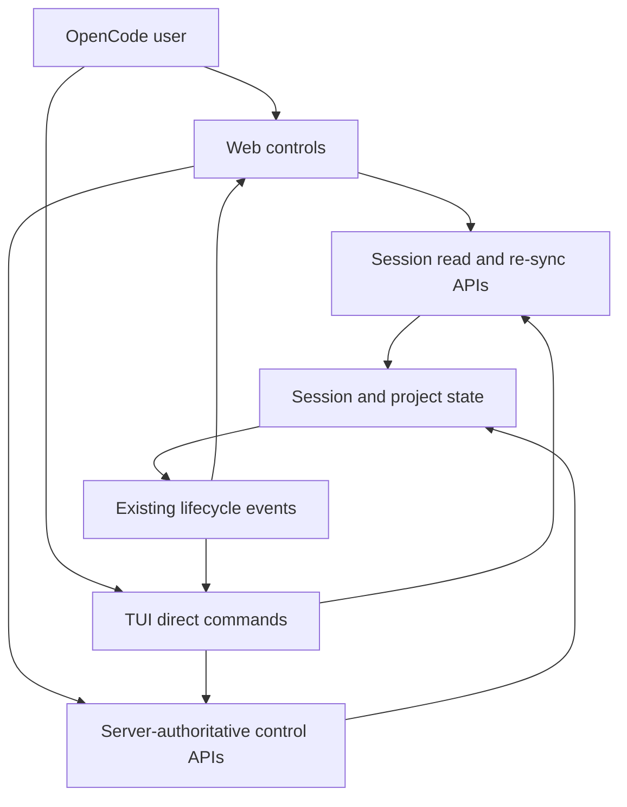
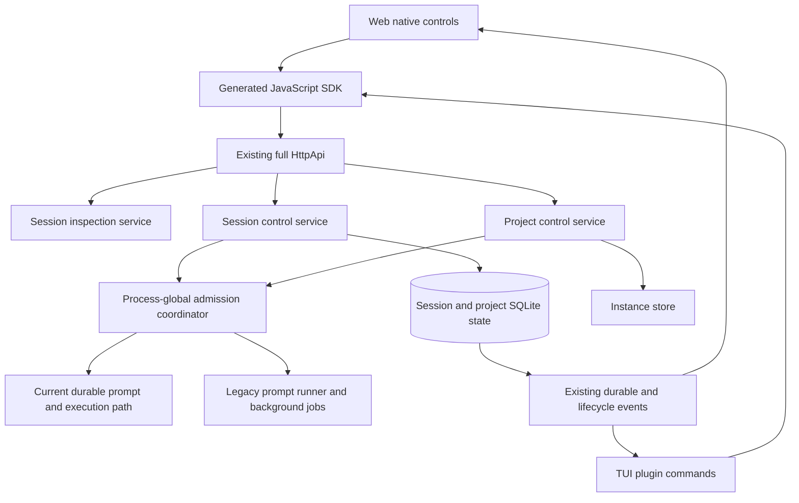
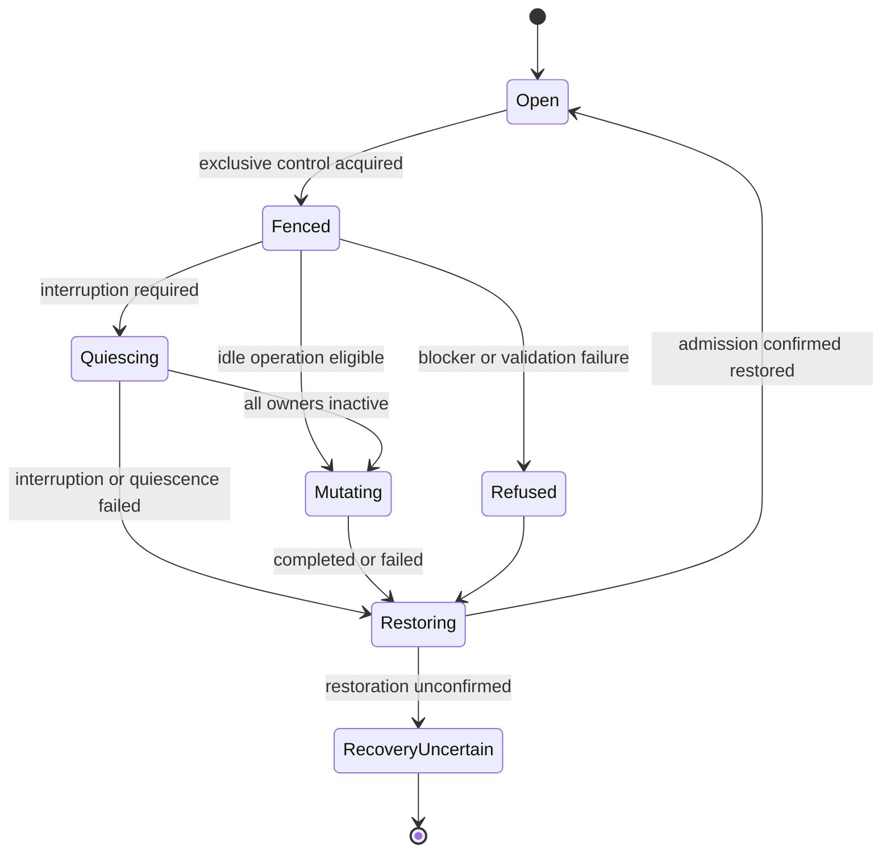
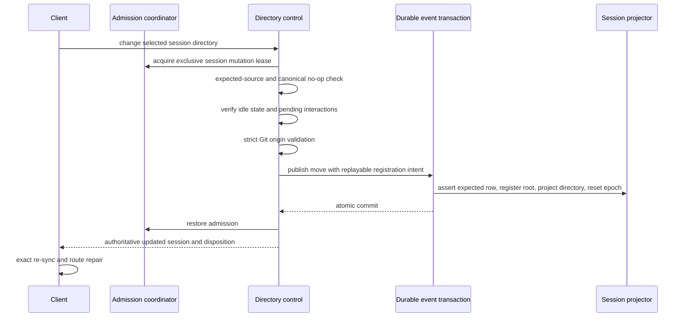

# OpenCode Project and Session Controls - Plan

## Goal Capsule

- **Objective:** Define a coordinated set of web and TUI controls for re-syncing and inspecting sessions, reloading session instructions and projects, and changing the selected session's directory without model turns or full-client restarts.
- **Authority:** The Product Contract governs behavior, the Planning Contract governs implementation, and repository instructions override execution mechanics.
- **Product authority:** This Product Contract governs the broadened capability set. The existing `docs/plans/2026-07-21-001-feat-opencode-project-reload-plan.md` remains authoritative until guarded project reload is completed. Then adapt that plugin as the TUI adapter or deprecate it if the resulting native integration makes it unnecessary.
- **Baseline status:** The MkChad fork is ready on the upstream OpenCode 1.18.18 baseline. Planning must revalidate only the APIs and synchronization primitives used by this capability family against that checked-out baseline.
- **Execution profile:** Plan the capabilities as separate coherent changesets over shared server behavior and client-specific integrations, preserving the original OpenCode 1.18.18 security and test disposition described below.
- **Rebase posture:** Keep the fork changes parallel to existing OpenCode server and client seams. Prefer additive modules and narrow hooks over broad refactors so the patch set remains easy to rebase and avoids unrelated generated or formatting churn.
- **Stop conditions:** Stop before implementation broadens the security model, modifies working-tree contents, admits old-context work through a control fence, bypasses generated-client contracts, or cannot preserve a recoverable admission state.
- **Tail ownership:** Complete and verify `opencode/` first, then adapt and verify `opencode-project-reload/`; the parent workspace records only the finished child revisions and this plan.

---

## Product Contract

### Summary

Add client-local targeted re-sync plus server-authoritative OpenCode project and session inspection and mutation controls, with separate web and TUI experiences.
The capability set covers targeted session re-sync, session inspection, explicit session-context reload, guarded project reload, and changing one session's directory. OpenCode v2 adoption remains outside this work.

**Directory terminology:** The selected session's current directory always means the durable directory stored on that session. It is not necessarily the project's primary directory or the working directory of the attached web or TUI client, and clients must not substitute either value for it.

### Governing OpenCode 1.18.18 Disposition

This work extends the original OpenCode 1.18.18 product and must retain its supported security posture rather than silently turning these controls into a stronger security boundary.

- **Trusted local operator:** OpenCode trusts the local user and user-controlled configuration. Permission prompts are a UX safeguard rather than a security boundary.
- **Opt-in server with optional shared authentication:** Server mode is opt-in, binds to `127.0.0.1` by default, and may run without authentication. When `OPENCODE_SERVER_PASSWORD` is configured, one shared HTTP Basic credential protects the normal route surface. OpenCode 1.18.18 does not provide per-user identity, roles, scopes, object ACLs, or a connection-bound authorization identity.
- **Request-selected project context:** Normal requests select their instance or workspace context through existing request and session routing. Directory and project selection are trusted operator inputs, not an allowlist, filesystem confinement mechanism, or authorization boundary.
- **Functional guardrails only:** Reload and directory-change validation in this contract protects a cooperative user from accidental interruption, state confusion, and data loss. It does not promise protection from a malicious local user or configuration, a hostile same-user filesystem writer, or arbitrary concurrent mutation outside OpenCode.
- **Existing automated gates:** The upstream CI contract runs package tests on Linux and Windows with `GITHUB_ACTIONS=false bun turbo test`, checks generated clients on Linux, runs the app Playwright suite on Linux and Windows, and runs `bun run test:httpapi` on Linux. The HttpApi exerciser requires non-skipped route scenarios and executes coverage, authentication, and effect passes with `--fail-on-missing --fail-on-skip`.
- **Assurance limit:** The route coverage pass proves scenario registration rather than exhaustive behavior. The authentication pass verifies the configured-password behavior for protected routes; it does not establish multi-user authorization. OpenCode 1.18.18 has no required SAST, dependency-audit, fuzzing, code-coverage threshold, or hardened multi-user security gate, and this work does not add one.

New or changed routes must preserve this disposition, join the existing HttpApi exerciser gates, and add focused unit or integration coverage for their functional safety rules. Client work must use the affected package's existing tests and the generated-client or Playwright gates when applicable.

### Problem Frame

OpenCode exposes useful project, session, message, worktree, and instance lifecycle data, but users cannot consistently inspect or control that state from both primary clients.
The web app normally follows session events but offers no user-facing way to repair one stale timeline without reloading the page.
After editing an applicable `AGENTS.md`, users also lack an explicit way to discard the selected session's cached instruction baseline and guarantee that its next model turn starts with the new rules.
The existing reload plugin provides a careful TUI-only workflow, yet its blocker checks and disposal remain separate client requests with an acknowledged concurrency race.
The server already has the durable projection needed to change a session's directory and reset that session's location-derived context. The desired operation exposes only that narrow capability and leaves both working trees untouched.

### Key Decisions

- **Target the ready OpenCode 1.18.18 baseline.** (session-settled: user-directed — the update from the earlier 1.18.9 fork is complete; controls must now be designed and verified against the checked-out 1.18.18 baseline.)
- **Retain the 1.18.18 security disposition.** Shared server behavior may add correctness and data-safety checks, but it must not introduce or imply per-user authorization, object ACLs, directory confinement, or stronger credential handling as part of this capability family.
- **Keep the patch set narrow and rebaseable.** Implement through existing server domains, events, clients, and extension seams where possible; avoid cross-cutting redesign that is not required by these controls.
- **Keep shared behavior on the server.** (session-settled: user-approved — chosen over duplicating lifecycle and mutation orchestration in each client: web and TUI should receive the same authoritative decisions and safety checks.)
- **Use client-specific presentation.** The web integration belongs in the OpenCode app, while direct TUI commands and TUI presentation belong in the external TUI plugin or a later upstream TUI integration.
- **Keep client re-sync separate from server mutation.** Session re-sync repairs one client's local projection through existing reads; it does not reload project state or mutate a session.
- **Keep session-context reload separate from project reload.** Resetting one session's instruction baseline after an `AGENTS.md` edit must not dispose its project instance or change its directory.
- **Count user and assistant activity separately.** (session-settled: user-approved — chosen over one completed-exchange count or provider-turn count: inspection should show user prompts and completed assistant responses as distinct primary counts.) Provider turns may appear as secondary detail.
- **Change only the selected session's directory.** (session-settled: user-approved — validate an existing destination as the same Git repository or project when applicable, update only the selected session and any required same-project directory registration, and never create a worktree or move working-tree changes.)
- **Treat the plugin as an adapter, not the whole product.** A broader plugin name is appropriate only after it owns more than project reload and its durable role is known.

### Actors

- A1. **OpenCode user:** Inspects or controls the current session or project from the web app or TUI.
- A2. **Client adapter:** Presents an action, sends a request through OpenCode's normal transport and optional authentication, reconciles returned state, and reports a bounded result.
- A3. **OpenCode server:** Owns session and project identity, validates mutations, changes durable state, and publishes lifecycle events.

### Requirements

**Baseline and shared behavior**

- R1. The controls target the ready MkChad fork based on upstream OpenCode 1.18.18; a later baseline change requires the affected fork behavior and capability interfaces to be revalidated before implementation continues.
- R2. Planning must revalidate the endpoints and client synchronization primitives used by this capability family against the checked-out 1.18.18 baseline rather than assuming the earlier 1.18.9 shapes remain unchanged.
- R3. Inspection, re-sync, project reload, session-context reload, and session-directory actions must execute without creating a user message, model turn, model-visible tool call, or hidden provider request.
- R4. Behavior shared by web and TUI must come from one server-authoritative capability rather than independent client interpretations.
- R5. Each control must use OpenCode's normal client transport, optional shared Basic-auth behavior, and request-selected session or project context. Clients must not create separate transports or credential handling, and the controls must not claim per-client identity, object-level authorization, or connection-bound access that OpenCode 1.18.18 does not provide.

**Web session re-sync**

- R6. The web session view must expose an explicit **Re-sync session** action from the existing server-status icon and popover, reachable by click or tap, that fetches current session metadata and latest turns without a full-page browser refresh.
- R7. Re-sync must use the existing forced session synchronization path when it remains available on the 1.18.18 baseline; it must not introduce a server endpoint solely to repeat existing reads.
- R8. Re-sync must preserve already loaded history, optimistic local state, and the user's reading position while reconciling newer server state.
- R9. A re-sync failure must leave the existing timeline visible and report the failure without implying that server-side session state changed.

**Session inspection**

- R10. A user must be able to inspect the selected session's directory, project identity, location classification, turn counts, activity state, and available worktree context without a model turn.
- R11. Inspection must report user prompts and completed assistant responses as separate primary counts; provider turns may be shown as a separately named secondary count.
- R12. Inspection results must be consistent across web and TUI and must come from authoritative server state rather than filesystem interpretation on the client host.
- R13. Planning must determine whether existing APIs can satisfy inspection coherently or whether one aggregate read endpoint is needed for efficiency and semantic consistency.

**Guarded project reload**

- R14. Project reload must validate the target project instance, active or retrying work, pending permissions, and pending questions through server-authoritative state before disposal.
- R15. A guarded reload capability must combine validation and disposal behind one server operation, while documenting any remaining inability to exclude work admitted concurrently.
- R16. Reload must affect only the selected project instance, preserve persisted sessions and messages, and leave the shared server and unrelated project instances running.
- R17. Web and TUI must expose the same reload eligibility and outcome categories without duplicating blocker policy.
- R18. Reload feedback must distinguish refusal before disposal, confirmed completion, failed recovery, and an uncertain post-dispatch outcome.

Project reload remains a separate capability for reinitializing project-instance state such as project configuration and server-side plugins. Changing a session directory resets that session's location-derived context so its next model turn discovers the destination's applicable `AGENTS.md` files. Independently, session-context reload resets the same per-session context at the selected session's durable current directory after an instruction edit; neither operation requires project-instance reload or recreates the session.

**Change session directory**

- R19. A user must be able to change an idle session's directory to an existing directory already registered to the same project or to an unregistered local Git checkout whose normalized `origin` identity matches the selected project. The server must validate before persistence, then commit any required directory registration and the session-location update as one operation, with registration established no later than the location update. Eligibility is a trusted-operator product guardrail, not a directory allowlist or security boundary.
- R20. The server must refuse the directory change while session work is active or retrying, or while a session-scoped permission or question is pending; clients present the authoritative result rather than implementing their own filesystem validation.
- R21. A successful directory change must update only the selected session's durable location and any required same-project directory registration, reset that session's location-derived context, and keep its identity and history intact. The existing internal session-location event and projector may perform the durable update and context reset; this work must not add a new client event contract.
- R22. A directory change must not copy, apply, discard, clean, or otherwise modify source or destination working-tree changes, and it must not create a worktree.
- R23. After success, the initiating client must perform an exact re-sync of the selected session and continue from the returned directory. Web resolves the selected session by ID and updates that cached record. The TUI must bypass its one-shot session-sync guard, update its directory-scoped cache, and adjust the selected route when the returned directory leaves the current list scope. Neither client requires a new event contract.
- R24. Directory-change feedback must distinguish same-directory no-op, validation refusal, pre-update failure, confirmed completion, and an uncertain post-dispatch outcome without claiming that either working tree was changed.

**Worktree and directory visibility**

- R25. Session inspection must show whether the selected session's durable current directory is the project's primary worktree, another recognized Git worktree, or another registered project directory.
- R26. Users may select a listed project directory or specify an existing local Git checkout. These session controls must reject a missing, non-Git, origin-less, or mismatched unregistered destination before project or session mutation. Registration failure must leave both project metadata and the session unchanged. The controls do not create, remove, or replace worktrees, but a worktree created independently by the user may be validated, registered, and selected.

**Client commands and packaging**

- R27. TUI actions may be exposed as direct slash or palette commands and must render output without entering the prompt-command model path.
- R28. Web actions must use native web controls until OpenCode adopts a supported web extension surface.
- R29. The standalone plugin must not be renamed until at least one broader TUI capability is implemented and the package's long-term responsibility is clear.

**Reload selected session context**

- R30. A user must be able to explicitly reload the selected session's location-derived system context after editing an applicable `AGENTS.md`, without changing the session directory or reloading its project instance.
- R31. Session-context reload must execute as one session-scoped transition: close prompt and execution admission for the selected session, interrupt and await any active execution, reset only that session's cached context epoch, then reopen admission. No old-baseline turn may continue after reset, no new turn may start before reset completes, and every terminal failure path must restore admission before returning or report an uncertain recovery state until restoration is confirmed.
- R32. The next model turn after session-context reload must discover applicable instructions from the session's current directory and initialize a fresh baseline containing the edited rules; ordinary session history and identity remain intact.
- R33. Web and TUI must expose session-context reload as a direct control that reports idle completion, active-turn interruption and completion, or failure without creating a model turn.

### Client And Server Relationship

### Key Flows

- F1. **Re-sync a stale web timeline:** The user opens the server-status control and selects **Re-sync session**; the web client force-fetches current session metadata and the latest message page; reconciliation adds missed turns while preserving existing history and viewport state.
- F2. **Inspect the current session:** The user opens session information in web or TUI; the client requests authoritative session and project context; the client presents the same named fields and turn-count definitions without creating a model turn.
- F3. **Reload a project instance:** The user requests reload; the server validates blockers and target identity; an eligible instance is disposed and recreated; clients reconcile lifecycle events and preserve the selected session.
- F4. **Change a session directory:** The user selects a listed same-project directory or specifies an existing local Git worktree created independently; the server validates blockers and project identity, atomically commits any required registration with the selected session-location update, resets its location-derived context, and returns the updated session; the initiating client re-syncs that session and continues from the destination without modifying either working tree.
- F5. **Reload edited session instructions:** The user edits an `AGENTS.md` applicable to the selected session and invokes session-context reload; the server fences that session against new work, interrupts and awaits any active execution, resets the context epoch, and reopens admission; the next model turn initializes a fresh instruction baseline from the selected session's unchanged durable directory without disposing the project instance.

### Acceptance Examples

- AE1. **Covers R6-R9.** Given another client created turns that the web timeline missed, when the user chooses **Re-sync session** from the server-status control, then the missing turns appear without a page reload and previously loaded history remains available.
- AE2. **Covers R8-R9.** Given the user is reading earlier turns and re-sync fails, when the failure is reported, then the timeline and reading position remain intact.
- AE3. **Covers R10-R13, R25.** Given a session in an alternate worktree, when its information is opened in web and TUI, then both clients report the same server directory, project, location classification, and named turn counts without model activity.
- AE4. **Covers R14-R17.** Given active work or a pending interaction in the target project, when reload is requested from either client, then the server refuses before disposal and both clients report the same blocker category.
- AE5. **Covers R14-R17.** Given an idle eligible project, when reload succeeds, then only that project instance is recreated and its persisted sessions remain available.
- AE6. **Covers R19-R23, R26.** Given an idle session and an unregistered local worktree created independently by the user whose normalized `origin` matches the selected project, when its directory is changed, then registration and the selected session-location update commit atomically, its history remains intact, the initiating client exactly re-syncs it from the destination, and its next model turn discovers the destination's applicable instructions.
- AE7. **Covers R22.** Given source and destination worktrees both contain uncommitted changes, when the session directory changes successfully, then both working trees remain unchanged.
- AE8. **Covers R3-R5, R17, R23.** Given equivalent actions in web and TUI, when either client invokes the action, then both use the same server policy and neither creates a model turn.
- AE9. **Covers R18.** Given project disposal was dispatched but completion or recovery cannot be confirmed, when bounded reconciliation ends, then the client reports an uncertain post-dispatch outcome and does not claim success.
- AE10. **Covers R24.** Given a same-directory request, validation refusal, pre-update failure, successful update, or lost post-dispatch response, when a directory change is requested, then feedback reports the matching outcome without claiming that either working tree changed.
- AE11. **Covers R30-R33.** Given the user edits an applicable `AGENTS.md` while the selected session is idle, when session-context reload completes, then the project instance is not disposed, the session directory, identity, and history remain unchanged, and its next model turn starts from a fresh baseline containing the edited rules.
- AE12. **Covers R31-R33.** Given a provider turn is active under the old instructions, when session-context reload is requested, then new work is fenced, active execution reaches quiescence before the context epoch is reset, admission reopens afterward, the project instance remains unchanged, and every later turn uses the new instruction baseline.
- AE13. **Covers R19, R26.** Given an independently created destination is missing, non-Git, origin-less, mismatched, or cannot be registered, when a directory change is requested, then the server refuses with project metadata and the session unchanged.
- AE14. **Covers R30-R33.** Given session-context reload cannot interrupt active execution or reset the context epoch, when the operation fails, then it restores session admission before reporting failure, does not claim new instructions are active, and does not dispose the project instance or change the session directory; inability to confirm admission restoration remains an explicit uncertain recovery state.

<!-- ce-section: work-relationships -->
### How This Work Fits Together

This plan owns the rough product contract for the capability family; each capability remains eligible for separate planning and delivery, and this breakdown is not a committed release roadmap.

- **Depends on:** The completed stable OpenCode update establishes the API baseline that every capability must revalidate against.
- **Can proceed independently:** Web session re-sync uses existing read behavior and does not depend on new mutation endpoints.
- **Enables:** Session inspection establishes shared terminology for location, worktree classification, and turn counts used by later controls.
- **Shares:** Guarded project reload and session-directory change share server-side blocker terminology and bounded outcome presentation, but neither requires the other to ship.
- **Reuses:** Session-context reload and session-directory change both reset one session's context epoch, but only directory change updates location or project-directory registration.

### Scope Boundaries

- Updating to or adopting the OpenCode v2 beta is not part of this work.
- Building a general web plugin runtime, cross-client plugin marketplace, or arbitrary declarative UI extension protocol is not part of this work.
- Hosted Workspace provisioning and distributed session execution are not part of this work.
- OpenCode-managed directory and worktree creation, removal, and primary-directory replacement are not part of this work. Existing worktrees created independently by the user remain eligible for validation and registration.
- Authentication hardening, per-user identity, roles or scopes, object ACLs, credential transport redesign, and directory confinement are not part of this work.
- The controls do not defend against malicious user configuration, hostile same-user filesystem mutation, or arbitrary external worktree changes; they must report observed conflicts and preserve the functional outcomes explicitly required here.
- Project reload does not imply a shared-server restart, process-global configuration reload, or TUI plugin reload.
- Changing a session directory does not move files, change project identity, create a new session, or introduce a new client event protocol.
- Broad server, session, event, client-routing, or generated-code refactors undertaken only for architectural cleanup are outside scope; implementation should minimize divergence from upstream 1.18.18.
- Final endpoint names, command names, button placement, and plugin package name are deferred to planning or later product decisions.

### Dependencies And Assumptions

- The current research and implementation baseline is the ready MkChad fork based on upstream OpenCode `v1.18.18`.
- The current web app has a forced session synchronization path that re-fetches session metadata and the latest message page through existing APIs.
- The current server exposes project instance disposal but no guarded operation that combines blocker validation and disposal.
- The current fork contains the durable same-project session-location and context-reset mechanics this plan narrows into a directory-change operation.
- The current session context machinery can reset a durable context epoch, but no public endpoint or client command exposes an explicit selected-session context reload.
- Existing project resolution derives stable identity from normalized Git `origin`, and instance loading can register an external linked worktree; the directory-change flow must perform identity validation before persisting a previously unregistered destination.
- External TUI plugins can register direct commands and render TUI output; the current stable architecture has no corresponding external web UI plugin target.
- OpenCode v2 remains a separate active beta line and is not a dependency of this work.

### Planning Resolutions

- Session inspection uses one aggregate read because no existing read defines counts and location classification coherently, and composing several reads would expose avoidable cross-request drift.
- Guarded project reload uses a server-owned exact-instance admission fence because combining the current checks and disposal without closing admission preserves the known concurrent-start race, while fencing by project identity would unnecessarily block other worktree instances.
- Web exposes re-sync in the server-status popover and the remaining selected-session controls in a native session-controls dialog reachable from the session menu and command palette. TUI presents inspection and controls as direct plugin commands with concise dialog or toast output.
- The standalone reload plugin becomes the 1.18.18 TUI adapter over the server operation. Renaming or deprecation remains deferred until broader native TUI ownership is proven.

### Sources And Research

- `opencode/packages/app/src/context/server-session.ts` contains forced session metadata and latest-message synchronization with reconciliation.
- `opencode/packages/opencode/src/server/routes/instance/httpapi/groups/instance.ts` defines project instance disposal and path reads.
- `opencode/packages/opencode/src/server/routes/instance/httpapi/groups/control-plane.ts` defines the experimental move-session operation.
- `opencode/packages/core/src/control-plane/move-session.ts`, `opencode/packages/core/src/session/projector.ts`, and `opencode/packages/core/src/session/context-epoch.ts` define the existing same-project session-location update and per-session context reset that the narrower directory-change operation can reuse.
- `opencode/packages/core/src/instruction-context.ts` establishes that applicable `AGENTS.md` discovery is location-scoped, so changing a session directory does not require project-instance reload.
- `opencode/packages/core/src/session/context-epoch.ts`, `opencode/packages/core/src/session/run-coordinator.ts`, and `opencode/packages/core/src/session/runner/llm.ts` establish the reset, interruption, and next-turn baseline behavior needed for explicit session-context reload.
- `opencode/packages/core/src/project.ts`, `opencode/packages/opencode/src/project/project.ts`, and `opencode/packages/core/src/project/directories.ts` define normalized Git-remote project identity and existing directory registration.
- `opencode/packages/tui/src/context/sync.tsx` and `opencode/packages/app/src/context/server-session.ts` show the TUI's directory-scoped list and one-shot sync guard versus the web app's ID-keyed exact-session re-sync seam.
- `opencode/packages/app/src/components/status-popover.tsx` and `opencode/packages/app/src/components/status-popover-body.tsx` define the server-status control that will expose **Re-sync session**.
- `opencode/packages/plugin/src/tui.ts` and `opencode/packages/opencode/specs/tui-plugins.md` define direct TUI commands and presentation surfaces.
- `opencode-project-reload/src/reload.ts` demonstrates the current client-side reload safety checks and acknowledged concurrency limitation.
- `opencode/SECURITY.md` defines the original 1.18.18 trusted-local-user, opt-in-server, optional-authentication, and permission-UX disposition.
- `opencode/.github/workflows/test.yml`, `opencode/packages/opencode/package.json`, and `opencode/packages/opencode/test/server/httpapi-exercise/` define the original 1.18.18 package, generated-client, Playwright, and HttpApi coverage/auth/effect gates.
- `opencode/packages/opencode/src/server/auth.ts`, `opencode/packages/opencode/src/server/routes/instance/httpapi/middleware/authorization.ts`, and `opencode/packages/opencode/src/server/routes/instance/httpapi/middleware/workspace-routing.ts` establish optional shared Basic authentication and trusted request-selected instance context without per-user or object-level authorization.
- `docs/plans/2026-07-21-001-feat-opencode-project-reload-plan.md` records the detailed existing reload product and planning contract.
- [OpenCode v1.18.18 release](https://github.com/anomalyco/opencode/releases/tag/v1.18.18) identifies the stable upstream baseline available when this document was written.

---

## Planning Contract

### Product Contract Preservation

Product Contract unchanged. Planning resolved the four deferred implementation questions and added no new actor, product capability, authorization promise, worktree mutation, or model-visible action.

### Key Technical Decisions

- KTD1. **Stay on the checked-out 1.18.18 architecture.** (session-settled: user-directed — chosen over adopting the v2 beta: the stable fork update is complete and the extension must remain rebaseable.) The work extends the mixed legacy/current server and client seams already used by the stable clients.
- KTD2. **Put shared policy behind server domain services.** (session-settled: user-approved — chosen over duplicating blocker and mutation orchestration in web and TUI: every client must receive the same authoritative decision.) Client adapters select a session, invoke a typed operation, and reconcile the returned outcome.
- KTD3. **Introduce one process-global admission coordinator below route adapters.** The coordinator tracks session and exact instance control ownership, rejects overlapping controls instead of queuing them, and lets another worktree instance of the same project proceed. Each work-starting path acquires a short-lived claim before its first durable or model-visible side effect; current claims end after durable input and wake registration, while legacy claims end after user-message persistence and runner registration. Control acquisition atomically closes new claims and waits for earlier claims to reach blocker-visible ownership before evaluating state. Abort and replies needed to drain existing work remain available.
- KTD4. **Fence before blocker evaluation and restore admission in an uninterruptible finalizer.** A session lease conflicts with its exact instance lease, and an instance lease conflicts with sessions currently located in that instance. Work arriving after closure receives a typed control-in-progress refusal without durable or model-visible state. Session moves, deletion, and every supported writer that can invalidate a control's expected location participate in the same mutation boundary. Every refusal and pre-commit failure returns only after admission is confirmed open; an unconfirmed restoration is an uncertain recovery outcome that disables automatic retry.
- KTD5. **Use one aggregate inspection read.** It returns the durable session directory and project identity, a containing-root classification of `primary_worktree`, `recognized_worktree`, `registered_directory`, or `unregistered`, separate projected user and completed-assistant counts, current activity, pending-interaction categories, and available project directories. Completed assistant responses are projections with a completion timestamp, including interrupted or errored terminal responses; optional provider-turn counts are omitted initially.
- KTD6. **Expose shared controls through the existing full OpenAPI and generated JavaScript SDK surface.** The root/instance HttpApi remains the stable-client transport used by web, TUI, plugins, and external automation. Do not add parallel `/api` Protocol endpoints, raw fetch paths, credential handling, prompt commands, MCP wrappers, or model-visible tools for this scope.
- KTD7. **Strengthen forced web session synchronization.** A forced request may share another forced request, but it must not collapse into an ordinary in-flight cache fill. If an ordinary request is active, schedule one trailing forced metadata and latest-message read while preserving older history, optimistic state, and viewport ownership.
- KTD8. **Derive guarded reload targets from the durable selected session.** The server accepts a session ID, derives its canonical `InstanceStore` directory key at the operation linearization point, refuses stale request-selected context, closes admission only for that exact instance, checks active/retrying work and pending interactions for sessions located there, then invokes the existing instance reload seam. Same-origin sessions in another worktree instance continue. Structured outcomes separate pre-dispatch refusal, confirmed completion, failed recovery, and server-side uncertainty; transport loss after dispatch remains client-reconciled uncertainty.
- KTD9. **Reload session context only after both execution systems are quiescent.** The operation closes session admission, interrupts current `SessionExecution` ownership and legacy `SessionRunState` plus descendant background jobs, awaits inactive status, resolves pending session interactions through existing interruption cleanup, resets the context epoch, and reopens admission. If either execution path cannot quiesce, the epoch remains unchanged even though work may have been interrupted.
- KTD10. **Implement directory change as a separate no-worktree operation with server-owned policy.** (session-settled: user-approved — chosen over moving worktree changes or creating worktrees: only the selected session location may change.) The server service owns admission, blocker policy, expected-source validation, and outcomes; Core owns canonical Git-origin comparison and the atomic durable mutation. Same-directory no-op is evaluated under the session mutation lease but before blocker and destination validation. Required destination-root registration is encoded in the durable moved event or derived deterministically by its projector so replay reproduces registration, exact location, and context reset together.
- KTD11. **Separate server disposition from host-owned client reconciliation.** A confirmed server mutation followed by failed client refresh reports completion-with-reconciliation-failure rather than server uncertainty or an automatic mutation retry. Web refreshes the ID-keyed selected record. TUI exposes a narrow plugin-host reconciliation capability that forces detail hydration, refreshes the filtered list, pins the selected session outside list scope, reconnects to the returned directory, and reports repair failure without giving external plugins cache mutation access.
- KTD12. **Adapt the reload plugin instead of renaming or deleting it.** The plugin targets the MkChad 1.18.18 capability contract, consumes locally built fork SDK/plugin artifacts for functional integration, replaces client-side blocker/disposal orchestration with generated-SDK invocation, and preserves direct command registration and privacy-safe feedback. A stock upstream 1.18.18 load check may prove graceful capability refusal but must not claim that upstream contains the fork endpoint. A broader package identity remains follow-up work.
- KTD13. **Retain the 1.18.18 security and authentication disposition.** Shared Basic authentication and request/session routing continue to protect and select normal routes. Control checks are cooperative correctness guardrails, not user authorization, filesystem confinement, or a stronger trust boundary.
- KTD14. **Use at-most-once client dispatch without durable operation receipts.** Completed duplicate requests are new operations; generated clients and adapters must not automatically retry mutation requests after response loss. Directory mutation includes the expected source directory and rejects stale delayed delivery. Context and project reload response loss remains causally uncertain, requires re-inspection before a new explicit action, and does not add a migration or durable deduplication ledger.

### High-Level Technical Design

The control family adds one shared admission boundary and narrow domain operations while keeping presentation and local cache repair client-specific.

Every mutating control follows the same admission lifecycle; operation-specific checks decide whether work is refused, interrupted, or committed.

Directory registration uses the existing durable-event transaction and replayable move data so no observer or rebuilt projection can see a registered destination without the matching session move, or a move without its context reset.

### Implementation Constraints

- Keep runtime dependencies directed from Schema to Core/Protocol and then Server/Client. Shared admission claims and durable directory mechanics belong in Core; blocker normalization, instance lifecycle, pending interactions, and legacy-runner orchestration remain in the server package.
- Preserve the existing module self-reexport pattern and avoid a new barrel in multi-sibling directories.
- Keep domain services free of HttpApi error types. Declare stable schemas and map typed domain failures at the handler boundary.
- Add public documentation comments to every affected exported service, operation, result, error, and schema, including failure and side-effect behavior.
- Use the full HttpApi route tree and generated SDK. Do not manually edit generated SDK or client files.
- Work-admission claims must sit at service-level start/resume/enqueue choke points, not only HTTP handlers. Claims bridge side-effect creation into blocker-visible runner ownership, while mutation leases also cover session move and deletion writers that can invalidate expected state.
- Same-directory no-op runs under the session mutation lease but precedes blocker and filesystem validation. Every other directory request compares the expected source, validates the exact destination and containing worktree root, and asserts the expected session row before persistence.
- Use published readiness signals, latches, deferred values, session status, and fake clocks in concurrency tests; do not synchronize with arbitrary sleeps.
- Do not persist or render pending permission/question bodies in inspection or refusal diagnostics; expose category and count only.
- Web changes must use `createStore`, localized strings, session-ownership guards, and the existing lazy-dialog pattern. Record the required session/timeline benchmark before changing synchronization and compare it after.
- TUI direct commands must bypass prompt-command submission. Plugin production code reuses `api.client`, the narrow host reconciliation API, `api.event`, and host lifecycle only.
- Keep the existing move-session operation and its worktree-change semantics intact for current consumers; the new directory control is additive.
- Existing raw instance disposal and experimental move routes remain separately named unguarded lifecycle operations for compatibility. New web/TUI controls never call them, and their residual bypass is not described as covered by guarded-control policy.

### Sequencing

1. Establish admission ownership and prove that both execution paths reject new work without durable side effects while controls hold a fence.
2. Add read-only inspection and the two session mutations over tested Core primitives.
3. Add guarded project reload over the admission and instance-store boundaries.
4. Publish the complete server contract through HttpApi and regenerate the JavaScript SDK only after domain outcomes stabilize.
5. Add web and TUI adapters over the generated contract, then reduce the standalone plugin to a 1.18.18 adapter.
6. Run package-local gates first, the HttpApi exerciser and generated-output checks second, and client/browser and adapter compatibility checks last.

### System-Wide Impact

- **Prompt admission:** All supported work-starting paths gain one short-lived process-local claim before durable or model-visible effects. The idle path must remain constant-time and allocation-light.
- **Persistent state:** No migration is required. Expected-row validation, replayable registration intent, the durable moved event, session projection, and context-epoch deletion use existing tables and one transaction.
- **Public API:** New generated-SDK methods and structured result/error types become externally consumable stable-fork interfaces and must remain authenticated like neighboring routes.
- **Client caches:** Web and TUI gain explicit exact-refresh behavior. Existing event reducers remain unchanged because no new movement event protocol is introduced.
- **Plugin compatibility:** `opencode-project-reload` moves from a 1.18.3/1.18.4 client-side safety controller to an adapter for the MkChad capability on the 1.18.18 baseline, with graceful refusal on stock hosts that lack it.
- **Performance:** Aggregate inspection replaces several client reads, but count queries and classification must be indexed/bounded and must not load message bodies or entire timelines into memory.

### Risks And Mitigations

- **Admission handoff gap:** A race between a one-time check and runner ownership could hide newly persisted work. Use claims that control closure drains into blocker-visible ownership and test the current durable-input/wake and legacy message/runner handoffs explicitly.
- **Writer bypass:** Legacy move, deletion, raw disposal, or experimental routes could invalidate assumptions or bypass guarded semantics. Make session-state writers participate in mutation leases; retain raw routes only as explicitly unguarded compatibility operations and prohibit new adapters from calling them.
- **Hybrid execution interruption:** Current and legacy runners can disagree about quiescence. Require both owners plus descendant background jobs to report inactive before context reset and preserve an explicit failed/uncertain outcome.
- **Fence leakage:** A defect after mutation could permanently block work. Use uninterruptible restoration, state-transition tests at every failure boundary, and no automatic retry after unconfirmed restoration.
- **Atomic registration drift:** Reusing project loading would suppress registration failure, while a local-only event commit hook would not replay. Serialize or deterministically derive registration in the durable move projection and inject precondition/projector/registration/event-row failures to prove rollback.
- **Post-commit event loss:** Event fan-out occurs after SQLite commit and can be missing or partial. Treat commit as the server mutation boundary, classify notification cuts as reconciliation failures or transport uncertainty, and repair by exact reads without mutation retry.
- **Delayed duplicate mutation:** No durable operation ledger exists. Require expected-source validation for directory changes, no-retry generated mutation calls, and explicit re-inspection after uncertain context/project reload outcomes.
- **Stale client routing:** Directory-filtered TUI state can lose the selected session after success. Keep an ID-pinned detail record through exact hydration and distinguish server success from local reconciliation failure.
- **Forced-sync coalescing:** A force request can currently join a weaker in-flight request. Add trailing-force semantics and race tests before exposing the UI action.
- **Upstream rebase conflict:** Session, HttpApi, app sync, and TUI sync are active upstream areas. Keep new services additive, route hooks narrow, generated churn isolated, and avoid unrelated formatting.
- **Localization breadth:** New web copy affects every locale. Reuse established terms where possible, update complete phrase keys through the existing locale workflow, and require parity tests; do not invent translations from model knowledge.

### Deferred To Follow-Up Work

- Dedicated Protocol `/api` endpoints and `@opencode-ai/client` methods for this stable capability family.
- Model-visible tools, MCP wrappers, prompt commands, or autonomous use of lifecycle mutations.
- A general cross-client plugin runtime or external web plugin surface.
- Renaming or deprecating `opencode-project-reload` before broader TUI ownership is established.
- Provider-turn counts in inspection unless a later use case gives them an unambiguous definition.
- Cluster-wide admission and execution ownership; this plan preserves the 1.18.18 process-local execution model.

---

## Implementation Units

### U1. Shared session and instance admission control

- **Goal:** Establish one process-global ownership boundary that fences both current and legacy work before model-visible or durable admission.
- **Requirements:** R3-R5, R14-R15, R20, R31; F3-F5; AE4, AE8, AE12, AE14; KTD2-KTD4.
- **Dependencies:** None.
- **Files:** `opencode/packages/core/src/session/admission.ts`, `opencode/packages/core/src/session.ts`, `opencode/packages/core/src/control-plane/move-session.ts`, `opencode/packages/core/test/session-admission.test.ts`, `opencode/packages/core/test/session-prompt.test.ts`, `opencode/packages/core/test/move-session.test.ts`, `opencode/packages/opencode/src/session/prompt.ts`, `opencode/packages/opencode/src/session/run-state.ts`, `opencode/packages/opencode/src/session/session.ts`, `opencode/packages/opencode/test/session/session-admission.test.ts`, `opencode/packages/opencode/src/server/routes/instance/httpapi/server.ts`.
- **Approach:** Add a global coordinator with short-lived work claims, exclusive session and exact-instance mutation leases, typed control-in-progress failure, visible ownership snapshots, and uninterruptible release. Current claims span durable input plus wake registration; legacy claims span user-message persistence plus runner registration. Exact-instance leases key off the canonical instance directory, not project ID. Legacy move and deletion acquire session mutation ownership without changing their existing functional semantics.
- **Execution note:** Start with deterministic handoff races around durable-input/wake and user-message/runner registration, then prove controls cannot pass blocker evaluation until older claims become visible.
- **Patterns to follow:** `SessionRunCoordinator` key serialization, `SessionExecution` global routing, Effect scoped acquisition/finalization, and published readiness helpers from `opencode/packages/opencode/test/AGENTS.md`.
- **Test scenarios:** Covers AE12. Work claims acquired before closure reach durable and runner-visible ownership before the control proceeds, while prompts arriving after closure fail without a `session_input`, user message, wake, or provider request; direct current-session and legacy-service calls behave identically; an exact-instance lease rejects sessions in that directory but permits a same-origin session in another worktree instance; session and instance leases conflict in both acquisition orders; legacy move and deletion serialize with controls; abort and pending-interaction replies remain usable while fenced; duplicate controls return control-in-progress rather than queueing; interruption, defect, cancellation, and scope exit release ownership; an unconfirmed release is recovery uncertainty; the idle claim path retains no per-call state after handoff.
- **Verification:** Every work-starting path has service-level coverage, admission order is proven with barriers rather than sleeps, unrelated sessions continue concurrently, and no route-only guard is required for correctness.

### U2. Aggregate session inspection

- **Goal:** Produce one authoritative, bounded inspection snapshot with stable count and directory-classification semantics.
- **Requirements:** R3-R5, R10-R13, R25-R26; F2; AE3, AE8; KTD5-KTD6.
- **Dependencies:** U1 for shared activity/control ownership visibility.
- **Files:** `opencode/packages/opencode/src/session/control-state.ts`, `opencode/packages/opencode/src/session/inspection.ts`, `opencode/packages/opencode/test/session/control-state.test.ts`, `opencode/packages/opencode/test/session/session-inspection.test.ts`, `opencode/packages/core/src/project/directories.ts`, `opencode/packages/core/test/project-directories.test.ts`, `opencode/packages/core/src/session/store.ts`.
- **Approach:** Add one privacy-safe control-state service that normalizes current/legacy activity, retrying state, control ownership, and pending interaction category counts for inspection and mutation policy. Read durable session/project/directory rows and projected count aggregates in one database transaction, then attach the control-state snapshot. Classify the containing Git/worktree root with explicit precedence and return `unregistered` for historical inconsistent state. Do not load message content, parts, permission bodies, or question bodies.
- **Execution note:** Implement the count and classification contract test-first because both clients and external automation will depend on its vocabulary.
- **Patterns to follow:** Existing `SessionStore` and `ProjectDirectories` Effect services, typed Schema result modules, and aggregate SQL projections used by session summaries.
- **Test scenarios:** Covers AE3. Inspect sessions at the primary root, nested beneath the primary root, in a recognized worktree, nested beneath a registered non-worktree directory, and in an unregistered historical directory; count user projections separately from assistant projections with `time.completed`; include interrupted and errored completed assistants but exclude incomplete assistants and pending durable inputs; omit message bodies and pending interaction content; report idle, active, retrying, permission, question, and control-in-progress snapshots; return typed not-found for a deleted session; keep durable fields internally consistent while a concurrent event updates volatile activity after the transaction.
- **Verification:** Web, TUI, and direct SDK callers can display identical fields without client filesystem interpretation or additional count reads, and query plans remain bounded by aggregate/indexed reads.

### U3. Atomic selected-session directory control

- **Goal:** Change only one idle session's durable directory, optionally registering a matching worktree root in the same transaction.
- **Requirements:** R3-R5, R19-R26; F4; AE6-AE8, AE10, AE13; KTD3-KTD4, KTD10-KTD11.
- **Dependencies:** U1-U2.
- **Files:** `opencode/packages/schema/src/session-event.ts`, `opencode/packages/schema/test/event.test.ts`, `opencode/packages/core/src/control-plane/change-session-directory.ts`, `opencode/packages/core/src/control-plane/move-session.ts`, `opencode/packages/core/src/project.ts`, `opencode/packages/core/src/project/directories.ts`, `opencode/packages/core/src/session/projector.ts`, `opencode/packages/core/test/change-session-directory.test.ts`, `opencode/packages/core/test/move-session.test.ts`, `opencode/packages/core/test/project.test.ts`, `opencode/packages/core/test/session-projector.test.ts`, `opencode/packages/core/test/event.test.ts`, `opencode/packages/opencode/src/session/control.ts`, `opencode/packages/opencode/src/session/control-state.ts`, `opencode/packages/opencode/test/session/session-control.test.ts`.
- **Approach:** Keep worktree-change capture/apply/discard behavior in the existing move operation, but make that writer participate in session mutation ownership. Expose one documented canonical remote-identity comparison in Core. The server control service acquires the session lease, compares the expected source, evaluates same-directory no-op, checks shared control state, and validates the destination. The Core primitive asserts that the session still exists at the expected project/source inside the transaction and publishes replayable registration intent with the existing moved event; projection stores the exact requested directory, registers the root idempotently, and resets only that session's epoch.
- **Execution note:** Use real temporary Git repositories and worktrees for identity behavior, with injected transaction failures for atomicity.
- **Patterns to follow:** `MoveSession` project resolution, the private origin normalization currently in `ProjectV2`, durable `SessionEvent.Moved` versioning, inline `SessionProjector` transactions, and idempotent `ProjectDirectories.create`.
- **Test scenarios:** Covers AE6. Move an idle session to a listed directory and to an independently created matching-origin worktree, including a nested requested directory; Covers AE7. preserve tracked, staged, untracked, and ignored files in source and destination byte-for-byte; Covers AE10. evaluate same-directory no-op under the lease before Git/blocker checks and distinguish validation, pre-commit, committed, post-commit notification loss, and uncertain transport dispositions; Covers AE13. reject missing, non-directory, non-Git, origin-less, mismatched-origin, stale expected source, deleted session, and registration failures; cover SSH/HTTPS remote equivalence and the established file-remote policy through the canonical identity helper; inject expected-row, projector, registration, context-reset, sequence, event-row, and commit failures and assert complete rollback with no notification; inject interruption after commit and assert durable state remains committed while exact read repairs missing notification; race legacy move and deletion against directory control; race two sessions registering one root and treat an already-present matching registration as satisfied; replay the durable move into a separately seeded projection and require directory, registration, and context-reset parity; reject active/retrying work and pending interactions; preserve session ID, messages, metadata, unrelated sessions, and both working trees.
- **Verification:** SQLite commit is the only mutation success boundary, pre-commit failure rolls back every durable effect, post-commit event loss never retries mutation, no filesystem-changing Git operation is called, and no new client movement event type exists.

### U4. Selected-session context reload

- **Goal:** Guarantee that the next turn uses freshly discovered instructions without changing the session directory or project instance.
- **Requirements:** R3-R5, R30-R33; F5; AE8, AE11-AE12, AE14; KTD3-KTD4, KTD9.
- **Dependencies:** U1-U2.
- **Files:** `opencode/packages/opencode/src/session/control.ts`, `opencode/packages/opencode/src/session/control-state.ts`, `opencode/packages/opencode/src/session/run-state.ts`, `opencode/packages/core/src/session/context-epoch.ts`, `opencode/packages/opencode/test/session/session-control.test.ts`, `opencode/packages/core/test/session-context-epoch.test.ts`, `opencode/packages/core/test/session-run-coordinator.test.ts`.
- **Approach:** Acquire the session lease, interrupt both execution owners and descendant background jobs, await current and legacy inactivity through the shared control-state service, allow interruption cleanup to settle pending session interactions, delete the selected session context epoch, and restore admission in an uninterruptible finalizer. Return structured idle-complete, interrupted-complete, failed-before-reset, and recovery-uncertain outcomes.
- **Execution note:** Characterize both interruption systems independently before composing the operation; every race test uses latches or status observation.
- **Patterns to follow:** `SessionExecution.interrupt`, `SessionRunState.cancel`, background-job descendant cancellation, `SessionContextEpoch.reset`, and session-runner next-turn context preparation.
- **Test scenarios:** Covers AE11. An idle reload preserves project instance, directory, identity, history, and messages, deletes only that session's epoch, and a deterministic local provider sees edited applicable `AGENTS.md` on the next turn; Covers AE12. an active current runner and an active legacy runner each reach quiescence before reset, with new prompts fenced throughout; exercise simultaneous legacy/current ownership defensively and require both inactive; Covers AE14. interruption failure or timeout leaves the old epoch authoritative and restores admission, reset failure restores admission without claiming new instructions, and unconfirmed restoration returns recovery uncertainty; verify descendant background jobs and pending interactions settle; verify another session's execution and epoch remain unchanged; cover cancellation at each pre-reset and post-reset boundary without asserting client retry behavior.
- **Verification:** No old-baseline work survives the quiescence boundary, no new work enters before reset, and every confirmed terminal result leaves admission open.

### U5. Guarded project reload

- **Goal:** Replace client-side best-effort preflight with one server-authoritative project reload operation.
- **Requirements:** R3-R5, R14-R18; F3; AE4-AE5, AE8-AE9; KTD3-KTD4, KTD8, KTD13.
- **Dependencies:** U1-U2.
- **Files:** `opencode/packages/opencode/src/project/control.ts`, `opencode/packages/opencode/src/project/instance-store.ts`, `opencode/packages/opencode/test/project/project-control.test.ts`, `opencode/packages/opencode/test/project/instance.test.ts`, `opencode/packages/opencode/src/server/routes/instance/httpapi/lifecycle.ts`.
- **Approach:** Resolve the selected session from durable state, derive and re-read its canonical instance directory under ownership, compare it with request-selected context, acquire the exact-instance lease, inspect shared control state for sessions located in that instance, and call the serialized instance reload seam only when clear. Keep response/disposal ordering and bounded recreation evidence explicit; restore admission against the replacement instance or return recovery uncertainty.
- **Execution note:** Preserve the current plugin's lifecycle characterization tests while moving policy and linearization to the server.
- **Patterns to follow:** `InstanceStore.reload`, lifecycle response-after-marking semantics, instance disposal events, and privacy-safe blocker categories from `opencode-project-reload/src/reload.ts`.
- **Test scenarios:** Covers AE4. refuse stale request context, active/retrying work, pending permission, pending question, malformed state, and a concurrent session/instance control before reload; Covers AE5. reload only the selected exact instance, preserve sessions/messages, permit a same-origin session in another worktree instance, and leave unrelated instances usable; complete a work claim immediately before fence closure and observe its runner ownership as a blocker, while work arriving after closure fails without side effects; race selected-session directory change against instance reload and require one authoritative ordering; cover no cached instance, bootstrap success, disposer failure, replacement bootstrap failure, lifecycle cancellation, and admission-restoration failure; distinguish refused, completed, recovery-failed, and server uncertainty without exposing pending content; ensure no provider request or model turn occurs.
- **Verification:** The operation closes the former preflight/disposal admission race on the supported process, performs at most one target reload, and never stops the shared server or disposes an unrelated instance.

### U6. Public HttpApi and generated SDK contract

- **Goal:** Publish inspection and mutation operations as authenticated, machine-readable methods used by every adapter.
- **Requirements:** R3-R5, R12-R18, R20, R23-R24, R27-R28, R30-R33; F2-F5; AE3-AE14; KTD6, KTD11, KTD13.
- **Dependencies:** U2-U5.
- **Files:** `opencode/packages/opencode/src/server/routes/instance/httpapi/groups/session.ts`, `opencode/packages/opencode/src/server/routes/instance/httpapi/groups/instance.ts`, `opencode/packages/opencode/src/server/routes/instance/httpapi/handlers/session.ts`, `opencode/packages/opencode/src/server/routes/instance/httpapi/handlers/instance.ts`, `opencode/packages/opencode/src/server/routes/instance/httpapi/api.ts`, `opencode/packages/opencode/src/server/routes/instance/httpapi/server.ts`, `opencode/packages/opencode/src/server/routes/instance/httpapi/errors.ts`, `opencode/packages/opencode/test/server/httpapi-session.test.ts`, `opencode/packages/opencode/test/server/httpapi-instance.test.ts`, `opencode/packages/opencode/test/server/httpapi-sdk.test.ts`, `opencode/packages/opencode/test/server/httpapi-exercise/index.ts`, `opencode/packages/sdk/js/src/v2/gen/`.
- **Approach:** Add typed inspection, directory change, context reload, and guarded reload endpoints to the existing session/instance route families. Accept session identity explicitly, retain normal workspace/instance routing and Authorization middleware, map domain failures to declared JSON errors, and return discriminated outcomes plus authoritative post-state where available. Regenerate the full JavaScript SDK; run the Protocol client generator as the repository-required guard and expect no new `/api` methods.
- **Execution note:** Add exerciser scenarios with the route declarations so coverage/auth/effect gates never contain a skipped placeholder.
- **Patterns to follow:** Existing HttpApi group/handler split, declared `Schema.ErrorClass` response contracts, session-location routing middleware, and the HttpApi exerciser DSL.
- **Test scenarios:** Direct generated-SDK inspection and all controls succeed under valid shared Basic authentication and reject missing/invalid authentication when configured; malformed payloads, missing sessions, stale selected context/source, control-in-progress, blockers, and validation failures decode into stable typed categories; every route creates no user message, durable prompt input, model turn, tool call, or provider request; successful mutation returns authoritative session/instance state; response loss before dispatch, after durable commit, and during client reconciliation remains distinguishable from server refusal and never triggers SDK retry; route coverage, auth, and effect modes all execute non-skipped scenarios; generated JavaScript methods and public types compile for web, TUI plugin, and external automation; raw instance disposal and experimental move remain separately named unguarded compatibility methods; Protocol generated output remains byte-identical.
- **Verification:** No adapter needs raw HTTP or UI-string parsing, generated files reproduce from source, and all routes inherit the supported authentication and request-routing disposition.

### U7. Web controls and exact reconciliation

- **Goal:** Add native web access to the shared controls while preserving timeline and route state.
- **Requirements:** R3-R13, R17-R18, R23-R24, R28, R30-R33; F1-F5; AE1-AE14; KTD7, KTD11.
- **Dependencies:** U6.
- **Files:** `opencode/packages/app/src/context/server-session.ts`, `opencode/packages/app/src/context/server-session.test.ts`, `opencode/packages/app/src/context/directory-sync.ts`, `opencode/packages/app/src/components/status-popover-body.tsx`, `opencode/packages/app/src/components/status-popover-body.test.tsx`, `opencode/packages/app/src/components/dialog-session-controls.tsx`, `opencode/packages/app/src/components/dialog-session-controls.test.tsx`, `opencode/packages/app/src/pages/session/use-session-commands.tsx`, `opencode/packages/app/src/pages/session/timeline/message-timeline.tsx`, `opencode/packages/app/src/i18n/en.ts`, `opencode/packages/app/src/i18n/parity.test.ts`, `opencode/packages/app/src/i18n/*.ts`, `opencode/packages/app/e2e/session-controls.spec.ts`.
- **Approach:** Add trailing-force semantics to exact session synchronization. Expose **Re-sync session** in the existing status popover. Add a lazy selected-session controls dialog reachable from the session more-options menu and command palette; it loads inspection, presents eligible directories plus explicit local-path entry, and invokes reload/context/directory operations through the generated SDK. Capture server key and session ID per action, guard completion with session ownership, and reconcile only the targeted record; retain server success when local repair fails.
- **Execution note:** Record a production-build baseline with `e2e/performance/timeline/session-timeline-benchmark.spec.ts` before changing synchronization, preserve its raw timing/render artifacts, run the same serial scenario afterward, and review relative deltas without adding a machine-dependent threshold.
- **Patterns to follow:** `createServerSession.sync`, `createSessionOwnership`, lazy dialog loading in `useSessionCommands`, status-popover view/state separation, existing directory selector components, and typed i18n APIs.
- **Test scenarios:** Covers AE1. a forced re-sync that overlaps an ordinary load performs one trailing forced metadata/latest-page read, while concurrent force requests coalesce; missed turns appear without dropping older pages, optimistic content, live-event updates, or reading position; Covers AE2. read failure leaves the timeline and viewport intact and shows localized failure; route/server selection changes during a request update only the captured cache and do not toast or navigate the new selection; Covers AE3. inspection renders server-defined fields and `unregistered` state without local filesystem inference; Covers AE4-AE5 and AE9. guarded reload shows matching refusal/completion/recovery/uncertainty states and preserves the selected session; Covers AE6-AE7, AE10, and AE13. directory selection, typed path, no-op, validation failure, server success, and reconciliation failure behave distinctly without implying file mutation; Covers AE11-AE12 and AE14. context reload reports idle, interrupted, failed, and recovery-uncertain outcomes; keyboard, pointer, narrow viewport, focus restoration, and accessible labels work; no action submits the composer or creates a model turn; i18n key and placeholder parity passes across locales.
- **Verification:** Unit tests prove reconciliation invariants, the timeline benchmark completes and collects the same metrics before and after with raw artifacts retained for relative review, and targeted browser coverage proves the controls on desktop and mobile layouts.

### U8. TUI adapter and standalone plugin migration

- **Goal:** Expose the same server outcomes as direct TUI commands and migrate project reload to the MkChad capability on the 1.18.18 baseline.
- **Requirements:** R3-R5, R10-R12, R17-R18, R23-R24, R27, R29-R33; F2-F5; AE3-AE14; KTD11-KTD13.
- **Dependencies:** U6 and its locally built SDK/plugin artifacts.
- **Files:** `opencode/packages/tui/src/context/sync.tsx`, `opencode/packages/tui/src/plugin/adapters.tsx`, `opencode/packages/tui/test/cli/cmd/tui/sync.test.tsx`, `opencode/packages/tui/test/cli/cmd/tui/sync-live-hydration.test.tsx`, `opencode/packages/tui/test/cli/cmd/tui/plugin-adapters.test.tsx`, `opencode/packages/plugin/src/tui.ts`, `opencode/packages/opencode/specs/tui-plugins.md`, `opencode-project-reload/src/reload.ts`, `opencode-project-reload/src/tui.ts`, `opencode-project-reload/src/version.ts`, `opencode-project-reload/package.json`, `opencode-project-reload/opencode-component.json`, `opencode-project-reload/test/reload.test.ts`, `opencode-project-reload/test/lifecycle.test.ts`, `opencode-project-reload/test/tui-plugin.test.ts`, `opencode-project-reload/test/package.test.ts`, `opencode-project-reload/test/integration/opencode.test.ts`, `opencode-project-reload/README.md`, `opencode-project-reload/dist/tui.js`.
- **Approach:** Extend TUI sync and the plugin adapter with one host-owned exact-reconciliation operation that can bypass one-shot hydration, refresh the filtered list, retain an ID-pinned selected detail, and repair route/editor ownership from authoritative server state. Expose inspection, directory change, and context reload as direct plugin commands with concise dialogs/toasts. Build the reload package against the local fork SDK/plugin types, replace duplicated preflight/event/disposal policy with one generated-SDK call plus host reconciliation, retain direct `/reload-project`, and capability-check hosts independently of the numeric 1.18.18 version.
- **Execution note:** Preserve current plugin behavior as characterization coverage, then change tests to assert thin-adapter requests and server outcome mapping instead of client-side policy.
- **Patterns to follow:** TUI keymap layers, route/state ownership in `@opencode-ai/plugin/tui`, existing command registration in `opencode-project-reload/src/tui.ts`, and host client/event/lifecycle reuse.
- **Test scenarios:** Covers AE3. web-equivalent inspection terms and counts render without prompt submission; Covers AE6, AE10, and AE13. directory success invokes host reconciliation, bypasses the one-shot guard, refreshes the filtered list, preserves the selected ID outside list scope, reconnects to the destination, and reports reconciliation failure without retrying mutation; Covers AE4-AE5 and AE9. `/reload-project` makes one server call, maps every structured outcome, preserves route/session, and no longer performs client-side blocker reads or disposal; Covers AE11-AE12 and AE14. context reload direct command maps idle/interrupted/failure/uncertainty results; repeated controls are bounded by server control-in-progress; response loss and plugin cancellation suppress late UI and never create a second mutation; functional integration loads the local MkChad fork server and generated SDK/plugin types, reuses host authentication, and generates no provider request; a stock upstream 1.18.18 fixture loads safely but refuses the absent capability; package metadata describes the fork capability rather than generic upstream compatibility; built `dist/tui.js` reproduces from source.
- **Verification:** TUI cache and route repair are host-owned and deterministic, every command is direct and model-free, and the standalone package is tested against local MkChad 1.18.18 artifacts with no duplicated safety policy or false stock-host claim.

---

## Verification Contract

### Focused Package Gates

| Scope | Commands | Proves |
|---|---|---|
| Schema and Core admission/durable state | From `opencode/packages/schema`: `bun test test/event.test.ts`; from `opencode/packages/core`: `bun test test/session-admission.test.ts test/session-prompt.test.ts test/move-session.test.ts test/change-session-directory.test.ts test/project.test.ts test/project-directories.test.ts test/session-context-epoch.test.ts test/session-run-coordinator.test.ts test/session-projector.test.ts test/event.test.ts` and `bun typecheck` | Replayable event contract, admission handoffs, writer serialization, origin identity, atomic move/registration/reset, and typed Core APIs |
| Server control services and HttpApi | From `opencode/packages/opencode`: `bun test test/session/session-admission.test.ts test/session/control-state.test.ts test/session/session-inspection.test.ts test/session/session-control.test.ts test/project/project-control.test.ts test/project/instance.test.ts test/server/httpapi-session.test.ts test/server/httpapi-instance.test.ts test/server/httpapi-sdk.test.ts`, `bun typecheck`, then `bun run test:httpapi` | Hybrid quiescence, shared blockers, exact-instance reload, SDK behavior, authentication, effects, and complete scenario registration |
| Generated clients | From `opencode/`: `./packages/sdk/js/script/build.ts`; from `opencode/packages/client`: `bun run check:generated` and `bun test` | Reproducible full JavaScript SDK controls and byte-identical Protocol generated outputs |
| Web app | From `opencode/packages/app`: `bun run test:unit`, `bun run test:browser`, `bun run typecheck`, targeted `bun run test:e2e -- e2e/session-controls.spec.ts`, and serial production-build runs of `e2e/performance/timeline/session-timeline-benchmark.spec.ts` before and after the sync change | Re-sync reconciliation, UI behavior, i18n parity, desktop/mobile flows, and comparable raw timeline metrics without a machine-dependent threshold |
| Plugin API and TUI | From `opencode/packages/plugin`: `bun typecheck`; from `opencode/packages/tui`: `bun test test/cli/cmd/tui/sync.test.tsx test/cli/cmd/tui/sync-live-hydration.test.tsx test/cli/cmd/tui/plugin-adapters.test.tsx` and `bun typecheck` | Host reconciliation contract, forced hydration, directory-filter repair, and direct-command integration |
| Reload adapter | From `opencode-project-reload`: `bun test`, `bun run typecheck`, `bun run test:build`, `bun run test:package`, and `bun run test:compat` against locally built MkChad 1.18.18 artifacts plus the stock-host refusal fixture | Thin generated-SDK adapter behavior, package artifact, local fork compatibility, and no false stock-host capability claim |

### Behavioral Gates

- Every shared control is callable through the generated SDK under the normal optional Basic-auth behavior and has a non-skipped HttpApi exerciser scenario in coverage, auth, and effect modes.
- No inspection, re-sync, reload, context reload, or directory action creates a user message, durable prompt input, model turn, provider request, model-visible tool call, or prompt command.
- Work claims admitted before closure reach blocker-visible durable/runner ownership before the control proceeds; prompts arriving after closure fail before their first durable or visible effect. Unrelated sessions and exact instances continue normally.
- Every confirmed terminal outcome leaves admission open. An unconfirmed restoration remains explicitly uncertain and never auto-retries.
- Inspection returns stable durable fields and named counts without loading message or interaction bodies; volatile status is labeled as an observed snapshot.
- Expected-row validation, replayable directory registration, session movement, and context reset commit atomically. Every pre-commit failure leaves durable state, notifications, and both working trees unchanged; every post-commit notification cut leaves durable state committed and is repaired by exact read without mutation retry.
- Context reload interrupts and awaits both execution systems before reset; a local provider fixture proves the next turn sees edited applicable instructions.
- Guarded reload affects only the selected session's exact durable instance and preserves persisted sessions/messages, same-origin worktree instances, and unrelated instances.
- Web forced re-sync preserves older history, optimistic/event state, and viewport position through overlap, route change, and failure.
- Web and TUI distinguish server refusal, server completion, server recovery failure/uncertainty, and local reconciliation failure without parsing presentation strings.
- TUI directory change keeps the same selected session through directory-filter and editor reconnection changes, falling back home only when exact repair fails.
- User-visible web and TUI diagnostics contain no pending interaction bodies, credentials, headers, model-authored text, or raw server payloads.
- The final fork diff contains only additive control modules, narrow admission/client hooks, generated outputs attributable to the new API, tests, and synchronized documentation.

### Broad Closeout Gates

- Run the affected package suites after focused tests pass, one resource-intensive suite at a time.
- Run OpenCode's generated-client validation and app Playwright coverage required by the changed public API and UI surfaces.
- Run `git diff --check` independently in `opencode/`, `opencode-project-reload/`, and the parent workspace.
- Inspect each child status and diff before committing; commit `opencode/` and `opencode-project-reload/` coherently before any parent gitlink update.

---

## Definition of Done

- The Product Contract remains unchanged and every R/F/AE affecting implementation is traced to at least one unit and behavioral gate.
- U1-U8 are complete in dependency order with their focused scenarios passing.
- Shared admission claims cover all supported current and legacy work-starting handoffs, and session mutation leases cover move and deletion writers that can invalidate control assumptions.
- Inspection, guarded reload, directory change, and context reload are authenticated generated-SDK capabilities with stable machine-readable outcomes.
- Re-sync remains client-local, exact, and timeline-preserving; no redundant server endpoint is added for it.
- Directory change mutates only the selected session and optional matching project-directory registration, never either working tree.
- Session-context reload guarantees a fresh next-turn instruction baseline after confirmed completion without project reload or directory change.
- Guarded project reload closes the supported process-local admission race, reloads only one instance, and preserves sessions/messages.
- Web controls work on desktop and mobile with localized, accessible feedback; the production timeline benchmark collects comparable before/after metrics and retains raw artifacts for regression review.
- TUI controls are direct, model-free actions; the reload plugin is integration-tested as a thin adapter against locally built MkChad capability artifacts on the 1.18.18 baseline and refuses stock hosts that lack the endpoint.
- Core, server, HttpApi exerciser, generated-client, app, browser, TUI, adapter package, and compatibility gates pass using the provisioned Bun runtime.
- Public exported APIs and affected documentation describe responsibilities, parameters, results, failure behavior, and side effects.
- No new `/api` Protocol surface, model tool, MCP wrapper, event protocol, worktree manager, security claim, broad refactor, compatibility shim, debug logging, generated archive, or abandoned experiment remains in the final diff.
